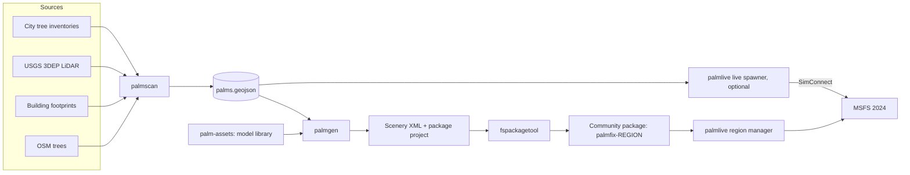

# 01. Architecture

## Summary

Five components. Two are core Python tools that run before a flight, one is an art pipeline, one is a Windows companion app, and one is an optional rendering experiment. They share a single data file: `palms.geojson`.

## Components

| Component | Language | Runs | Job |
|---|---|---|---|
| `palmscan` | Python | Offline, once per region (refresh when data updates) | Pulls tree and LiDAR data and writes `palms.geojson`: location, species, height and crown size for every palm |
| `palmgen` | Python | Offline, after `palmscan` | Turns `palms.geojson` into an MSFS scenery project (exclusion polygons and palm placements), then calls `fspackagetool` to compile it |
| `palm-assets` | Blender + MSFS SDK plugin | Offline, when models change | Builds the 3D palm library as glTF with LODs, packaged as a model library and (if needed) as SimObjects |
| `palmlive` | C# (.NET) with the SDK's managed SimConnect wrapper | On your PC, alongside the sim | Region manager: activates region packages before launch. Optional live spawner: places palms near the aircraft during flight |
| `palmfx` (optional) | C++ ReShade add-on | Inside the sim's render loop | Stretch experiment: erase and redraw blobs on the rendered frame |

## Data flow



## Why it's split this way

- **The data is static.** Palms don't move, so detection and package builds run once per region and are cached. "On demand" means activating a region you already built, or building a new one in minutes.
- **`palms.geojson` is the contract.** Detection can improve (new data, better rules, ML) without touching the generator, and the generator can change output format without touching detection.
- **The companion app is optional for the core fix.** A region package works dropped into the Community folder by hand. The app adds convenience and the live-spawn option.

## Tech stack

| Area | Choice | Reason |
|---|---|---|
| Geo processing | Python 3.12, geopandas, shapely, pyproj | Standard, well documented |
| LiDAR | PDAL (Python bindings) reading Entwine Point Tiles from `s3://usgs-lidar-public` | Streams only the area you need; no AWS account required |
| Rasters | rasterio, numpy, scikit-image (local maxima, watershed) | Canopy height model and crown segmentation |
| Spatial index for live spawning | GeoPackage or SQLite with R-tree | Fast radius queries; one file per region |
| XML generation | lxml + Jinja2 templates captured from Scenery Editor output | The SDK discourages hand-writing XML, so templates come from files the editor itself saved |
| Build | `fspackagetool.exe` from the SDK, called from Python | Command-line builds; it drives a partial sim instance, so builds run on the Windows PC |
| 3D | Blender with the SDK's `io_scene_gltf2_msfs_2024` plugin | Official 2024 exporter, includes Auto LODs |
| Companion app | C# / .NET 8, SimConnect managed wrapper from the SDK | Best-supported SimConnect binding on Windows |
| Tests | pytest, jsonschema, xUnit (C#) | See `06-testing.md` |

## Repo layout

```
palmfix/
  README.md
  pyproject.toml
  regions/                    # one YAML config per region
    san-diego-coastal.yaml
    la-westside.yaml
  palmscan/
    sources/                  # one adapter per data source
      arcgis_rest.py
      geojson_file.py
      lidar_ept.py
      osm_overpass.py
      buildings.py
    detect/
      chm.py                  # canopy height model
      peaks.py                # palm candidate detection
      merge.py                # match inventory points to LiDAR peaks
    classify/
      species.py              # rules, then a small trained classifier
    cli.py                    # palmscan run --region san-diego-coastal
  palmgen/
    templates/                # XML snippets saved from the Scenery Editor in Phase 0
    geometry.py               # circles, unions, building clipping
    xml_writer.py
    project.py                # package project and asset group files
    build.py                  # wraps fspackagetool
    cli.py                    # palmgen build --region san-diego-coastal
  assets/
    blender/                  # source .blend files
    PackageSources/           # exported glTF, bin, xml, textures
  palmlive/                   # C# solution
    PalmLive.App/
    PalmLive.Core/            # spawn manager, region manager (testable, no SimConnect dependency)
    PalmLive.SimConnect/      # thin adapter
    PalmLive.Tests/
  palmfx/                     # optional, later
  tests/
    unit/
    golden/                   # expected XML output
    visual/                   # screenshot sets per test site
  data/                       # downloaded data cache (gitignored)
  build/                      # generated projects and packages (gitignored)
```

## Region config

Each region is one YAML file. Everything region-specific lives here, not in code.

```yaml
region: san-diego-coastal
bbox: [-117.28, 32.70, -117.15, 32.82]   # lon_min, lat_min, lon_max, lat_max
sources:
  inventory:
    - type: arcgis_rest
      url: https://webmaps.sandiego.gov/arcgis/rest/services/DSD/Environment/MapServer/20
      species_field: SPECIES_NAME
  lidar: 3dep_ept          # USGS 3DEP, s3://usgs-lidar-public
  buildings: osm           # or microsoft_footprints
  osm_trees: true
species_priors:            # placeholder values; computed from the inventory in Phase 1
  washingtonia_robusta: 0.45
  syagrus_romanzoffiana: 0.25
  phoenix_canariensis: 0.15
  archontophoenix_cunninghamiana: 0.10
  washingtonia_filifera: 0.05
exclusion:
  margin_m: 1.5            # added to crown radius
  polygon_sides: 12
  merge_gap_m: 2.0         # merge cutouts closer than this
  clip_buildings: true
mask_out: []               # areas already covered by other palm mods
```

## Data contract: `palms.geojson`

One point feature per palm. `palmgen` and `palmlive` read only these fields.

```json
{
  "type": "Feature",
  "geometry": { "type": "Point", "coordinates": [-117.2531, 32.7893] },
  "properties": {
    "palm_id": "sdc-000123",
    "species": "washingtonia_robusta",
    "species_confidence": 0.95,
    "species_source": "inventory",
    "height_m": 22.4,
    "height_source": "lidar",
    "crown_diam_m": 3.8,
    "ground_elev_m": 12.1,
    "detected_by": "inventory+lidar",
    "source_ids": ["sd_street_trees:48213"],
    "exclusion_radius_m": 3.4,
    "building_conflict": false,
    "data_vintage": { "inventory": "2021", "lidar": "2018" },
    "region": "san-diego-coastal"
  }
}
```

The example values are illustrative, not a real palm. A JSON Schema file in `tests/` enforces the contract (see `06-testing.md`).

## Recap

- `palmscan` finds palms, `palmgen` builds the package, `palm-assets` makes the models, `palmlive` manages regions and optional live spawning.
- `palms.geojson` is the one shared file.
- Regions are YAML configs, so adding a city means adding a file, not changing code.
