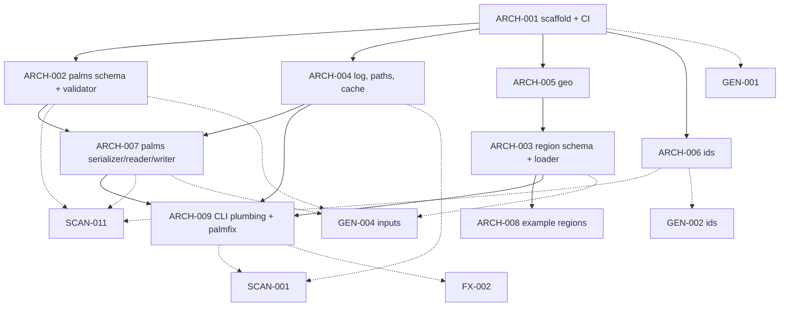

# 01. Architecture (detailed)

Source plan: `plans/01-architecture.md`. Area: **ARCH**. Tasks: ARCH-001 to ARCH-009.

## Summary

- ARCH builds the shared Python base: tooling and CI, the `palmcore/` package, both JSON Schemas, the region YAML loader, two example regions, the console-script entry points, and a small `palmfix` utility CLI.
- `palms.geojson` is the contract between detection and generation. ARCH owns its schema, validator, deterministic serializer, reader and versioning rules.
- IDs are deterministic. `palm_id` and every GUID come from UUIDv5 or SHA hashes, so rebuilds give identical output.
- All ARCH work is pure code tested on fixtures, on Linux CI and on the Windows sim PC. The one exception is ARCH-008, which checks source URLs online.
- Detection logic and `palmscan/cli.py` belong to SCAN (SCAN-001). Generation logic and `palmgen/cli.py` belong to GEN (GEN-001). The C# app belongs to LIVE. ARCH gives them stable `palmcore` interfaces and shared CLI plumbing.

---

## Scope and interfaces

### Repo layout owned by ARCH

The repo root is `palmfix/` from the source plan. There is no nested `palmfix/` directory.

```
pyproject.toml                      # ARCH-001 (later edits: see "Shared files")
.github/workflows/python.yml        # ARCH-001
schemas/
  palms.geojson.schema.json         # ARCH-002
  region.schema.json                # ARCH-003
  CHANGELOG.md                      # ARCH-002 (history of both schemas + versioning policy)
regions/
  san-diego-coastal.yaml            # ARCH-008
  la-westside.yaml                  # ARCH-008
palmcore/
  __init__.py                       # ARCH-001: __version__ only
  py.typed                          # ARCH-001
  errors.py                         # ARCH-001: exception hierarchy + default exit codes
  schemas.py                        # ARCH-001: locate and load JSON Schemas
  log.py, paths.py, cache.py        # ARCH-004
  geo.py                            # ARCH-005
  ids.py                            # ARCH-006
  contract.py                       # ARCH-002: palms.geojson validation + version checks
  palms.py                          # ARCH-007: Palm dataclass, serializer, reader, writer
  config.py                         # ARCH-003: region YAML loader
  context.py, cli_common.py         # ARCH-009: shared CLI plumbing
  cli.py, __main__.py               # ARCH-009: `palmfix` utility CLI
palmscan/__init__.py                # ARCH-001 creates (version string only); SCAN owns afterwards
palmgen/__init__.py                 # ARCH-001 creates (version string only); GEN owns afterwards
tests/unit/palmcore/test_*.py       # ARCH tasks
tests/fixtures/palmcore/            # palms/, palms_io/, regions/
```

Not ARCH:
- `palmscan/cli.py`, `palmscan/__main__.py`, everything else in `palmscan/` (SCAN-001 onward);
- `palmgen/cli.py`, `palmgen/__main__.py`, everything else in `palmgen/` (GEN-001 onward), and `palmgen/templates/captured/` (SPIKE-003);
- `tests/conftest.py`, `tests/__init__.py`, `tests/helpers/` (TEST-001);
- `.gitignore` (bootstrap).

**Required `.gitignore` entries** (bootstrap adds them): `data/`, `build/`, `.venv/`, `__pycache__/`, `*.egg-info/`, `dist/`, `.pytest_cache/`, `.mypy_cache/`, `.ruff_cache/`, `.coverage`, `coverage.xml`, `htmlcov/`.

**Shared files**
- `pyproject.toml`: created by ARCH-001; ARCH-009 adds the `palmfix` script. Another area that must edit it (a dependency, a package such as `palmfx`) lists `pyproject.toml` in `touches` and depends on ARCH-009. ARCH-001 already includes every dependency the SCAN, GEN and TEST plans named. Today SCAN-001 and FX-002 touch it with only ARCH-001 as a dependency (Q18).
- `palmcore/assets/` and `schemas/asset-manifest.schema.json` are ASSET's (ASSET-005 onward). They live inside `palmcore` and follow its rules (strict mypy, no heavy dependencies). They load their schema with `load_schema("asset-manifest.schema.json")`.
- `palmscan/__init__.py` and `palmgen/__init__.py` hold only `__version__ = "0.1.0"`. SCAN and GEN own them after ARCH-001 (GEN uses `palmgen.__version__` as the generator semver).

### palmcore public API

Consumers import submodules (`from palmcore.palms import read_palms`). `palmcore/__init__.py` re-exports nothing, so later tasks never conflict on it. Runtime dependencies of `palmcore`: `pyyaml`, `jsonschema`, `pyproj` only.

| Module | Main names | Used by |
|---|---|---|
| `palmcore.errors` | `PalmfixError`, `ConfigError`, `ContractError`, `SourceError`, `CacheMiss`, `ExternalToolError`, `EXIT_*` | all |
| `palmcore.schemas` | `schema_dir()`, `load_schema(name)`, `make_validator(schema)` | contract, config |
| `palmcore.log` | `get_logger()`, `setup_logging()`, `new_run_id()` | all |
| `palmcore.paths` | `Paths`, `ensure_dir()`, `REGION_RE` | CLIs, SCAN, GEN |
| `palmcore.cache` | `canonical_json()`, `cache_key()`, `cache_path()`, `meta_path()`, `write_cache()`, `read_meta()`, `is_cached()`, `is_fresh()`, `atomic_write_bytes()`, `atomic_write_text()` | SCAN `Cache`, palms, GEN |
| `palmcore.geo` | `Bbox`, `haversine_m()`, `meters_per_degree()`, `utm_epsg()`, `local_crs_for()`, `transformer()`, `to_local()`, `to_wgs84()` | SCAN, GEN |
| `palmcore.ids` | `NAMESPACE`, `palm_key()`, `palm_id()`, `cluster_key()`, `object_guid()`, `format_guid()`, `stable_unit_float()`, `seeded_rng()`, `assert_unique()` | SCAN (palm ids), GEN (`palmgen/ids.py` wraps it) |
| `palmcore.contract` | `PALMS_SCHEMA_VERSION`, `ValidationIssue`, `ValidationReport`, `parse_version()`, `check_version()`, `validate_palms()`, `validate_palms_file()` | palms, SCAN, GEN, TEST helpers |
| `palmcore.palms` | `Palm`, `PalmsMeta`, `PalmCollection`, `dump_palms()`, `write_palms_doc()`, `write_palms()`, `read_palms()` | SCAN (write), GEN and TEST (read) |
| `palmcore.config` | `RegionConfig` and parts, `load_region()`, `load_region_dict()`, `list_regions()`, `check_regions()` | SCAN `load_scan_config`, GEN `load_gen_config` |
| `palmcore.context` | `RunContext` | CLIs |
| `palmcore.cli_common` | `add_common_args()`, `add_region_arg()`, `build_paths()`, `build_context()`, `run_main()` | `palmfix`; optional for SCAN and GEN CLIs |

### CLI commands

| Command | Owner | Notes |
|---|---|---|
| `palmscan ...` | SCAN-001 (`palmscan/cli.py`) | Entry point `palmscan = "palmscan.cli:main"` declared by ARCH-001 |
| `palmgen ...` | GEN-001 (`palmgen/cli.py`) | Entry point `palmgen = "palmgen.cli:main"` declared by ARCH-001 |
| `palmfix validate PATH [--region R] [--strict] [--json]` | ARCH-009 | Validates a palms file; exit 0 or 3 |
| `palmfix regions [--check]` | ARCH-009 | Lists regions; `--check` loads all and cross-checks prefixes |
| `palmfix config --region R [--format yaml\|json]` | ARCH-009 | Prints the region config with defaults applied |

- Until SCAN-001 and GEN-001 land, running `palmscan` or `palmgen` fails with `ModuleNotFoundError`. Declaring the scripts early means neither area has to edit `pyproject.toml`.
- Common flags on every `palmfix` subcommand: `-v/--verbose` (repeatable), `-q/--quiet`, `--data-dir`, `--build-dir`, `--regions-dir`, `--log-file PATH`, `--no-log-file`. SCAN and GEN may reuse `add_common_args()` so the flags stay identical across tools.
- `python -m palmcore` runs the `palmfix` CLI.

### Data consumed and produced

| Artifact | Producer | Consumers | Location |
|---|---|---|---|
| Region YAML | human (REGION tasks) | palmscan, palmgen, palmlive | `regions/<region>.yaml` |
| `palms.geojson` | palmscan via `palmcore.palms` | palmgen, palmlive, TEST, FX | `build/scan/<region>/palms.geojson` (canonical; `Paths.palms_path`) |
| `buildings.geojson` | palmscan | palmgen (clipping) | `build/scan/<region>/buildings.geojson` (canonical; secondary contract, WS5) |
| Download cache | SCAN `Cache` on `palmcore.cache` | SCAN | `data/<namespace>/<key[:2]>/<key><suffix>` |
| Run logs | `palmcore.log` | humans | `build/logs/<tool>-<run_id>.log` |
| Package project | GEN | fspackagetool | `build/palmfix-<region>/` (plan 04 §1) |

---

## Work breakdown

### WS1 Tooling and CI

Task: **ARCH-001**.

**`pyproject.toml`**

- Build backend `hatchling`. `name = "palmfix"`, `version = "0.1.0"`, `requires-python = ">=3.12"`.
- `[tool.hatch.build.targets.wheel] packages = ["palmcore", "palmscan", "palmgen"]`, and `[tool.hatch.build.targets.wheel.force-include] "schemas" = "palmcore/_schemas"`.
- `[project.scripts]`: `palmscan = "palmscan.cli:main"`, `palmgen = "palmgen.cli:main"`. ARCH-009 adds `palmfix = "palmcore.cli:main"`.
- Dependencies (lower bounds only). These merge the requests in `plans/detailed/02-detection-pipeline.md` (W1), `plans/detailed/04-fs2024-integration.md` and `plans/detailed/06-testing.md`:

| Group | Packages |
|---|---|
| base | `pyyaml>=6.0`, `jsonschema>=4.21`, `pyproj>=3.6` |
| `dev` | `pytest>=8.0`, `pytest-cov>=5.0`, `ruff>=0.6`, `mypy>=1.10`, `types-PyYAML`, `types-jsonschema`, `numpy>=1.26`, `scipy>=1.11`, `shapely>=2.0`, `lxml>=5.0`, `pillow>=10.0`, `scikit-image>=0.22` |
| `scan` | `geopandas>=1.0`, `shapely>=2.0`, `pyogrio>=0.7`, `numpy>=1.26`, `scipy>=1.11`, `requests>=2.31` |
| `lidar` | `rasterio>=1.3`, `scikit-image>=0.22`, `scikit-learn>=1.4` |
| `pdal` | `pdal>=3.4` (needs the native PDAL library; never installed in CI, see Q4) |
| `gen` | `lxml>=5.0`, `jinja2>=3.1`, `shapely>=2.0` |

SCAN W1 asked for `pdal` inside `lidar`. It is a separate extra here so CI can install the raster stack without native PDAL. This is a deliberate deviation (Q4).

**Ruff:** `line-length = 100`, `target-version = "py312"`, `[tool.ruff.lint] select = ["E", "F", "W", "I", "UP", "B", "SIM", "RUF"]`. Formatting with `ruff format`.

**Mypy:** `python_version = "3.12"`, `files = ["palmcore", "palmscan", "palmgen"]`, `warn_unused_configs = true`, `warn_redundant_casts = true`, `disallow_untyped_defs = true`. Override `palmcore.*`: `strict = true`. Override `["geopandas.*", "pdal.*", "rasterio.*", "skimage.*", "shapely.*", "pyproj.*", "lxml.*", "sklearn.*", "scipy.*", "pyogrio.*"]`: `ignore_missing_imports = true`.

**Pytest** (follows the TEST request in `plans/detailed/06-testing.md`):

```toml
[tool.pytest.ini_options]
testpaths = ["tests"]
pythonpath = ["."]
addopts = ["--import-mode=importlib", "-ra", "--strict-markers"]
markers = [
  "network: makes live network calls",
  "sim: needs Windows + MSFS 2024 + SDK",
  "slow: takes more than about 10 seconds",
]
```

- TEST-001 also registers these markers and the `--run-network`/`--run-sim` flags in `tests/conftest.py`. Registering a marker twice is harmless. Doing it here lets ARCH tests use `slow` before TEST-001 lands.
- The live-network guard is TEST's autouse fixture. ARCH tests are offline by construction (fixtures and `tmp_path` only).
- ARCH tests find fixtures with `Path(__file__).resolve().parents[2] / "fixtures" / "palmcore"`. They do not need `tests/helpers`, so they don't wait for TEST-001.

**`palmcore/errors.py`**

```python
EXIT_OK = 0; EXIT_UNEXPECTED = 1; EXIT_CONFIG = 2; EXIT_CONTRACT = 3; EXIT_SOURCE = 4
EXIT_CACHE_MISS = 5; EXIT_EXTERNAL_TOOL = 6; EXIT_INTERRUPTED = 130

class PalmfixError(Exception):
    exit_code: ClassVar[int] = EXIT_UNEXPECTED
class ConfigError(PalmfixError):        exit_code = EXIT_CONFIG          # bad region YAML, bad path, bad flag value
class ContractError(PalmfixError):      exit_code = EXIT_CONTRACT        # palms.geojson invalid or unsupported version
    def __init__(self, message: str, issues: Sequence[Any] = ()) -> None   # self.issues = list(issues)
class SourceError(PalmfixError):        exit_code = EXIT_SOURCE          # fetch or parse of a data source failed
class CacheMiss(SourceError):           exit_code = EXIT_CACHE_MISS      # --offline and no cached copy
class ExternalToolError(PalmfixError):  exit_code = EXIT_EXTERNAL_TOOL   # PDAL CLI, fspackagetool
```

- The numbers match the SCAN plan's CLI table (2 config, 3 schema, 4 source, 5 cache miss). Argparse usage errors are also 2.
- GEN defines its own classes and codes in `palmgen/errors.py` and maps `palmcore` errors inside its wrapper modules. That is allowed: `palmcore` codes are defaults for `run_main`, not a rule for every tool.

**`palmcore/schemas.py`**

```python
SCHEMA_FILES: Final = {"palms": "palms.geojson.schema.json", "region": "region.schema.json"}
def schema_dir() -> Path
def load_schema(name: str) -> dict[str, Any]   # functools.cache; callers must not mutate
    # name: a SCHEMA_FILES key ("palms", "region") or a file name matching ^[a-z0-9-]+\.schema\.json$
    # (e.g. "asset-manifest.schema.json" from ASSET-005), so other areas never edit this module
    # Names that are SCHEMA_FILES keys map to their file and are exempt from the pattern, because
    # "palms.geojson.schema.json" contains a dot the pattern rejects. Other files (e.g.
    # buildings.geojson.schema.json) are read by their owner via schema_dir() / <file name>.
def make_validator(schema: Mapping[str, Any]) -> jsonschema.Draft202012Validator
    # check_schema() first, then Draft202012Validator(schema, format_checker=Draft202012Validator.FORMAT_CHECKER)
```

`schema_dir()` resolution order, first hit wins:
1. env `PALMFIX_SCHEMA_DIR`, if set (must exist, else `ConfigError`);
2. `Path(__file__).resolve().parents[1] / "schemas"` (source checkout or editable install);
3. `importlib.resources.files("palmcore") / "_schemas"` (installed wheel).

If none exists: `PalmfixError("schema directory not found; tried: ...")`. A `name` that is neither a key nor a valid file name raises `ValueError`. A missing schema file or invalid JSON raises `PalmfixError` naming the full path.

**Package `__init__.py` files:** each of `palmcore/__init__.py`, `palmscan/__init__.py`, `palmgen/__init__.py` contains a one-line docstring and `__version__ = "0.1.0"`. Each package keeps its own version (GEN bumps `palmgen.__version__` by its own rules).

**`.github/workflows/python.yml`**

- Triggers: `push` to `main` and `pull_request`, both with `paths:` `palmcore/**`, `palmscan/**`, `palmgen/**`, `schemas/**`, `regions/**`, `tests/**`, `pyproject.toml`, `.github/workflows/python.yml`.
- `concurrency: {group: python-${{ github.ref }}, cancel-in-progress: true}`.
- Job `lint` (ubuntu-latest): `actions/checkout@v4`, `actions/setup-python@v5` (`python-version: "3.12"`, `cache: pip`), `pip install -e ".[dev,scan,lidar,gen]"`, then `ruff check .`, `ruff format --check .`, `mypy`.
- Job `test`, matrix `os: [ubuntu-latest, windows-latest]`: same install, then `pytest -m "not network and not sim" --cov=palmcore --cov-report=term-missing --cov-fail-under=85`.
- Windows is in the matrix because `palmgen build` runs on the Windows sim PC.

### WS2 Errors, logging, paths and cache

Task: **ARCH-004** (errors are in ARCH-001).

**`palmcore/log.py`**

```python
LOGGER_ROOT: Final = "palmfix"
def get_logger(name: str) -> logging.Logger
    # "palmscan.sources.arcgis_rest" -> logging.getLogger("palmfix.palmscan.sources.arcgis_rest")
    # a name already starting with "palmfix" is used unchanged
def setup_logging(verbosity: int = 0, *, log_file: Path | None = None,
                  stream: TextIO | None = None) -> None
def new_run_id(now: datetime | None = None) -> str   # "20261121T180400Z-3fa9c1": UTC time + 6 hex chars (secrets)
```

- Verbosity: `-1` → WARNING, `0` → INFO, `1` → DEBUG for `palmfix.*`, `>=2` → DEBUG for the root logger too.
- Stream handler (default `sys.stderr`): format `%(levelname).1s %(name)s: %(message)s`.
- File handler: always DEBUG, format `%(asctime)s %(levelname)s %(name)s: %(message)s` with UTC time (set `converter = time.gmtime` on that formatter only), UTF-8, parent dir created.
- Idempotent: handlers installed here carry `_palmfix = True` and are removed on the next call. Other handlers (pytest `caplog`) are left alone.

**`palmcore/paths.py`**

```python
REGION_RE: Final = re.compile(r"^[a-z0-9]+(-[a-z0-9]+)*$")

@dataclass(frozen=True)
class Paths:
    repo_root: Path
    data_dir: Path
    build_dir: Path
    regions_dir: Path

    @classmethod
    def resolve(cls, *, repo_root: Path | None = None, data_dir: Path | None = None,
                build_dir: Path | None = None, regions_dir: Path | None = None,
                env: Mapping[str, str] | None = None, cwd: Path | None = None) -> "Paths"
    def region_file(self, region: str) -> Path          # regions_dir / f"{region}.yaml"
    def scan_out_dir(self, region: str) -> Path         # build_dir / "scan" / region      (SCAN default)
    def palms_path(self, region: str) -> Path           # scan_out_dir(region) / "palms.geojson"
    def package_project_dir(self, region: str) -> Path  # build_dir / f"palmfix-{region}"  (plan 04 §1)
    def logs_dir(self) -> Path                          # build_dir / "logs"

def ensure_dir(path: Path) -> Path                      # mkdir(parents=True, exist_ok=True); returns path
```

- Precedence per directory: explicit argument (CLI flag) > env var > default.
- Env vars: `PALMFIX_ROOT`, `PALMFIX_DATA_DIR`, `PALMFIX_BUILD_DIR`, `PALMFIX_REGIONS_DIR`. `env` defaults to `os.environ`.
- `repo_root` default: walk up from `cwd` (default `Path.cwd()`) to the first directory whose `pyproject.toml` contains the line `name = "palmfix"`. Fall back to `Path(__file__).resolve().parents[1]`.
- Defaults: `repo_root/"data"`, `repo_root/"build"`, `repo_root/"regions"`. Relative flag/env paths resolve against `repo_root`. All returned paths are absolute.
- `resolve()` creates nothing. Callers use `ensure_dir()`.
- Region-taking methods raise `ConfigError` if `region` fails `REGION_RE`, which also blocks path traversal.
- These are conventions. SCAN (`--out`, `palmscan.output_dir`) and GEN (`palmgen/paths.py`) may layer their own defaults on top, but should start from `Paths` so `--data-dir`/`--build-dir` mean the same everywhere.

**`palmcore/cache.py`: download cache layout under `data/`**

The layout matches the SCAN plan (W1 `palmscan/cache.py`). SCAN's `Cache` class (`get_or_fetch`, offline/refresh handling) builds on these primitives instead of re-implementing them.

```
data/<namespace>/<key[:2]>/<key><suffix>             # raw bytes
data/<namespace>/<key[:2]>/<key><suffix>.meta.json   # provenance sidecar
```

```python
NAMESPACE_RE: Final = re.compile(r"^[a-z0-9_.-]+(/[a-z0-9_.-]+)*$")   # e.g. "arcgis_rest", "lidar/CA_SanDiego_2018"
def canonical_json(obj: Any) -> str      # json.dumps(sort_keys=True, separators=(",", ":"), ensure_ascii=False, allow_nan=False)
def cache_key(identity: Mapping[str, Any] | str) -> str   # sha1 hex (40 chars) of canonical_json(identity) or of the str
def cache_path(data_dir: Path, namespace: str, key: str, suffix: str = "") -> Path
    # ValueError if namespace fails NAMESPACE_RE, key fails ^[0-9a-zA-Z_.-]{2,}$, or suffix not "" / ^\.[a-z0-9.]{1,16}$
def meta_path(path: Path) -> Path        # path.with_name(path.name + ".meta.json")
def write_cache(path: Path, data: bytes, *, url: str | None, params: Mapping[str, Any] | None = None,
                now: datetime | None = None) -> None
def read_meta(path: Path) -> dict[str, Any]
def is_cached(path: Path) -> bool        # data file AND meta file exist (data without meta = interrupted write)
def is_fresh(path: Path, max_age_days: float | None, now: datetime | None = None) -> bool
    # False if not cached; True if max_age_days is None; else age of meta.fetched_at <= max_age_days
def atomic_write_bytes(path: Path, data: bytes) -> None
def atomic_write_text(path: Path, text: str, encoding: str = "utf-8") -> None
```

- Meta keys: `url`, `params`, `fetched_at` (ISO 8601 UTC, `Z`), `bytes`, `sha256`, `palmfix_version`.
- `write_cache` writes data first, meta second, both atomically.
- Atomic write: temp file `path.with_name(path.name + f".tmp-{os.getpid()}")` in the same directory, `flush` + `os.fsync`, `os.replace`. Delete the temp file on any exception. Create parent dirs. Works on Windows.
- Policy (SCAN implements, ARCH defines): default never expires (the data is static); `--refresh` refetches; `--offline` with no cached copy raises `palmcore.errors.CacheMiss`.

### WS3 Geo helpers

Task: **ARCH-005**.

```python
WGS84: Final = "EPSG:4326"
EARTH_RADIUS_M: Final = 6_371_008.8

@dataclass(frozen=True)
class Bbox:
    lon_min: float; lat_min: float; lon_max: float; lat_max: float
    # __post_init__: finite; -180<=lon<=180; -90<=lat<=90; lon_min<lon_max; lat_min<lat_max; else ValueError
    @classmethod
    def from_list(cls, values: Sequence[float]) -> "Bbox"   # exactly 4 numbers
    def to_list(self) -> list[float]
    def as_tuple(self) -> tuple[float, float, float, float]
    def contains(self, lon: float, lat: float) -> bool       # edges inclusive
    def intersects(self, other: "Bbox") -> bool              # touching edges count
    def center(self) -> tuple[float, float]                  # (lon, lat)
    def buffer_m(self, meters: float) -> "Bbox"              # degrees from meters_per_degree at centre lat; clamped
    def width_m(self) -> float                               # at centre lat
    def height_m(self) -> float

def haversine_m(lon1: float, lat1: float, lon2: float, lat2: float) -> float
def meters_per_degree(lat: float) -> tuple[float, float]     # (m per deg lon, m per deg lat)
def utm_epsg(lon: float, lat: float) -> int                  # zone floor((lon+180)/6)+1 clamped 1..60; 326zz N / 327zz S
def local_crs_for(bbox: Bbox, override: str | None = None) -> str
    # override validated with pyproj.CRS.from_user_input (ValueError if bad), else f"EPSG:{utm_epsg(*bbox.center())}"
@functools.cache
def transformer(src: str, dst: str) -> pyproj.Transformer    # Transformer.from_crs(src, dst, always_xy=True)
def to_local(lons: Sequence[float], lats: Sequence[float], crs: str) -> tuple[list[float], list[float]]
def to_wgs84(xs: Sequence[float], ys: Sequence[float], crs: str) -> tuple[list[float], list[float]]
```

- Axis order is always (lon, lat) / (x, y).
- No antimeridian support and no Norway/Svalbard UTM exceptions. Both are stated in docstrings.
- `meters_per_degree`: lat m = 111132.92 − 559.82·cos 2φ + 1.175·cos 4φ − 0.0023·cos 6φ; lon m = 111412.84·cos φ − 93.5·cos 3φ + 0.118·cos 5φ.
- Test values: (−117.25, 32.79) → 32611; (151.2, −33.9) → 32756; lon 180 → zone 60; 0.001° lat at 32.79° N ≈ 110.9 m (±0.2); round trip error < 1e-7°.
- GEN plans a transverse-Mercator `LocalProjection` centred on the bbox. It may use UTM from here or its own projection; either is fine, because metric work is local.
- Out of scope: circles, unions, clipping, tiling (GEN).

### WS4 Deterministic IDs

Task: **ARCH-006**.

```python
NAMESPACE: Final = uuid.UUID("<literal>")   # frozen value of uuid.uuid5(uuid.NAMESPACE_URL, "urn:palmfix:namespace:v1")
PALM_ID_RE: Final = re.compile(r"^[a-z]{2,6}-[0-9a-f]{16}$")
ID_PREFIX_RE: Final = re.compile(r"^[a-z]{2,6}$")

def palm_key(stable_source_ids: Sequence[str], fallback_key: str) -> str
    # non-empty stable ids -> "src:" + min(stable_source_ids); else fallback_key (must be non-empty)
def location_key(lon: float, lat: float) -> str
    # f"loc:{lon:.5f},{lat:.5f}" with -0.00000 normalised; a generic fallback (about 1 m grid)
def palm_id(prefix: str, key: str) -> str
    # f"{prefix}-{uuid.uuid5(NAMESPACE, 'palm|' + key).hex[:16]}"; ValueError on bad prefix or empty key
def cluster_key(palm_ids: Iterable[str]) -> str
    # "cluster:" + ",".join(sorted(set(palm_ids))); ValueError if empty
def object_guid(kind: str, *parts: str) -> uuid.UUID
    # uuid.uuid5(NAMESPACE, "|".join([kind, *parts])); kind ^[a-z_]+$; >= 1 part; no "|" in parts
def format_guid(u: uuid.UUID, style: GuidStyle = "braces_upper") -> str
    # GuidStyle = Literal["braces_upper", "braces_lower", "plain_upper", "plain_lower"]
def stable_unit_float(*parts: str) -> float
    # int(sha256("|".join(parts)).hexdigest()[:13], 16) / 16**13, in [0, 1)
def seeded_rng(*parts: str) -> random.Random
    # random.Random(int(sha256("|".join(parts)).hexdigest()[:16], 16))
def assert_unique(ids: Iterable[str], what: str = "id") -> None
    # ContractError listing up to 20 duplicates
```

- **Why hashes, not sequence numbers:** the source plan's example `sdc-000123` looks sequential. A sequence changes when data is added, and every GUID downstream would change with it. The SCAN plan (W9, Q4) reached the same conclusion.
- **Stable keys:** SCAN passes only record ids that survive reruns (inventory and OSM) as `stable_source_ids`, and its own fallback for LiDAR-only palms (SCAN W9 uses `lidar:<dataset>:<round(x)>:<round(y)>`). `location_key` is there for callers without a better key.
- **Collisions:** 16 hex characters = 64 bits. For 10⁶ palms in one region the chance is about 3·10⁻⁸. This replaces SCAN's 10-hex fallback with lengthening on collision: one fixed length is simpler and matches the schema pattern. `assert_unique` still runs in the validator.
- **GEN:** `palmgen/ids.py` wraps `NAMESPACE`, `object_guid` and `format_guid` (polygon, object and child GUIDs; heading and variant hashes). Recommended mapping: `object_guid("polygon", region, tile_id, cluster_key(ids), str(part))`, `object_guid("object", region, tile_id, palm_id)`, heading `stable_unit_float("heading", palm_id) * 360`.
- **GUID text format:** `VERIFY:` braces and case in Scenery Editor XML come from the SPIKE-003 templates. `format_guid` supports all four styles, and GEN picks one in `templates.yaml`.
- **Golden vectors:** ARCH-006 hard-codes the outputs for fixed inputs in its test. Any later change fails the test. Changing a derivation is a MAJOR contract change (WS10).

### WS5 Palms data contract

Task: **ARCH-002**.

**File-level keys** (GeoJSON FeatureCollection, RFC 7946; extra top-level keys are allowed "foreign members"):

| Key | Type | Required | Rule |
|---|---|---|---|
| `type` | string | yes | `"FeatureCollection"` |
| `schema_version` | string | yes | pattern `^1\.(0\|[1-9][0-9]*)$` |
| `region` | string | yes | slug `^[a-z0-9]+(-[a-z0-9]+)*$` |
| `generated_at` | string | yes | `date-time`, UTC, ends in `Z` |
| `data_version` | string | yes | `^\d{4}-\d{2}$`; GEN uses it for `+data2026-11` (plan 04 §1) |
| `generator` | object | yes | `{name: string, version: string}`, no other keys |
| `config_sha256` | string or null | yes | `^[0-9a-f]{64}$` or null |
| `bbox` | array | no | 4 numbers |
| `features` | array | yes | items: Feature below; may be empty |

**Feature:** `type: "Feature"`; optional `id` (string, must equal `palm_id`); `geometry` = `{type: "Point", coordinates: [lon, lat]}`, exactly 2 numbers, lon −180..180, lat −90..90, WGS84; `properties` per the table, with `additionalProperties: false` and `patternProperties: {"^x_[a-z0-9_]+$": {}}` for experimental fields.

| Property | Type | Required | Rule | Notes |
|---|---|---|---|---|
| `palm_id` | string | yes | `^[a-z]{2,6}-[0-9a-f]{16}$` | WS4 |
| `species` | string | yes | `^[a-z]+(_[a-z]+)+$` | pattern, not an enum, so new species (Florida) need no schema change; the canonical key list is the registry `palmscan/data/species_keys.yaml` (SCAN-002) |
| `species_confidence` | number | yes | 0..1 | |
| `species_source` | string | yes | enum `inventory`, `osm`, `prior`, `lidar_rules`, `lidar_tree` | SCAN field mapping |
| `height_m` | number | yes | 0.5..60 | metres above ground |
| `height_source` | string | yes | enum `inventory`, `species_default`, `lidar`, `region_median` | SCAN field mapping |
| `crown_diam_m` | number | yes | 0.3..20 | |
| `ground_elev_m` | number or null | yes | −100..4000 | metres, orthometric ground height at the point (`VERIFY:` 3DEP vertical datum, usually NAVD88; SCAN-101); null in Phase 1; informational, GEN does not use it |
| `detected_by` | string | yes | enum `inventory`, `osm`, `lidar`, `inventory+osm`, `inventory+lidar`, `osm+lidar`, `inventory+osm+lidar` | fixed order inventory, osm, lidar |
| `source_ids` | array of string | yes | minItems 1, uniqueItems, item `^[a-z0-9_]+:.+$` | `<source name>:<record id>`, sorted |
| `exclusion_radius_m` | number | yes | 0.3..15 | |
| `building_conflict` | boolean | yes | | |
| `data_vintage` | object | yes | keys from `inventory`, `osm`, `lidar`, `buildings`; values `^\d{4}(-\d{2}(-\d{2})?)?$`; no other keys | |
| `region` | string | yes | slug | equals file `region` |

**`palmcore/contract.py`**

```python
PALMS_SCHEMA_VERSION: Final = "1.0"
SUPPORTED: Final = (1, 0)                     # (major, newest minor this code knows)

@dataclass(frozen=True)
class ValidationIssue:
    severity: Literal["error", "warning"]
    path: str                 # "features[12].properties.height_m"; "" for file level
    message: str
    feature_index: int | None = None
    palm_id: str | None = None
    def __str__(self) -> str  # "error features[12] sdc-...: properties.height_m: -1 is less than the minimum of 0.5"

@dataclass
class ValidationReport:
    schema_version: str | None
    feature_count: int
    issues: list[ValidationIssue]
    truncated: bool = False
    @property
    def ok(self) -> bool
    @property
    def errors(self) -> list[ValidationIssue]
    @property
    def warnings(self) -> list[ValidationIssue]
    def raise_for_errors(self) -> None          # ContractError(summary, self.errors)
    def to_dict(self) -> dict[str, Any]
    def error_strings(self, limit: int = 20) -> list[str]   # for SCAN/TEST wrappers returning list[str]

def parse_version(text: str) -> tuple[int, int]               # "^\d+\.\d+$", else ValueError
def check_version(found: str) -> Literal["exact", "older_minor", "newer_minor"]
    # ContractError if malformed or major != SUPPORTED[0]
def validate_palms(doc: Mapping[str, Any], *, mode: Literal["read", "write"] = "read",
                   region: str | None = None,
                   bbox: tuple[float, float, float, float] | None = None,
                   max_errors: int = 100) -> ValidationReport
def validate_palms_file(path: Path, **kwargs: Any) -> ValidationReport   # JSON parse error -> one error, path ""
```

SCAN (`palmscan/output.py`) and TEST (`tests/helpers/contract.py`) plan wrappers named `validate_palms(fc) -> list[str]`. They can return `validate_palms(fc, mode="write").error_strings()`.

Validation order:
1. `schema_version` present and parseable, else one error and stop. A major mismatch raises `ContractError` at once.
2. Schema choice. `write` mode: version must equal `PALMS_SCHEMA_VERSION`, strict schema. `read` mode, exact or older minor: strict. `read` mode, newer minor: relaxed schema plus one warning ("file is schema 1.N, this palmcore knows 1.0; unknown fields ignored").
3. Relaxed schema = deep copy with feature `properties.additionalProperties = true`, and the `enum`s on `species_source`, `height_source`, `detected_by` replaced by `{"type": "string"}`.
4. Validate the envelope with `features` replaced by `[]`. Then validate each feature against `$defs/feature` with one compiled validator (`iter_errors`, sorted by path), up to `max_errors`, then set `truncated = True`.
5. Semantic checks on features that passed the schema:

| # | Check | Severity |
|---|---|---|
| S1 | `palm_id` unique in the file | error |
| S2 | `properties.region` equals file `region`; file `region` equals the `region` argument if given | error |
| S3 | all `palm_id` prefixes identical | error |
| S4 | feature `id`, if present, equals `palm_id` | error |
| S5 | point inside the `bbox` argument, if given (edges inclusive) | error |
| S6 | `exclusion_radius_m >= crown_diam_m / 2 - 1e-6` | error |
| S7 | `height_source == "lidar"` ⇒ `"lidar"` in `detected_by`; `species_source == "inventory"` ⇒ `"inventory"` in it; `species_source == "osm"` ⇒ `"osm"` in it | error |
| S8 | `ground_elev_m` null while `height_source == "lidar"` | warning |
| S9 | `features` empty | warning |

- Performance target: 100,000 features in under 60 s on a CI runner. A `slow` test checks 10,000 synthetic features in under 15 s.
- Schema file: Draft 2020-12, `$id: "urn:palmfix:schema:palms:1"`, feature under `$defs/feature`, `$comment` pointing to `schemas/CHANGELOG.md`.

**Secondary contract: `buildings.geojson`** (ARCH-002, `schemas/buildings.geojson.schema.json`, `$id: "urn:palmfix:schema:buildings:1"`, checked by `palmcore.contract.validate_buildings(doc) -> ValidationReport`). Written by palmscan next to `palms.geojson`, read by palmgen for clipping. Minimal: `type` `"FeatureCollection"`; `schema_version` `"1.0"`; `region` slug; features with Polygon or MultiPolygon geometry (WGS84 lon/lat); required properties `building_id` (string, unique in the file, e.g. `way/123`, `msbf:42`) and `source` (string, e.g. `osm`, `microsoft_footprints`); other properties allowed. Same MAJOR/MINOR rules as WS10.

**Fixtures** in `tests/fixtures/palmcore/palms/`:
- `valid_minimal.geojson` (1 feature), `valid_small.geojson` (10 features, every `detected_by` value, one `x_note` field), `valid_empty.geojson`.
- `newer_minor_1_1.geojson`: version `1.1`, unknown property `canopy_class`, and `species_source: "lidar_ml"`. Valid in `read` mode with one warning; errors in `write` mode.
- `invalid/<case>.geojson` plus `invalid/expected.json` (`{file: {"path": ..., "contains": ...}}`). Cases: `missing_palm_id`, `bad_palm_id`, `bad_species_source`, `height_too_low`, `coords_3d`, `missing_data_version`, `duplicate_palm_id`, `region_mismatch`, `mixed_prefix`, `id_mismatch`, `radius_lt_crown`, `lidar_height_without_lidar`, `unknown_property`, `major_2`.

### WS6 Palms read and write

Task: **ARCH-007**.

```python
@dataclass(frozen=True, slots=True)
class Palm:
    palm_id: str
    lon: float
    lat: float
    species: str
    species_confidence: float
    species_source: str
    height_m: float
    height_source: str
    crown_diam_m: float
    ground_elev_m: float | None
    detected_by: str
    source_ids: tuple[str, ...]
    exclusion_radius_m: float
    building_conflict: bool
    data_vintage: Mapping[str, str]
    region: str
    extra: Mapping[str, Any] = field(default_factory=dict)  # x_* fields and unknown fields from newer minors
    def to_feature(self) -> dict[str, Any]
    @classmethod
    def from_feature(cls, feature: Mapping[str, Any]) -> "Palm"

@dataclass(frozen=True)
class PalmsMeta:
    schema_version: str; region: str; generated_at: str; data_version: str
    generator_name: str; generator_version: str; config_sha256: str | None
    def to_dict(self) -> dict[str, Any]      # what GEN's resolve_data_version reads

@dataclass
class PalmCollection:
    meta: PalmsMeta
    palms: list[Palm]                        # sorted by palm_id
    report: ValidationReport
    def by_id(self) -> dict[str, Palm]

def dump_palms(doc: Mapping[str, Any]) -> str
    # canonical text for an already-built FeatureCollection: rounding, key order, sorting, layout
def write_palms_doc(path: Path, doc: Mapping[str, Any]) -> None
    # validate(mode="write") on the canonicalised doc; ContractError -> nothing written; else atomic write
def write_palms(path: Path, palms: Iterable[Palm], *, region: str, generator_name: str,
                generator_version: str, config_sha256: str | None = None,
                generated_at: datetime | None = None, data_version: str | None = None) -> PalmsMeta
def read_palms(path: Path, *, validate: bool = True, region: str | None = None,
               bbox: tuple[float, float, float, float] | None = None) -> PalmCollection
```

**Canonical form** (same input → byte-identical file). The rounding and layout follow the SCAN plan (W9, field mapping), so SCAN-011's `write_palms(fc, path)` can delegate to `write_palms_doc` and keep its golden test:
- Features sorted by `palm_id`; `source_ids` sorted.
- Rounding: coordinates 7 decimals; `height_m`, `crown_diam_m`, `ground_elev_m` 1 decimal; `exclusion_radius_m` 2; `species_confidence` 2. `-0.0` becomes `0.0`.
- Key order: file keys as in the WS5 file table; feature `type`, `id`, `geometry`, `properties`; properties as in the WS5 property table, then `extra` keys sorted.
- `json.dumps(doc, indent=1, ensure_ascii=False, allow_nan=False)` plus one trailing newline. NaN or inf → `ContractError`.
- Feature `id` is always written and equals `palm_id`.
- `generated_at`: argument, else env `SOURCE_DATE_EPOCH` (integer seconds), else now; UTC `YYYY-MM-DDTHH:MM:SSZ`.
- `data_version`: argument, else the `YYYY-MM` of `generated_at`.

**Reading:** `read_palms` validates in `read` mode, logs warnings through `get_logger("palmcore.palms")`, raises `ContractError` on errors. With `validate=False` it still runs `check_version`.

**Shared fixture:** `tests/fixtures/palmcore/palms_io/sample_10.geojson`, written by `write_palms` with `generated_at` `2026-01-01T00:00:00Z`. GEN and TEST may copy it into their own fixture folders; they must not edit it in place.

**Memory:** `json.load` of the whole file. With `indent=1`, about 700 bytes per feature, so 300,000 palms ≈ 210 MB of text. A streaming reader is a later option (Q10).

### WS7 Region config

Task: **ARCH-003**.

This merges the source plan's example with the keys requested in `plans/detailed/02-detection-pipeline.md` (Inputs) and `plans/detailed/04-fs2024-integration.md` (Region config keys palmgen reads).

**Top-level keys** (`schemas/region.schema.json`, Draft 2020-12, `$id: "urn:palmfix:schema:region:1"`; `additionalProperties: false` at every level except `options`, `palmscan`, `palmgen`, and mask `geometry`):

| Key | Type | Required | Default | Rule / use |
|---|---|---|---|---|
| `config_version` | integer | yes | | const `1` |
| `region` | string | yes | | slug; equals file stem |
| `id_prefix` | string | no | initials of the `-`-parts of `region` (`san-diego-coastal` → `sdc`) | `^[a-z]{2,6}$`; unique across `regions/`; prefix of `palm_id` |
| `name` | string | no | `region` | label |
| `bbox` | [4 numbers] | yes | | lon_min, lat_min, lon_max, lat_max; checked by `Bbox` |
| `local_crs` | string or null | no | null (auto UTM) | any pyproj CRS string |
| `sources.inventory` | list | no | `[]` | items below |
| `sources.lidar` | string, object or null | no | `none` | `3dep_ept` or `none`, or `{type, options}` |
| `sources.buildings` | string, object or null | no | `none` | `osm`, `microsoft_footprints`, `none`, or `{type, options}` |
| `sources.buildings_path` | string or null | no | null | local footprints file (SCAN) |
| `sources.overpass_url` | string | no | `https://overpass-api.de/api/interpreter` | SCAN |
| `sources.osm_trees` | boolean | no | `false` | |
| `species_priors` | map species → number | no | `{}` | key `^[a-z]+(_[a-z]+)+$`; value ≥ 0; if non-empty, sum > 0; normalised to sum 1 on load |
| `exclusion.margin_m` | number | no | `1.5` | 0..10 |
| `exclusion.polygon_sides` | integer | no | `12` | 6..64 |
| `exclusion.merge_gap_m` | number | no | `2.0` | 0..20 |
| `exclusion.clip_buildings` | boolean | no | `true` | |
| `exclusion.clip_buffer_m` | number | no | `0.3` | 0..5 (GEN) |
| `exclusion.min_part_area_m2` | number | no | `1.0` | 0..100 (GEN) |
| `exclusion.radius_min_m` | number | no | `1.0` | 0..15 (GEN; see Q14) |
| `exclusion.radius_max_m` | number | no | `8.0` | 0..15, ≥ `radius_min_m` |
| `exclusion.default_radius_m` | number | no | `3.0` | 0..15 (GEN) |
| `exclusion.max_cluster_extent_m` | number | no | `150` | 10..2000 (GEN) |
| `exclusion.max_vertices` | integer | no | `256` | 8..10000 (GEN; `VERIFY:` sim limit) |
| `placement.scale_clamp` | number | no | `0.15` | 0..1 (GEN) |
| `mask_out` | list | no | `[]` | items below |
| `masks.airports.enabled` | boolean | no | `true` | plan 04 §7; GEN builds the airport file (`palmgen masks airports`) |
| `masks.airports.buffer_m` | number | no | `100` | 0..2000 |
| `masks.airports.path` | string | no | `docs/compat/airports-mask.geojson` | default airport polygons produced by RISK-004 (`kind: airport` features); repo-root relative; a region may point at a `palmgen masks airports` output instead. Manual extras are `mask_out` entries with `kind: airport` |
| `palmscan` | object | no | `{}` | free-form; keys and defaults owned by SCAN (`palmscan/config.py`): `output_dir`, `allow_large_bbox`, `palm_filter`, `inventory`, `dedupe_radius_m`, `exclusion.building_overlap_min_m2`, `lidar`, `peaks`, `rules`, `merge`, `classify`, `qa` (see `plans/detailed/02-detection-pipeline.md#inputs-region-config-keys`). `id_prefix` and the radius clamps are top-level/`exclusion` keys, not here |
| `palmgen` | object | no | `{}` | free-form; reserved for GEN-only knobs |

**Inventory item** (union of the source plan and SCAN Inputs):

| Key | Type | Required | Rule |
|---|---|---|---|
| `name` | string | yes | `^[a-z0-9_]+$`; unique in the file; prefix of `source_ids` (required, not defaulted, because ids derive from it; Q13) |
| `type` | string | yes | `arcgis_rest` or `geojson_file` |
| `url` / `path` | string | exactly one | `arcgis_rest` needs `url`; relative `path` resolves against the repo root |
| `format` | string | no | `geojson` or `csv`; `geojson_file` only; default from the url/path extension |
| `species_field` | string | yes | |
| `common_name_field`, `id_field`, `status_field`, `height_field`, `dbh_field`, `date_field` | string or null | no | SCAN adapter fields |
| `height_units` | string | no | `ft` (default) or `m` |
| `lon_field`, `lat_field` | string | required when the format is csv | checked after the format is resolved |
| `where` | string | no | default `1=1` (ArcGIS) |
| `vintage` | string or null | no | `^\d{4}(-\d{2}(-\d{2})?)?$` |
| `license` | string or null | no | free text |
| `cache_max_age_days` | number or null | no | null = never expires |
| `options` | object | no | free-form, validated by the adapter |

**Mask item** (merges SCAN `{name, bbox|path}` and GEN `{name, kind, geometry|path}`): `name` (required, `^[a-z0-9_-]+$`, unique), `kind` (`mod`, `airport`, `other`; default `other`), exactly one of `bbox` (4 numbers), `geometry` (GeoJSON Polygon or MultiPolygon object), `path` (GeoJSON file, relative to the repo root), and an optional `note`.

**Path rule:** every relative path in a region file resolves against the repo root (`base_dir`). `RegionConfig` stores absolute paths, so consumers never resolve paths themselves. GEN's plan says mask paths are relative to the region YAML; this plan overrides that to one rule for all paths (Q15).

**Defaults** live once, as Python constants in `config.py`. The schema repeats them in `default` keywords, and a test asserts the two match.

**`palmcore/config.py`**

```python
SUPPORTED_CONFIG_VERSIONS: Final = frozenset({1})

@dataclass(frozen=True)
class InventorySource:
    name: str; type: Literal["arcgis_rest", "geojson_file"]; url: str | None; path: Path | None
    format: Literal["geojson", "csv"] | None; species_field: str
    common_name_field: str | None; id_field: str | None; status_field: str | None
    height_field: str | None; height_units: Literal["ft", "m"]; dbh_field: str | None
    date_field: str | None; lon_field: str | None; lat_field: str | None; where: str | None
    vintage: str | None; license: str | None; cache_max_age_days: float | None
    options: Mapping[str, Any]
@dataclass(frozen=True)
class TypedSource:                 # lidar, buildings
    type: str; options: Mapping[str, Any]
@dataclass(frozen=True)
class Sources:
    inventory: tuple[InventorySource, ...]; lidar: TypedSource; buildings: TypedSource
    buildings_path: Path | None; overpass_url: str; osm_trees: bool
@dataclass(frozen=True)
class ExclusionConfig:
    margin_m: float = 1.5; polygon_sides: int = 12; merge_gap_m: float = 2.0; clip_buildings: bool = True
    clip_buffer_m: float = 0.3; min_part_area_m2: float = 1.0; radius_min_m: float = 1.0
    radius_max_m: float = 8.0; default_radius_m: float = 3.0; max_cluster_extent_m: float = 150.0
    max_vertices: int = 256
@dataclass(frozen=True)
class PlacementConfig:
    scale_clamp: float = 0.15
@dataclass(frozen=True)
class MaskArea:
    name: str; kind: Literal["mod", "airport", "other"]; bbox: Bbox | None
    geometry: Mapping[str, Any] | None; path: Path | None; note: str | None
@dataclass(frozen=True)
class AirportMasks:
    enabled: bool = True; buffer_m: float = 100.0; path: Path | None = None   # None -> repo root / docs/compat/airports-mask.geojson
@dataclass(frozen=True)
class RegionConfig:
    config_version: int; region: str; id_prefix: str; name: str; bbox: Bbox; local_crs: str | None
    sources: Sources; species_priors: Mapping[str, float]; exclusion: ExclusionConfig
    placement: PlacementConfig; mask_out: tuple[MaskArea, ...]; airport_masks: AirportMasks
    palmscan: Mapping[str, Any]; palmgen: Mapping[str, Any]
    raw: Mapping[str, Any]          # parsed YAML before defaults (SCAN asked for the raw mapping)
    source_path: Path | None; sha256: str   # sha256 of the raw file bytes
    def crs(self) -> str            # geo.local_crs_for(self.bbox, self.local_crs)
    def to_dict(self) -> dict[str, Any]   # normalised, defaults applied, paths as strings

def load_region(name_or_path: str | Path, *, regions_dir: Path | None = None,
                base_dir: Path | None = None) -> RegionConfig
def load_region_dict(data: Mapping[str, Any], *, base_dir: Path, source_path: Path | None = None,
                     expected_name: str | None = None) -> RegionConfig
def list_regions(regions_dir: Path) -> list[str]     # sorted stems of *.yaml; skips names starting with "_"
def check_regions(regions_dir: Path) -> list[str]    # load every file; errors incl. duplicate id_prefix
```

- `name_or_path`: a value ending in `.yaml`/`.yml` or containing a path separator is a path; otherwise a slug resolved as `regions_dir / f"{name}.yaml"` (`regions_dir` required, else `ConfigError`). `base_dir` default: the parent of the regions directory.
- YAML: `yaml.load` with a `SafeLoader` subclass that raises `ConfigError` on duplicate keys (plain PyYAML keeps the last one silently). Empty file or non-mapping top level → `ConfigError`.
- Errors: all schema errors (`iter_errors`, sorted by path) in one `ConfigError`, one line each, e.g. `regions/x.yaml: sources.inventory[0].species_field: 'species_field' is a required property`.
- Semantic checks after the schema: stem match, `Bbox`, unique inventory and mask names, priors, csv lon/lat fields, `radius_min_m <= radius_max_m`, `local_crs` parses, `config_version` supported. A mask bbox outside the region bbox gives a logged warning.
- Shorthands: `lidar: 3dep_ept` → `TypedSource("3dep_ept", {})`; `null` → `TypedSource("none", {})`.
- Fixtures in `tests/fixtures/palmcore/regions/`: `minimal.yaml`, `full.yaml`, `invalid/` cases with `expected.json` (`dup_key`, `bad_bbox_order`, `priors_negative`, `unknown_key`, `arcgis_no_url`, `file_url_and_path`, `csv_no_lon_field`, `stem_mismatch`, `bad_prefix`, `radius_min_gt_max`, `mask_two_geometries`, `version_2`), and a `dup_prefix/` folder with two valid files sharing an `id_prefix`.

### WS8 Example regions

Task: **ARCH-008**.

`regions/san-diego-coastal.yaml` (values from the source plan; `id_field` checked online in the task):

```yaml
config_version: 1
region: san-diego-coastal
id_prefix: sdc
name: San Diego coastal
bbox: [-117.28, 32.70, -117.15, 32.82]   # lon_min, lat_min, lon_max, lat_max
sources:
  inventory:
    - name: sd_street_trees
      type: arcgis_rest
      url: https://webmaps.sandiego.gov/arcgis/rest/services/DSD/Environment/MapServer/20
      species_field: SPECIES_NAME
      id_field: OBJECTID              # VERIFY: from the layer's ?f=pjson field list
      license: "City of San Diego public data; accuracy disclaimer"
  lidar: 3dep_ept
  buildings: osm
  osm_trees: true
species_priors:                       # placeholders; SCAN computes real values (palmscan priors)
  washingtonia_robusta: 0.45
  syagrus_romanzoffiana: 0.25
  phoenix_canariensis: 0.15
  archontophoenix_cunninghamiana: 0.10
  washingtonia_filifera: 0.05
exclusion:
  margin_m: 1.5
  polygon_sides: 12
  merge_gap_m: 2.0
  clip_buildings: true
mask_out: []
masks:
  airports: {enabled: true}
palmscan: {}
```

`regions/la-westside.yaml`: `id_prefix: law`, `name: LA Westside and beaches`, starting `bbox: [-118.52, 33.96, -118.37, 34.09]` (Santa Monica, Venice, Westwood, Culver City; REGION tasks may tune it). One inventory source `la_county_trees`, `type: geojson_file`, `url` or `path` for the LA County compilation from github.com/stiles/la-trees, with `species_field` and `id_field` taken from the real file. `license: "Public records compilation; check before redistributing"`. Same placeholder priors, `lidar: 3dep_ept`, `buildings: osm`, `osm_trees: true`.

- If a value cannot be confirmed, keep the best guess, add `# VERIFY:` on that line, and log it in the task.
- StreetsLA is added as a second source only if it has a machine-readable endpoint. Otherwise leave a comment for SCAN.
- Test `tests/unit/palmcore/test_region_files.py` (offline): every `regions/*.yaml` loads; `check_regions(Path("regions"))` returns `[]`.

### WS9 Shared CLI plumbing and palmfix

Task: **ARCH-009**.

**`palmcore/context.py`**

```python
@dataclass(frozen=True)
class RunContext:
    tool: str                      # "palmfix", "palmscan", "palmgen"
    paths: Paths
    run_id: str
    started_at: datetime           # UTC
    log_file: Path | None
    region: RegionConfig | None = None
    @property
    def log(self) -> logging.Logger          # get_logger(self.tool)
    def require_region(self) -> RegionConfig # ConfigError if None
```

**`palmcore/cli_common.py`**

```python
def add_common_args(parser: argparse.ArgumentParser) -> None
    # -v/--verbose (count) and -q/--quiet (mutually exclusive), --data-dir, --build-dir,
    # --regions-dir, --log-file PATH, --no-log-file
def add_region_arg(parser: argparse.ArgumentParser, *, required: bool = True) -> None   # --region NAME|PATH
def build_paths(args: argparse.Namespace) -> Paths
def build_context(args: argparse.Namespace, tool: str, *, load_region_arg: bool = True) -> RunContext
    # Paths -> (load_region if args.region) -> new_run_id -> setup_logging(verbosity, log_file)
    # log file default: paths.logs_dir() / f"{tool}-{run_id}.log"; --log-file overrides; --no-log-file disables
def run_main(parser: argparse.ArgumentParser, argv: Sequence[str] | None,
             *, error_map: Mapping[type[BaseException], int] | None = None) -> int
    # parse; return args.func(args)
    # error_map checked first (most specific class wins), then PalmfixError.exit_code
    # KeyboardInterrupt -> 130; other Exception -> log traceback, return 1; no subcommand -> help, 2
```

- SCAN-001 and GEN-001 may build their CLIs on these helpers (recommended, not required). GEN passes its own `error_map`.
- stdout carries results; logs go to stderr and the log file.

**`palmcore/cli.py`: the `palmfix` utility CLI**

```
$ palmfix validate build/scan/san-diego-coastal/palms.geojson
OK: 1234 features, schema 1.0, 0 warnings                                       (exit 0)

$ palmfix validate bad.geojson
error features[12] sdc-3f9a0c12be7d4e01: properties.height_m: -1 is less than the minimum of 0.5
error features[40] sdc-77aa0c12be7d4e02: duplicate palm_id
FAILED: 2 errors, 0 warnings in 1234 features                                   (exit 3)

$ palmfix regions
la-westside          law  [-118.52, 33.96, -118.37, 34.09]
san-diego-coastal    sdc  [-117.28, 32.7, -117.15, 32.82]

$ palmfix regions --check          # problems listed, exit 2 if any; else "OK: 2 regions"
$ palmfix config --region san-diego-coastal --format json      # normalised config on stdout
```

- `validate`: at most 50 issues printed, then `... and N more`. `--strict` makes warnings fail (exit 3). `--region R` loads the region and passes its name and bbox. `--json` prints only `report.to_dict()` JSON on stdout.
- `main(argv: Sequence[str] | None = None) -> int`; `palmcore/__main__.py` runs `raise SystemExit(main())`.

### WS10 Data contract versioning policy

Implemented by ARCH-002 (palms, `schemas/CHANGELOG.md`) and ARCH-003 (region). ARCH-002 copies this text into the top of `schemas/CHANGELOG.md`.

**Two versioned artifacts**

| Artifact | Field | Form | Current |
|---|---|---|---|
| `palms.geojson` | `schema_version` | `"MAJOR.MINOR"` string | `"1.0"` |
| Region YAML | `config_version` | integer | `1` |

The region field is an integer because YAML reads an unquoted `1.0` as a float.

**palms.geojson**

- **MAJOR (breaking):** remove or rename a field; change a type, unit, CRS or meaning; make an optional field required; narrow a range or enum so old files fail; change how `palm_id` or GUID inputs are derived (GEN's GUIDs come from `palm_id`).
- **MINOR (additive):** a new optional field; a new enum value; a wider range.
- **No bump:** `x_*` experimental fields. Consumers never depend on them.
- **Writers** write only `PALMS_SCHEMA_VERSION`.
- **Readers:** different major → `ContractError` (exit 3): `palms.geojson schema X.Y is not supported (this palmcore reads 1.x); rerun palmscan or update palmfix`. Same major, same or older minor → full validation. Newer minor → relaxed validation, one warning, unknown fields kept in `Palm.extra`.
- **Change procedure** (one task, one review): edit the schema; bump `PALMS_SCHEMA_VERSION` and `SUPPORTED`; add a `schemas/CHANGELOG.md` entry; add `tests/fixtures/palmcore/palms/valid_v<major>_<minor>.geojson`. All older `valid_v1_*` fixtures must still pass. Any area may request a change. The task making it touches `schemas/` and depends on the previous schema task.
- **Other languages:** palmlive (C#) and any SQLite index GEN exports apply the same major check (LIVE/GEN own that).

**Region config**

- A new optional key with a default needs no bump; old files still load.
- Removing or renaming a key, or changing its meaning, bumps `config_version`. The loader then migrates (`_migrate_v1_to_v2(raw) -> dict`, run before validation) or refuses with a message naming the change.
- Unknown keys are errors (usually typos): `unknown key 'x' (config_version 1); update palmfix or remove the key`. Keys inside `palmscan`, `palmgen` and `options` are checked by their owners.

**Not covered:** the package version `1.3.0+data2026-11` (plan 04 §1) is GEN's. It reads `data_version` from the palms file.

---

## Task index

| ID | Title | Phase | Depends on | Requires | Est h |
|---|---|---|---|---|---|
| ARCH-001 | Scaffold the Python monorepo (pyproject, package layout, lint/test tooling, CI) | 1 | - | none | 4 |
| ARCH-002 | Define the palms.geojson JSON Schema (and the buildings.geojson secondary schema) and a shared validator | 1 | ARCH-001 | none | 6 |
| ARCH-003 | Define the region YAML config schema and loader | 1 | ARCH-001, ARCH-005 | none | 5 |
| ARCH-004 | Add palmcore logging, path resolution and download-cache helpers | 1 | ARCH-001 | none | 3 |
| ARCH-005 | Add palmcore geo helpers (Bbox, distances, UTM, transforms) | 1 | ARCH-001 | none | 3 |
| ARCH-006 | Add deterministic UUIDv5 ids and seeded randomness to palmcore | 1 | ARCH-001 | none | 2 |
| ARCH-007 | Add the palms.geojson serializer, reader and writer | 1 | ARCH-002, ARCH-004 | none | 4 |
| ARCH-008 | Write the two example region configs and verify their sources | 1 | ARCH-003 | network | 2 |
| ARCH-009 | Add shared CLI plumbing and the palmfix utility CLI | 1 | ARCH-003, ARCH-004, ARCH-007 | none | 4 |

Total about 32 h.

## Dependency graph



Dotted edges are what other areas should depend on. Those areas own their own `depends_on`; see "Cross-area dependencies" in the open questions.

## Parallelization notes

- **Wave 1:** ARCH-001 alone. Everything imports from it.
- **Wave 2 (4 in parallel):** ARCH-002, ARCH-004, ARCH-005, ARCH-006. Disjoint `touches` (separate modules, tests, fixture folders).
- **Wave 3:** ARCH-003 (after ARCH-005) and ARCH-007 (after ARCH-002 and ARCH-004). Disjoint.
- **Wave 4:** ARCH-008 and ARCH-009. Disjoint (`regions/` + one test vs `palmcore/cli*`, `context.py`, `pyproject.toml`).
- **Serialized on purpose:** `pyproject.toml` (ARCH-001 → ARCH-009 → any later edit by another area).
- **Outside ARCH:** GEN-001 and TEST-001 can start right after ARCH-001 (they own their packages). SCAN-001 and FX-002 wait for ARCH-009 because they may edit `pyproject.toml`; FX-002 is also ordered after SCAN-001.
- **Environment:** all `none` except ARCH-008 (`network`). Nothing needs the Windows sim PC, Blender or a human. The Windows CI runner covers Windows paths.
- **Critical path:** ARCH-001 → ARCH-005 → ARCH-003 → ARCH-009, about 15 h.
- **Phase 0 policy:** ARCH-001 does not depend on GATE-P0. Code work that runs in a Linux container (`requires: none` or `network`) may proceed in parallel with Phase 0; windows-sim build and validation work still waits for the relevant gates and SPIKE outputs. The proposed ADR (ADR-0013, written by the bootstrap session) records this. The risk is about 32 h of parked work if Phase 0 is a no-go.

## Verification strategy

- **Per task:** unit tests on fixtures in `tests/unit/palmcore/`. No network.
- **Every PR:** `ruff check .`, `ruff format --check .`, `mypy`, `pytest -m "not network and not sim"` on Ubuntu and Windows (`python.yml`). `palmcore` coverage ≥ 85%.
- **Determinism:** golden id vectors (ARCH-006); byte-identical `write_palms` output with fixed `SOURCE_DATE_EPOCH`, and a committed `sample_10.geojson` golden (ARCH-007).
- **Contract:** table-driven invalid fixtures with expected error paths (ARCH-002, ARCH-003); compatibility test over `valid_v1_*`; defaults-match-schema test (ARCH-003).
- **End to end (ARCH-009):** fresh venv, `pip install -e ".[dev]"`, `palmfix regions`, `palmfix validate tests/fixtures/palmcore/palms_io/sample_10.geojson`, `palmfix config --region san-diego-coastal`.
- **Tracker:** `python3 scripts/tasks.py validate` shows no errors for ARCH files.

## Open questions and VERIFY items

| # | Item | Owner / task |
|---|---|---|
| Q1 | `palm_id` = `<prefix>-<16 hex>`, not the plan's sequential `sdc-000123`. SCAN's fallback (10 hex, lengthen on collision) should use `palmcore.ids.palm_id` instead; the schema pattern requires 16. | SCAN-011, ARCH-006 |
| Q2 | `VERIFY:` GUID spelling in Scenery Editor XML (braces, case). | SPIKE-003, GEN |
| Q3 | `VERIFY:` `ground_elev_m` vertical datum (3DEP is usually NAVD88; varies by project). Informational only. Datum now documented in the schema (metres, orthometric, `VERIFY:`). | SCAN-101 |
| Q4 | `VERIFY:` `pdal` needs native PDAL (conda may be required, also on Windows). It is a separate `pdal` extra, not part of `lidar` as SCAN W1 asked, so CI can install the raster stack. SCAN's plan and SCAN-001 now follow this (`lidar` = rasterio, scikit-image, scikit-learn; `pdal` separate). | SCAN-101, ARCH-001 |
| Q5 | **CLI ownership conflict.** The ARCH brief lists "CLI skeletons for palmscan and palmgen", but SCAN-001 and GEN-001 already plan `palmscan/cli.py` and `palmgen/cli.py` (with full flag sets and exit codes), and depend only on ARCH-001. To avoid two tasks writing the same file, ARCH declares the entry points and supplies shared plumbing; SCAN and GEN own their `cli.py`. | caller / SCAN-001 / GEN-001 |
| Q6 | Airport masks: resolved as `masks.airports.{enabled, buffer_m}` (GEN builds the file with `palmgen masks airports`), plus `kind: airport` entries in `mask_out` for manual cases. SCAN's Q6 assumed `mask_out` only. Resolved 2026-11-22: default polygons come from RISK-004 via `masks.airports.path` (`docs/compat/airports-mask.geojson`). | SCAN, GEN, RISK-004 |
| Q7 | Overlapping regions: the same tree in two regions gets two `palm_id`s (different prefixes), so two palms would be placed. Regions must not overlap or must `mask_out` each other. | REGION, GEN |
| Q8 | Plan 01 says the JSON Schema lives in `tests/`. Repo convention is `schemas/`, which this plan follows. | resolved |
| Q9 | Plan 05 estimates Phase 1 at 8–15 h in total. ARCH alone is about 32 h before any SCAN work. | user / GATE-P1 |
| Q10 | `read_palms` loads the whole file. A streaming reader may be needed past about 500,000 palms per region. | later ARCH task, if measured |
| Q11 | Default palms path: SCAN writes `build/scan/<region>/palms.geojson`; GEN's plan defaults to `data/<region>/palms.geojson`. `palmcore.paths.Paths.palms_path` follows SCAN. GEN should change `palmgen/paths.py` (GEN Q3 asks exactly this). Resolved 2026-11-22: GEN-001 defaults to `build/scan/<region>/`. | GEN-001 |
| Q12 | Writer duplication: SCAN-011 plans its own `write_palms(fc, path)`. The canonical form here copies SCAN's rounding and `indent=1` layout, so SCAN-011 can delegate to `palmcore.palms.write_palms_doc`, and the file is defined in one place. Resolved 2026-11-22: SCAN-011 delegates (depends on ARCH-006, ARCH-007). | SCAN-011 |
| Q13 | Inventory `name` is required here; SCAN defaults it to `<type>_<index>`. An index-based default changes every `source_id`, and therefore every `palm_id`, if sources are reordered. | SCAN-001 |
| Q14 | Radius clamp is defined twice: GEN wants top-level `exclusion.radius_min_m/radius_max_m` = 1.0/8.0; SCAN has `palmscan.exclusion.radius_min_m/radius_max_m` = 1.5/8.0. This plan puts them top-level with GEN's defaults. SCAN should read `RegionConfig.exclusion` instead. `id_prefix` is the same case: top-level here, inside `palmscan:` in SCAN's plan. Resolved 2026-11-22: the ARCH-003 values (margin 1.5, clamps 1.0/8.0) and top-level `id_prefix` are the only definitions; SCAN reads `RegionConfig.exclusion`/`id_prefix`. | SCAN-001, GEN-004 |
| Q15 | Relative paths: GEN says mask paths are relative to the region YAML; this plan resolves every relative path against the repo root and stores absolute paths in `RegionConfig`. Resolved 2026-11-22: GEN-007 follows the repo-root rule. | GEN-004 |
| Q16 | ASSET plan expects a species **enum** in the ARCH-002 schema. The schema uses a pattern; the list of valid species keys belongs to SCAN (`palm_genera.yaml`/normalisation tables), which ASSET should validate against. Resolved 2026-11-22: registry is `palmscan/data/species_keys.yaml` (SCAN-002); ASSET-005 validates manifest species against it. | ASSET-005, SCAN |
| Q17 | `VERIFY:` San Diego layer id field (`OBJECTID`?) and the LA compilation's URL and fields. | ARCH-008 |
| Q18 | `pyproject.toml` races: SCAN-001 and FX-002 touch it but depend only on ARCH-001, so either can run alongside ARCH-009. Each should depend on ARCH-009. SCAN-001 may not need the edit at all, since ARCH-001 already carries its dependencies. FX-002 must add `palmfx` to the hatch `packages` list. Resolved 2026-11-22: SCAN-001 and FX-002 depend on ARCH-009; FX-002 also depends on SCAN-001. | SCAN-001, FX-002 |
| Q19 | `generator` and `data_vintage` use `additionalProperties: false` in schema 1.0, so a newer minor that adds a key there fails even in relaxed read mode (the relaxed schema only loosens feature `properties` and three enums). Consider widening these two objects (or relaxing them too) so forward-compatible minors can add keys. Left as the plan states for 1.0. | ARCH-007 |

**Cross-area dependencies** this plan assumes (owners set them in their own task files; all applied 2026-11-22): SCAN-001 → ARCH-001, ARCH-003, ARCH-009 (pyproject); FX-002 → ARCH-009 (pyproject), SCAN-001; ASSET-005 → ARCH-001; SCAN-011 → ARCH-002, ARCH-006, ARCH-007; GEN-001 → ARCH-001; GEN-002 → ARCH-006; GEN-004 → ARCH-002, ARCH-003, ARCH-007; TEST-001 → ARCH-001; TEST-004 → ARCH-002, ARCH-003.

## Reconciliation notes (2026-11-22)

Cross-area reconciliation after the seven parallel breakdowns:

- Canonical palmscan outputs: `build/scan/<region>/palms.geojson` and `build/scan/<region>/buildings.geojson` (data table, Q11). GEN, TEST and FX references updated in their plans.
- WS5: `ground_elev_m` datum documented (metres, orthometric, `VERIFY:` 3DEP); `data_version` confirmed as the GEN data-version key; `buildings.geojson` secondary contract added to ARCH-002 (`schemas/buildings.geojson.schema.json`, `validate_buildings`).
- Species key registry: `palmscan/data/species_keys.yaml` (SCAN-002), referenced by the `species` pattern row, SCAN normalization and ASSET manifest validation (Q16).
- WS7: added `masks.airports.path` (default RISK-004 file); listed the SCAN `palmscan:` keys; `id_prefix` and `exclusion.*` defaults defined only here (Q14). Path rule applies to GEN masks too (Q15).
- ARCH-001 no longer depends on GATE-P0 (Phase 0 policy in Parallelization notes; proposed ADR-0013 from the bootstrap session).
- `pyproject.toml` order: ARCH-001 → ARCH-009 → SCAN-001 → FX-002 (Q18). The `pdal` extra stays separate from `lidar` (Q4).
- CLI ownership unchanged: no ARCH task touches `palmscan/cli.py` or `palmgen/cli.py` (Q5).
- `palmcore/assets/` stays ASSET's (ASSET-005 onward); no ARCH task touches it. GEN loads the manifest through `palmcore.assets.manifest.load_manifest`.
- DEC-008 records the asset-binary storage decision here when it lands (repo layout); ASSET-008 implements it.

## Recap

- ARCH-001 sets up tooling, CI and entry points. Four small `palmcore` modules then run in parallel, followed by the region loader, the palms serializer and the `palmfix` CLI.
- `palms.geojson` has a strict schema, semantic checks, one canonical serializer, and clear MAJOR/MINOR rules.
- IDs and GUIDs are hash-based and covered by golden tests, so rebuilds never shuffle them.
- SCAN and GEN own their CLIs and logic. They build on `palmcore` and never need to edit it.
