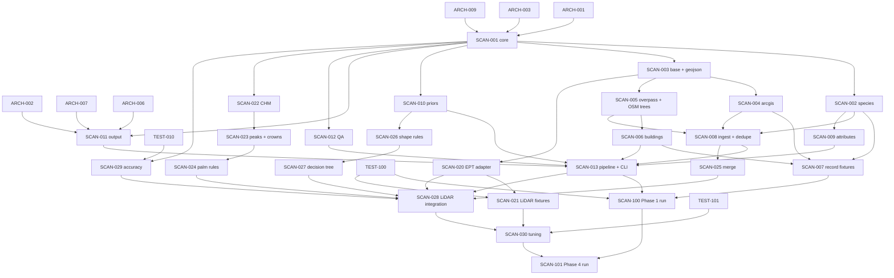

# 02. Detection Pipeline (`palmscan`): Detailed Plan

Source plan: `plans/02-detection-pipeline.md`. Contract: `plans/01-architecture.md#data-contract-palmsgeojson`. Phase order: `plans/05-phases.md`. Accuracy targets: `plans/06-testing.md#2-data-accuracy`.

## Summary

- `palmscan run --region <name>` reads a region YAML, pulls tree inventories, OSM trees, building footprints and (Phase 4) USGS 3DEP LiDAR, and writes `palms.geojson` plus QA files to `build/scan/<region>/`.
- Phase 1 (SCAN-001 to SCAN-013, deliverable SCAN-100) is inventory only: adapters, species normalization, palm filter, dedupe, default sizes, exclusion radius, building conflict, QA.
- Phase 4 (SCAN-020 to SCAN-030, deliverable SCAN-101) adds the LiDAR canopy height model, crown detection, palm rules, inventory-LiDAR merge, shape rules, a decision tree and accuracy metrics.
- Every code task is `requires: none` and tests on fixtures. Live pulls and recording fixtures are separate `network` tasks (SCAN-007, SCAN-021, SCAN-030, SCAN-100, SCAN-101).
- Downloads are cached under `data/`. All thresholds are config keys with defaults in `palmscan/config.py`, overridable per region.

---

## Scope and interfaces

### Package layout

Repo root plays the role of `palmfix/`. Files `palmscan` owns:

```
palmscan/
  __init__.py              # __version__
  cli.py                   # argparse entry point: run, priors, eval
  config.py                # ScanConfig dataclasses + defaults + load_scan_config()
  cache.py                 # Cache: download cache under data/
  http.py                  # HttpClient: retries, generic User-Agent, injectable for tests
  geo.py                   # local metric CRS helpers (wraps palmcore.geo if it has them)
  model.py                 # TreeRecord, PalmRecord, LidarCandidate, Reject, SourceVintage
  species_names.py         # normalize_species()
  filters.py               # palm genus filter, stump/vacant/removed filter
  ingest.py                # ingest_inventory(): adapters -> normalized palm records
  attributes.py            # default sizes, exclusion radius, building conflict
  mask.py                  # mask_out application
  output.py                # assign palm_id, build FeatureCollection, validate, write
  pipeline.py              # run(): orchestrates stages
  data/
    species_keys.yaml      # canonical species-key registry (ARCH-002 pattern, ASSET manifest check)
    species_aliases.csv    # name normalization table (data, not code)
    palm_genera.yaml       # genus sets (socal, florida) + genus default species
    species_defaults.yaml  # default height and crown per species key
    non_tree_markers.yaml  # stump / vacant / removed patterns
  sources/
    __init__.py
    base.py                # InventoryAdapter protocol, SourceError
    registry.py            # type string -> adapter class
    geojson_file.py        # local or URL GeoJSON/CSV (LA County compilation)
    arcgis_rest.py         # ArcGIS MapServer/FeatureServer query with paging
    overpass.py            # Overpass API client (shared)
    osm_overpass.py        # OSM natural=tree points
    buildings.py           # OSM buildings, Microsoft footprints from a local file
    lidar_ept.py           # USGS 3DEP EPT via PDAL (Phase 4)
  detect/
    __init__.py
    dedupe.py              # cross-source dedupe within 2 m (Phase 1)
    chm.py                 # DTM, DSM, CHM, ground sampling (Phase 4)
    peaks.py               # local maxima + watershed crowns (Phase 4)
    palm_rules.py          # palm test table, reject reasons (Phase 4)
    merge.py               # inventory <-> LiDAR matching (Phase 4)
  classify/
    __init__.py
    priors.py              # compute priors, deterministic sampling
    species.py             # classification order + shape rules (Phase 4)
    tree_model.py          # decision tree train/predict/serialize (Phase 4)
  qa/
    __init__.py
    summary.py             # qa_summary.md
    gpkg.py                # qa_map.gpkg
    rejects.py             # qa_rejects.csv
    accuracy.py            # runs the TEST-010 evaluator, fallback height error (Phase 4)
tests/unit/palmscan/test_scan_*.py   # prefix avoids name clashes with other packages
tests/fixtures/palmscan/<adapter or case>/
```

### Inputs: region config keys

Keys already in the architecture example (schema owned by ARCH-003):

| Key | Used for |
|---|---|
| `region` | Output folder name, `region` property |
| `id_prefix` | Top-level key (ARCH-003; default: initials of `region`), prefix of `palm_id`. Not in the `palmscan:` block |
| `bbox` | `[lon_min, lat_min, lon_max, lat_max]`, EPSG:4326 |
| `sources.inventory[]` | One entry per inventory adapter |
| `sources.lidar` | `3dep_ept` or absent (Phase 4) |
| `sources.buildings` | `osm`, `microsoft_footprints`, or absent |
| `sources.osm_trees` | `true` / `false` |
| `species_priors` | Fallback species mix (map species key -> weight) |
| `exclusion.margin_m` | Added to crown radius. Default 1.5 (ARCH-003) |
| `exclusion.radius_min_m` / `exclusion.radius_max_m` | Radius clamp. Defaults 1.0 / 8.0 (ARCH-003; single definition shared with palmgen) |
| `exclusion.radius_max_m`, `exclusion.clip_buffer_m` | Also set the search radius for `buildings.geojson` (W11 stage 9) |
| `mask_out` | Areas to drop palms from |

Keys this plan proposes; ARCH-003 must accept them (see [Cross-area interfaces](#cross-area-interfaces)):

`sources.inventory[]` item:

| Key | Default | Meaning |
|---|---|---|
| `type` | required | `arcgis_rest` or `geojson_file` |
| `name` | required (ARCH-003 Q13: an index default would change every `palm_id` on reorder) | Source name used in `source_ids` and QA, e.g. `sd_street_trees` |
| `url` / `path` | one required | Service URL, or file URL / local path |
| `format` | from extension | `geojson` or `csv` (geojson_file only) |
| `species_field` | required | Field with the species name |
| `common_name_field` | none | Second field tried if species does not normalize |
| `id_field` | `OBJECTID` (arcgis) / feature id or row index | Record id |
| `status_field` | none | Field checked for stump/vacant/removed |
| `height_field`, `height_units` | none, `ft` | Inventory height, if any |
| `dbh_field` | none | Kept in QA only; not used for height |
| `date_field` | none | Record date, used for vintage |
| `lon_field`, `lat_field` | none | CSV coordinates |
| `where` | `1=1` | ArcGIS where clause |
| `vintage` | derived | Override vintage year string, e.g. `"2021"` |

Other proposed keys: `sources.buildings_path` (local file for `microsoft_footprints`), `sources.overpass_url` (default `https://overpass-api.de/api/interpreter`), and `mask_out` items in the ARCH-003 shape `{name, kind: mod|airport|other, bbox | geometry | path, note}` (paths resolve against the repo root). All accepted by ARCH-003 (WS7).

The `palmscan:` block holds every detection parameter. All keys optional; defaults live in `palmscan/config.py`:

```yaml
palmscan:
  output_dir: null           # default build/scan/<region>
  palm_filter:
    genus_sets: [socal]      # keys of palm_genera.yaml: socal, florida
    exclude_species: []      # e.g. [phoenix_roebelenii] for shrub palms; see Q5
  inventory:
    height_min_m: 3.0        # parsed inventory heights outside this range are ignored
    height_max_m: 40.0
  dedupe_radius_m: 2.0
  exclusion:
    building_overlap_min_m2: 0.1   # radius_min_m/radius_max_m are region exclusion: keys (ARCH-003), not here
  lidar:                     # Phase 4
    datasets: []             # force EPT dataset names; empty = auto-select
    tile_size_m: 500
    tile_buffer_m: 20
    resolution_m: 0.5
    smooth_sigma_px: 1.0
    noise_classes: [7, 18]
    use_building_class: true
  peaks:
    min_height_m: 6.0
    min_distance_m: 3.0
    crown_mask_height_m: 2.0
  rules:
    height_min_m: 8.0
    height_max_m: 35.0
    crown_min_m: 3.0
    crown_max_m: 12.0
    ratio_min: 2.0
    ratio_exempt_large_crown: true   # see Q1
    ratio_exempt_crown_min_m: 7.0
    ratio_exempt_ratio_min: 1.0
    shared_boundary_max: 0.35
    building_buffer_m: 1.0
  merge:
    match_radius_m: 3.0
    region_median_min_n: 5
  classify:
    use_tree: true
    tree_max_depth: 4
    tree_min_samples_leaf: 5
    tree_min_class_n: 15
    tree_min_total_n: 50
    tree_min_gain: 0.05
    tree_model_path: null    # reuse a species_tree.json from another region
  qa:
    vintage_grid_deg: 0.01   # matches palmgen tile size
    stale_years: 5
    write_crowns: false
    list_non_palms: false
```

### Outputs

Default output directory `build/scan/<region>/` (gitignored; override with `--out` or `palmscan.output_dir`):

| File | Written by | Contents |
|---|---|---|
| `palms.geojson` | SCAN-011 | FeatureCollection, one Point per palm, contract fields only |
| `buildings.geojson` | SCAN-013 | Secondary contract (ARCH-002 `schemas/buildings.geojson.schema.json`): building polygons within `exclusion.radius_max_m + exclusion.clip_buffer_m` of any palm (input to palmgen clipping, also when GEN tunes `--margin-m`). Properties: `building_id`, `source` |
| `species_priors.yaml` | SCAN-013 | Priors computed from this run's inventory, ready to paste into the region YAML |
| `qa_summary.md` | SCAN-012 | Counts, vintage, warnings, classifier and accuracy sections |
| `qa_map.gpkg` | SCAN-012 | Layers listed in [W10](#w10-qa-outputs) |
| `qa_rejects.csv` | SCAN-012 | Every rejected record or candidate with a reason |
| `species_tree.json` | SCAN-027/028 | Trained decision tree (Phase 4), when used |
| `accuracy.json` | SCAN-029/028 | TEST-010 evaluator results per profile, when `--eval-site` is given |
| `eval/<site>/chm.tif` | SCAN-028 | CHM clipped to the eval site, input for TEST-009 `gt.py fill-heights` |
| `run.json` | SCAN-013 | Run metadata: version, git sha, config hash, timings per stage, exit status |

### palms.geojson field mapping

| Field | Phase 1 value | Phase 4 value |
|---|---|---|
| `palm_id` | from stable key, see [W9](#w9-output-writer-and-palm-ids) | same |
| `species` | normalized key; `palm_unknown` records get a prior sample | plus LiDAR-only palms from rules/tree/priors |
| `species_confidence` | 0.95 species-level name, 0.8 genus-only name, 0.3 prior | plus 0.7/0.5 rules, tree leaf score |
| `species_source` | `inventory`, `osm`, `prior` | plus `lidar_rules`, `lidar_tree` |
| `height_m` | inventory height or species default | LiDAR height, region median, or default |
| `height_source` | `inventory`, `species_default` | plus `lidar`, `region_median` |
| `crown_diam_m` | species default | LiDAR crown when matched |
| `ground_elev_m` | `null` (see Q3) | DTM sample at the palm point |
| `detected_by` | `inventory`, `osm` | plus `lidar`, `inventory+lidar`, `osm+lidar` |
| `source_ids` | `["<source name>:<record id>", ...]` sorted | plus `lidar:<candidate id>` (the id already starts with the dataset) |
| `exclusion_radius_m` | `clamp(crown/2 + exclusion.margin_m, exclusion.radius_min_m, exclusion.radius_max_m)`, all from the region `exclusion:` block | same |
| `building_conflict` | circle overlaps a building > 0.1 m² | same |
| `data_vintage` | `{inventory: "YYYY"}` or `{osm: "YYYY-MM"}` | plus `lidar: "YYYY"` |
| `region` | `cfg.region` | same |

Enum values above are proposals. VERIFY against the schema from ARCH-002 before SCAN-011 is merged; the schema wins.

Rounding (keeps output diffs clean): coordinates 7 decimals, `height_m` and `crown_diam_m` 0.1, `exclusion_radius_m` 0.01, `species_confidence` 0.01, `ground_elev_m` 0.1. Features sorted by `palm_id`. JSON written with `indent=1`, `sort_keys=False` in contract field order, `ensure_ascii=False`, trailing newline.

### CLI

Entry point `palmscan = "palmscan.cli:main"` (registered in `pyproject.toml`; follow the CLI style ARCH-001 sets if it differs from argparse).

```
palmscan run    --region NAME [--regions-dir regions] [--out DIR] [--data-dir data]
                [--offline] [--refresh] [--no-lidar] [--only inventory|lidar]
                [--eval-site SITE] [-v|-vv]
palmscan priors --region NAME [--regions-dir regions] [--data-dir data] [--offline]
palmscan eval   --palms PATH --site SITE [--profile NAME] [--match-radius-m 3.0] [--out PATH]
```

- `--offline`: never touch the network; a missing cache entry is an error.
- `--refresh`: re-download even if cached.
- `--no-lidar`: skip the LiDAR stage even if `sources.lidar` is set.
- `--only lidar`: skip inventory and OSM trees (used for LiDAR-only recall).
- Exit codes: 0 ok, 2 config error, 3 output failed schema validation, 4 source/network error, 5 offline cache miss, 1 anything else.

### Internal data model

`palmscan/model.py` (dataclasses, `slots=True`):

```python
@dataclass(slots=True)
class TreeRecord:                 # raw record from an inventory/OSM adapter
    source: str                   # config source name, e.g. "sd_street_trees"
    source_id: str
    lon: float
    lat: float
    species_raw: str | None
    common_name_raw: str | None = None
    status_raw: str | None = None
    height_raw: str | None = None
    dbh_raw: str | None = None
    date_raw: str | None = None
    extra: dict[str, Any] = field(default_factory=dict)

@dataclass(slots=True)
class LidarCandidate:
    candidate_id: str             # "<dataset>:<tile_id>:<n>"
    dataset: str
    x: float; y: float            # local metric CRS (peak cell centre)
    lon: float; lat: float
    height_m: float               # unsmoothed CHM max in the segment
    crown_area_m2: float
    crown_diam_m: float           # 2 * sqrt(area / pi)
    ratio: float                  # height_m / crown_diam_m
    shared_boundary_frac: float
    ground_elev_m: float | None
    in_building: bool = False
    accepted: bool = False
    reasons: list[str] = field(default_factory=list)
    vintage: str | None = None

@dataclass(slots=True)
class PalmRecord:                 # one palm moving through the pipeline
    stable_key: str
    lon: float; lat: float
    x: float; y: float
    species: str | None
    species_confidence: float | None
    species_source: str | None
    height_m: float | None = None
    height_source: str | None = None
    crown_diam_m: float | None = None
    ground_elev_m: float | None = None
    detected_by: str = "inventory"
    source_ids: list[str] = field(default_factory=list)
    data_vintage: dict[str, str] = field(default_factory=dict)
    exclusion_radius_m: float | None = None
    building_conflict: bool = False
    lidar: LidarCandidate | None = None
    species_raw: str | None = None
    height_raw: str | None = None   # inventory height text, parsed by W7 assign_sizes

@dataclass(slots=True)
class Reject:
    stage: str                    # inventory | dedupe | mask | lidar_rules | merge
    source: str
    source_id: str
    lon: float; lat: float
    reason: str                   # first failing rule
    all_reasons: list[str] = field(default_factory=list)
    species_raw: str | None = None
    metrics: dict[str, float] = field(default_factory=dict)

@dataclass(slots=True)
class SourceVintage:
    source: str
    vintage: str | None           # "YYYY" or "YYYY-MM"
    basis: str                    # config | record_dates | layer_edit_date | fetched
    fetched_at: str               # ISO 8601 UTC
```

### Cross-area interfaces

| Other area | What palmscan needs or gives | Assumed id |
|---|---|---|
| ARCH | Repo scaffold, `pyproject.toml`, `palmcore` package, lint/test config | ARCH-001 |
| ARCH | Palms JSON Schema at `schemas/palms.geojson.schema.json`, `palmcore.contract.validate_palms`, and the `buildings.geojson` schema + `validate_buildings` | ARCH-002 |
| ARCH | `palmcore.cache` (SCAN `Cache` builds on it), `palmcore.log`, `palmcore.errors` | ARCH-004, ARCH-001 |
| ARCH | `palmcore.palms.write_palms_doc` (canonical writer; SCAN-011 delegates) | ARCH-007 |
| ARCH | `pyproject.toml` order: SCAN-001 after ARCH-009 | ARCH-009 |
| ARCH | Region YAML loader in `palmcore` that returns the raw mapping, and a schema that accepts the keys in [Inputs](#inputs-region-config-keys) (`palmscan:` block, extra inventory keys, `mask_out` item shape) | ARCH-003 |
| ARCH | `palmcore.ids.palm_id` (16 hex; schema pattern) | ARCH-006 |
| TEST | Test site bboxes T1 to T5 | TEST-100 |
| TEST | Ground truth points for two sites in the TEST-009 format | TEST-101 |
| TEST | The accuracy evaluator (single implementation, gates Phase 4) | TEST-010 |
| GEN | Reads `build/scan/<region>/palms.geojson` and `buildings.geojson` | GEN-100 |
| REGION | Owns `regions/<name>.yaml` files; palmscan only reads them | (none) |

---

## Work breakdown

Phase 1: W1 to W12. Phase 4: W13 to W21.

### W1. Package core

Task: SCAN-001.

**`palmscan/config.py`**
- Frozen dataclasses mirroring the YAML: `ScanConfig`, `InventorySourceCfg`, `MaskArea`, `PalmFilterParams`, `InventoryParams`, `ExclusionParams`, `LidarParams`, `PeakParams`, `RuleParams`, `MergeParams`, `ClassifyParams`, `QaParams`. Every default from the YAML block in [Inputs](#inputs-region-config-keys) is a dataclass default, so code never reads raw dicts.
- `load_scan_config(region: str, regions_dir: Path = Path("regions")) -> ScanConfig`: calls the palmcore region loader (ARCH-003), then maps keys. Unknown keys inside `palmscan:` raise `ConfigError` naming the key (catches typos in thresholds).
- `scan_config_from_mapping(raw: dict) -> ScanConfig` for tests (no file).
- `ScanConfig.config_hash() -> str`: sha256 of the canonical JSON of the resolved config; written to `run.json` and the QA summary.
- Validation: bbox has `lon_min < lon_max`, `lat_min < lat_max`, within [-180, 180] / [-90, 90]; bbox larger than 1.0 deg in either axis raises `ConfigError` unless `palmscan.allow_large_bbox: true` (guards against pulling a whole county by typo); every `species_priors` weight >= 0 and the sum > 0 (normalized on load).
- `id_prefix`, inventory sources, masks, priors and the `exclusion:` block come from `RegionConfig` (ARCH-003), which already applies defaults and normalizes priors. `ScanConfig` holds the `RegionConfig` plus the `palmscan:` blocks; `palmscan: {id_prefix: ...}` or `palmscan: {exclusion: {radius_min_m: ...}}` is an unknown-key error.

**`palmscan/cache.py`**
```python
class CacheMiss(Exception): ...
class Cache:
    def __init__(self, root: Path = Path("data"), offline: bool = False, refresh: bool = False): ...
    def path_for(self, namespace: str, key: str, suffix: str = "") -> Path: ...
    def get_or_fetch(self, namespace: str, key: str, fetch: Callable[[Path], None],
                     suffix: str = "", meta: dict | None = None) -> Path: ...
    def read_meta(self, path: Path) -> dict: ...
```
- Built on `palmcore.cache` (ARCH-004): layout, key hashing, atomic writes and the meta sidecar are palmcore's; `Cache` adds `get_or_fetch`, offline and refresh. `CacheMiss` is `palmcore.errors.CacheMiss`.
- Layout: `data/<namespace>/<key[:2]>/<key><suffix>` where `key` is a sha1 hex of the request identity (URL + sorted params or query text) unless the caller passes a readable key (LiDAR tiles).
- Writes go to `<path>.tmp` then `os.replace` (atomic). A sidecar `<path>.meta.json` holds `{url, params, fetched_at, bytes, sha256}`.
- `offline=True` and missing file -> `CacheMiss(path)`. `refresh=True` ignores existing files.
- Namespaces used: `arcgis_rest`, `geojson_file`, `overpass`, `lidar_boundaries`, `lidar/<dataset>`.

**`palmscan/http.py`**
```python
class HttpError(Exception): ...           # carries status, url
class HttpClient:
    def __init__(self, user_agent: str = f"palmscan/{__version__}", timeout_s: float = 60,
                 retries: int = 3, backoff_s: float = 2.0): ...
    def get_json(self, url: str, params: dict | None = None) -> dict: ...
    def post_text(self, url: str, data: dict) -> str: ...
    def download(self, url: str, dest: Path) -> None: ...   # streamed, chunked
```
- Uses `requests`. Retries on connection errors, 429, 500, 502, 503, 504 with exponential backoff (`backoff_s * 2**attempt`), honouring `Retry-After`. Other 4xx raise `HttpError` at once.
- User-Agent is generic: never include a user name or email.
- Tests use a `FakeHttpClient` defined in the test module (maps `(url, frozenset(params))` to fixture files). No HTTP mocking library.

**`palmscan/geo.py`**: `local_crs(bbox) -> pyproj.CRS` (UTM zone of the bbox centre, e.g. EPSG:32611 for SoCal), `Transformer` helpers `to_local(lon, lat)` / `to_wgs84(x, y)` working on numpy arrays. If `palmcore` already exposes equivalents, wrap them instead of reimplementing.

**`palmscan/model.py`**: dataclasses from [Internal data model](#internal-data-model), all phases, so Phase 4 tasks can start in parallel.

**`palmscan/cli.py`**: argparse skeleton with the three subcommands; `run` and `priors` print "not implemented" and exit 1 until SCAN-013; `eval` until SCAN-028.

**Package dirs**: create empty `palmscan/sources/__init__.py`, `palmscan/detect/__init__.py`, `palmscan/classify/__init__.py`, `palmscan/qa/__init__.py` so later tasks never touch them.

**Dependencies**: ARCH-001 already declares, for palmscan: `geopandas`, `shapely>=2`, `pyproj`, `pyogrio`, `numpy`, `scipy`, `requests`, `pyyaml`; the extra `lidar` with `rasterio`, `scikit-image`, `scikit-learn`; and `pdal` as its own extra (ARCH Q4, so CI installs the raster stack without native PDAL). SCAN-001 runs after ARCH-009 and adds only what is still missing; it is the only SCAN task that may edit `pyproject.toml`, and FX-002 edits it after SCAN-001.

### W2. Species normalization and palm filter

Task: SCAN-002.

**Data files**

`palmscan/data/species_keys.yaml`: the one canonical list of species keys (`version: 1`, `keys: [{key, genus, set, level}]`, sorted). Every key normalization can emit (species keys, `<genus>_sp`, `palm_unknown`) is listed; every key matches the ARCH-002 `species` pattern; ASSET-005 validates manifest species against this file. New species (Florida, DEC-006) are added here first.


`palmscan/data/species_aliases.csv` (UTF-8, header row, sorted by `alias`):
```
alias,species_key,is_palm,notes
washingtonia robusta,washingtonia_robusta,true,
mexican fan palm,washingtonia_robusta,true,
washingtonia filifera,washingtonia_filifera,true,
california fan palm,washingtonia_filifera,true,
cocos plumosa,syagrus_romanzoffiana,true,synonym; not genus Cocos
arecastrum romanzoffianum,syagrus_romanzoffiana,true,synonym
sago palm,,false,Cycas revoluta is a cycad
ponytail palm,,false,Beaucarnea recurvata
...
```
- `alias` is the cleaned form (see algorithm). `species_key` empty when `is_palm` is false.
- Seed with scientific and common names for every genus in the source plan: Washingtonia (robusta, filifera, x filibusta), Phoenix (canariensis, dactylifera, roebelenii, reclinata), Syagrus romanzoffiana (+ synonyms Arecastrum romanzoffianum, Cocos plumosa), Archontophoenix (cunninghamiana, alexandrae), Brahea (armata, edulis), Butia (capitata, odorata), Livistona (chinensis, australis), Trachycarpus fortunei, Chamaerops humilis, Dypsis (lutescens, decaryi), Sabal palmetto, Roystonea regia, Cocos nucifera, Wodyetia bifurcata, Adonidia merrillii (+ Veitchia merrillii). Common names: Mexican fan, California fan, Canary Island date, date, pygmy date, queen, king, Mexican blue, Guadalupe, pindo / jelly, Chinese fan, windmill, Mediterranean fan, areca, triangle, cabbage (Sabal), royal, coconut, foxtail, Christmas / Manila palm.
- Non-palms with "palm" in the name, `is_palm=false`: sago palm (Cycas), ponytail palm (Beaucarnea), cabbage palm when written "cordyline australis" / "cabbage tree", yucca, dracaena.
- Note: "cabbage palm" is ambiguous (Sabal palmetto in Florida, Cordyline in NZ usage). Map the common name to `sabal_palmetto` and note it.

`palmscan/data/palm_genera.yaml`:
```yaml
genus_sets:
  socal: [washingtonia, phoenix, syagrus, archontophoenix, brahea, butia, livistona,
          trachycarpus, chamaerops, dypsis]
  florida: [sabal, roystonea, cocos, wodyetia, adonidia]
genus_default_species:       # used for genus-only names, confidence 0.8
  washingtonia: washingtonia_robusta
  phoenix: phoenix_canariensis
  syagrus: syagrus_romanzoffiana
  archontophoenix: archontophoenix_cunninghamiana
generic_palm_names: [palm, palms, palm tree, palm spp, palm species, unknown palm, palm sp]
```
Genus-only names for genera without a default become `<genus>_sp` (e.g. `brahea_sp`), confidence 0.8.

`palmscan/data/species_defaults.yaml` (midpoints of `plans/03-palm-assets.md#1-species-list`; others are rough starting values to tune):
```yaml
washingtonia_robusta:          {height_m: 22.0, crown_diam_m: 4.0}
washingtonia_filifera:         {height_m: 15.0, crown_diam_m: 5.0}
phoenix_canariensis:           {height_m: 15.0, crown_diam_m: 10.0}
syagrus_romanzoffiana:         {height_m: 11.0, crown_diam_m: 6.0}
archontophoenix_cunninghamiana: {height_m: 12.0, crown_diam_m: 5.0}
_genus:                        # fallback by genus
  phoenix: {height_m: 10.0, crown_diam_m: 7.0}
  brahea:  {height_m: 9.0,  crown_diam_m: 4.0}
  # ... one row per genus in palm_genera.yaml
_default: {height_m: 12.0, crown_diam_m: 5.0}   # palm_unknown and anything else
```

`palmscan/data/non_tree_markers.yaml`:
```yaml
reasons:
  stump:   [stump, stump removal, grind stump]
  vacant:  [vacant, vacant site, vacant planting site, planting site, empty site, no tree]
  removed: [removed, tree removed, proposed removal completed]
```
Matched against the cleaned species string (exact or prefix) and the cleaned status string (substring). `dead` is not a marker (a dead palm can still stand); it is counted in QA.

**`palmscan/species_names.py`**
```python
@dataclass(frozen=True, slots=True)
class NormalizedSpecies:
    key: str | None        # e.g. "washingtonia_robusta", "brahea_sp", "palm_unknown", None
    genus: str | None
    is_palm: bool
    level: str             # "species" | "genus" | "generic" | "none"
    match: str             # "alias" | "binomial" | "genus" | "generic" | "none"

def clean_name(raw: str | None) -> str: ...
def normalize_species(raw: str | None, common: str | None = None) -> NormalizedSpecies: ...
```
Algorithm:
1. `clean_name`: `None` -> `""`. NFKD fold to ASCII, lowercase, replace `_`, `-`, `,`, `.`, `;` with spaces, drop quoted cultivar text (`'...'`, `"..."`), drop `var.`/`cv.`/`ssp.` and what follows, drop a standalone ` x ` hybrid marker, collapse whitespace, strip.
2. Exact alias lookup on the full cleaned string.
3. Split the raw string on ` - `, `/`, `(`, `)`, `,`; clean each part; alias lookup on each, first hit wins.
4. Reversed common-name form: `palm mexican fan` -> try `mexican fan palm` (inventories often write "PALM, MEXICAN FAN").
5. Binomial regex `^([a-z]+) ([a-z]+)\b` with a genus from any genus set -> `genus_epithet`, level `species`. Epithet `sp`/`spp`/`species` -> genus-only.
6. Genus-only regex `^([a-z]+)( spp?)?$` with a known palm genus -> genus default species or `<genus>_sp`, level `genus`.
7. Cleaned string in `generic_palm_names` -> `palm_unknown`, level `generic`.
8. If nothing matched and `common` was given, repeat 2 to 7 on `common`.
9. Else `NormalizedSpecies(None, None, False, "none", "none")`.
- `is_palm` is true only for a genus in the configured genus sets, `palm_unknown`, or an alias row with `is_palm=true`. Pure function, `functools.lru_cache(maxsize=4096)` on `(raw, common)`; the alias table loads once.

**`palmscan/filters.py`**
```python
def non_tree_reason(species_raw: str | None, status_raw: str | None) -> str | None: ...
def palm_filter(ns: NormalizedSpecies, genus_sets: list[str], exclude_species: list[str]) -> str | None:
    """Return None to keep, else a reject reason: not_palm | excluded_species | genus_not_in_set."""
```
Order in ingest: `non_tree_reason` first (a "Vacant site" row is never a palm), then `palm_filter`.

**Tests** (`tests/unit/palmscan/test_scan_species_names.py`, `test_scan_filters.py`): the plan's example (`Washingtonia robusta`, `WASHINGTONIA ROBUSTA`, `Mexican fan palm` -> `washingtonia_robusta`); `PALM, MEXICAN FAN`; `Syagrus romanzoffiana 'Silver'`; `Cocos plumosa` -> queen palm not Cocos; `Sago palm` -> not palm; `Phoenix spp.` -> `phoenix_canariensis` level genus; `Brahea` -> `brahea_sp`; `Palm` -> `palm_unknown`; `Quercus agrifolia` -> not palm; empty and `None`; Florida genus excluded when `genus_sets=[socal]`; `Vacant Site` and status `STUMP` -> markers. Also a table test: every alias row normalizes to its own `species_key`.

**Implementation notes (SCAN-002, 2026-11-22)**
- `palm_genera.yaml` also has a third genus set `other` (real palm genera outside the modelled sets: rhapis, howea, caryota, jubaea, chamaedorea, bismarckia, ravenea, rhopalostylis, serenoa, veitchia). They are palms (`is_palm`), and `palm_filter` rejects them as `genus_not_in_set` unless `other` is in `genus_sets`. It also has `genus_aliases` (old names and misspellings of genera, e.g. `arecastrum`, `pheonix`, `livistonia`), and monotypic genera (chamaerops, cocos, wodyetia, adonidia) have a `genus_default_species`. VERIFY: monotypic status against a taxonomic source.
- Normalization emits only registry keys. A binomial whose epithet is not a listed species (e.g. `Phoenix rupicola`) gives `<genus>_sp`, level `genus`, match `binomial`, instead of an unregistered `genus_epithet` key. Second words `sp`, `spp`, `species`, `palm`, `tree` count as genus-only.
- Alias lookup also tries the name with a trailing `tree` removed, and with ` palm` added or removed (so `queen` and `Mexican fan palm tree` hit). The exact form is tried first, so `cabbage tree` stays a non-palm.
- Step 8 also refines a generic `palm_unknown` from `raw` with the `common` column when `common` gives a genus or species.
- `genus_sets` in `palm_filter` may be any sequence of set names; an unknown name raises `ValueError`. A generic palm (no genus) is kept.

### W3. Inventory and OSM source adapters

Tasks: SCAN-003 (base + geojson_file), SCAN-004 (arcgis_rest), SCAN-005 (overpass + osm trees).

**`palmscan/sources/base.py`**
```python
from palmcore.errors import SourceError   # re-exported; message carries source name and url

@dataclass(slots=True)
class FetchResult:
    records: list[TreeRecord]
    vintage: SourceVintage
    warnings: list[str]

class InventoryAdapter(Protocol):
    name: str
    def fetch(self, bbox: Bbox | Sequence[float], cache: Cache, http: HttpClient) -> FetchResult: ...
```
Adapters return raw records inside the bbox only. They do not normalize species.

Vintage rule, shared helper `derive_vintage(cfg_vintage, record_dates, layer_edit_ms, fetched_at, *, source="") -> SourceVintage` (`record_dates` are raw values parsed with `parse_date`; the even-count median takes the lower year): config `vintage` wins (basis `config`); else the median year of parseable record dates (basis `record_dates`); else the layer edit date year (basis `layer_edit_date`); else the fetch date as `YYYY-MM` (basis `fetched`). Date parsing accepts ISO strings, `MM/DD/YYYY`, and epoch milliseconds.

**`palmscan/sources/geojson_file.py`**: `GeoJsonFileAdapter(cfg: InventorySourceCfg)`
- `url` -> download through `cache.get_or_fetch("geojson_file", sha1(url), ...)`, keeping the original file name as suffix. `path` -> read in place.
- `format: geojson` -> `geopandas.read_file(path, bbox=bbox, engine="pyogrio")`. Non-point geometries: use the representative point and add a warning count.
- `format: csv` -> stream with `csv.DictReader` (files can be large: the LA County compilation is 1.6M records), keep rows whose `lon_field`/`lat_field` parse and fall inside the bbox. Rows with bad coordinates are counted in a warning, not raised.
- Record id: `id_field` value, else GeoJSON feature `id`, else the 0-based row index (warn: unstable across file updates).
- CRS: GeoJSON must be EPSG:4326 (per RFC 7946); if the file declares another CRS, the bbox is transformed into it for the OGR filter, then features are reprojected to 4326 and a warning is added.
- Memory: CSV is streamed; GeoJSON goes through the OGR spatial filter so only clipped features reach Python. VERIFY (SCAN-007): peak memory of the GDAL GeoJSON driver on the 627 MB LA County file; if high, convert once to GeoPackage/FlatGeobuf and point `path` at it.
- VERIFY in SCAN-007: actual file layout, URLs, field names and coordinate columns of `stiles/la-trees`.

**`palmscan/sources/arcgis_rest.py`**: `ArcGisRestAdapter(cfg)`
1. Layer info: `GET <url>?f=json` (cached). Read `maxRecordCount` (default 1000), `objectIdField` (default `OBJECTID`), `advancedQueryCapabilities.supportsPagination`, `editingInfo.lastEditDate`, `fields`. Fail with `SourceError` if `species_field` is not in `fields`.
2. Query `GET <url>/query` with `where=<cfg.where>`, `geometry=<lon_min>,<lat_min>,<lon_max>,<lat_max>`, `geometryType=esriGeometryEnvelope`, `inSR=4326`, `spatialRel=esriSpatialRelIntersects`, `outFields=*`, `returnGeometry=true`, `outSR=4326`, `orderByFields=<objectIdField> ASC`, `f=json`, `resultOffset=<n>`, `resultRecordCount=<page>`, where `page = min(maxRecordCount, 2000)`.
3. Continue while the response has `exceededTransferLimit: true` or a full page came back. Each page cached as its own entry keyed by URL + params.
4. No pagination support (only an explicit `supportsPagination: true` enables `resultOffset`; absent or false uses the fallback): `returnIdsOnly=true` first, then fetch by `objectIds` in chunks of `min(page, 500)` (ids travel in the GET query string, so the chunk is capped to keep URLs short). A page that adds no new object ids raises `SourceError` (server ignored `resultOffset`).
5. A JSON body with an `error` key (ArcGIS returns HTTP 200 for errors) raises `SourceError` with its `code` and `message`.
6. Point geometry `{x, y}` -> lon/lat. Features with null geometry are skipped and counted.
7. Hard stop at 200,000 records per source per run (guards a wrong bbox); raise `SourceError`.
- VERIFY in SCAN-007 against San Diego layer 20: `SPECIES_NAME` exists, which field holds status (vacant/stump), whether a date field exists, pagination support, `maxRecordCount`, and whether `lastEditDate` is present.

**`palmscan/sources/overpass.py`**
```python
class OverpassClient:
    def __init__(self, http: HttpClient, cache: Cache, url: str = DEFAULT_OVERPASS_URL): ...
    def query(self, ql: str) -> dict: ...   # POST data={"data": ql}; cached by sha1(ql)
```
- Bbox in Overpass order `(south, west, north, east)`. Bboxes larger than 0.05 deg per side are split into 0.05 deg tiles, queried separately and merged by element id.
- HTTP 429 / 504 retried through `HttpClient`; a response with `remark` containing `runtime error` raises `SourceError`.
- `bbox_tiles(bbox, max_deg=0.05)` splits into `ceil(span/max_deg)` equal tiles per side (0.12 deg -> 3 x 3 = 9); `query_bbox(template, bbox)` formats `{south}`, `{west}`, `{north}`, `{east}` or `{bbox}` per tile and merges elements by `(type, id)`. Runtime-error responses are not cached. Records carry `extra["license"]` and `extra["attribution"]` (ODbL, RISK-001). `OsmTreesAdapter.fetch(bbox, cache=None, http=None)` ignores `cache`/`http` because the client owns them.

**`palmscan/sources/osm_overpass.py`**: `OsmTreesAdapter(overpass, name="osm")`
```
[out:json][timeout:120];
node["natural"="tree"](S,W,N,E);
out body;
```
- Species text: first non-empty of tags `species`, `genus`, `taxon`, `species:en` -> `species_raw`; `species:en` also -> `common_name_raw`. Nodes with none of these are dropped at the adapter (they cannot pass the palm filter) and counted.
- `source_id` = `node/<id>`; `date_raw` = none; vintage = fetch month (`YYYY-MM`, basis `fetched`).
- Tests on a hand-made Overpass JSON fixture with palm, non-palm and untagged nodes.

### W4. Building footprints

Task: SCAN-006.

**`palmscan/sources/buildings.py`**
```python
def fetch_buildings(cfg: ScanConfig, cache: Cache, http: HttpClient) -> geopandas.GeoDataFrame:
    """Columns: building_id (str), source (str), geometry (Polygon/MultiPolygon, EPSG:4326)."""
```
- `osm`: Overpass query
  ```
  [out:json][timeout:180];
  (way["building"](S,W,N,E); relation["building"]["type"="multipolygon"](S,W,N,E););
  out geom;
  ```
  Closed ways -> Polygon. Multipolygon relations -> assemble outer and inner rings with `shapely.ops.polygonize` over member geometries, then subtract inners. Unclosed ways are skipped and counted. `building_id` = `way/<id>` or `relation/<id>`.
- `microsoft_footprints`: read `sources.buildings_path` (GeoJSON, GeoJSON-lines, or GPKG) clipped to the bbox with `pyogrio`. `building_id` = `msbf:<row index>`. Download is manual for now (VERIFY in SCAN-007 how the Global ML Building Footprints are distributed and whether a per-quadkey URL can be automated; record the answer in the fixture README).
- Absent `sources.buildings`: return an empty GeoDataFrame and add a QA warning "no building footprints; building_conflict is false everywhere".
- Repair: `shapely.make_valid` on every polygon, drop empties, explode GeometryCollections to polygons.
- Implemented (SCAN-006): returns `(gdf, warnings)`; `none` gives an empty frame plus the warning text. OSM relations with an outer member lacking inline geometry are skipped and counted. `msbf:<n>` is the GDAL feature id (0-based for GeoJSON and GeoJSON lines). Licence notices (OSM ODbL, Microsoft CDLA Permissive 2.0) are in `SOURCE_NOTICES` and `gdf.attrs`; the frame keeps exactly the three columns.

### W5. Recorded fixtures and source verification

Task: SCAN-007 (`requires: network`).

- Recording bbox: 400 m x 400 m around `(-117.2531, 32.7893)` (inside the example `san-diego-coastal` bbox) unless TEST-100 has published the T1 bbox, then use a 400 m clip of T1.
- Record with the real adapters and a pass-through cache whose files are then copied to `tests/fixtures/palmscan/recorded/<source>/`:
  - San Diego street trees layer 20: layer info JSON and every query page for the bbox.
  - `stiles/la-trees`: a 400 m clip of one city file (reduced to the bbox, original header kept). Pick an LA bbox around a known palm street.
  - Overpass: `natural=tree` and buildings responses for the San Diego bbox.
- Trim fixtures to < 2 MB each. Write `tests/fixtures/palmscan/recorded/README.md`: source URL, date fetched, bbox, license note (OSM is ODbL; tree data per source terms), and the answers to every VERIFY item in W3 and W4.
- List distinct `species_raw` values in the recordings; add any palm or "palm"-named non-palm values missing from `species_aliases.csv`; add status values to `non_tree_markers.yaml`.
- Add `tests/unit/palmscan/test_scan_recorded_sources.py`: each adapter parses its recording offline (`Cache(offline=True)`) and yields > 0 records with the expected fields; at least one record per source normalizes to a palm.
- Implemented (SCAN-007, 2026-11-22): fixtures and answers in `tests/fixtures/palmscan/recorded/README.md`. Corrections to this plan: San Diego layer 20 has a status field, `MAPNG_STAT_CD` (`AB` as built, `RM` removed = 25% of rows), now `status_field` in the region file, with a whole-string `status_codes` entry in `non_tree_markers.yaml`; `editingInfo.lastEditDate` is absent; `SPECIES_NAME` is null on about 37% of standing rows (common-name fallback is essential); la-trees county `id` is a row index and the file has no height, status or date; per-city la-trees files use other CRSs (Santa Monica: EPSG:2229) and class-string heights; the OSM recording bbox for San Diego has zero trees, so a second 400 m bbox around the species-tagged Jubaea palms was recorded; Microsoft footprints come as a CSV index of country and level-9 quadkey `.csv.gz` GeoJSON-lines tiles (78 to 171 MB for the example regions).

### W6. Ingest and dedupe

Task: SCAN-008.

**`palmscan/sources/registry.py`**: `ADAPTERS = {"arcgis_rest": ArcGisRestAdapter, "geojson_file": GeoJsonFileAdapter}`; `build_inventory_adapters(cfg) -> list[InventoryAdapter]` (config order = priority order); unknown `type` -> `ConfigError`.

**`palmscan/ingest.py`**
```python
@dataclass(slots=True)
class IngestResult:
    palms: list[PalmRecord]
    rejects: list[Reject]
    vintages: list[SourceVintage]
    counts: dict[str, dict[str, int]]      # per source: fetched, non_tree, not_palm, palm, ...
    unmatched_palm_names: Counter[str]     # cleaned names containing "palm" that did not normalize
    warnings: list[str]

def ingest_inventory(cfg: ScanConfig, cache: Cache, http: HttpClient,
                     adapters: list[InventoryAdapter] | None = None) -> IngestResult: ...
```
Steps per record: `non_tree_reason` -> reject stage `inventory`; `normalize_species` + `palm_filter` -> non-palms counted only (rejects only if `qa.list_non_palms`), excluded species rejected; palms become `PalmRecord` with:
- `stable_key = f"{source}:{source_id}"`, `source_ids=[stable_key]`, `x, y` from `geo.to_local`.
- species: species-level key -> confidence 0.95; genus-level -> 0.8; `palm_unknown` -> species `None` (classified later); `species_source = "inventory"` (or `"osm"` for the OSM adapter); `detected_by` the same.
- `data_vintage = {"inventory": year}` (record date year if parseable, else the source vintage); OSM: `{"osm": "YYYY-MM"}`.
- `height_raw` kept on the `PalmRecord` for W7 (`assign_sizes` parses it with the source's `height_units`).
- OSM trees run after the inventory adapters when `sources.osm_trees` is true. An OSM failure is a warning; an inventory failure aborts the run with `SourceError` (exit 4), because silently missing a source drops palms.

**`palmscan/detect/dedupe.py`**
```python
def dedupe_cross_source(palms: list[PalmRecord], radius_m: float = 2.0,
                        source_priority: list[str] | None = None) -> tuple[list[PalmRecord], list[Reject]]: ...
```
- Only points from different sources merge. Two points from the same source within 2 m are both kept (palms are planted in tight clusters).
- Process sources in priority order. For each point of a lower-priority source, find the nearest kept point within `radius_m` (scipy `cKDTree` on local x/y) that comes from a different source and has not already absorbed a point from this source. If found: append its `source_ids`, fill `species` if the kept one is `None` or genus-level and this one is species-level, keep the kept point's position, and emit a `Reject(stage="dedupe", reason="duplicate_of:<stable_key>")`. Else keep it.
- Deterministic: candidate pairs of one source are resolved closest-first, ties by incoming then kept `stable_key` (so a contested kept point goes to the nearest incoming point, not the one with the smaller key); a source not in `source_priority` ranks after the listed ones, alphabetically. `source_ids` of every output palm are sorted; `height_raw` and missing `data_vintage` keys are filled from the merged-away point. Output sorted by `stable_key`. Inputs are not modified.
- `ingest_inventory` also takes `osm_adapter=` (test hook), enforces each source's `cache_max_age_days` through a per-source cache view (stale entries are refetched; offline they are used with a warning), counts `excluded` (excluded species or genus outside the set, also rejects) and returns `source_order` (config order, then `osm`) to pass as `source_priority`. `registry.build_osm_adapter` builds the OSM adapter. Buildings are not registered in `ADAPTERS`: SCAN-006's `fetch_buildings` is called by the pipeline directly.

### W7. Palm attributes and exclusion

Task: SCAN-009.

**`palmscan/attributes.py`**
```python
def parse_height(raw: str | None, units: str = "ft") -> float | None: ...
def assign_sizes(palms, cfg, region_medians: dict[str, float] | None = None) -> None: ...
def assign_exclusion(palms, exclusion: ExclusionConfig) -> None: ...   # RegionConfig.exclusion (ARCH-003)
def flag_building_conflicts(palms, buildings: GeoDataFrame, crs, overlap_min_m2=0.1) -> GeoDataFrame: ...
```
- `parse_height`: numbers (`"35"`, `"35.5"`), ranges (`"30-45"`, `"30 to 45"` -> midpoint), with optional unit suffix (`ft`, `'`, `m`) overriding `units`; class labels that do not parse -> `None`. Converted to metres. VERIFY in SCAN-007 whether any inventory has a height field and its units.
- `assign_sizes` order, per palm that has no LiDAR height: inventory height within `[height_min_m, height_max_m]` -> `height_source="inventory"`; else `region_medians[species]` -> `"region_median"` (Phase 4 only passes this); else `species_defaults.yaml` species row, else genus row, else `_default` -> `"species_default"`. `crown_diam_m` from the same defaults table unless LiDAR set it. Palms with species `None` at this point use `_default`.
- `assign_exclusion`: `r = crown_diam_m / 2 + exclusion.margin_m`, clamped to `[exclusion.radius_min_m, exclusion.radius_max_m]` (defaults 1.5, 1.0, 8.0 live only in ARCH-003), rounded to 0.01. palmgen treats this value as authoritative; its `--margin-m` override recomputes from `crown_diam_m` with the same clamps.
- `flag_building_conflicts`: buffer each palm (local CRS, 32-segment circle) by its radius; spatial join against buildings reprojected to the local CRS (`STRtree`); `building_conflict = True` when any intersection area > `overlap_min_m2`. Returns the conflicting buildings (EPSG:4326), deduplicated, sorted by `building_id`, for `buildings.geojson` and the QA layer.

**`palmscan/mask.py`**
```python
def load_masks(mask_out: list[MaskArea], base_dir: Path) -> list[tuple[str, BaseGeometry]]: ...
def apply_masks(palms, masks) -> tuple[list[PalmRecord], list[Reject]]: ...
```
A palm whose point is inside any mask polygon is removed with `Reject(stage="mask", reason=f"mask_out:{name}")`. `mask_out` items are `palmcore.config.MaskArea` (`kind`, one of `bbox`/`geometry`/`path`). The default airport masks (`masks.airports`, RISK-004 polygons) are applied by palmgen, not palmscan (Q6).

### W8. Species priors

Task: SCAN-010.

**`palmscan/classify/priors.py`**
```python
def compute_priors(palms: list[PalmRecord], min_count: int = 1) -> dict[str, float]: ...
def merge_priors(computed: dict[str, float], configured: dict[str, float], min_n: int = 30) -> dict[str, float]: ...
def sample_species(priors: dict[str, float], key: str) -> str: ...
def priors_yaml(priors: dict[str, float]) -> str: ...
```
- `compute_priors`: shares of species-level keys among inventory palms (genus-level and `palm_unknown` excluded), rounded to 0.01, renormalized, sorted by share descending.
- `merge_priors`: use the computed mix when it rests on at least `min_n` palms, else the configured `species_priors`. The palm count is needed, so `compute_priors` returns a `SpeciesMix` (a dict subclass with `n_palms`); a plain mapping needs the keyword `n_palms=`. (SCAN-010 Log, 2026-11-22.)
- `sample_species`: deterministic. `u = int(sha1(key).hexdigest()[:12], 16) / 16**12`; walk the cumulative distribution over keys sorted alphabetically; return the first key whose cumulative share > `u`. `washingtonia_filifera` weight is folded into `washingtonia_robusta` before sampling (source plan: default to robusta without inventory data; see Q2).
- `priors_yaml`: the `species_priors:` block, ready to paste into a region YAML.
- Phase 1 use: palms with species `None` get `sample_species(priors, stable_key)`, confidence 0.3, `species_source="prior"`.

### W9. Output writer and palm IDs

Task: SCAN-011.

**`palmscan/output.py`**
```python
def stable_key_for(palm: PalmRecord) -> str: ...
def assign_palm_ids(palms: Sequence[PalmRecord], prefix: str) -> list[str]: ...  # ids in input order; PalmRecord has no palm_id field
def to_feature_collection(palms: Sequence[PalmRecord], region: str, *, id_prefix: str, meta: PalmsMeta) -> dict: ...
def validate_palms(fc: Mapping) -> list[str]: ...   # wraps the ARCH-002 validator; returns error strings
def write_palms(fc: Mapping, path: Path) -> None: ...
def write_invalid(fc: Mapping, directory: Path) -> Path: ...   # plain json, palms.invalid.geojson
```
`meta` (`palmcore.palms.PalmsMeta`) carries `generated_at`, `data_version`, generator and `config_sha256`; a fixed `generated_at` gives byte-identical output. `source_ids` starting with `lidar:` are never used for the stable key.
- Stable key: inventory/OSM palms use the lexicographically smallest of their `source_ids`; LiDAR-only palms use `lidar:<dataset>:<round(x)>:<round(y)>` (local metres). Stable across reruns as long as the source record ids do not change.
- `palm_id`: `palmcore.ids.palm_id(prefix, stable_key)` (ARCH-006, `<prefix>-<16 hex>`). No local fallback. The contract example `sdc-000123` is a sequential id; sequential ids are not stable when data changes, so this plan uses hashes (see Q4).
- `write_palms` delegates to `palmcore.palms.write_palms_doc` (ARCH-007), which owns rounding, key order, layout and the atomic write; SCAN does not reimplement them.
- `to_feature_collection`: properties in contract order, rounding from [field mapping](#palmsgeojson-field-mapping), `ground_elev_m` as `null` when unknown, `source_ids` sorted. Features sorted by `palm_id`.
- Validation failure: write `palms.invalid.geojson`, print the first 20 errors, exit 3. Never write an invalid `palms.geojson`.
- Byte-identical output for identical input (golden test with a fixed list of `PalmRecord`s in `tests/fixtures/palmscan/output/expected_palms.geojson`).

### W10. QA outputs

Task: SCAN-012 (Phase 1 parts); SCAN-028 adds the LiDAR parts.

**`palmscan/qa/rejects.py`**: `write_rejects_csv(rejects, path)`. Columns, in order: `stage, source, source_id, lon, lat, reason, all_reasons, species_raw, height_m, crown_diam_m, ratio, shared_boundary_frac`. `all_reasons` joined with `;`. Rows sorted by `(stage, source, source_id)`. Empty metric cells for inventory rows.

**`palmscan/qa/gpkg.py`**: `write_qa_gpkg(path, palms, rejects, conflict_buildings, vintage_grid, candidates=None, crowns=None)`. Delete the file first, then write layers with `geopandas.to_file(driver="GPKG", layer=...)`:

| Layer | Geometry | Attributes |
|---|---|---|
| `palms` | Point | all contract fields plus `stable_key`, `species_raw` |
| `exclusion_circles` | Polygon | `palm_id`, `exclusion_radius_m`, `building_conflict` |
| `check_radius_3m` | Polygon | `palm_id` (3 m buffers for the Phase 1 visual check) |
| `rejects` | Point | rejects CSV columns |
| `building_conflicts` | Polygon | `building_id`, `source` |
| `vintage_grid` | Polygon | `cell_id`, `palm_count`, `inventory_vintage`, `lidar_vintage`, `stale` |
| `lidar_candidates` (Phase 4) | Point | all `LidarCandidate` fields, `accepted`, `reasons` |
| `crowns` (Phase 4, `qa.write_crowns`) | Polygon | `candidate_id` |

Buffers are built in the local CRS and written in EPSG:4326. Implemented signature additions (SCAN-012): keyword-only `id_prefix` (palm ids match `palms.geojson`) and `crs` (local CRS, default the UTM zone of the palms); `conflict_buildings` is a list of `ConflictBuilding(building_id, source, geometry)` (WGS84); `crowns` is a list of `(candidate_id, geometry)`; `lidar_candidates` and `crowns` are written only when not `None`. `exclusion_circles` skips palms without `exclusion_radius_m`. Vintage years: `data_vintage` keys starting with `lidar` count as LiDAR, all other keys as inventory. Empty layers are still written (with schema) so QGIS projects keep working.

**Vintage grid**: cells of `qa.vintage_grid_deg` aligned to multiples of that step; `cell_id` like `n32p78_w117p26` (same style as palmgen tile names in `plans/04-fs2024-integration.md#1-region-package-layout`). Per cell: palm count, median inventory vintage year, median LiDAR vintage year, `stale = (run_year - min(vintages)) > qa.stale_years`.

**`palmscan/qa/summary.py`**: `render_summary(ctx: QaContext) -> str` and `write_summary(...)`. `QaContext` is a dataclass carrying everything the sections need. Sections, in order:
1. `# palmscan QA: <region>`, run time (UTC), palmscan version, git sha (if `git rev-parse` works), config hash, stages run, output path.
2. **Counts by source**: table `source | fetched | non-tree | not palm | palm | deduped | masked | kept`.
3. **Counts by species**: `species | count | share | mean height_m | species_source split`.
4. **Detection**: counts by `detected_by`.
5. **Heights**: share of palms with `height_source = lidar`; counts by `height_source`.
6. **Building conflicts**: count of palms and of buildings.
7. **Data vintage**: per source table (`source | vintage | basis | fetched_at`); stale cell count and list of the 10 oldest cells.
8. **Unmatched names containing "palm"**: top 20 with counts (to extend the alias table).
9. **Species priors**: computed vs configured, and which one was used.
10. **Classifier** (Phase 4): rules vs tree CV accuracy, chosen model, confusion matrix.
11. **Accuracy** (when `--eval-site`): TEST-010 results via W19.
12. **Warnings**: every warning collected during the run.
`QaContext` also takes `accuracy_md` (already rendered Markdown from `palmscan/qa/accuracy.py`, SCAN-029), `classifier` (`ClassifierSummary`, so this module does not import the tree model) and `git_sha` (from `git_sha()`; the renderer itself is pure). Classifier and Accuracy are omitted when their data is absent; section headings are unnumbered. Tests mask the timestamp line and compare to `tests/fixtures/palmscan/qa/expected_summary.md`.

### W11. Pipeline and CLI

Task: SCAN-013.

**`palmscan/pipeline.py`**
```python
@dataclass(slots=True)
class RunOptions:
    out_dir: Path
    offline: bool = False
    refresh: bool = False
    no_lidar: bool = False
    only: str | None = None          # None | "inventory" | "lidar"
    eval_site: str | None = None
    generated_at: datetime | None = None   # None: SOURCE_DATE_EPOCH, then now (fixed value = byte-identical palms.geojson)

@dataclass(slots=True)
class RunResult:
    palms_path: Path
    counts: dict
    warnings: list[str]
    exit_code: int

def run(cfg: ScanConfig, opts: RunOptions, cache: Cache, http: HttpClient,
        adapters: list[InventoryAdapter] | None = None, point_source=None) -> RunResult: ...
```
Stage order (Phase 1; Phase 4 inserts the LiDAR stages in SCAN-028):
1. `fetch_buildings` (needed early in Phase 4 for the building rule).
2. `ingest_inventory` (skipped with `--only lidar`).
3. `dedupe_cross_source`.
4. `apply_masks`.
5. (Phase 4) LiDAR: tiles, CHM, peaks, rules, merge, classify.
6. Priors: `compute_priors` + `merge_priors`; species `None` -> `sample_species`.
7. `assign_sizes`, `assign_exclusion`, `flag_building_conflicts`.
8. `assign_palm_ids`, `to_feature_collection`, `validate_palms`, `write_palms`.
9. Write `buildings.geojson` (ARCH-002 secondary contract, `validate_buildings`; footprints within `exclusion.radius_max_m + exclusion.clip_buffer_m` of any kept palm), `species_priors.yaml`, QA files, `run.json`.
- Logging through the palmcore logger (ARCH-001) or stdlib `logging`: one INFO line per stage with counts and seconds.
- Phase 1 behaviour when `sources.lidar` is set: warning "LiDAR stage not implemented yet; inventory only" and continue.
- `palmscan priors`: runs stages 2 to 4 and prints `priors_yaml`. Computed priors count species-level names only (`pipeline.species_level`: confidence 0.95, no `<genus>_sp`), so genus defaults do not inflate a species.
- `ingest_inventory` wraps adapter errors in `SourceError`; the pipeline re-raises a wrapped `CacheMiss` as `CacheMiss` so the exit code is 5, not 4. `run.json` is also written for failed runs (with `exit_code` and `error`). `buildings.geojson` carries a top-level `notices` map (`source` -> licence, attribution) from `SOURCE_NOTICES`.
- `cli.main(argv=None) -> int`: maps `ConfigError` -> 2, schema failure -> 3, `SourceError`/`HttpError` -> 4, `CacheMiss` -> 5.
- End-to-end test: `tests/fixtures/palmscan/regions/e2e.yaml` (geojson_file source on a small synthetic GeoJSON, buildings from a local fixture via `microsoft_footprints` + `buildings_path`, one `mask_out` bbox, `osm_trees: false`), run through `cli.main(["run", "--region", "e2e", "--regions-dir", ..., "--out", tmp, "--offline", "--data-dir", tmp])`. Asserts: exit 0, schema-valid output, expected palm count, one masked palm, one building conflict, all QA files present, second run byte-identical `palms.geojson`.

### W12. Phase 1 deliverable run

Task: SCAN-100 (`requires: network, human`).

1. Use the region YAML for the Phase 1 test block (DEC-004, TEST-100 T1). It must exist under `regions/`; palmscan does not create it (see Q7).
2. `palmscan run --region <test>`; then `palmscan run --region <test> --offline` must give a byte-identical `palms.geojson`.
3. Open `qa_map.gpkg` in QGIS over aerial imagery (any public basemap). Along at least three inventory streets in T1, count every palm visible on the imagery (aim for 50 or more) and how many have a `palms` point within the `check_radius_3m` layer. Exit target from `plans/05-phases.md#phase-1-detection-mvp-815-hours`: at least 90%.
4. Record the counts, the misses (with reason guesses: not in inventory, stale record, mis-normalized name) and `qa_summary.md` highlights in `tracking/logs/SCAN-100-run.md`. Add any missed species names to `species_aliases.csv`.

### W13. LiDAR EPT adapter

Task: SCAN-020; fixtures and VERIFY in SCAN-021 (`requires: network`).

**`palmscan/sources/lidar_ept.py`**
```python
@dataclass(frozen=True, slots=True)
class EptDataset:
    name: str            # e.g. "CA_SanDiego_2015" (VERIFY naming)
    url: str             # .../ept.json
    year: int | None
    footprint: BaseGeometry   # EPSG:4326

@dataclass(frozen=True, slots=True)
class LidarTile:
    tile_id: str         # "e{easting_m}_n{northing_m}" of the tile's lower-left corner, local UTM
    bounds: tuple[float, float, float, float]   # local CRS, without buffer
    buffered: tuple[float, float, float, float]

def load_boundaries(cache: Cache, http: HttpClient) -> list[EptDataset]: ...
def select_datasets(datasets, bbox, forced: list[str]) -> list[EptDataset]: ...
def plan_tiles(bbox, crs, tile_size_m=500, buffer_m=20) -> list[LidarTile]: ...
def build_pipeline(ds: EptDataset, tile: LidarTile, crs, noise_classes, out_path: Path) -> dict: ...
def fetch_tile(ds, tile, crs, params, cache) -> Path: ...           # runs PDAL, returns cached .laz
def read_points(path: Path) -> np.ndarray: ...                     # structured: X Y Z Classification ReturnNumber NumberOfReturns

class PointSource(Protocol):
    def tiles(self) -> list[tuple[EptDataset, LidarTile]]: ...
    def points(self, ds: EptDataset, tile: LidarTile) -> np.ndarray: ...
```
- Dataset index: the USGS 3DEP public bucket has a boundaries GeoJSON listing each EPT dataset with name and `ept.json` URL. VERIFY the exact URL (believed to be published in the `hobuinc/usgs-lidar` repository as `boundaries/resources.geojson`) and its property names in SCAN-021. Cached in namespace `lidar_boundaries` with `max_age` of 30 days.
- `select_datasets`: datasets whose footprint intersects the bbox; if several cover the same area, prefer the newest `year` (parsed from the name with `_(\d{4})`, VERIFY); `lidar.datasets` overrides. No coverage -> `SourceError("no 3DEP EPT coverage for bbox")`.
- PDAL pipeline (JSON dict):
  ```json
  [
    {"type": "readers.ept", "filename": "<ept.json url>",
     "bounds": "([minx, maxx], [miny, maxy])"},
    {"type": "filters.range", "limits": "Classification![7:7],Classification![18:18]"},
    {"type": "filters.reprojection", "out_srs": "EPSG:32611"},
    {"type": "writers.las", "filename": "<cache>.laz", "compression": "laszip"}
  ]
  ```
  `bounds` are the buffered tile bounds transformed into the EPT's native SRS. VERIFY in SCAN-021 that the public EPT SRS is EPSG:3857 (read `srs` from `ept.json` instead of assuming it).
- Cache: `data/lidar/<dataset>/<tile_id>.laz` plus `.meta.json` (dataset, bounds, point count, PDAL version). Reused unless `--refresh`.
- As built (SCAN-020): `build_pipeline` returns `{"pipeline": [...]}` (valid PDAL input) and takes keyword-only `ept_srs`; `fetch_tile` takes `ept_srs` (a callable, called only when PDAL must run), `runner` (injectable `PdalRunner`; default `PdalPythonRunner`, lazy `import pdal`, streaming execution) and writes through a `.part` file, so tiles never pass through Python memory (no change to `Cache.get_or_fetch`). A cached tile is reused only if the signature (dataset URL, buffered bounds, CRS, noise classes) in its `.meta.json` matches. Facts read 2026-11-22: boundaries index properties are `name`, `id`, `count`, `url` (2284 MultiPolygon features); `ept.json` `srs` = `{authority: EPSG, horizontal: 3857, wkt}` for the San Diego 2014 dataset; names may carry no year or two (first `_YYYY` is used).
- Tests: pipeline JSON for a known tile (golden dict), tile planning (count, ids, buffer), dataset selection on `tests/fixtures/palmscan/lidar_ept/boundaries_sample.geojson` (3 hand-made features, overlapping years). Any test that executes PDAL uses `pytest.importorskip("pdal")`.

### W14. Canopy height model

Task: SCAN-022.

**`palmscan/detect/chm.py`**
```python
@dataclass(slots=True)
class ChmResult:
    dtm: np.ndarray          # float32, metres, NaN filled
    dsm: np.ndarray
    chm: np.ndarray          # DSM - DTM, unsmoothed, >= 0
    chm_smooth: np.ndarray   # gaussian sigma = smooth_sigma_px
    building_mask: np.ndarray | None   # bool, cells whose top return is class 6
    transform: affine.Affine # rasterio-style, north-up
    crs: pyproj.CRS
    res: float

def build_chm(points: np.ndarray, bounds, crs, res=0.5, smooth_sigma_px=1.0,
              use_building_class=True) -> ChmResult: ...
def sample_ground(chm: ChmResult, x: np.ndarray, y: np.ndarray) -> np.ndarray: ...
def write_debug_rasters(chm: ChmResult, out_dir: Path) -> None: ...   # GeoTIFFs, -vv only
```
Steps:
1. Grid origin snapped to multiples of `res`; shape from bounds. Points outside bounds are dropped.
2. DTM: class 2 points; per-cell mean Z (bin with `np.bincount` on flat cell index). Fill empty cells: linear interpolation (Delaunay triangulation of the known cells touching a gap, fixed 0.01 px query offset for speed and determinism; plain `griddata` over all cells took over 30 s on a 540 m tile), then nearest-neighbour for cells outside the convex hull. No ground points at all -> `SourceError("no ground points")`.
3. DSM: first returns (`ReturnNumber == 1`, noise classes 7 and 18 excluded); per-cell max Z (`np.maximum.at` or a sort-and-reduce). Empty cells: 3x3 max filter over valid cells once; still empty -> DTM value (CHM 0).
4. CHM = DSM - DTM; values < 0 -> 0; values > 60 m -> 0 and counted as outliers (birds, wires, noise). Outliers are counted on cells with a first return and set to the DTM before the hole fill, so a spike does not spread into neighbouring holes.
5. `chm_smooth = scipy.ndimage.gaussian_filter(chm, sigma=smooth_sigma_px)`.
6. Building mask (if `use_building_class`): cells whose max-Z first return has class 6. Only set when the dataset has class 6 points; else `None`.
- Performance target: a 540 m x 540 m buffered tile at 20 points/m2 (about 6M points) in under 30 s and 2 GB RAM on a laptop.
- Tests with synthetic points: flat ground at 10 m plus a cone tree of height 20 m and radius 2 m -> CHM peak 20 m +/- 0.5 at the right cell; ground gap filled; negative CHM clipped; outlier spike removed; sloped ground (5%) gives CHM ~ 0 away from the tree.

### W15. Peaks and crown segmentation

Task: SCAN-023.

**`palmscan/detect/peaks.py`**
```python
def find_peaks(chm: ChmResult, min_height_m=6.0, min_distance_m=3.0) -> np.ndarray: ...   # (n, 2) row, col
def segment_crowns(chm: ChmResult, peaks: np.ndarray, mask_height_m=2.0) -> np.ndarray: ...  # int32 labels, 0 = background
def crown_stats(chm: ChmResult, labels: np.ndarray, peaks, dataset: str, tile_id: str, tile_bounds: Sequence[float] | None = None) -> list[LidarCandidate]: ...   # tile_bounds = unbuffered (xmin, ymin, xmax, ymax)
```
1. Peaks: cells of `chm.chm_smooth` that are >= `min_height_m` and equal the max of their 3x3 neighbourhood (1e-4 m tolerance); connected equal cells (a flat top) collapse to the first cell in row-major order; then, highest first (ties by row, col), a peak suppresses lower peaks within `round(min_distance_m / res)` cells (Chebyshev). Returned sorted by (row, col). (`skimage.feature.peak_local_max` was not used: it keeps several peaks on a plateau.)
2. Markers image with label `i+1` at each peak; `skimage.segmentation.watershed(-chm.chm_smooth, markers, mask=chm.chm_smooth > mask_height_m)`.
3. Per label: `height_m` = max of the unsmoothed CHM in the segment; `crown_area_m2 = pixel_count * res**2`; `crown_diam_m = 2 * sqrt(area / pi)`; `ratio = height_m / crown_diam_m`; position = peak cell centre, transformed to lon/lat; `ground_elev_m = sample_ground` at the peak.
4. `shared_boundary_frac`: boundary pixels of the segment (pixels with a 4-neighbour outside the segment) that touch another non-zero label, divided by all boundary pixels. 0 = fully surrounded by low ground; 1 = fully embedded in canopy.
5. `in_building` from `chm.building_mask` at the peak cell when present.
6. Candidates whose peak lies outside `tile_bounds` (the tile buffer) are dropped, so neighbouring tiles never double-count.
- Tests: two separate synthetic cones -> 2 candidates with correct diameters (+/- 0.5 m); two cones 2 m apart -> 1 peak (min distance); a tall crown ringed by 8 m crowns -> `shared_boundary_frac` > 0.5 (a lone peak on a wide flat plateau is not a reliable test: the watershed gives the cone most of the plateau); a peak in the buffer -> dropped.

### W16. Palm rules

Task: SCAN-024.

**`palmscan/detect/palm_rules.py`**
```python
RULE_ORDER = ["height_low", "height_high", "crown_small", "crown_large", "ratio", "not_isolated", "building"]

def apply_palm_rules(cands: list[LidarCandidate], params: RuleParams,
                     buildings_local: GeoDataFrame | None) -> tuple[list[LidarCandidate], list[Reject]]: ...
```
| Reason code | Fails when | Source plan row |
|---|---|---|
| `height_low` | `height_m < height_min_m` (8) | Height |
| `height_high` | `height_m > height_max_m` (35) | Height |
| `crown_small` | `crown_diam_m < crown_min_m` (3) | Crown diameter and Pole check |
| `crown_large` | `crown_diam_m > crown_max_m` (12) | Crown diameter |
| `ratio` | `ratio <= ratio_min` (2.0), except the large-crown exemption below | Height / crown |
| `not_isolated` | `shared_boundary_frac > shared_boundary_max` (0.35) | Isolation |
| `building` | peak inside a building buffered by `building_buffer_m` (1 m), or `in_building` | Building check |

- Large-crown exemption (`ratio_exempt_large_crown`, default true): a candidate with `crown_diam_m >= 7` and `ratio > 1.0` that passes `not_isolated` is not rejected for `ratio`. Without it the rule set rejects every Canary Island date palm (12 to 20 m tall, 8 to 12 m crown, ratio 1 to 2.5), which the species rules then expect to find. See Q1.
- Every rule is evaluated; `reasons` lists all failures in `RULE_ORDER`; `reason` = first. `accepted = not reasons`.
- Buildings: reprojected once to the local CRS, buffered, indexed with `STRtree`.
- Tests: one candidate per rule just inside and just outside each threshold (boundary values inclusive as in the table); exemption on and off; multiple failures listed in order.

### W17. Inventory-LiDAR merge

Task: SCAN-025.

**`palmscan/detect/merge.py`**
```python
@dataclass(slots=True)
class MergeResult:
    palms: list[PalmRecord]          # inventory palms (some matched) + LiDAR-only palms
    training: list[tuple[PalmRecord, LidarCandidate]]   # species-level matches = labels
    region_medians: dict[str, float]
    rejects: list[Reject]

def match_inventory_to_lidar(inv: list[PalmRecord], cands: list[LidarCandidate],
                             match_radius_m=3.0) -> list[tuple[int, int, float]]: ...
def merge(inv, cands, params: MergeParams, dedupe_radius_m=2.0) -> MergeResult: ...
```
1. Match pool: all candidates with `height_m >= peaks.min_height_m` whose reasons do not include `building`. Rule-rejected candidates may still match, because the inventory already says it is a palm (a palm next to a ficus fails `not_isolated` but its height is still good).
2. One-to-one global greedy matching: all pairs within `match_radius_m` via `cKDTree.query_ball_point`, sorted by (distance, inventory `stable_key`, `candidate_id`); take a pair if neither side is taken.
3. Matched: `height_m`, `crown_diam_m`, `ground_elev_m` from LiDAR; `height_source="lidar"`; `detected_by` -> `inventory+lidar` (or `osm+lidar`); add `lidar:<candidate_id>` to `source_ids`; `data_vintage["lidar"] = candidate.vintage`. Position stays the inventory point (trunk base; see Q8).
4. `region_medians`: median LiDAR height per species over matches with species-level names, only for species with at least `region_median_min_n` (5) matches.
5. Unmatched inventory palms: height via `assign_sizes(..., region_medians)` later in the pipeline.
6. LiDAR-only palms: accepted candidates not matched, and not within `dedupe_radius_m` (2 m) of any inventory palm (else `Reject(stage="merge", reason="near_inventory")`). New `PalmRecord` with `detected_by="lidar"`, species `None` (classified in W18), stable key from W9.
7. `training`: matched pairs where the inventory species is species-level (confidence 0.95).
- Tests: exact match, match at 2.9 m vs none at 3.1 m, two inventory palms competing for one candidate, rule-rejected candidate still matched, building-rejected candidate not matched, LiDAR-only within 2 m dropped, region medians with fewer than 5 samples omitted.

### W18. Species classification

Tasks: SCAN-026 (rules + order), SCAN-027 (decision tree).

**`palmscan/classify/species.py`** (SCAN-026)
```python
FEATURES = ["height_m", "crown_diam_m", "ratio", "shared_boundary_frac"]

class ShapeModel(Protocol):
    name: str                                   # "lidar_tree"
    def predict(self, X: np.ndarray) -> list[tuple[str | None, float]]: ...   # None = no answer

def shape_rules(height_m: float, crown_diam_m: float) -> tuple[str | None, float]: ...
def classify(palms: list[PalmRecord], priors: dict[str, float], model: ShapeModel | None = None, rules: Sequence[ShapeRule] = DEFAULT_SHAPE_RULES) -> None: ...
```
The rule thresholds live in `DEFAULT_SHAPE_RULES` (a table of `ShapeRule`, not logic); `shape_rules(h, c, rules=...)` also takes a table. VERIFY: the starting values below are the plan's, with no cited source yet.
`shape_rules`, first match wins, bounds inclusive:
1. `height_m >= 18` and `crown_diam_m <= 5` -> `washingtonia_robusta`, 0.7
2. `crown_diam_m >= 7` and `8 <= height_m <= 20` -> `phoenix_canariensis`, 0.7
3. `8 <= height_m <= 15` and `4 <= crown_diam_m <= 7` -> `syagrus_romanzoffiana`, 0.5
4. else `(None, 0.0)`

`classify` order per palm (first answer wins):
1. Species already set from inventory/OSM (species- or genus-level): unchanged.
2. Palm has LiDAR shape (`palm.lidar` set) and `model` is given: `model.predict`; a non-None answer -> `species_source="lidar_tree"`.
3. Palm has LiDAR shape: `shape_rules`; non-None -> `species_source="lidar_rules"`.
4. Else `sample_species(priors, stable_key)`, 0.3, `species_source="prior"`.
This covers inventory `palm_unknown` records that matched LiDAR, as well as LiDAR-only palms. Rules never output `washingtonia_filifera` (source plan).

**`palmscan/classify/tree_model.py`** (SCAN-027)
```python
@dataclass(slots=True)
class TrainReport:
    n_samples: int
    classes: list[str]
    cv_acc_tree: float | None
    cv_acc_rules: float
    used: bool
    reason: str                 # "ok" | "too_few_samples" | "no_gain" | "disabled"
    confusion: dict[str, dict[str, int]]

class TreeModel:                # implements ShapeModel
    name = "lidar_tree"
    def predict(self, X) -> list[tuple[str | None, float]]: ...
    def to_json(self) -> dict: ...
    @classmethod
    def from_json(cls, d: dict) -> "TreeModel": ...

def train(training: list[tuple[PalmRecord, LidarCandidate]], params: ClassifyParams) -> tuple[TreeModel | None, TrainReport]: ...
```
1. Labels: inventory species. Classes with fewer than `tree_min_class_n` (15) samples -> `_other`.
2. Fewer than `tree_min_total_n` (50) samples, or fewer than 2 real classes -> no model, reason `too_few_samples`.
3. `sklearn.tree.DecisionTreeClassifier(max_depth=4, min_samples_leaf=5, class_weight="balanced", random_state=0)` on `FEATURES`.
4. 5-fold `StratifiedKFold(shuffle=True, random_state=0)` accuracy for the tree, and accuracy of `shape_rules` on the same samples. A rules `None` is "no species", the same answer as the `_other` label, so it counts as right on `_other` samples and wrong on real-class samples (this keeps the comparison symmetric: the tree's `_other` also counts right on `_other` samples). Accuracy is computed over the pooled out-of-fold predictions; the confusion matrix is built from them. `train(..., rules=DEFAULT_SHAPE_RULES)` takes the rules table; labels `washingtonia_filifera` fold into `washingtonia_robusta`; `save_model`/`load_model` read and write `species_tree.json`.
5. Use the tree only if `cv_acc_tree >= cv_acc_rules + tree_min_gain` (0.05); else reason `no_gain`. The final model is fit on all samples.
6. Prediction: leaf class; `_other` -> `None` (falls through to rules); confidence = leaf class fraction x 0.9, clamped to [0.3, 0.85].
7. Serialization: JSON with `features`, `classes`, and the sklearn tree arrays (`children_left`, `children_right`, `feature`, `threshold`, `value`). `predict` walks these arrays in numpy, so inference does not need scikit-learn and is reproducible. `tree_model_path` loads a saved model instead of training (for regions without inventory).
- Tests: synthetic separable data (tall-thin vs wide) -> tree used, accuracy > rules; 30 samples -> `too_few_samples`; round-trip JSON gives identical predictions; `_other` falls through.

### W19. Accuracy metrics

Task: SCAN-029 (rescoped 2026-11-22). Ground truth itself is TEST-101 (format TEST-009); the metrics are TEST-010.

TEST-010 (`tests/accuracy/metrics.py`) is the single implementation of matching, metrics and thresholds, and the one that gates Phase 4 (TEST-012). palmscan does not reimplement it. SCAN-029 produces the inputs and runs the evaluation for palmscan's own QA:

**`palmscan/qa/accuracy.py`**
```python
def load_evaluator(repo_root: Path): ...                     # imports tests.accuracy.metrics and tests.accuracy.gt, or None
def evaluate_site(palms_fc: dict, site: str, *, repo_root: Path, sites_root: Path | None = None,
                  profiles: list[str] | None = None, radius_m: float | None = None) -> dict: ...
def fallback_height_error(palms: GeoDataFrame) -> float | None: ...
def write_accuracy(results: dict, out_dir: Path) -> Path: ...  # accuracy.json
def accuracy_section_md(results: dict) -> str: ...
```
- Ground truth: `tests/accuracy/<site>/ground_truth.geojson`, `labeled_area.geojson`, `meta.yaml`, loaded with TEST-009's `gt.py`. Height classes are TEST's: `S` < 8 m, `M` 8 to < 15, `T` 15 to < 25, `X` >= 25, `unknown`.
- Per profile (`lidar_only`, `combined`, `phase1_inventory`; `tests/accuracy/thresholds.yaml`), `evaluate_site` calls TEST-010's `load_thresholds`, `evaluate` and `check_thresholds` and returns their output unchanged. No formula or numeric target lives in palmscan.
- `tests/` is not in the wheel: the evaluator is importable only from a repo checkout. If it is not, the run logs a QA warning and skips accuracy.
- `fallback_height_error`: on palms with `height_source=lidar`, the median of |species region median - LiDAR height|, i.e. how wrong heights are for palms without LiDAR. SCAN-only, reported next to TEST-010's numbers (Q9).
- Inputs palmscan produces for TEST: `build/scan/<region>/palms.geojson` and, with `--eval-site`, `eval/<site>/chm.tif` for `python -m tests.accuracy.gt fill-heights` (TEST-009).
- Output: `accuracy.json` (TEST-010 results per profile plus `fallback_height_error_m`) and the Accuracy section in `qa_summary.md`.
- Tests: `evaluate_site` on a fixture site equals a direct TEST-010 `evaluate` call; missing evaluator is a warning; empty predictions do not raise.

### W20. LiDAR pipeline integration

Task: SCAN-028.

Changes to `palmscan/pipeline.py`, `palmscan/cli.py` and `palmscan/qa/*`:
1. LiDAR stage when `sources.lidar == "3dep_ept"` and not `--no-lidar`: build a `PointSource` (EPT by default; injectable for tests); per tile: `build_chm` -> `find_peaks` -> `segment_crowns` -> `crown_stats` -> collect candidates; then `apply_palm_rules` on all candidates with the buildings layer.
2. `merge` with inventory palms (empty list under `--only lidar`).
3. Train or load the species tree (`classify.use_tree`); write `species_tree.json` when used; `classify(palms, priors, model)`.
4. `assign_sizes(..., region_medians)`; `ground_elev_m` for palms without LiDAR: `sample_ground` from the CHM of the tile containing the palm, when available.
5. QA: `lidar_candidates` and optional `crowns` layers; LiDAR rejects in `qa_rejects.csv` (stage `lidar_rules` with metrics); Classifier section; `data_vintage.lidar` per grid cell.
6. `--eval-site SITE` on `run` and the `eval` subcommand both call `evaluate_site` (W19, i.e. TEST-010) and write `accuracy.json`; `run` also writes `eval/<site>/chm.tif` for TEST-009 `fill-heights`.
7. Memory: process one tile at a time; keep only candidates, not rasters (except with `-vv`, which writes debug GeoTIFFs to `<out>/debug/`).
- End-to-end test with a fake `PointSource` serving synthetic points (flat ground, three isolated palm-like cones, one wide canopy blob, one pole, one cone inside a building footprint) plus a two-record inventory fixture. Asserts the detected_by mix, reject reasons, schema validity and that `accuracy.json` is written with a tiny truth file.

### W21. Threshold tuning and Phase 4 deliverable

Tasks: SCAN-030 (tuning, `network, human`), SCAN-101 (deliverable, `network, human`).

Tuning procedure (SCAN-030):
1. Run `palmscan run` on regions or bbox overrides covering T1 (inventory street), T2 (beach), T4 (false positives) with `-vv`.
2. For T2 and T1 with TEST-101 truth: `palmscan eval` with `--only lidar` runs for LiDAR-only precision/recall.
3. Inspect `qa_rejects.csv` and the `lidar_candidates` layer over imagery: for each rule, count true palms it rejected and non-palms it passed (T4: cypress, eucalyptus, poles).
4. Change one threshold at a time; record each run (params, P, R, notes) in `tracking/logs/SCAN-030-tuning.md`.
5. Put the chosen values into the defaults in `palmscan/config.py` (region-specific values go in the region YAML via a REGION task, not here). Unit tests that pin the old defaults get updated in the same change.

Deliverable (SCAN-101): full LiDAR-enriched run on the Phase 1 test region and the beach site; `accuracy.json` for both TEST-101 sites; results against the Phase 4 targets in `tracking/logs/SCAN-101-run.md`; the beach-site in-sim check itself belongs to GATE-P4 (needs a palmgen build).

---

## Task index

| ID | Title | Phase | Depends on | Requires | Est h |
|---|---|---|---|---|---|
| SCAN-001 | Create palmscan package core: config, cache, HTTP, models, CLI skeleton | 1 | ARCH-001, ARCH-003, ARCH-004, ARCH-009 | none | 3 |
| SCAN-002 | Species normalization table, normalizer and palm filter | 1 | SCAN-001 | none | 3 |
| SCAN-003 | Source adapter base and geojson_file adapter | 1 | SCAN-001 | none | 3 |
| SCAN-004 | ArcGIS REST inventory adapter with paging and cache | 1 | SCAN-003 | none | 3 |
| SCAN-005 | Overpass client and OSM tree adapter | 1 | SCAN-003 | none | 2 |
| SCAN-006 | Building footprints adapter (OSM, Microsoft file) | 1 | SCAN-005 | none | 3 |
| SCAN-007 | Record live source fixtures and confirm source fields | 1 | SCAN-002, SCAN-004, SCAN-006 | network | 2 |
| SCAN-008 | Inventory ingest stage and cross-source dedupe | 1 | SCAN-002, SCAN-004, SCAN-005 | none | 3 |
| SCAN-009 | Palm sizes, exclusion radius, building conflict, mask_out | 1 | SCAN-002 | none | 3 |
| SCAN-010 | Species priors and deterministic prior sampling | 1 | SCAN-001 | none | 2 |
| SCAN-011 | palms.geojson writer, palm IDs and schema validation | 1 | SCAN-001, ARCH-002, ARCH-006, ARCH-007 | none | 2 |
| SCAN-012 | QA outputs: qa_summary.md, qa_map.gpkg, qa_rejects.csv | 1 | SCAN-001 | none | 3 |
| SCAN-013 | palmscan run pipeline and CLI, end-to-end on fixtures | 1 | SCAN-006, SCAN-008, SCAN-009, SCAN-010, SCAN-011, SCAN-012 | none | 3 |
| SCAN-100 | Deliverable: Phase 1 live run and QA map check | 1 | SCAN-007, SCAN-013, TEST-100 | network, human | 2 |
| SCAN-020 | USGS 3DEP EPT LiDAR adapter (PDAL pipeline, tiles, cache) | 4 | SCAN-003 | none | 4 |
| SCAN-021 | Record LiDAR fixtures and confirm 3DEP EPT facts | 4 | SCAN-020, TEST-100 | network | 2 |
| SCAN-022 | Canopy height model (DTM, DSM, CHM) | 4 | SCAN-001 | none | 3 |
| SCAN-023 | Peak detection and watershed crown segmentation | 4 | SCAN-022 | none | 3 |
| SCAN-024 | Palm rule filter with reject reasons | 4 | SCAN-023 | none | 2 |
| SCAN-025 | Inventory-to-LiDAR matching and merge | 4 | SCAN-008 | none | 3 |
| SCAN-026 | Species shape rules and classification order | 4 | SCAN-010 | none | 2 |
| SCAN-027 | Decision tree species classifier with rules fallback | 4 | SCAN-026 | none | 4 |
| SCAN-029 | Run the TEST-010 accuracy evaluation from palmscan (in-run QA) | 4 | SCAN-001, TEST-010 | none | 2 |
| SCAN-028 | Wire LiDAR stages into palmscan run, QA and eval | 4 | SCAN-013, SCAN-020, SCAN-024, SCAN-025, SCAN-027, SCAN-029 | none | 4 |
| SCAN-030 | Tune LiDAR palm thresholds on test sites | 4 | SCAN-021, SCAN-028, TEST-101 | network, human | 4 |
| SCAN-101 | Deliverable: LiDAR-enriched run with accuracy report | 4 | SCAN-030, SCAN-100 | network, human | 3 |

Totals: Phase 1 about 37 h, Phase 4 about 36 h (see Q10).

## Dependency graph



## Parallelization notes

- After SCAN-001: SCAN-002, SCAN-003, SCAN-010, SCAN-011 (once ARCH-002, ARCH-006 and ARCH-007 are done), SCAN-012, SCAN-022 and SCAN-029 (once TEST-010 is done) touch disjoint files and can run at the same time.
- After SCAN-003: SCAN-004, SCAN-005 and SCAN-020 can run together. SCAN-006 waits for SCAN-005 (shares `overpass.py`).
- Phase 4 code (SCAN-020, SCAN-022 to SCAN-027, SCAN-029) needs no data and no network, so cloud agents can build it during Phases 2 and 3. Only SCAN-021, SCAN-030 and SCAN-101 need the network.
- Serialized by shared files, already ordered through `depends_on`:
  - `palmscan/cli.py`: SCAN-001 -> SCAN-013 -> SCAN-028.
  - `palmscan/pipeline.py`, `palmscan/qa/{summary,gpkg,rejects}.py`: SCAN-012/013 -> SCAN-028.
  - `palmscan/config.py`: SCAN-001 -> SCAN-030.
  - `palmscan/data/species_aliases.csv`, `non_tree_markers.yaml`: SCAN-002 -> SCAN-007 -> SCAN-100.
  - `pyproject.toml`: only SCAN-001 (after ARCH-009; FX-002 after SCAN-001).
- Network tasks: SCAN-007, SCAN-021, SCAN-030, SCAN-100, SCAN-101. Human tasks: SCAN-030, SCAN-100, SCAN-101 (QGIS review over imagery).
- External waits: SCAN-100 and SCAN-021 need TEST-100 bboxes; SCAN-030 needs TEST-101 labels.

## Verification strategy

- **Unit tests per task** on fixtures only: `pytest tests/unit/palmscan -q`. No test opens a socket: adapters take an injected `HttpClient` and an offline `Cache`. PDAL-dependent tests use `pytest.importorskip("pdal")`.
- **Recorded fixtures** (SCAN-007, SCAN-021) prove the adapters parse real responses; they are re-recorded when a source changes format.
- **Golden files**: `palms.geojson` writer (byte-identical), QA summary (timestamp masked), PDAL pipeline JSON.
- **Determinism**: every end-to-end test runs twice and compares `palms.geojson` bytes.
- **Schema**: every `palms.geojson` written in tests is validated with the ARCH-002 validator.
- **Accuracy**: `palmscan eval` against TEST-101 labels; targets from `plans/06-testing.md#2-data-accuracy` reported pass/fail in `qa_summary.md` and `accuracy.json`.
- **Human checks**: QA map over aerial imagery (SCAN-100: >= 90% of visible inventory-street palms within 3 m), threshold tuning review (SCAN-030).
- Lint and types per ARCH-001 config (e.g. `ruff check palmscan`, `mypy palmscan` if configured).

## Open questions and VERIFY items

Questions (need an answer from the plan owner or another area):

- **Q1. Ratio rule vs Canary Island date palm.** The palm test requires height / crown > 2.0, but Canary Island date palms (12 to 20 m, crown 8 to 12 m) have ratios of 1 to 2.5, and the species rules expect to find them (crown >= 7 m). This plan adds an exemption (`ratio_exempt_large_crown`, crown >= 7 m and ratio > 1.0 if isolated), on by default. Confirm, or tune in SCAN-030.
- **Q2. California fan palm in priors.** The example priors give `washingtonia_filifera` 0.05, but the source plan says to default to *W. robusta* without inventory data. This plan folds filifera into robusta when sampling priors.
- **Q3. `ground_elev_m` in Phase 1.** No DTM exists before Phase 4. This plan writes `null`; the ARCH-002 schema must allow it (palmgen uses sim altitude anyway). Resolved 2026-11-22: ARCH-002 allows `null` and documents metres, orthometric, `VERIFY:` 3DEP datum (SCAN-101 confirms).
- **Q4. `palm_id` format.** The contract example `sdc-000123` looks sequential; sequential ids change when data changes. This plan uses a hash of a stable key. ARCH-002/palmcore should fix the pattern. Resolved: `palmcore.ids.palm_id`, 16 hex.
- **Q5. Shrub palms.** The genus list includes *Chamaerops*, *Dypsis* and *Phoenix roebelenii*, which rarely exceed 4 m and may not be blobs; cutting them could leave holes. `palm_filter.exclude_species` exists, empty by default. Decide after the first in-sim review.
- **Q6. Airport masks.** `plans/04-fs2024-integration.md#7-compatibility` says to mask airports by default. Nothing in palmscan generates those masks. Resolved 2026-11-22 (ARCH-003): `masks.airports.{enabled, buffer_m, path}` with default polygons from RISK-004 (`docs/compat/airports-mask.geojson`), applied by palmgen; manual cases are `mask_out` entries with `kind: airport`.
- **Q7. Region YAML ownership.** Phase 1 task 1 creates the test region YAML, but no anchor owns it. palmscan only reads `regions/*.yaml`; SCAN-100 blocks if the file is missing.
- **Q8. Palm point for leaning palms.** Inventory points are trunk bases; the photogrammetry blob sits under the crown. Kept the inventory point; if Phase 2 shows offset cuts for leaning fan palms, consider an exclusion centre field.
- **Q9. "Height error vs LiDAR on matched palms."** Ambiguous in `plans/06-testing.md`; ground truth has only a rough height class. Resolved 2026-11-22: TEST-010 defines height error vs `height_ref_m` (CHM) and height-class agreement (TEST classes); SCAN-029 runs it and adds the fallback (region median) error vs LiDAR.
- **Q10. Effort.** The source phase plan gives 8 to 15 h for Phase 1 and 10 to 20 h for Phase 4; this breakdown, with tests and fixtures, sums to about 37 h and 36 h.
- **Q11. Building polygons for palmgen.** The contract has only `building_conflict`; palmgen needs the polygons to clip. This plan writes `buildings.geojson` next to `palms.geojson`. Resolved 2026-11-22: canonical `build/scan/<region>/buildings.geojson`, a secondary contract specified by ARCH-002; GEN defaults to it.
- **Q12. Enum values** for `species_source`, `height_source`, `detected_by` and `data_vintage` keys (adds `osm`) must match the ARCH-002 schema. Resolved: the ARCH-002 enums include `osm`.

VERIFY items (assigned to network tasks):

| Item | Task |
|---|---|
| San Diego layer 20: `SPECIES_NAME` field, status field for stumps/vacant, date field, pagination support, `maxRecordCount`, `editingInfo.lastEditDate` | SCAN-007 |
| `stiles/la-trees`: file layout (per city?), download URLs, format (GeoJSON/CSV), species, id, coordinate and size field names | SCAN-007 |
| StreetsLA inventory: is there a machine-readable endpoint (ArcGIS FeatureServer on LA GeoHub?) | SCAN-007 |
| Whether any inventory has a height field, and its units | SCAN-007 |
| Real species strings and status values; extend alias and marker tables | SCAN-007 |
| Microsoft Global ML Building Footprints: distribution format and whether download can be automated | SCAN-007 |
| 3DEP boundaries index URL and property names; EPT dataset naming and year parsing | SCAN-021 |
| EPT native SRS (`srs` in `ept.json`, believed EPSG:3857) | SCAN-021 |
| Classification availability in SoCal 3DEP datasets (class 2 ground, class 6 building, noise 7/18) | SCAN-021 |
| Collection year source (name vs metadata) for `data_vintage.lidar` | SCAN-021 |
| palmcore validator and id helper names; region loader return type (resolved: `validate_palms`, `palm_id`, `RegionConfig`; check the merged code) | SCAN-001, SCAN-011 |
| TEST-101 ground truth file path and properties (resolved: TEST-009 format under `tests/accuracy/<site>/`) | SCAN-029, SCAN-030 |

## Reconciliation notes (2026-11-22)

- Canonical outputs confirmed: `build/scan/<region>/palms.geojson` and `build/scan/<region>/buildings.geojson`; GEN, TEST and FX now default to them.
- `buildings.geojson` is a secondary contract (ARCH-002 schema, `validate_buildings`) and now includes every footprint within `exclusion.radius_max_m + exclusion.clip_buffer_m` of a palm, so GEN's `--margin-m` tuning has the footprints it needs (SCAN-013).
- `id_prefix` and the exclusion clamps moved out of the `palmscan:` block; SCAN reads `RegionConfig.id_prefix` and `RegionConfig.exclusion` (ARCH-003 defaults margin 1.5, clamps 1.0/8.0; SCAN's 1.5 m minimum dropped). Inventory `name` is required; `mask_out` uses the ARCH-003 shape (SCAN-001, SCAN-009).
- SCAN-001 depends on ARCH-004 and ARCH-009: the cache builds on `palmcore.cache`, `pyproject.toml` is only topped up if needed, `pdal` is its own extra.
- SCAN-011 depends on ARCH-006 and ARCH-007: ids from `palmcore.ids.palm_id`, writing through `palmcore.palms.write_palms_doc`; the local sha1 fallback and serializer are gone.
- Species-key registry `palmscan/data/species_keys.yaml` added to SCAN-002 (also in SCAN-007/SCAN-100 touches); the ARCH-002 pattern, SCAN normalization and ASSET-005 manifest validation all reference it.
- Accuracy: SCAN-029 rescoped to run TEST-010 (depends on TEST-010); height classes follow TEST (S/M/T/X). CLI `--truth PATH` replaced by `--eval-site SITE` / `eval --site SITE` (SCAN-028, SCAN-030, SCAN-101).

## Recap

- Phase 1 is 13 code tasks plus one live run: adapters, species table, filter, dedupe, sizes, exclusion, QA, `palmscan run`.
- Phase 4 adds the LiDAR chain (EPT, CHM, peaks, rules, merge, shape rules, decision tree, accuracy) as code tasks that can be built early, then tuned on live data.
- Every threshold is a config key with a default; every download is cached under `data/`; every test runs offline.
- Open points to settle with other areas: schema enums and nullable fields (ARCH), `buildings.geojson` for palmgen (GEN), region YAML ownership (REGION), ground truth format (TEST).
