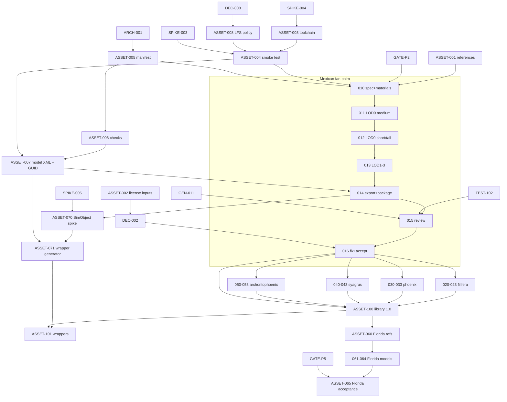

# 03. Palm Asset Library: Detailed Plan

Source: `plans/03-palm-assets.md`. Area prefix: `ASSET`. Owner agent: `asset-pipeline-artist`.

## Summary

- The library is one MSFS 2024 package, `palmfix-assets`, built from `assets/`. It holds 12 SoCal palm variants (5 species, 2-3 heights each), each with 4 LODs.
- `assets/manifest.json` is the contract with the rest of the project. `palmgen` (GEN) reads it to pick a variant and scale it. `palmlive` (LIVE) reads it for SimObject titles. A Python tool generates and checks it, so it never drifts from the exported files.
- The Mexican fan palm goes first, through the whole pipeline and a review in the sim. The other four species start only after that review passes. After that they can run in parallel.
- Everything that can be scripted is Python with unit tests that run anywhere: manifest generation, triangle budgets read from exported glTF, texture sizes, naming, GUIDs. Modeling needs Blender. Packaging and review need the Windows sim PC and a human eye.
- SimObject wrappers (for live spawning) and the Florida species come later, as separate tasks.

---

## Scope and interfaces

### Paths and folder layout

The repo root plays the role of `palmfix/`. Everything in this area lives under `assets/`, except the Python tooling (`palmcore/assets/`), the manifest schema (`schemas/`) and tests (`tests/`).

```
assets/
  README.md                          # pointers, LFS policy, commands (ASSET-008, ASSET-100)
  TOOLCHAIN.md                       # pinned Blender/SDK/plugin versions + export settings (ASSET-003/004)
  library.yaml                       # package name/version, scale limits, species fallback map (ASSET-005)
  budgets.yaml                       # thresholds for automated checks (ASSET-006)
  manifest.json                      # GENERATED, committed. Never hand-edit.
  species/<species_key>.yaml         # hand-written spec per species: variants, target heights
  reference/<species_key>.md         # reference sheet: photo links, proportions, distinguishing features
  reference/build-vs-license.md      # inputs for DEC-002
  reviews/<species_key>.md           # in-sim review notes and acceptance checklist
  blender/_pipeline_test/            # smoke-test scene (ASSET-004)
  blender/<species_key>/<species_key>.blend
  blender/<species_key>/textures/    # source PNG textures + SOURCES.md (license per file)
  palmfix-assets.xml                 # package project file
  PackageDefinitions/palmfix-assets.xml
  PackageSources/modelLib/<species_key>/<model_name>/   # exporter output: model XML, glTF, bin
  PackageSources/modelLib/<species_key>/texture/        # exported textures
  simobjects/                        # separate package for SimObject wrappers (W12, only if live is tested)

palmcore/assets/                     # Python tooling: manifest, checks, CLI (python -m palmcore.assets)
schemas/asset-manifest.schema.json   # JSON Schema for assets/manifest.json
tests/unit/palmcore/test_asset_*.py
tests/fixtures/palmcore/assets/      # synthetic glTF, sample exporter output, sample SimObject
tests/visual/lineup-<species_key>/<YYYY-MM-DD>/   # screenshots from species lineup reviews
```

`modelLib` is our folder name, not an SDK requirement. The asset group in the package definition points at it. VERIFY (ASSET-004): the 2024 model-library asset group type name, and whether one asset group pointed at `PackageSources/modelLib/` picks up every subfolder.

### Naming conventions

| Thing | Pattern | Example |
|---|---|---|
| Species key | `genus_species`, lowercase. Same keys as `palms.geojson` `species` (ARCH-002 pattern); must be listed in the canonical registry `palmscan/data/species_keys.yaml` (SCAN-002), which `validate` checks | `washingtonia_robusta` |
| Variant | `short`, `medium`, `tall`, optional alternate crown suffix `_b` | `medium`, `medium_b` |
| Model name | `palmfix_<species_key>_<variant>` | `palmfix_washingtonia_robusta_tall` |
| Model XML | `<model_name>.xml` | `palmfix_washingtonia_robusta_tall.xml` |
| LOD glTF | `<model_name>_LOD<n>.gltf` / `.bin` (VERIFY the exporter's own naming in ASSET-004; adopt it if it differs and update this table) | `palmfix_washingtonia_robusta_tall_LOD2.gltf` |
| Blender collection | `<model_name>` holding `<model_name>_LOD0` to `_LOD3` | |
| Blender object | `<model_name>_LOD<n>_<part>`, part in `trunk`, `fronds`, `skirt`, `crownshaft`, `cards` | `palmfix_phoenix_canariensis_short_LOD0_trunk` |
| Material | `mat_<species_key>_<part>` | `mat_washingtonia_robusta_fronds` |
| Texture | `tx_<species_key>_<part>_<map>.png`, map in `albedo`, `normal`, `orm` | `tx_washingtonia_robusta_bark_albedo.png` |
| SimObject title | `PalmFix <Genus> <species> <Variant>`, variant title-cased, `_b` becomes ` B` | `PalmFix Washingtonia robusta Medium B` |

All file names are ASCII, with no spaces. Lowercase, except the `_LOD<n>` suffix.

### GUID policy

- Every model gets a deterministic GUID: `uuid5(NAMESPACE, "palmfix-assets/" + model_name)`.
- `NAMESPACE = uuid5(NAMESPACE_DNS, "palmfix-assets.sim-palms.invalid")`. It's a constant in `palmcore/assets/manifest.py`, and it differs from GEN's namespace for scenery-object GUIDs.
- A model name never changes its GUID. Geometry changes keep the GUID. A new model name gets a new GUID.
- The manifest stores GUIDs lowercase, without braces. The tooling converts to the exporter's format when it writes or compares model XML. VERIFY (ASSET-004): where the 2024 exporter puts the GUID (an export option or an attribute in the model XML), and its format (braces, case).
- If the exporter can't take a fixed GUID, `python -m palmcore.assets stamp-guids` rewrites it in each exported model XML after export (ASSET-007).
- `validate` fails if any model XML GUID differs from the manifest.

### Manifest contract

Inputs: `assets/library.yaml` + `assets/species/*.yaml` + exported files under `assets/PackageSources/modelLib/`.
Output: `assets/manifest.json`, written by `python -m palmcore.assets build-manifest`.

The output is deterministic: sorted keys, 2-space indent, no timestamps. `build-manifest --check` exits 1 if the committed file is stale.

Species spec (hand-written, `assets/species/washingtonia_robusta.yaml`):

```yaml
species: washingtonia_robusta
common_name: Mexican fan palm
set: socal              # socal | florida
status: draft           # draft | in_review | accepted
lean_max_deg: 5         # 0 for species that grow straight
variants:
  - variant: short
    native_height_m: 15.0   # design target; manifest records the measured value
    crown_diam_m: 3.5
  - variant: medium
    native_height_m: 21.0
    crown_diam_m: 4.0
  - variant: tall
    native_height_m: 28.0
    crown_diam_m: 4.5
```

Library config (`assets/library.yaml`):

```yaml
package_name: palmfix-assets
package_version: 0.1.0
scale_limits: {min: 0.85, max: 1.15}
species_fallback:           # species with no model yet -> species to use instead
  washingtonia_filifera: washingtonia_robusta
  _default: washingtonia_robusta
```

Generated manifest (one variant shown; values illustrative):

```json
{
  "manifest_version": 1,
  "package_name": "palmfix-assets",
  "package_version": "0.1.0",
  "scale_limits": {"min": 0.85, "max": 1.15},
  "species_fallback": {"_default": "washingtonia_robusta", "washingtonia_filifera": "washingtonia_robusta"},
  "species": {
    "washingtonia_robusta": {
      "common_name": "Mexican fan palm",
      "set": "socal",
      "status": "in_review",
      "lean_max_deg": 5,
      "variants": [
        {
          "variant": "tall",
          "height_class": "tall",
          "alt": null,
          "model_name": "palmfix_washingtonia_robusta_tall",
          "model_guid": "3f0c2a8e-5b1d-5a7e-9c41-0d2f6b8e1a77",
          "native_height_m": 27.86,
          "crown_diam_m": 4.41,
          "model_xml": "PackageSources/modelLib/washingtonia_robusta/palmfix_washingtonia_robusta_tall/palmfix_washingtonia_robusta_tall.xml",
          "lods": [
            {"lod": 0, "file": "palmfix_washingtonia_robusta_tall_LOD0.gltf", "triangles": 5480, "min_size": null, "design_distance_m": 0},
            {"lod": 1, "file": "palmfix_washingtonia_robusta_tall_LOD1.gltf", "triangles": 1310, "min_size": null, "design_distance_m": 150},
            {"lod": 2, "file": "palmfix_washingtonia_robusta_tall_LOD2.gltf", "triangles": 260, "min_size": null, "design_distance_m": 600},
            {"lod": 3, "file": "palmfix_washingtonia_robusta_tall_LOD3.gltf", "triangles": 8, "min_size": null, "design_distance_m": 2000}
          ],
          "simobject_title": "PalmFix Washingtonia robusta Tall"
        }
      ]
    }
  }
}
```

Field rules:

| Field | Source | Rule |
|---|---|---|
| `manifest_version` | constant | Integer. Bump on any breaking change to this contract |
| `package_version` | `library.yaml` | Semver. Must equal the version in `PackageDefinitions/palmfix-assets.xml` |
| `status` | species yaml | `draft` species are left out of the manifest. `in_review` and `accepted` are included |
| `model_guid` | computed | uuid5 per the GUID policy; unique across the manifest |
| `native_height_m` | measured | Top of the LOD0 bounding box above the origin, from the glTF. Must be within 2% of the species yaml target |
| `crown_diam_m` | measured | Largest horizontal extent of LOD0 |
| `lods[].triangles` | measured | From the glTF (W3). Exactly 4 LODs, counts strictly decreasing |
| `lods[].min_size` | model XML | Whatever LOD switch value the exporter writes. `null` until ASSET-007 parses it |
| `lods[].design_distance_m` | constant | Design intent from the LOD table (0, 150, 600, 2000) |
| `simobject_title` | computed | Always present, by naming convention. Whether wrappers exist is a property of the separate `palmfix-assets-simobjects` package |

### What GEN and LIVE consume

- **GEN (`palmgen`)** reads `assets/manifest.json`. It uses `model_guid`, `native_height_m`, `scale_limits`, `lean_max_deg`, `species_fallback`, `status`, `package_name` and `package_version`.
  - Suggested selection rule (GEN owns and implements it): choose the variant of the palm's species (after fallback) with the smallest `|ln(height_m / native_height_m)|`, then scale = clamp(height_m / native_height_m, min, max). Among variants of the same `height_class` (alternate crowns), pick one seeded by `palm_id`.
  - GEN should record `package_version` in its `build_report.md`. When `native_height_m` changes, regions need a rebuild to rescale.
  - The region package declares a dependency on `palmfix-assets`. VERIFY (GEN/ASSET-014): how a 2024 package definition declares that dependency.
- **LIVE (`palmlive` spawner)** reads `simobject_title` and `native_height_m`. VERIFY (ASSET-070): whether a spawned SimObject can be scaled. If it can't, LIVE picks the nearest variant with no scaling.
- **TEST** reads `lods[].triangles` and the budgets for performance reports.
- Loader API for Python consumers: `palmcore.assets.manifest.load_manifest(path) -> Manifest`, with typed dataclasses. GEN should import this rather than parse the JSON itself.

### Scale limits and species fallback

Plan 04 has `placement.scale_clamp` (0.15) and a priors-based species fallback; this plan has `scale_limits` (0.85/1.15) and `species_fallback`. Both describe the same two rules, so one side must own each. Decision (ASSET-005):

- **The manifest owns the defaults.** How far a model can be scaled before it looks wrong, and which model stands in for a species that has none, are properties of the library: they change when models are added or reviewed, not per region, and a region config cannot know them. The generated `scale_limits` and `species_fallback` travel with the models they describe, and `validate` checks that every fallback target exists in the manifest.
- **Region config overrides, it does not duplicate.** `placement.scale_clamp` becomes optional (no default). When unset, GEN uses the manifest `scale_limits`. When set, it replaces the manifest limits for that region (a tuning knob for GEN-017/GEN-019, not a second default).
- **Fallback order for a palm's species**: (1) the species has variants in the manifest; (2) `species_fallback[species]`; (3) region `species_priors`, only if non-empty (an explicit per-region choice outranks the library default); (4) `species_fallback["_default"]`. Today's step 1 in plan 04 (priors, then first species alphabetically) is replaced by this order. `SPECIES_FALLBACK` is still warned for steps 2 to 4.
- Why not region-owned: with two copies the values drift (0.85/1.15 vs 0.15 are only the same by luck), and ASSET cannot validate a region file.
- This is an interface change to plan 04 (GEN-011 text and the `placement.scale_clamp` row), which ASSET-005 does not own. GEN-011 applies it; if its owner disagrees, the fallback is to keep the manifest fields as informational only and delete them in a manifest version bump. No user decision is needed unless the owners disagree.

### Large file policy

Proposal. The user decides it in DEC-008 (ADR-0009), which also settles whether visual screenshots are committed as JPEG in plain git (TEST plan) or through LFS; ASSET-008 then implements the decision before any binary is committed.

- Git LFS for `*.blend`, `*.png`, `*.bin` and `*.ktx2` under `assets/`, and for `*.png` under `tests/visual/`. Text glTF, XML, YAML and JSON stay in plain git.
- Why commit the exports: the package can then be built on the sim PC without opening Blender.
- Alternative if LFS quota is a problem: keep `.blend` files and source textures in an external store (cloud drive), and record their path and SHA-256 in `assets/blender/<species>/SOURCES.md`.
- Reference photos are not committed. Reference sheets hold links only. Downloaded copies go in `data/reference/` (gitignored).
- Textures: CC0 or self-made only, with the source recorded per file in `textures/SOURCES.md`. This holds even for personal use, so DEC-001 (publish) never forces a redo.

---

## Work breakdown

### W1 Reference and build-vs-license

- **ASSET-001: reference sheets** for the 5 SoCal species, one file each at `assets/reference/<species_key>.md`. Each sheet has:
  - 8-15 photo links with license notes, covering whole tree, crown close-up, trunk texture, base and skirt.
  - Proportions table: trunk base and top diameter, crown diameter, frond count, frond length, petiole length, skirt presence.
  - Distinguishing features against look-alikes (robusta vs filifera; queen vs king).
  - Frond color notes at noon.
  - Typical heights in the test regions.
- **ASSET-002: build-vs-license inputs** for DEC-002, at `assets/reference/build-vs-license.md`:
  - Candidate stores and products, and which species each covers.
  - Exact license clauses on redistributing the model inside a game mod.
  - Price, triangle counts, formats, and what work remains (LODs, MSFS materials).
  - Build-hour estimate from this plan's task index.
  - DEC-002 (owned by plan 07, depends on ASSET-002) makes the decision. ASSET-002 only collects facts.
  - Timing: DEC-002 opens at the start of Phase 3 with the default "build the Mexican fan palm first". The pilot (ASSET-010..015) runs under that default; the decision, informed by its hours, is needed before ASSET-016 and the other four species. ASSET-016 writes the `Decided (ADR-0003)` note here.

### W2 Toolchain and pipeline smoke test

- **ASSET-003:** install the Blender version the SDK's 2024 plugin supports, plus `io_scene_gltf2_msfs_2024` from `[SDK ROOT]\Tools\Blender\addons\`. Make sure the 2020 plugin is not enabled. Record Blender, SDK, plugin and sim versions in `assets/TOOLCHAIN.md`.
- **ASSET-004:** smoke-test the whole pipeline with a throwaway model (a 10 m cylinder trunk with alpha-tested crossed quads, 4 LODs):
  - Export it and package it as a model library in a throwaway package under `build/`.
  - Build with `fspackagetool`, load it in the sim, and place it once by hand in the Scenery Editor. Place it once more by editing a copy of SPIKE-003's scenery-object template with our GUID.
  - Copy the exporter's output into `tests/fixtures/palmcore/assets/sample_export/` so the Python tooling is tested against real files.
  - Answer the W2 VERIFY items (see the open questions) and record the export settings in `TOOLCHAIN.md`.

### W3 Asset tooling in Python

Pure Python 3.12, plus `jsonschema` and `PyYAML`. glTF is parsed as JSON; no `.bin` reading is needed. PNG sizes come from the IHDR header with the standard library. CLI: `python -m palmcore.assets <cmd>`. Exit codes: 0 ok, 1 check failures, 2 usage or IO error.

| Command | Task | Does |
|---|---|---|
| `build-manifest [--assets-dir assets] [--out PATH] [--check] [--include-draft]` | 005, 006, 007 | Builds the manifest. `--check` compares against the committed file. Species tasks write a preview with `--include-draft --out build/manifest.preview.json`, so they never touch the committed manifest |
| `validate [--manifest PATH]` | 005, 007 | Schema, unique GUIDs, files exist, GUID matches model XML, package version matches |
| `check [--species KEY] [--assets-dir assets] [--budgets PATH]` | 006, 007 | Asset checks below. Prints one row per finding (ERROR or WARN) and a `N errors, M warnings` line; exit 1 on any ERROR. Budgets default to `<assets-dir>/budgets.yaml`, then the repo's `assets/budgets.yaml`. `build-manifest` fills `native_height_m` (LOD0 top), `crown_diam_m` (LOD0 horizontal extent) and `lods[].triangles` from the LOD glTFs when they exist (006) |
| `stamp-guids [--species KEY]` | 007 | Only if the exporter can't take a fixed GUID |
| `simobjects --out DIR` | 071 | Generates SimObject wrappers from the manifest |

Checks (`check`). Thresholds come from `assets/budgets.yaml`:

| Check | Rule (starting values) | Level |
|---|---|---|
| Naming | Files, materials and textures match the naming table | ERROR |
| LOD count | Exactly 4 LOD glTFs per model | ERROR |
| Triangle budget | LOD0 ≤ 6000, LOD1 ≤ 1500, LOD2 ≤ 300, LOD3 ≤ 50 (Florida LOD0 ≤ 3000) | ERROR over max, WARN under min (3000/800/150/0) |
| Monotonic | Triangles strictly decrease LOD0 to LOD3 | ERROR |
| Primitives | ≤ 3 primitives (draw calls) per LOD, 1 at LOD3 | WARN |
| Height | LOD0 top within 2% of spec `native_height_m`; every LOD's top within 3% of LOD0 (no size pop) | ERROR |
| Base | Bounding-box bottom between -0.25 m and 0.0 m (trunk sinks slightly into the ground) | ERROR |
| Crown | Horizontal extent within 20% of spec `crown_diam_m` | WARN |
| Alpha mode | No material uses `BLEND`. `*_fronds`, `*_skirt` and `*_cards` use `MASK` and `doubleSided: true` | ERROR |
| Textures | PNG, power-of-two sides, within the max size per map role, every referenced file exists | ERROR. WARN for unreferenced files |
| GUID | Model XML GUID equals the manifest GUID (007) | ERROR |

Triangle math: for each primitive, mode 4 (TRIANGLES) gives index count / 3, or POSITION count / 3 when there are no indices. Modes 5 and 6 (strip, fan) give count - 2. Bounding boxes come from POSITION accessor `min`/`max` (required by the glTF 2.0 spec), transformed through the node hierarchy (TRS or matrix). The up axis is set by `budgets.yaml` `up_axis: y` (glTF's convention).

### W4 Blender scene conventions

- One `.blend` per species at `assets/blender/<species_key>/<species_key>.blend`. It holds all variants and LODs of that species.
- Units: Metric, Unit Scale 1.0, meters. Z up in Blender.
- Origin: the trunk base center sits at world origin (0, 0, 0), at ground level. All export objects keep their object origin at world origin, with transforms applied (location 0, rotation 0, scale 1).
- Ground sink: the trunk mesh continues 0.15 m below z = 0, so small terrain slopes don't show a floating base.
- Models are upright. Lean (0-5°) and yaw are applied at placement (GEN), never baked in.
- Collections: one top-level collection per model (`<model_name>`) with child collections `<model_name>_LOD0` to `_LOD3`. A `_work` collection holds frond masters, reference images and helpers, and is excluded from export.
- Frond masters: model 1-3 master fronds per species and instance them with linked duplicates or geometry nodes. VERIFY (ASSET-004): whether the exporter exports instances. If it doesn't, realize instances on an export copy, never in the master scene.
- UVs: one UV map. Bark V runs along the trunk and tiles. Fronds, skirt and cards map into the species atlas.
- No animation or wind in v1 (see the open questions).

Per-species modeling notes:

| Species | Key features to get right |
|---|---|
| `washingtonia_robusta` | Very tall thin trunk with a slight flare at the base. Small dense fan head. Optional short skirt of dead fronds under the crown |
| `washingtonia_filifera` | Thick columnar trunk. Heavy full-length or half skirt (a shell mesh with an alpha-tested texture). Larger, greyer-green fans |
| `phoenix_canariensis` | Thick trunk with a diamond leaf-base pattern (albedo + normal), often a pineapple-like knob under the crown. Large round crown of many long pinnate fronds (alpha cards) |
| `syagrus_romanzoffiana` | Slim, smooth grey trunk. Plume-like drooping pinnate fronds |
| `archontophoenix_cunninghamiana` | Smooth ringed trunk (texture). Green crownshaft (own material). Arching pinnate fronds with leaflets that hang down |

### W5 Height variants

Starting values. Before modeling each species, check them against a height histogram from any available `palms.geojson` (SCAN-100 or SCAN-101 output) and adjust in the species yaml.

| Species | Variants: native height m (covers at ±15%) | Crown diam m |
|---|---|---|
| `washingtonia_robusta` | short 15 (12.8-17.3), medium 21 (17.9-24.2), tall 28 (23.8-32.2) | 3.5 / 4.0 / 4.5 |
| `washingtonia_filifera` | short 12 (10.2-13.8), tall 16 (13.6-18.4) | 4.5 / 5.5 |
| `phoenix_canariensis` | short 10 (8.5-11.5), medium 14 (11.9-16.1), tall 18 (15.3-20.7) | 8 / 10 / 11 |
| `syagrus_romanzoffiana` | short 9 (7.7-10.4), tall 13 (11.1-15.0) | 5 / 6 |
| `archontophoenix_cunninghamiana` | short 10 (8.5-11.5), tall 14 (11.9-16.1) | 4.5 / 5.5 |

- A variant is a rebuild, not a rescale. Trunk length changes, trunk diameter changes less, and the crown changes least.
- Heights outside the covered range get clamped scale (GEN). That's acceptable for v1.

### W6 LODs and budgets

| LOD | Design distance | Triangles | Build method |
|---|---|---|---|
| LOD0 | 0-150 m | 3000-6000 | Full fronds, trunk detail, normal maps |
| LOD1 | 150-600 m | 800-1500 | Auto LOD from LOD0, then hand-fix: fewer frond segments, small fronds merged, 8-sided trunk |
| LOD2 | 600 m-2 km | 150-300 | Frond cards (one bent quad per frond or 6-10 crown cards), 6-sided trunk, cards atlas |
| LOD3 | > 2 km | < 50 | 2-3 crossed quads with a baked silhouette of the whole tree (trunk + crown), one material |

- Try the exporter's Auto LODs first, as the source plan says. Hand-fix what looks wrong. VERIFY (ASSET-004): what Auto LODs produces and how it's configured.
- LOD2/LOD3 card textures are baked from LOD0 (orthographic renders with alpha, in Blender) into `tx_<species>_cards_albedo.png`.
- Silhouette rule: every LOD keeps LOD0's height and crown extent (checked automatically) so switches don't change size.
- Distances are design intent. MSFS switches LODs by a value in the model XML. VERIFY (ASSET-004, ASSET-015): what that value is in 2024 (for example a screen-size `minSize`) and how it maps to distance; tune it in the robusta review.

### W7 Materials and textures

| Map role | Max size (W×H) | Notes |
|---|---|---|
| `fronds_albedo` | 2048×2048 | RGBA; alpha is the cutout mask |
| `fronds_normal` | 1024×1024 | LOD0-1 only |
| `bark_albedo` | 1024×2048 | Tiles along V |
| `bark_normal` | 1024×2048 | LOD0 only |
| `*_orm` | 1024×1024 | Occlusion, roughness, metallic (glTF packing) |
| `skirt_albedo`, `crownshaft_albedo` | 1024×1024 | RGBA for the skirt |
| `cards_albedo` | 1024×1024 | Baked; LOD2-3 |

Florida set: half these sizes.

- Fronds, skirt and cards: alpha mode Mask (cutout), starting cutoff 0.5, double-sided, metallic 0, roughness around 0.7-0.85. Never alpha Blend.
- Trunk: opaque, tiling bark per species, normal map at LOD0 only.
- Optional foliage shading trick: point frond normals outward from the crown center (data transfer from a sphere), so backlit fronds don't render black. Judge it in the sim.
- Color: match the reference photos at noon, then check at golden hour. Don't make the green darker or more saturated than the references.
- VERIFY (ASSET-004/010): which MSFS material type in the 2024 plugin suits vegetation (any foliage or translucency option), how it exposes alpha mode and double-sided, and the texture rules (power of two, max size, PNG to KTX2 conversion during the package build).
- No seasonal variants (palms are evergreen). A dry-frond tint variant is optional and out of v1.

### W8 Export and packaging

- Export each model's collection with the MSFS 2024 plugin into `assets/PackageSources/modelLib/<species_key>/<model_name>/`, with textures in `.../<species_key>/texture/`. The exact settings live in `TOOLCHAIN.md` (from ASSET-004). Settings intent: export only the model collection, apply modifiers, no animation, PNG textures, LODs written as the plugin expects, GUID per the GUID policy.
- After each export, run:
  1. `python -m palmcore.assets check --species <key>`
  2. `python -m palmcore.assets build-manifest --include-draft --out build/manifest.preview.json`
  3. `python -m palmcore.assets validate --manifest build/manifest.preview.json`
- Package project: `assets/palmfix-assets.xml` and `assets/PackageDefinitions/palmfix-assets.xml`, created in ASSET-014 from the structure captured in ASSET-004. Build: `fspackagetool assets\palmfix-assets.xml -outputdir build\palmfix-assets -nopause` on the sim PC (command form from plan 04; VERIFY against SPIKE-004's notes).
- Versioning: bump `package_version` in `library.yaml` and in the package definition together (`validate` checks that they match). 0.x until all 5 SoCal species are accepted; 1.0.0 at ASSET-100.
- Only ASSET-014, ASSET-016, ASSET-100 and ASSET-065 write the committed `assets/manifest.json`, in that order.

### W9 Mexican fan palm first

Order: ASSET-010 (spec, textures, materials), 011 (LOD0 medium), 012 (LOD0 short and tall), 013 (LOD1-3), 014 (export, package, first manifest), 015 (review in the sim), 016 (fix pass and acceptance).

- What 016 adds: it writes what the pipeline taught us into this plan and `TOOLCHAIN.md`, and tunes `budgets.yaml` and the LOD switch values.
- The other species start only after ASSET-016 is done. This is the "fix the pipeline before doing the other species" rule in `plans/05-phases.md`.
- If DEC-002 picks license or hybrid, ASSET-011/012 become "import and adapt the licensed model". Everything else stays the same.

### W10 Other SoCal species

Four tasks per species, numbered x0-x3, all after ASSET-016:

| Species | Spec + textures + materials | LOD0 variants | LOD1-3 + export + checks | Acceptance |
|---|---|---|---|---|
| `washingtonia_filifera` | ASSET-020 | ASSET-021 | ASSET-022 | ASSET-023 |
| `phoenix_canariensis` | ASSET-030 | ASSET-031 | ASSET-032 | ASSET-033 |
| `syagrus_romanzoffiana` | ASSET-040 | ASSET-041 | ASSET-042 | ASSET-043 |
| `archontophoenix_cunninghamiana` | ASSET-050 | ASSET-051 | ASSET-052 | ASSET-053 |

Species tasks never write `assets/manifest.json` or the package definition. They write a preview manifest to `build/`. ASSET-100 integrates.

### W11 Acceptance review

Per species, in the sim (ASSET-015/016 for robusta, x3 for the others). It follows the visual protocol from TEST-102 and writes `assets/reviews/<species_key>.md`.

1. Run `python -m palmcore.assets check --species <key>`. It must show zero errors.
2. Build `palmfix-assets` locally, including this species.
3. Lineup: in Dev Mode, place every variant of the species 15 m apart in a row on flat ground. Use a spot outside photogrammetry (test site T5 if suitable) so no blob gets in the way. Record the coordinates in the review file.
4. Screenshot at street level (2 m), 150 m and 600 m, at noon and at golden hour. Save them under `tests/visual/lineup-<species_key>/<YYYY-MM-DD>/`.
5. If the species occurs at a test site in `palms.geojson`, also review it there via GEN's manifest-driven placement (GEN-011; ASSET-015 depends on it).
6. Fill in the checklist:
   - [ ] Automated checks pass
   - [ ] Right at street level, 150 m and 600 m, noon and golden hour
   - [ ] Base sits on the ground on flat terrain: no floating, no visible sinking
   - [ ] LOD switches don't pop noticeably on a slow fly-away at normal object LOD settings
   - [ ] Matches reference photos for trunk shape, crown shape and frond color
   - [ ] Within the LOD budget
7. Pass: set `status: accepted` in the species yaml. Small fixes (about 1 h) are done inside the task. Bigger ones become a new task.

### W12 SimObject wrappers

Only if the Phase 5 bake-off tests live spawning.

- **ASSET-070 (spike):** wrap one variant as a SimObject and spawn it with SPIKE-005's SimConnect script. Capture the container files as templates in `assets/simobjects/templates/`. Answer these VERIFY items:
  - the 2024 SimObject container format for a static object
  - whether it can reference the model-library model or needs its own copy
  - whether spawned objects can be scaled
  - whether titles must be unique across packages
  - which package layout works
- **ASSET-071:** `python -m palmcore.assets simobjects` generates one wrapper per manifest variant from those templates, with unit tests.
- **ASSET-101:** generate all wrappers into the separate package `palmfix-assets-simobjects` (`assets/simobjects/`), build it, and spawn every title once.

### W13 Florida set

Phase 6, low detail:

- 2 variants per species. LOD0 ≤ 3000 triangles. Textures at half size.
- One modeling task per species covering spec, model, LODs, export and checks: ASSET-061 `sabal_palmetto`, 062 `roystonea_regia`, 063 `cocos_nucifera`, 064 `wodyetia_bifurcata`.
- ASSET-060 writes the reference sheets first. ASSET-065 runs one combined acceptance review and updates the manifest.
- Until then, `species_fallback` maps each Florida key to the closest SoCal model (cabbage palm → `washingtonia_filifera`, royal → `archontophoenix_cunninghamiana`, coconut and foxtail → `syagrus_romanzoffiana`). VERIFY with the user: are these fallbacks better than leaving the blob uncut?

---

## Task index

| ID | Title | Phase | Depends on | Requires | Est h |
|---|---|---|---|---|---|
| ASSET-001 | Write reference sheets for the 5 SoCal species | 3 | - | network | 5 |
| ASSET-002 | Collect build-vs-license inputs for DEC-002 | 3 | - | network | 3 |
| ASSET-003 | Install and pin Blender and the MSFS 2024 exporter | 3 | SPIKE-004 | blender, windows-sim | 2 |
| ASSET-004 | Smoke-test the asset pipeline with a throwaway model | 3 | ASSET-003, ASSET-008, SPIKE-003 | blender, windows-sim | 5 |
| ASSET-005 | Manifest schema, species spec format, loader and generator | 3 | ARCH-001 | none | 5 |
| ASSET-006 | glTF stats and automated asset checks | 3 | ASSET-005 | none | 5 |
| ASSET-007 | Model XML parsing, GUID cross-check, LOD info in manifest | 3 | ASSET-006, ASSET-004 | none | 4 |
| ASSET-008 | Implement the asset large-file policy decided in DEC-008 | 3 | DEC-008 | none | 1.5 |
| ASSET-010 | Mexican fan palm: species spec, textures, materials (pilot) | 3 | GATE-P2, ASSET-001, ASSET-004, ASSET-005 | blender | 4 |
| ASSET-011 | Mexican fan palm: LOD0 medium variant | 3 | ASSET-010 | blender | 5 |
| ASSET-012 | Mexican fan palm: LOD0 short and tall variants | 3 | ASSET-011 | blender | 3 |
| ASSET-013 | Mexican fan palm: LOD1-LOD3 for all variants | 3 | ASSET-012 | blender | 4 |
| ASSET-014 | Mexican fan palm: export, create palmfix-assets package, first manifest | 3 | ASSET-013, ASSET-007 | blender, windows-sim | 4 |
| ASSET-015 | Mexican fan palm: in-sim review | 3 | ASSET-014, TEST-102, GEN-011 | windows-sim, human | 3 |
| ASSET-016 | Mexican fan palm: fix pass, acceptance, pipeline lessons, DEC-002 note | 3 | ASSET-015, DEC-002 | blender, windows-sim, human | 4 |
| ASSET-020..023 | California fan palm: spec, LOD0, LODs+export, acceptance | 3 | ASSET-016 (chain) | blender (x0-x2); blender, windows-sim, human (x3) | 3+6+4+2 |
| ASSET-030..033 | Canary Island date palm: same four steps | 3 | ASSET-016 (chain) | blender (x0-x2); blender, windows-sim, human (x3) | 3+6+4+2 |
| ASSET-040..043 | Queen palm: same four steps | 3 | ASSET-016 (chain) | blender (x0-x2); blender, windows-sim, human (x3) | 3+6+4+2 |
| ASSET-050..053 | King palm: same four steps | 3 | ASSET-016 (chain) | blender (x0-x2); blender, windows-sim, human (x3) | 3+6+4+2 |
| ASSET-100 | Deliverable: palmfix-assets 1.0.0 model library with manifest | 3 | ASSET-016, ASSET-023, ASSET-033, ASSET-043, ASSET-053 | windows-sim | 3 |
| ASSET-070 | Spike: wrap one variant as a SimObject and spawn it | 5 | ASSET-014, SPIKE-005 | windows-sim | 4 |
| ASSET-071 | SimObject wrapper generator from the manifest | 5 | ASSET-070, ASSET-007 | none | 4 |
| ASSET-101 | Deliverable: SimObject wrapper package for every variant | 5 | ASSET-071, ASSET-100 | windows-sim | 3 |
| ASSET-060 | Florida reference sheets | 6 | ASSET-100 | network | 4 |
| ASSET-061 | Cabbage palm: low-detail model, LODs, export | 6 | ASSET-060 | blender | 6 |
| ASSET-062 | Royal palm: low-detail model, LODs, export | 6 | ASSET-060 | blender | 6 |
| ASSET-063 | Coconut palm: low-detail model, LODs, export | 6 | ASSET-060 | blender | 6 |
| ASSET-064 | Foxtail palm: low-detail model, LODs, export | 6 | ASSET-060 | blender | 6 |
| ASSET-065 | Florida set: acceptance review and manifest update | 6 | ASSET-061..064, GATE-P5 | windows-sim, human | 4 |

Totals:

| Part | Hours |
|---|---|
| Phase 3 | about 120 |
| Phase 5 wrappers | 11 |
| Phase 6 Florida | 32 |

That's far above the 20-40 h in `plans/05-phases.md` (see the open questions).

---

## Dependency graph



Each species node `0x0-0x3` is a chain: x0 → x1 → x2 → x3.

---

## Parallelization notes

- **Ready early, before Phase 3** (no GATE-P2 dependency):
  - ASSET-001 and 002 (network only, any agent)
  - ASSET-005 to 007 (code, `none`, cloud agents)
  - DEC-008 (user decision), then ASSET-008 (`none`)
  - ASSET-003 and 004 (sim PC, once Phase 0 has installed the SDK)
- **Serial on purpose:** the robusta chain ASSET-010 to 016. It proves the pipeline. Nothing else in Blender should start until ASSET-016 is done.
- **Parallel after ASSET-016:** the four species chains share no files (separate `assets/blender/<key>/`, `assets/species/<key>.yaml`, `PackageSources/modelLib/<key>/`, `reviews/<key>.md`). In practice, Blender tasks are limited by how many people or Blender seats there are, not by the graph.
- **Shared files, ordered:**

  | File | Written by, in order |
  |---|---|
  | `assets/manifest.json` | 014 → 016 → 100 → 065 |
  | `assets/TOOLCHAIN.md` | 003 → 004 → 016 |
  | `palmcore/assets/__main__.py` | 005 → 006 → 007 → 071 |
  | `assets/PackageDefinitions/palmfix-assets.xml` | 014 → 100 → 065 |

  ASSET-101 writes only under `assets/simobjects/`.
- **Environment:**

  | Requirement | Tasks |
  |---|---|
  | `none` | 005, 006, 007, 071 |
  | `network` | 001, 002, 060 |
  | `blender` | modeling tasks; Blender runs on the sim PC too, so x3 fixes can happen there |
  | `windows-sim` | 003, 004, 014, 015, 016, x3, 100, 070, 101, 065 |
  | `human` | 015, 016, all acceptance reviews (008 is `none` now; the decision is DEC-008) |

---

## Verification strategy

1. **Unit tests (no Blender, no sim):** `pytest tests/unit/palmcore -q`. These run on synthetic glTF fixtures and on the real exporter sample captured in ASSET-004. They cover triangle math, bounding boxes through node transforms, PNG header parsing, naming regexes, GUID determinism, schema validation and manifest determinism.
2. **Asset checks on real exports:** `python -m palmcore.assets check` on every species task. CI can run `build-manifest --check` and `validate` on every commit, because both read committed files only.
3. **Package build:** `fspackagetool` exits 0 and the model library loads in Dev Mode (ASSET-004, 014, 100).
4. **Visual acceptance:** the W11 checklist per species, with screenshots under `tests/visual/lineup-<key>/`. The visual protocol and folders come from TEST-102.
5. **Performance:** not owned here. TEST-103 measures. If the frametime budget (DEC-005) is missed, the response is to tighten `budgets.yaml` and redo LODs.
6. **After sim or SDK updates:** TEST-104's regression routine rebuilds a region, which pulls in `palmfix-assets`. A changed exporter version means re-running ASSET-004's smoke test.

---

## Open questions and VERIFY items

| # | Item | Resolved in |
|---|---|---|
| 1 | VERIFY: Blender version supported by the 2024 plugin for the installed SDK | ASSET-003 |
| 2 | VERIFY: how the 2024 plugin organizes LODs, what files it writes, LOD file naming | ASSET-004 |
| 3 | VERIFY: where the model GUID is set and its format in model XML | ASSET-004, ASSET-007 |
| 4 | VERIFY: 2024 model-library asset group type name; whether one asset group covers subfolders | ASSET-004 |
| 5 | VERIFY: Auto LODs: how it's configured, and whether its output is usable | ASSET-004, ASSET-013 |
| 6 | VERIFY: vegetation-suitable material type; alpha mask/cutoff and double-sided in the plugin | ASSET-004, ASSET-010 |
| 7 | VERIFY: whether linked duplicates or geometry-node instances export | ASSET-004 |
| 8 | VERIFY: texture rules (power of two, max size, automatic PNG to KTX2) | ASSET-004 |
| 9 | VERIFY: LOD switch value in model XML (for example `minSize`) and its mapping to distance; any Dev Mode LOD debug view | ASSET-004, ASSET-015 |
| 10 | VERIFY: whether scenery objects support pitch/bank (lean) and uniform scale | SPIKE-003 (template), noted in ASSET-015 |
| 11 | VERIFY: SimObject container format in 2024; model reuse; scaling at spawn; title uniqueness | ASSET-070 |
| 12 | VERIFY: how a region package declares a dependency on `palmfix-assets` | ASSET-014 (with GEN) |
| 13 | Git LFS vs external store; LFS quota; screenshot storage (JPEG vs LFS) | DEC-008 (user), implemented by ASSET-008 |
| 14 | Species keys: ARCH-002 uses a pattern, not an enum. Resolved 2026-11-22: keys (including Florida) must be in `palmscan/data/species_keys.yaml` (SCAN-002) | ASSET-005 |
| 15 | Estimate: this breakdown totals about 120 h for Phase 3 vs 20-40 h in `plans/05-phases.md`. Licensing or fewer variants (1-2 per species) would cut it | User, at DEC-002 |
| 16 | `plans/05-phases.md` lists build-vs-license as Phase 3 task 1 but in the decision table as "after phase 3", with the default "build one species first". This plan assumes DEC-002 resolves at the start of Phase 3, possibly as "build robusta, then re-decide". Resolved 2026-11-22: DEC-002 opens at the start of Phase 3 with that default; the pilot (ASSET-010..015) runs under it; ASSET-016 and later species wait for the decision | DEC-002 owner |
| 17 | Frond wind animation: out of v1. Worth a later look if static fronds look dead | User |
| 18 | Alternate crowns (`_b` variants): in the contract, but no task yet. Add after ASSET-100 if rows look copy-pasted | User, after ASSET-100 |
| 19 | Florida fallbacks before Florida models exist: use the nearest SoCal model, or leave those blobs alone? | User |
| 21 | Scale limits and species fallback: manifest owns the defaults, region `placement.scale_clamp` and `species_priors` only override (see [Scale limits and species fallback](#scale-limits-and-species-fallback)). GEN-011 must apply it in plan 04 and the loader | GEN-011 owner (ASSET-005 proposes) |
| 20 | Young palms below the shortest variant get clamped scale. Add an `xshort` variant if histograms show many | ASSET-010 / x0 tasks |

---

## Reconciliation notes (2026-11-22)

- Species keys: validated against the canonical registry `palmscan/data/species_keys.yaml` (SCAN-002); the ARCH-002 schema keeps a pattern (ASSET-005, open question 14).
- Asset storage: DEC-008 is the decision (ADR-0009), including whether visual screenshots are committed as JPEG or via LFS (folded in from TEST). ASSET-008 is now the implementation, depends on DEC-008, `requires: none`.
- DEC-002 timing: depends on ASSET-002; opens at the start of Phase 3 with the "build one species first" default; ASSET-010 no longer waits for it (pilot); ASSET-016 depends on DEC-002 and writes its `Decided (ADR-0003)` note into this plan, so DEC-002 no longer edits this file (removes the unordered overlap with ASSET-004/ASSET-007).
- GEN loads the manifest only through `palmcore.assets.manifest.load_manifest` (GEN-011 depends on ASSET-005). `palmcore/assets/` stays ASSET's; no ARCH task touches it.
- ASSET-015 depends on GEN-011 (manifest-driven placement for the T1 review). Viewpoints are the standard street level (~2 m), low oblique (~150 m), approach (~600 m), now also in the TEST plan.
- ASSET-010/020/030/040/050 read palm heights from the canonical palmscan output `build/scan/<region>/palms.geojson` (was `data/`).
- Resolved by ASSET-005 (2026-11-22), pending GEN-011 confirmation: `library.yaml` `scale_limits` and `species_fallback` overlap GEN's `placement.scale_clamp` (0.15) and priors-based fallback. The manifest is the single source for both defaults; see [Scale limits and species fallback](#scale-limits-and-species-fallback). Plan 04 still needs a matching edit in GEN-011 (see open question 21).

## Recap

- One package, `palmfix-assets`, built from `assets/`, with a generated `assets/manifest.json` that GEN and LIVE read. GUIDs are deterministic uuid5 values from the model name.
- The Mexican fan palm proves the full pipeline in the sim (ASSET-010 to 016) before the other four species run in parallel.
- Budgets, naming, heights, alpha mode and GUIDs are checked by Python tools with unit tests. Modeling, packaging and visual review need Blender, the sim PC and a human.
- SimObject wrappers (Phase 5) and the Florida set (Phase 6) are separate, later tasks. The estimate is well above the source plan's, so it's worth deciding early at DEC-002.
