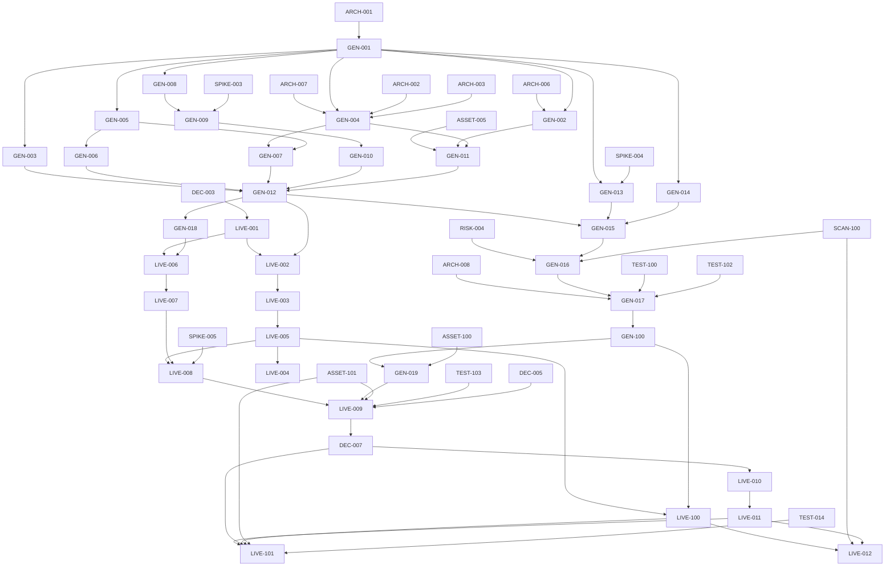

# 04. FS2024 Integration: Detailed Plan (GEN + LIVE)

Source: `plans/04-fs2024-integration.md`. Areas: **GEN** (`palmgen/`) and **LIVE** (`palmlive/`).
Date: 2026-11-21. Status: plan only.

## Summary

- `palmgen` turns `palms.geojson` into a Community package project: 12-sided exclusion circles, merged and clipped by buildings and masks, tiled at 0.01°, filled into XML templates the Scenery Editor saved in Phase 0, then compiled with `fspackagetool` and checked.
- Every id is deterministic (UUIDv5), every output file is written byte-stable, so rebuilds diff cleanly and golden tests can pin the XML.
- `palmlive` is a C# solution. `PalmLive.Core` holds all logic (region manager, spawn manager) behind interfaces and builds and tests on Linux. `PalmLive.SimConnect` is a thin Windows-only adapter.
- Region switching uses folder links into the Community folder. Live spawning reads a per-region SQLite R-tree that `palmgen index` exports.
- Anything about MSFS XML, `fspackagetool` output or SimConnect behaviour that we do not know is marked `VERIFY:` and routed to SPIKE-003/004/005 or an in-sim task.

---

## Scope and interfaces

### Repo paths

The repo root is `palmfix/` from `01-architecture.md`. GEN and LIVE own these paths:

```
palmgen/
  __init__.py              # __version__ = "0.1.0" (generator semver)
  __main__.py              # python -m palmgen
  cli.py                   # argparse; all subcommands and flags (GEN-001)
  errors.py                # exception classes with exit codes
  model.py                 # shared dataclasses
  paths.py                 # default path rules
  ids.py                   # GUIDs and per-palm hashes
  tiling.py
  inputs.py                # palms, buildings, region config -> GenConfig
  geometry.py              # projection, circles, merge, clip, ring normalisation
  masks.py                 # mod/airport masks; Overpass airport fetch
  templates.py             # TemplateSet loader (Jinja2 + templates.yaml)
  xml_writer.py            # tile rendering, write-if-changed, element counting
  project.py               # project file + PackageDefinitions
  version.py               # PackageVersion
  variants.py              # manifest loading, variant pick, scale, heading
  pipeline.py              # generate() and run_build()
  build.py                 # fspackagetool wrapper, sim-running check, output checks
  report.py                # build_report.md / build_report.json
  spatial_index.py         # palmgen index
  sql/palm_index_v1.sql    # DDL shared with palmlive
  templates/
    captured/              # raw Scenery Editor output (written by SPIKE-003, read-only for GEN)
    templates.yaml         # template registry + format rules (GEN-009/010)
    scene_file.xml.j2
    exclusion_polygon.xml.j2
    scenery_object.xml.j2
    project.xml.j2
    package_definition.xml.j2
palmlive/
  PalmLive.sln
  global.json              # pins .NET 8 SDK
  Directory.Build.props
  .gitignore               # bin/ obj/
  PalmLive.Core/           # net8.0, no Windows or SimConnect dependency
  PalmLive.SimConnect/     # net8.0-windows, x64, references the SDK managed wrapper
  PalmLive.App/            # net8.0-windows WinForms window + CLI verbs
  PalmLive.Tests/          # xUnit, references Core only
tests/unit/palmgen/        # pytest per module
tests/fixtures/palmgen/    # small geojson, yaml, manifest, fake templates, tool logs
tests/fixtures/palmlive/   # build_tree/, tracks/, plans/, index_small.sqlite
tests/golden/gen-small-static/
tests/golden/gen-small-exclusions-only/
tests/perf/bakeoff/        # LIVE-009 runs
tests/perf/soak/           # LIVE-101 runs
```

Shared code from ARCH that GEN uses: `palmcore` config loading, palms schema validation, UUIDv5 helper, geo helpers, logging. If a `palmcore` signature differs from what this plan assumes, adapt inside the GEN wrapper module (`palmgen/ids.py`, `palmgen/inputs.py`, `palmgen/geometry.py`), never in callers.

### palmgen CLI

Entry point: `palmgen` console script (ARCH-001 owns `pyproject.toml`), and always `python -m palmgen`.

```
palmgen build --region NAME
    [--config PATH]          default regions/NAME.yaml
    [--palms PATH]           default build/scan/NAME/palms.geojson      (canonical palmscan output)
    [--buildings PATH]       default build/scan/NAME/buildings.geojson  (canonical palmscan output)
    [--manifest PATH]        default assets/manifest.json
    [--models library|placeholder]          default library
    [--placement static|exclusions-only]    default static
    [--out DIR]              default build
    [--margin-m FLOAT]       tuning override: radius = crown_diam_m/2 + margin
    [--data-version YYYY-MM] override the data version
    [--no-airport-mask]      disable the default airport mask
    [--skip-compile]         write the project only (works on Linux)
    [--fspackagetool PATH]
    [--allow-sim-running]    skip the sim-running refusal
    [--allow-empty]          allow a package with zero palms
    [--timeout SECONDS]      default 3600
    [-v | --verbose]

palmgen index --region NAME [--config] [--palms] [--manifest] [--out DIR]
    [--data-version YYYY-MM] [--allow-missing-titles]

palmgen masks airports --region NAME [--config]
    [--out PATH]             default data/NAME/masks/airports.geojson  (a build uses masks.airports.path; point it here to use the fetched file)
    [--endpoint URL]         default https://overpass-api.de/api/interpreter
```

Exit codes (from `palmgen/errors.py`):

| Code | Class | Meaning |
|---|---|---|
| 0 | | success |
| 2 | `InputError` | bad flag, missing or invalid input, schema failure, duplicate `palm_id` |
| 3 | `GenerationError` | geometry or template failure, empty result without `--allow-empty` |
| 4 | `CompileError` | `fspackagetool` non-zero exit or timeout |
| 5 | `OutputCheckError` | compiled but a check failed (missing BGL, count mismatch) |
| 6 | `SimRunningError` | sim is running and builds can't run alongside it (per SPIKE-004) |
| 7 | `ToolUnavailableError` | `fspackagetool` not found, or not on Windows without `--skip-compile` |
| 1 | | unexpected exception (bug) |

### palmgen Python API

```python
# palmgen/model.py  (all frozen dataclasses unless noted; coordinates lon/lat WGS84)
Palm(palm_id: str, lon: float, lat: float, species: str, height_m: float | None,
     crown_diam_m: float | None, exclusion_radius_m: float | None, building_conflict: bool)
Cluster(member_ids: tuple[str, ...], polygon_local: "shapely.Polygon")       # sorted member ids
ExclusionPolygon(name: str, member_ids: tuple[str, ...], part: int,
                 ring: tuple[tuple[float, float], ...], tile_id: str, guid: uuid.UUID)
Placement(palm_id: str, lon: float, lat: float, tile_id: str, species: str, variant: str,
          model_guid: str, simobject_title: str | None, scale: float, heading_deg: float,
          guid: uuid.UUID)
TileContent(tile_id: str, polygons: list[ExclusionPolygon], placements: list[Placement])
BuildWarning(code: str, message: str, palm_id: str | None)
GenerateResult(region, package_name, version, tiles, counts: dict[str, int],
               warnings: list[BuildWarning], files_written, files_unchanged, files_removed,
               timings: dict[str, float])                                     # mutable
CompileResult(exit_code: int, duration_s: float, command: list[str], log_path: Path)
Check(name: str, expected: str, actual: str, passed: bool)

# palmgen/ids.py
GUID_SCHEME = "v1"
def polygon_guid(region: str, tile_id: str, member_ids: Sequence[str], part: int = 0) -> uuid.UUID
def object_guid(region: str, tile_id: str, palm_id: str) -> uuid.UUID
def child_guid(parent_name: str, role: str) -> uuid.UUID
def format_guid(u: uuid.UUID, style: str) -> str      # style from templates.yaml
def unit_hash(palm_id: str, purpose: str) -> float    # deterministic, in [0, 1)

# palmgen/tiling.py
TILE_DEG = 0.01
def tile_index(lon: float, lat: float) -> tuple[int, int]
def tile_id(ix: int, iy: int) -> str                  # "n32p79_w117p26"
def parse_tile_id(tid: str) -> tuple[int, int]
def tile_filename(tid: str) -> str                    # "tile_n32p79_w117p26.xml"
def tile_bounds(tid: str) -> tuple[float, float, float, float]

# palmgen/inputs.py
def load_palms(path: Path, region: str) -> tuple[list[Palm], dict]   # (palms, collection-level metadata)
def load_buildings(path: Path) -> list["shapely.Polygon"]            # lon/lat
def load_gen_config(region_name: str, config_path: Path) -> GenConfig

# palmgen/geometry.py
class LocalProjection:            # transverse Mercator centred on the region bbox centre
    def __init__(self, lon0: float, lat0: float): ...
    def forward(self, lon, lat) -> tuple[float, float]; def inverse(self, x, y) -> tuple[float, float]
    def geom_to_local(self, g); def geom_to_lonlat(self, g)
def palm_radius(p: Palm, cfg: GenConfig, margin_override: float | None) -> tuple[float, str | None]
def circle_polygon(x: float, y: float, r: float, sides: int = 12, circumscribe: bool = True) -> Polygon
def merge_clusters(items: list[tuple[str, Polygon]], gap_m: float, max_extent_m: float) -> list[Cluster]
def simplify_cluster(poly: Polygon, tol_m: float, max_vertices: int) -> tuple[Polygon, bool]
def clip_buildings(clusters, footprints_local, buffer_m, min_part_area_m2, supports_holes=False,
                   conflict_ids=frozenset(), *, palm_points_local: Mapping[str, tuple[float, float]]) -> ClipResult
# ClipResult(parts=[(Cluster, part from 0, member_ids)], in_building, too_small, conflict_no_footprint)
def remove_holes(poly: Polygon) -> list[Polygon]
def normalize_ring(poly_lonlat: Polygon, orientation: str, decimals: int, closed: bool) -> tuple[tuple[float, float], ...]

# palmgen/masks.py
Mask(name: str, kind: str, geometry_lonlat)            # kind: mod | airport | other; LocalMask(name, kind, geometry) in metres
def load_masks(cfg: GenConfig, projection: LocalProjection, no_airport_mask: bool = False) -> list[Mask]
def localize_masks(masks, projection) -> list[LocalMask]
def apply_point_masks(palms, masks) -> tuple[list[Palm], dict[str, list[str]]]   # an entry per mask, even when empty
def clip_polygons_by_masks(polys_local, masks_local, kinds=frozenset({"airport"}), *, min_part_area_m2=1.0,
                           supports_holes=False) -> tuple[list[tuple[int, Polygon]], dict[str, int]]
                           # parts as (index into polys_local, polygon); counts have an entry per mask of the kinds
def overpass_to_geojson(resp: dict) -> dict
def fetch_airports(bbox, out_path: Path, endpoint: str, http_post=None, *, sleep=time.sleep) -> int
                           # http_post(url, body: bytes) -> bytes, raises OverpassHttpError(status)
def run_fetch_airports(opts) -> int                    # bbox = region bbox + masks.airports.buffer_m; opts.http_post optional (tests)

# palmgen/templates.py
class TemplateSet:
    @classmethod
    def load(cls, directory: Path) -> "TemplateSet"
    format: FormatSpec                                 # parsed templates.yaml "format"
    placeholder_model: dict | None
    def render(self, name: str, item_name: str, /, **values) -> str   # positional-only: `name` is also a placeholder
    def count_xpath(self, name: str) -> str | None

# palmgen/xml_writer.py
def render_tile(ts: TemplateSet, region: str, tile: TileContent) -> str
def write_if_changed(path: Path, text: str) -> bool    # True if bytes changed
def count_elements(xml_text: str, xpath: str) -> int

# palmgen/project.py
def write_project(ts: TemplateSet, project_dir: Path, package_name: str,
                  version: PackageVersion, tile_files: list[str]) -> list[Path]

# palmgen/version.py
PackageVersion(generator: str, data: str)              # .full -> "1.3.0+data2026-11"; .package_field -> "1.3.0"
def parse_version(s: str) -> PackageVersion
def resolve_data_version(collection_meta: dict, override: str | None) -> str

# palmgen/variants.py
Variant(species: str, variant: str, model_guid: str, native_height_m: float, simobject_title: str | None)
Selection(variant: Variant, scale: float, scale_clamped: bool, species_fallback: bool, height_missing: bool)
def load_manifest(path: Path) -> list[Variant]     # wraps palmcore.assets.manifest.load_manifest (ASSET-005); never parses JSON itself
def select_variant(p: Palm, variants: list[Variant], priors: dict[str, float], clamp: float) -> Selection
def heading_deg(palm_id: str) -> float

# palmgen/pipeline.py
BuildOptions (dataclass mirroring the CLI flags)
def generate(opts: BuildOptions) -> GenerateResult
def select_placements(opts: BuildOptions) -> list[tuple[Palm, Selection]]   # palms that get objects; used by palmgen index
def run_build(opts: BuildOptions) -> int               # exit code

# palmgen/build.py
SIM_PROCESS_NAMES: tuple[str, ...]                     # filled from SPIKE-004
def find_fspackagetool(explicit: Path | None) -> Path
def sim_is_running(names=SIM_PROCESS_NAMES, runner=subprocess.run) -> bool
def compile_package(project_xml: Path, out_dir: Path, tool: Path, timeout_s: int,
                    log_path: Path, runner=subprocess.run) -> CompileResult
def check_outputs(gen: GenerateResult, comp: CompileResult, out_dir: Path,
                  ts: TemplateSet, scene_dir: Path) -> list[Check]

# palmgen/report.py
def build_report_dict(gen, comp, checks) -> dict
def render_report_md(report: dict) -> str
def write_reports(project_dir: Path, report: dict) -> None

# palmgen/spatial_index.py
def export_index(rows: list[dict], out_path: Path, meta: dict[str, str]) -> int
def run_index(opts) -> int
```

### Region config keys palmgen reads

ARCH-003 owns the schema and is the only place the defaults below are defined (palmgen reads them from `RegionConfig`; SCAN reads the same `exclusion.*` values). Every key marked *new* is now in ARCH-003 (WS7). Relative paths resolve against the repo root (ARCH rule), not the region file.

| Key | Default | Use |
|---|---|---|
| `region` | required | package name `palmfix-<region>` |
| `bbox` | required | projection centre; palms outside are dropped |
| `species_priors` | `{}` | species fallback order |
| `exclusion.margin_m` | 1.5 | radius when recomputed from crown |
| `exclusion.polygon_sides` | 12 | circle sides |
| `exclusion.merge_gap_m` | 2.0 | merge distance |
| `exclusion.clip_buildings` | true | building clipping on/off |
| `exclusion.clip_buffer_m` *new* | 0.3 | footprint buffer before clipping |
| `exclusion.min_part_area_m2` *new* | 1.0 | drop smaller clip fragments |
| `exclusion.radius_min_m` / `radius_max_m` *new* | 1.0 / 8.0 | radius clamp |
| `exclusion.default_radius_m` *new* | 3.0 | radius when crown and radius are both missing |
| `exclusion.max_cluster_extent_m` *new* | 150 | split longer clusters |
| `exclusion.max_vertices` *new* | 256 | per polygon (VERIFY: sim limit) |
| `mask_out` | `[]` | list of `{name, kind: mod\|airport\|other, bbox \| geometry \| path, note}` (ARCH-003 mask item; `path` relative to the repo root) |
| `masks.airports.enabled` *new* | true | default airport mask |
| `masks.airports.buffer_m` *new* | 100 | buffer around aerodrome polygons |
| `masks.airports.path` *new* | `docs/compat/airports-mask.geojson` | default airport polygons, produced by RISK-004; may point at a `palmgen masks airports` output |
| `placement.scale_clamp` *new* | none (optional override) | replaces the manifest `scale_limits` when set (ASSET-005); `GenConfig.scale_clamp` is `None` when unset. ARCH-003 still carries a 0.15 default in `RegionConfig` and the schema; GEN-004 reads the raw value so an unset key stays `None` |

### Asset manifest fields palmgen reads

ASSET-100 owns `assets/manifest.json`. palmgen needs, per variant entry: `species` (palms.geojson key), `variant` (string, e.g. `tall`), `model_guid` (string as the scenery XML expects it), `native_height_m` (float), `simobject_title` (string or null until ASSET-101). Unknown extra fields are ignored. `load_manifest` raises `InputError` on a missing required field, duplicate `(species, variant)`, or `native_height_m <= 0`.

### Template placeholder conventions

- Captured files in `palmgen/templates/captured/` are never edited. Templates are Jinja2 files `*.xml.j2` derived from them by GEN-009/010.
- Jinja2 environment: `StrictUndefined`, `autoescape=True`, `keep_trailing_newline=True`, `trim_blocks=False`. A missing value is an error, never an empty string.
- Allowed constructs only: `{{ name }}`, `…`, `{{ guid("role") }}`, and `{{ body }}` (pre-rendered child fragments, passed as `Markup`). No filters, conditionals or arithmetic in templates; the writer pre-formats every value as a string.
- Placeholder names are lower snake case. Standard names:

| Template | Placeholders |
|---|---|
| `scene_file` | `body`, `guid("self")` if the captured file has a file-level GUID |
| `exclusion_polygon` | `name`, `guid("self")`, `vertices` (each `v.lat`, `v.lon`, plus `v.alt` only if captured vertices carry altitude), extra `guid(...)` roles for any other per-instance GUIDs |
| `scenery_object` | `name`, `guid("self")`, `lat`, `lon`, `heading`, `scale`, `model_guid` |
| `project` | `package_name`, `scene_dir`, other values as found |
| `package_definition` | `package_name`, `title`, `version`, `creator`, other values as found |

- `guid(role)` returns `format_guid(child_guid(item_name, role))`; `guid("self")` returns the item's own GUID. This covers nested GUIDs whose structure we don't know yet.
- Every template starts with a Jinja comment naming its source: `{# from captured/scene_one_polygon.xml lines 12-30, SDK <version> #}`.
- A GUID in a capture is an **instance** GUID (becomes a placeholder) if it differs between `scene_two_polygons.xml`'s two polygons, otherwise a **constant** (kept literal). The stand-in model GUID is a constant recorded in `templates.yaml`.
- `templates.yaml`:

```yaml
schema_version: 1
captured: {sim_version: "", sdk_version: "", notes: captured/CAPTURE_NOTES.md}
format:
  guid_style: braces_upper        # braces_upper | braces_lower | plain_upper | plain_lower
  lat_decimals: 8                 # VERIFY from capture
  lon_decimals: 8
  heading_decimals: 3
  scale_decimals: 4
  vertex_order: ccw               # VERIFY from capture
  ring_closed: false              # true if the capture repeats the first vertex
  supports_holes: false
  line_ending: lf
  scene_dir: PackageSources/scene # VERIFY: folder Dev Mode uses
templates:
  scene_file:         {file: scene_file.xml.j2}
  exclusion_polygon:  {file: exclusion_polygon.xml.j2, count_xpath: "<xpath from capture>"}
  scenery_object:     {file: scenery_object.xml.j2,    count_xpath: "<xpath from capture>"}
  project:            {file: project.xml.j2}
  package_definition: {file: package_definition.xml.j2}
placeholder_model: {name: "", model_guid: "", native_height_m: null}
```

- Round-trip rule: rendering each template with the values read from its capture must reproduce the captured fragment byte for byte (after line-ending normalisation). This is the main guard against template drift.
- Unit tests use fake templates in `tests/fixtures/palmgen/templates/` with obviously fake element names (`<FixturePolygon>`), so the writer is built before SPIKE-003 lands.

### Build output layout

```
build/palmfix-<region>/
  palmfix-<region>.xml                  # package project
  PackageDefinitions/palmfix-<region>.xml
  <scene_dir>/tile_<tile_id>.xml        # one per non-empty tile
  palmfix_build.json                    # build metadata (below)
  build_report.md
  build_report.json
  logs/fspackagetool.log
  out/                                  # -outputdir; inner layout VERIFY (SPIKE-004)
  palmfix-<region>.palms.sqlite         # palmgen index (live placement only)
```

- Tile files for tiles that are now empty are deleted. Unchanged files are not rewritten (mtime kept).
- Text files: UTF-8 without BOM, `\n` line endings unless `format.line_ending` says otherwise.
- A lock file `build/.palmgen.lock` prevents two builds at once (exit 2 if held).

### Build metadata file

`build/palmfix-<region>/palmfix_build.json`, written by `palmgen build` and `palmgen index`. Read by `PalmLive.Core.Regions.RegionCatalog`.

```json
{
  "schema_version": 1,
  "region": "san-diego-coastal",
  "package_name": "palmfix-san-diego-coastal",
  "version": "1.3.0+data2026-11",
  "package_version": "1.3.0",
  "generator_version": "1.3.0",
  "data_version": "2026-11",
  "placement": "static",
  "models": "library",
  "bbox": [-117.28, 32.70, -117.15, 32.82],
  "counts": {"palms_in": 0, "polygons": 0, "objects": 0, "tiles": 0},
  "inputs_sha256": {"palms": "", "buildings": "", "manifest": "", "config": "", "templates": ""},
  "compiled_package_dir": "out/<relative path to the compiled package folder>",
  "index_file": null,
  "built_utc": "2026-11-21T10:00:00Z"
}
```

`compiled_package_dir` is null until a successful compile. `index_file` is the sqlite filename when `palmgen index` has run. Only `built_utc` varies between identical builds.

Versioning: `generator_version` is `palmgen.__version__`. Bump MAJOR when output layout or GUID scheme changes, MINOR when generated XML changes, PATCH for fixes with identical output. `data_version` comes from `--data-version`, else from the palms collection metadata (key set by ARCH-002), else `InputError`. Full version `<generator>+data<data_version>` goes to metadata and the report; the package definition gets only `package_version` until SPIKE-003 shows the version field accepts build metadata (VERIFY).

### Build report fields

`build_report.json` (machine-readable) and `build_report.md` (same content as tables). Top-level keys, in this order:

| Key | Content |
|---|---|
| `result` | `PASS` or `FAIL` |
| `region`, `package_name`, `version`, `package_version`, `generator_version`, `data_version`, `placement`, `models` | identity |
| `inputs` | per input: `path` (repo-relative), `sha256` |
| `counts` | `palms_in`, `dropped_outside_bbox`, `dropped_by_mask`, `dropped_in_building`, `radius_defaulted`, `radius_clamped`, `clusters`, `clusters_split`, `polygons`, `polygon_parts_from_clip`, `objects`, `scale_clamped`, `species_fallback`, `height_missing`, `tiles` |
| `masks` | list of `{name, kind, palms_dropped, polygons_clipped}` |
| `variants` | list of `{species, variant, count, scale_min, scale_median, scale_max}` |
| `tiles` | list of `{tile_id, polygons, objects, bgl}` (all tiles, sorted) |
| `timings` | `generate_s`, `compile_s`, `checks_s`, `total_s` |
| `fspackagetool` | `path`, `command`, `exit_code`, `log_path`, `warning_lines`, `error_lines` |
| `checks` | list of `{name, expected, actual, passed}`: `exit_code_zero`, `bgl_per_tile`, `polygon_count_matches`, `object_count_matches`, `no_error_lines_in_log` |
| `warnings` | list of `{code, count, examples: [first 20 messages]}` |

Warning codes: `RADIUS_DEFAULTED`, `RADIUS_CLAMPED`, `OUTSIDE_BBOX`, `MASKED`, `IN_BUILDING`, `CONFLICT_NO_FOOTPRINT`, `CLIP_PART_TOO_SMALL`, `CLUSTER_SPLIT`, `VERTICES_SIMPLIFIED`, `SPECIES_FALLBACK`, `HEIGHT_MISSING`, `SCALE_CLAMPED`.

Golden comparisons drop `timings`, `fspackagetool` and `inputs.*.path`.

### Spatial index schema

`palmgen/sql/palm_index_v1.sql` is the single source. The C# test project links the same file.

```sql
CREATE TABLE meta (key TEXT PRIMARY KEY, value TEXT NOT NULL);
-- required keys: schema_version ('1'), region, package_name, package_version,
-- data_version, palm_count, crs ('EPSG:4326'), manifest_sha256
CREATE TABLE palms (
  id              INTEGER PRIMARY KEY,   -- 1..N in palm_id order
  palm_id         TEXT NOT NULL UNIQUE,
  lon             REAL NOT NULL,
  lat             REAL NOT NULL,
  species         TEXT NOT NULL,
  variant         TEXT NOT NULL,
  simobject_title TEXT NOT NULL,
  height_m        REAL,
  scale           REAL NOT NULL,         -- informational; SimObjects may not scale (VERIFY)
  heading_deg     REAL NOT NULL,
  ground_elev_m   REAL
);
CREATE VIRTUAL TABLE palms_rtree USING rtree(id, min_lon, max_lon, min_lat, max_lat);
-- one row per palm, min = max = the point
```

- Only palms that survive masks and building checks are exported, the same set that gets objects in a static build.
- Radius query: bbox prefilter with `dlat = r / 111320`, `dlon = r / (111320 * cos(lat))`, then exact distance (equirectangular is enough under 10 km).
- The file is written to a temp name and renamed, so a running spawner never reads a half-written file.

### palmlive C# interfaces

Namespaces under `PalmLive.Core`. All types live in Core unless noted.

```csharp
// Regions
public sealed record RegionInfo(string Region, string PackageName, string Version, string PackageVersion,
    string DataVersion, string Placement, double[] Bbox, string ProjectDir,
    string? CompiledPackageDir, string? IndexFile, DateTimeOffset BuiltUtc);
public enum RegionState { Inactive, Active, NotCompiled, Broken, Conflict, ForeignLink }
public sealed record RegionStatus(RegionInfo Info, RegionState State, string LinkPath);
public interface IRegionCatalog { IReadOnlyList<RegionInfo> Load(string buildRoot); }
public interface IFolderLinker {
    void CreateLink(string linkPath, string targetDir);
    bool IsLink(string path);
    string? GetLinkTarget(string path);
    void RemoveLink(string linkPath);           // removes the link only; throws if not a link
}
public sealed class RegionManager {
    public RegionManager(IRegionCatalog catalog, IFolderLinker linker, PalmLiveConfig config);
    public IReadOnlyList<RegionStatus> List();
    public RegionStatus Activate(string region);
    public RegionStatus Deactivate(string region);
    public IReadOnlyList<RegionStatus> ActivateOnly(IEnumerable<string> regions);
}
// Sim
public interface ISimProcessDetector { bool IsSimRunning(); }
// Flight plans
public interface IFlightPlanRegionPicker {
    IReadOnlyList<string> Pick(string plnPath, IReadOnlyList<RegionInfo> regions, double corridorKm);
}
// Spatial
public sealed record PalmRecord(long Id, string PalmId, double Lat, double Lon,
    string SimObjectTitle, double HeadingDeg, string Region);
public interface ISpatialIndex : IDisposable {
    string Region { get; }
    IReadOnlyList<PalmRecord> QueryRadius(double lat, double lon, double radiusM);
}
// Spawning
public readonly record struct AircraftState(double Lat, double Lon, double AltAglM);
public abstract record SimEvent;
public sealed record AircraftStateEvent(AircraftState State) : SimEvent;
public sealed record ObjectCreatedEvent(uint RequestId, uint ObjectId) : SimEvent;
public sealed record ObjectCreateFailedEvent(uint RequestId, string Reason) : SimEvent;
public sealed record ObjectRemovedEvent(uint ObjectId) : SimEvent;
public sealed record DisconnectedEvent : SimEvent;
public sealed record SpawnRequest(string Title, double Lat, double Lon, double HeadingDeg);  // on ground
public interface ISimConnectAdapter : IDisposable {
    bool IsConnected { get; }
    void Connect();
    IReadOnlyList<SimEvent> DrainEvents();      // pull model: deterministic in tests
    uint RequestCreate(SpawnRequest request);   // returns request id
    void RequestRemove(uint objectId);
}
public sealed record SpawnOptions(double RadiusGroundM = 1500, double RadiusHighM = 4000,
    double HighAglM = 1000, double Hysteresis = 0.20, int MaxObjects = 2000,
    int MaxSpawnsPerTick = 200, int MaxRemovalsPerTick = 400, double RequeryDistanceM = 100,
    double CreateTimeoutS = 10, double FailedRetryDelayS = 60);
public interface ISpawnLedger { IReadOnlyCollection<uint> Load(); void Save(IReadOnlyCollection<uint> objectIds); }
public sealed class SpawnManager {
    public SpawnManager(ISimConnectAdapter sim, IReadOnlyList<ISpatialIndex> indexes,
        SpawnOptions options, ISpawnLedger? ledger = null, TimeProvider? time = null);
    public void Tick();                          // drain events, then plan spawns/removals
    public void Shutdown(TimeSpan timeout);      // remove everything, empty the ledger
    public int LiveCount { get; }
    public int PendingCount { get; }
    public SpawnStats Stats { get; }             // spawned, removed, failed, maxLive
}
```

`PalmLive.SimConnect.SimConnectAdapter : ISimConnectAdapter` is the only class that touches the SDK wrapper.

### palmlive config and CLI

Config: `%APPDATA%\PalmLive\palmlive.json` (any OS: `Environment.SpecialFolder.ApplicationData`), or `--config PATH`.

```json
{
  "communityPath": "D:\\MSFS2024\\Community",
  "buildRoot": "C:\\src\\sim-palms\\build",
  "linkType": "junction",
  "simProcessNames": ["<from SPIKE-004>"],
  "corridorKm": 20,
  "ledgerPath": null,
  "spawn": { "RadiusGroundM": 1500, "RadiusHighM": 4000, "HighAglM": 1000, "Hysteresis": 0.2, "MaxObjects": 2000 }
}
```

`linkType`: `junction` (Windows default, no admin rights needed) or `symlink` (Linux tests; Windows needs Developer Mode). Missing `communityPath` is a config error; auto-detection is out of scope (VERIFY where 2024 stores it).

CLI (`PalmLive.App.exe`, no arguments opens the window):

```
regions list [--json]
regions activate NAME [NAME...]
regions deactivate NAME [NAME...] | --all
regions only NAME [NAME...]            # activate exactly these, deactivate the rest
pick --plan PATH [--corridor-km N] [--apply]
spawn [--regions NAME...] [--max-objects N]
record-track --out PATH                # CSV t_s,lat,lon,alt_agl_m at 1 Hz
cleanup                                # remove objects listed in the ledger
global: --config PATH  --build-root DIR
```

Exit codes: 0 ok, 2 usage or config error, 3 feature not available in this build (no SimConnect SDK), 4 conflict (a non-link folder or foreign link already has the package name). While the sim is running, `activate`/`deactivate` still work but print a warning: changes apply at the next sim start.

---

## Work breakdown

### GEN workstream

#### GEN skeleton and CLI

GEN-001. Creates the package, every CLI subcommand and flag above, `errors.py` with exit codes, `model.py` dataclasses, and `paths.py` default-path rules (`default_config(region)`, `default_palms(region)`, `default_buildings(region)`, `default_airports(region)`, `project_dir(out, region)`, `package_name(region)`). Subcommands dispatch to `palmgen.pipeline.run_build`, `palmgen.spatial_index.run_index` and `palmgen.masks.run_fetch_airports`. Until those exist they are stubs raising `NotImplementedError`, mapped to exit 1 with a clear message. Later tasks fill the stubs and do not edit `cli.py`.

#### GEN deterministic ids

GEN-002. `palmgen/ids.py` wraps `palmcore.ids` (plan 01 WS4, ARCH-006): every GUID is `palmcore.ids.object_guid(kind, GUID_SCHEME, *parts)` (UUIDv5 under `palmcore.ids.NAMESPACE`, parts joined with `|`), with `GUID_SCHEME = "v1"`. The `gen/v1/...` strings below are human-readable names only (logs, reports); they are not hashed.

| Item | `object_guid` call | Readable name |
|---|---|---|
| exclusion polygon | `object_guid("gen_excl", "v1", region, tile_id, ",".join(sorted(member_ids)), str(part))` | `gen/v1/excl/{region}/{tile_id}/{members}#{part}` |
| scenery object | `object_guid("gen_obj", "v1", region, tile_id, palm_id)` | `gen/v1/obj/{region}/{tile_id}/{palm_id}` |
| tile-level GUID | `object_guid("gen_tile", "v1", region, tile_id)` | `gen/v1/tile/{region}/{tile_id}` |
| child GUID | `object_guid("gen_child", "v1", parent_name, role)` | `{parent_name}/{role}` |

- `unit_hash(palm_id, purpose)` = `palmcore.ids.stable_unit_float(purpose, palm_id)` (sha256 of `purpose|palm_id`, 52-bit fraction), in [0, 1).
- `format_guid` styles: `braces_upper` → `{8C5E…}`, `plain_lower` → `8c5e…`, etc.
- Tests: same input gives same output across runs; 100,000 synthetic ids give zero collisions; changing any part of the name changes the GUID; known-value test pins 3 GUIDs so an accidental scheme change fails loudly.

#### GEN tiling

GEN-003. Grid of 0.01°, tile named by its south-west corner.

- `tile_index`: `ix = floor(round(lon * 1e8) / 1e6)`, same for `iy` with lat (integer maths avoids float floor errors at exact edges).
- `tile_id(ix, iy)`: lat part `n` if `iy >= 0` else `s`, then `abs(iy) // 100`, `p`, `abs(iy) % 100` as two digits; lon part `e` if `ix >= 0` else `w`, same digits. Lat first, then `_`, then lon. Example: lon -117.2531, lat 32.7893 → `ix=-11726`, `iy=3278` → `n32p78_w117p26`. A south-west corner with negative coordinates names the more negative edge: lat -0.005 → `iy=-1` → `s0p01`.
- `parse_tile_id` inverts it; round-trip tested for all four hemispheres and the 0/±180 edges.
- Assignment rule: a placement goes to the tile of its palm point; an exclusion polygon goes to the tile of its smallest member `palm_id`'s point (always inside the polygon unless clipped away, deterministic).
- A region whose bbox crosses the antimeridian is rejected (`InputError`).

#### GEN inputs

GEN-004.

- `load_palms`: read with `palmcore.palms.read_palms` (ARCH-007, validates with ARCH-002; GEN-004 depends on ARCH-007); `InputError` listing the first 20 schema errors. Duplicate `palm_id` → `InputError`. Features whose `region` differs from `--region` → `InputError`. Returns palms sorted by `palm_id` plus the collection-level members (every top-level key except `type` and `features`) for `resolve_data_version`. Missing, unreadable or non-JSON files are also `InputError`.
- `load_buildings`: the ARCH-002 secondary contract `buildings.geojson` (checked with `palmcore.contract.validate_buildings`), Polygon/MultiPolygon in EPSG:4326; MultiPolygons exploded; invalid geometries repaired with `shapely.make_valid`, empty ones dropped. File missing while `clip_buildings` is true → `InputError` with a hint to pass `--buildings` or set `clip_buildings: false`.
- `load_gen_config`: loads the region YAML through `palmcore` and maps the keys in [Region config keys palmgen reads](#region-config-keys-palmgen-reads) into a frozen `GenConfig`; defaults come from `RegionConfig` (ARCH-003), not from GEN code. Unknown keys under `exclusion` produce a warning, not an error (they are dropped before the ARCH-003 loader runs, which would reject them). `region` must equal `region_name`; the file name is not checked, so `region_small.yaml` can hold region `fixture-small`. `GenConfig` exposes `margin_m`, `default_radius_m`, `radius_min_m`, `radius_max_m` as read-only properties so it satisfies `palmgen.geometry.RadiusConfig`, which is declared with read-only properties for that reason (a plain attribute in a Protocol is settable and rejects frozen dataclasses).
- Fixtures created here and reused by later tasks: `tests/fixtures/palmgen/palms_small.geojson` (12 palms over 2 tiles: one 5-palm row 3 m apart, one pair 10 m apart, one palm touching a building, one palm inside a building, one palm inside a mod mask, one palm near an airport polygon, one with the minimum height 0.5 m, one with an unknown species, one with the minimum crown 0.3 m and radius 0.3 m; the ARCH-002 palms schema has no nulls for `height_m`, `crown_diam_m` or `exclusion_radius_m`, so the "null" cases are built in memory by the tests that need them), `buildings_small.geojson`, `region_small.yaml`.

#### GEN geometry

GEN-005. All metric work happens in `LocalProjection` (pyproj transverse Mercator, `lat_0`/`lon_0` = bbox centre, WGS84). Use `palmcore` geo helpers if they provide the same.

- **Radius:** if `--margin-m` is given and `crown_diam_m` is set: `crown_diam_m / 2 + margin`. Else `exclusion_radius_m` if set. Else `crown_diam_m / 2 + exclusion.margin_m` if crown set. Else `default_radius_m` (warning `RADIUS_DEFAULTED`). Clamp to `[radius_min_m, radius_max_m]` (warning `RADIUS_CLAMPED`).
- **Circle:** regular N-gon, N = `polygon_sides` (default 12), circumscribed: vertex radius `r / cos(pi / N)` so the polygon contains the full circle. Vertex k at angle `2*pi*k/N` from east, counter-clockwise.
- **Merge:** build an STRtree over circles; connect two circles when `a.distance(b) <= merge_gap_m`; connected components via union-find, processed in sorted-member order.
  - Singleton: polygon unchanged.
  - Component: minimum spanning tree over member centres (Euclidean, ties broken by palm_id); polygon = `unary_union(circles + [convex_hull(c_i ∪ c_j) for each MST edge])`. Always one connected polygon that covers every member circle.
  - **Split:** if the component's bbox diagonal exceeds `max_cluster_extent_m` (150 m), remove MST edges longest first (ties by palm_id) until every sub-component's diagonal is within the limit; warning `CLUSTER_SPLIT`.
- **Simplify:** `simplify(0.1 m, preserve_topology=True)`; while vertices > `max_vertices`, double the tolerance (max 5 times); warning `VERTICES_SIMPLIFIED` (flag is true only when the doubling happened); still over → `GenerationError`.
- **Normalise for output (`normalize_ring`):** to lon/lat, round to `lat_decimals`/`lon_decimals`, drop consecutive duplicate vertices, orient per `vertex_order`, rotate so the ring starts at the smallest `(lon, lat)` vertex, add the closing vertex only if `ring_closed`.
- Tests: circle closed, valid, vertex count N, contains a true circle of radius r; a 5-palm row at 3 m spacing stays 5 polygons and at 1.5 m spacing becomes 1 (radius 1 m, gap 0.5 m; the gap is measured between circle edges, so at gap 2 m the 3 m row would merge); every member circle is covered (area difference < 1e-6 m²); split rule on a 400 m row yields 3+ clusters each ≤ 150 m; output stable when input order is shuffled.

#### GEN building clipping

GEN-006. Applies when `exclusion.clip_buildings` is true.

1. Project footprints, buffer each by `clip_buffer_m` (0.3 m), STRtree.
2. For each cluster polygon P: footprints intersecting P → `P' = P.difference(unary_union(hits))`, then `make_valid`, keep Polygon parts with area ≥ `min_part_area_m2` (smaller parts: warning `CLIP_PART_TOO_SMALL`).
3. Parts are numbered by sorted `(minx, miny)`; `part` feeds the GUID.
4. Each member palm is assigned to the first part (by number) covering its point (`palm_points_local` gives the points; the cluster alone has none). A palm whose point is in no part is inside a building: its object is dropped too (no cut means a placed palm would double the blob), warning `IN_BUILDING`.
5. No parts left → cluster dropped entirely.
6. If `supports_holes` is false (expected), `remove_holes` splits a part with interior rings by a vertical line through each hole's centroid (`shapely.ops.split`) until no interiors remain.
7. Every polygon is clipped, not only flagged ones; `building_conflict = true` on a palm whose polygon hit no footprint gives warning `CONFLICT_NO_FOOTPRINT` (data mismatch signal for SCAN).

Tests: circle half over a building → one valid part, no overlap with the buffered footprint; building splitting a cluster in two → 2 parts with stable numbering; palm inside a building → no polygon, no object; footprint fully inside a circle → hole removed, union of parts equals the holed polygon; no output polygon is invalid or empty (property test over 200 random layouts).

#### GEN masks

GEN-007.

- `load_masks`: inline `mask_out` `bbox`/`geometry` entries and `path` files (already absolute in `RegionConfig`; ARCH-003 resolves against the repo root), plus the airport file `masks.airports.path` (default `docs/compat/airports-mask.geojson` from RISK-004) when `masks.airports.enabled` and not `--no-airport-mask`. Airport polygons are buffered by `masks.airports.buffer_m` in local metres (`LocalProjection`, 8 segments per quarter circle); each feature becomes a mask named `airport:<icao|code|faa|osm_id>`. A manual `mask_out` entry of kind `airport` is used as drawn (not buffered). Airport mask enabled but file missing → `InputError` with the hint (RISK-004 output, or `palmgen masks airports --region NAME --out <path>`).
- Order in the pipeline: point masks first (palm inside any mask → dropped, warning `MASKED`), then after clipping, exclusion polygons are differenced with `airport` masks only (mod overlaps are harmless, airport scenery is not). Counts per mask go to the report.
- `fetch_airports`: Overpass QL `[out:json][timeout:60];(way["aeroway"="aerodrome"](S,W,N,E);relation["aeroway"="aerodrome"](S,W,N,E););out geom;`, converted by `overpass_to_geojson` (closed ways → Polygon; multipolygon relations → polygonize outer members). Writes a FeatureCollection with `name`, `icao` (from `icao` tag, may be null) and `osm_id`. Credit OSM (ODbL) in the file's `attribution` member. HTTP is injectable; unit tests use `tests/fixtures/palmgen/overpass_airports.json` (hand-written, 1 way + 1 relation). The live fetch is run during region setup, not in tests.

#### GEN templates and XML writer

GEN-008 builds the engine on fake templates; GEN-009 converts the real captures.

- `TemplateSet.load` reads `templates.yaml`, checks every listed file exists, compiles templates, and checks each declares only the allowed constructs (regex scan for `{%` other than `for`/`endfor`, and for `|`).
- `render_tile`: polygons sorted by name, then placements sorted by `palm_id`; each rendered with its own `item_name` (the GUID name string), joined into `scene_file` `body`. Number formatting: fixed decimals from `format`, `-0` normalised to `0`, heading in `[0, 360)`.
- After rendering, the text is parsed with lxml (`XMLParser(resolve_entities=False)`) to prove it is well-formed; a parse failure is a `GenerationError` naming the template.
- Number format (`xml_writer.format_fixed`, `format_heading`): fixed decimals; a value that rounds to zero loses its sign (`-0.0` at 3 decimals prints `0.000`, at 0 decimals `0`). Fragments are checked one by one inside a dummy root first, so a parse failure names the template; the assembled `scene_file` is checked last. `render_tile` joins fragments with no separator (each is ended with a newline if the template did not).
- A comment at the top of a template that precedes an XML declaration must use `{#- ... -#}` style trailing dash (`-#}`), or the newline after it lands before `<?xml`.
- `format.line_ending` (`lf` or `crlf`) sets Jinja's `newline_sequence`; `write_if_changed` writes the text's UTF-8 bytes with no newline translation.
- The template scan is stricter than "no `{%` except for/endfor, no `|`": a `{{ }}` may hold only `name`, `a.b` or `guid("role")`, and a `for` tag must be exactly `for x in name`. Arithmetic, conditionals, calls and `for ... if` are rejected at load.
- `write_if_changed` compares bytes; writes via temp file + rename.
- `count_elements(xml, xpath)` uses lxml XPath; used by output checks and tests.
- GEN-009 steps: read `captured/CAPTURE_NOTES.md`; diff `scene_two_polygons.xml` to split instance vs constant GUIDs; cut fragments into `scene_file`, `exclusion_polygon`, `scenery_object`; fill `format` and `placeholder_model` in `templates.yaml`; write round-trip tests (see [Template placeholder conventions](#template-placeholder-conventions)).

#### GEN package project and versioning

GEN-010. Converts `captured/project.xml` and `captured/package_definition.xml` into `project.xml.j2` and `package_definition.xml.j2` with the same round-trip rule. `write_project` writes the project file and the package definition. If the captured project lists scene files individually (VERIFY), the template loops over `tile_files`; if it points at a folder, it uses `scene_dir`. `version.py` implements `PackageVersion`, `parse_version` (regex `^(\d+)\.(\d+)\.(\d+)\+data(\d{4})-(\d{2})$`) and `resolve_data_version`. Package title: `PalmFix <Region Title Case>`; creator `palmfix`. The `palmfix-assets` dependency declaration is not added here; GEN-019 adds it if the sim needs one (VERIFY).

#### GEN variant selection

GEN-011.

- `--models placeholder`: every placement uses `templates.yaml` `placeholder_model`, scale 1.0.
- `--models library`: variants from `load_manifest`, which wraps ASSET's `palmcore.assets.manifest.load_manifest` (GEN-011 depends on ASSET-005).
  1. Species with no variant: use the species with the highest `species_priors` value that has variants (ties alphabetical); warning `SPECIES_FALLBACK`. No priors match → first species alphabetically.
  2. Height missing: target = median `native_height_m` of the species' variants; warning `HEIGHT_MISSING`.
  3. Pick the variant minimising `abs(ln(h / native_height_m))`; ties → lower native height. Several variants with the same native height (alternate crowns): pick index `floor(unit_hash(palm_id, "alt") * k)` among them sorted by `variant`.
  4. `scale = h / native_height_m` clamped to `[1 - clamp, 1 + clamp]` (clamp 0.15); warning `SCALE_CLAMPED`.
- `heading_deg = round(unit_hash(palm_id, "heading") * 360, 1) % 360`.
- `--placement exclusions-only` skips placements entirely (live spawning); variant selection still runs for `palmgen index`.
- Fixture: `tests/fixtures/palmgen/manifest_small.json` (3 species, 2-3 variants each, one pair of same-height alternates, titles set).

#### GEN generate pipeline

GEN-012. `generate(opts)` in this order, timing each step:

1. `load_gen_config`, `load_palms`, `load_buildings` (if clipping), `load_masks`, `TemplateSet.load(palmgen/templates)` (`--templates` is not a flag; tests pass a `templates_dir` field in `BuildOptions`).
2. Drop palms outside `bbox` (`OUTSIDE_BBOX`), apply point masks.
3. Radii, circles, merge, simplify, building clip, airport clip.
4. Variant selection (static placement only), ids, tile assignment, `TileContent` per tile.
5. Zero placements and zero polygons → `GenerationError` unless `--allow-empty`.
6. Render and `write_if_changed` every tile; delete stale `tile_*.xml`; `write_project`; write `palmfix_build.json` (with `compiled_package_dir: null`).
7. Return `GenerateResult`.

`select_placements(opts)` runs steps 1-4 and returns the palms that get objects with their `Selection`; GEN-018 uses it.

Golden cases (update with `PALMGEN_UPDATE_GOLDEN=1 pytest tests/unit/palmgen/test_pipeline.py`):
- `tests/golden/gen-small-static/`: whole project tree for `palms_small.geojson`, real templates, `--models library --placement static --data-version 2026-11`, plus `build_report.json` minus volatile keys.
- `tests/golden/gen-small-exclusions-only/`: same with `--placement exclusions-only`.

Also: running `generate` twice leaves every file byte-identical and mtime-unchanged except `palmfix_build.json`.

#### GEN fspackagetool wrapper

GEN-013.

- `find_fspackagetool`: `--fspackagetool`, then env `PALMGEN_FSPACKAGETOOL`, then `shutil.which("fspackagetool")`, then the install path recorded by SPIKE-004; else `ToolUnavailableError`. Not Windows → `ToolUnavailableError` (hint: `--skip-compile`).
- `sim_is_running`: `tasklist /FO CSV /NH` parsed for `SIM_PROCESS_NAMES`. If SPIKE-004 found builds work with the sim open, `run_build` only warns; otherwise it raises `SimRunningError` unless `--allow-sim-running`.
- `compile_package`: runs `[tool, str(project_xml), "-outputdir", str(out_dir), "-nopause"]` (the only flags we know) with `cwd=project_dir`, stdout+stderr to `logs/fspackagetool.log`, `timeout_s`. Timeout → kill, `CompileError`.
- `check_outputs`: exit code 0; one BGL per tile file using the naming rule from SPIKE-004 (implemented as one function `expected_bgl_name(tile_file) -> str`, VERIFY); polygon and object counts via `count_xpath` over the written tile files equal `counts`; log lines matching the error/warning patterns from SPIKE-004 sample logs counted. Any failed check → `OutputCheckError` after the report is written.
- Runner and filesystem are injected; tests use a fake runner that writes fake BGLs and replays the SPIKE-004 sample logs copied to `tests/fixtures/palmgen/fspackagetool/`.

#### GEN build report

GEN-014. `build_report_dict` assembles the keys in [Build report fields](#build-report-fields) from `GenerateResult`, optional `CompileResult` and checks; `render_report_md` renders it as a title line, an identity bullet list and one table per section; `write_reports` writes both files. `result = FAIL` if any check failed. Tests: md snapshot for a fixed dict; key order stable; volatile keys isolated in `timings` and `fspackagetool`.

#### GEN build command

GEN-015. `run_build`: lock, `generate`, then unless `--skip-compile`: sim check, `compile_package`, `check_outputs`, update `palmfix_build.json` `compiled_package_dir`; always `write_reports` (also on failure after generation); map exceptions to exit codes. End-to-end test with the fake runner covers exit codes 0, 4, 5, 6, 7.

#### GEN in-sim validation

All `windows-sim`; they serialize on the Windows PC.

- **GEN-016 first Windows build:** run `palmgen build` on the Phase 1 test region; fix `expected_bgl_name`, log patterns and `SIM_PROCESS_NAMES` from reality; save real logs as fixtures; open the project in Dev Mode and confirm it loads.
- **GEN-017 Dev Mode review and margin tuning:** iterate with `--margin-m` in the Dev Mode loop (open project, build, slew to T1/T3, inspect, regenerate). Try 0.5, 1.0, 1.5, 2.0, 2.5 m; pick the smallest margin with no visible blob remnant; write it to the test region YAML (`exclusion.margin_m`, the single key palmscan also reads, so the next `palmscan run` uses it); screenshots per TEST-102 into `tests/visual/<site>/<date>_gen017-margin/`.
- **GEN-100 deliverable:** palmscan rerun with the tuned margin, clean `palmgen build`, link or copy the compiled package into Community, restart the sim, run the visual protocol at T1 and T3 (street ~2 m, oblique ~150 m, approach ~600 m; runs `tests/visual/<site>/<date>_gen100/`), check Phase 2 exit criteria (≥ 90% of visible blobs gone, no wall cuts, no autogen trees in holes).
- **GEN-019 real model library (Phase 3):** `--models library` with ASSET-100's manifest; confirm cross-package model GUIDs resolve (if not, add the dependency declaration to `package_definition.xml.j2`, VERIFY), palm bases on the ground, scale and heading applied.

#### GEN spatial index export

GEN-018. `palmgen index`: calls `pipeline.select_placements(opts)` (public function from GEN-012, so loading, masks and building logic are identical to `generate`) with `--models library`; every exported palm needs `simobject_title`, else `InputError` unless `--allow-missing-titles` (those palms skipped). Writes `palmfix-<region>.palms.sqlite` with the DDL, rows in `palm_id` order, then sets `index_file` in `palmfix_build.json`. Produces the cross-language fixture `tests/fixtures/palmlive/index_small.sqlite` from `palms_small.geojson` + `manifest_small.json`.

### LIVE workstream

Default language C# (.NET 8). See [LIVE if Python wins DEC-003](#live-if-python-wins-dec-003).

#### LIVE solution skeleton

LIVE-001.

- `global.json` pins SDK 8.0.x with `rollForward: latestFeature`.
- `Directory.Build.props`: `Nullable=enable`, `TreatWarningsAsErrors=true`, `LangVersion=latest`; property `MsfsSdkDir` from env `MSFS_SDK_DIR` (our name); `SimConnectManagedDll` = path recorded by SPIKE-005 under `$(MsfsSdkDir)` (VERIFY); `HasSimConnectSdk` = `Exists('$(SimConnectManagedDll)')`.
- `PalmLive.Core`: `net8.0`, package `Microsoft.Data.Sqlite` (exact pinned version).
- `PalmLive.SimConnect`: `net8.0-windows`, `PlatformTarget=x64`, `Reference` to `$(SimConnectManagedDll)`, copies the native SimConnect DLL found next to it.
- `PalmLive.App`: `net8.0-windows`, `UseWindowsForms=true`, `EnableWindowsTargeting=true` (compiles on Linux), references Core; references SimConnect and defines `HAS_SIMCONNECT` only when `HasSimConnectSdk` is true.
- `PalmLive.Tests`: `net8.0`, xUnit, references Core only; links `../../tests/fixtures/palmlive/**` and `../../palmgen/sql/*.sql` as content copied to output (wildcards, so missing files don't break the build).
- Linux commands: `dotnet test palmlive/PalmLive.Tests/PalmLive.Tests.csproj` and `dotnet build palmlive/PalmLive.App/PalmLive.App.csproj`. The full `.sln` builds only on Windows with the SDK.

#### LIVE region catalog and manager

LIVE-002 (catalog) and LIVE-003 (linker, manager, sim detector, config).

- `RegionCatalog.Load(buildRoot)`: every `buildRoot/*/palmfix_build.json` with `schema_version == 1`; others skipped with a logged warning; sorted by region. Paths resolved relative to the project dir.
- State rules for `Community/<package_name>`:

| On disk | State |
|---|---|
| nothing | `Inactive` (or `NotCompiled` if `CompiledPackageDir` is null) |
| link → our compiled dir, target exists | `Active` |
| link → our compiled dir, target missing | `Broken` |
| link → somewhere else | `ForeignLink` |
| real folder | `Conflict` |

- `Activate`: `Inactive` → create link; `Active` → no-op; `Broken` → remove and recreate; `NotCompiled`, `ForeignLink`, `Conflict` → throw `RegionConflictException` (exit 4), never touch.
- `Deactivate`: `Active`/`Broken` → `RemoveLink`; others no-op or throw for `Conflict`/`ForeignLink`.
- `FolderLinker`: on Windows with `junction`, `cmd.exe /c mklink /J "<link>" "<target>"` (exit code checked); else `Directory.CreateSymbolicLink`. `IsLink`/`GetLinkTarget` via `FileSystemInfo.LinkTarget`. `RemoveLink` checks `IsLink` first, then deletes the link entry only (never a recursive delete). Safety test: after `RemoveLink`, the target folder and all its files still exist.
- `ProcessSimDetector`: `Process.GetProcessesByName` for each configured name.
- `PalmLiveConfig.Load(path)`: System.Text.Json, case-insensitive; validation errors list every problem.

#### LIVE app

LIVE-005. All verb logic in `PalmLive.Core/Commands/` (testable); `PalmLive.App` only parses args, builds objects and shows the window.

- `CommandRouter.Run(string[] args, TextWriter out, TextWriter err) -> int` implements every verb in [palmlive config and CLI](#palmlive-config-and-cli). `pick`, `spawn`, `record-track` and `cleanup` call into classes created here as stubs (`FlightPlanRegionPicker`, `SpawnCommand`, `RecordTrackCommand`, `CleanupCommand`) that return exit 3 "not built yet"; LIVE-004, LIVE-008 and LIVE-010 fill them.
- `App/SimConnectFactory.cs`: returns `null` without `HAS_SIMCONNECT`; LIVE-008 fills the other branch.
- Window (`MainForm`): one row per region (checkbox, region, version, data version, state); checking a box activates, unchecking deactivates (one click); red banner "Sim is running: changes apply at next start" refreshed every 5 s; "Pick from flight plan…" button (disabled until the picker exists); status line for errors.

#### LIVE flight plan pick

LIVE-004 (optional). `PlnParser` reads a `.pln` XML and returns waypoint coordinates. Expected shape (MSFS 2020 format, VERIFY for 2024 with a plan exported from the 2024 planner): `ATCWaypoint/WorldPosition` text like `N32° 44' 2.20",W117° 11' 22.80",+000017.00`; also accept decimal `lat,lon[,alt]`. Picker: route = waypoint polyline; a region is picked if its bbox intersects the route buffered by `corridorKm` (default 20) or contains the last waypoint. `pick --apply` calls `ActivateOnly`. Fixtures: two hand-written `.pln` files (DMS and decimal); LIVE-100 adds one real exported plan.

#### LIVE spatial index reader

LIVE-006. `SqliteSpatialIndex(path)`: opens read-only (`Mode=ReadOnly`), checks `meta.schema_version == "1"`, reads `region`. `QueryRadius`: R-tree bbox query (see [Spatial index schema](#spatial-index-schema)) joined to `palms`, then exact distance filter with `GeoMath.DistanceM` (equirectangular), results sorted by distance then `PalmId`. Tests: against `index_small.sqlite` from GEN-018 (contract test) and against generated grids built in temp files from the linked DDL.

#### LIVE spawn loop

LIVE-007. `SpawnManager.Tick()`:

1. Drain events. `AircraftStateEvent` → last state. `ObjectCreatedEvent` → move pending to live (if the palm was cancelled while pending, remove immediately). `ObjectCreateFailedEvent` → drop pending, mark palm failed at now. `ObjectRemovedEvent` → forget the object. `DisconnectedEvent` → clear live and pending maps (ledger kept, see LIVE-010).
2. No state or not connected → return.
3. `R = RadiusGroundM + (RadiusHighM - RadiusGroundM) * clamp(AltAglM / HighAglM, 0, 1)`; `Rkeep = R * (1 + Hysteresis)`.
4. Re-query all indexes with radius `Rkeep + RequeryDistanceM` when first tick, moved more than `RequeryDistanceM` since the last query, or R changed by more than 10%. Dedupe by `PalmId`.
5. Distances for candidates and for every live/pending palm (from stored coordinates).
6. `target` = nearest `MaxObjects` of {candidates with d ≤ R} ∪ {live/pending with d ≤ Rkeep}, ordered by (d, PalmId).
7. Remove live objects not in `target`, farthest first, at most `MaxRemovalsPerTick`. Pending not in `target` → mark cancelled.
8. Spawn `target` palms that are not live, pending or failed within `FailedRetryDelayS`, nearest first, at most `MaxSpawnsPerTick`, and only while live + pending < `MaxObjects`.
9. Pending older than `CreateTimeoutS` → dropped, marked failed.

Invariants tested on recorded tracks with `FakeSimConnectAdapter` (configurable create latency in ticks, failure rate, deterministic seed):
- live + pending ≤ `MaxObjects` at every tick;
- after settling (aircraft still, zero latency), live = nearest min(K, cap) palms within R;
- no live palm beyond `Rkeep` after `ceil(n / MaxRemovalsPerTick)` ticks;
- `edge_oscillation.csv` (aircraft moving ±50 m across the radius): no palm spawned twice;
- `Shutdown` leaves zero live objects.

Tracks: `tests/fixtures/palmlive/tracks/` CSV `t_s,lat,lon,alt_agl_m` at 1 Hz: `low_pass.csv`, `climb_to_1500m.csv`, `edge_oscillation.csv`, `teleport.csv` (jump of 20 km), generated by `make_tracks.py` (stdlib) in the same folder. Real tracks recorded by LIVE-008 are added beside them.

#### LIVE SimConnect adapter

LIVE-008 (`windows-sim`).

- `SimConnectAdapter`: open the connection; request the user aircraft's position once per second using standard SimVars for latitude, longitude and altitude above ground (VERIFY the 2024 names and units); create with `SimConnect_AICreateSimulatedObject_EX1` (on-ground init position, VERIFY field use per SPIKE-005); remove with `SimConnect_AIRemoveObject`; translate SDK callbacks into `SimEvent`s on a queue; `DrainEvents` empties the queue. Message pumping per SPIKE-005's working sample.
- Fill `SpawnCommand` (prototype loop: 1 Hz timer calling `Tick`, Ctrl+C → `Shutdown`), `RecordTrackCommand` and `SimConnectFactory`.
- Smoke test in sim with a default SimObject title, then record 2 real tracks into `tests/fixtures/palmlive/tracks/recorded_*.csv`.

#### LIVE placement bake-off

LIVE-009 (`windows-sim`, `gpu`, `human`). Three setups over the densest test area, same build data:
1. no fix (all regions deactivated);
2. static: `palmgen build --placement static --models library --out build/bakeoff-static`;
3. live: `palmgen build --placement exclusions-only --out build/bakeoff-live`, `palmgen index`, `PalmLive.App spawn`.

Run TEST-103's fixed flight 3 times each. Compare average FPS, 1% low, p99 frametime, stutter events, live object count, and visual notes (pop-in at spawn radius, LOD transitions). Decision rule: live wins only if it beats static on frametime or stutter beyond run-to-run noise, with no worse visuals; otherwise static (plan default). Output: `tests/perf/bakeoff/<date>/report.md` (raw) and `docs/findings/LIVE-009.md` (measurements, rule applied, recommendation). LIVE-009 writes no ADR: DEC-007 depends on it and writes ADR-0008, then drops or keeps LIVE-010, LIVE-011, LIVE-101 and ASSET-101. GATE-P5 reads both.

#### LIVE cleanup ledger and app integration

Only if DEC-007 (ADR-0008, from the LIVE-009 bake-off) picks live; otherwise DEC-007 sets LIVE-010, LIVE-011 and LIVE-101 to `dropped`. LIVE-010 depends on DEC-007.

- **LIVE-010:** `JsonSpawnLedger` at `%LOCALAPPDATA%\PalmLive\spawned.json` (or `ledgerPath`): object ids saved after every tick that changed the live set (temp file + rename). On start: if the ledger is non-empty and SPIKE-005 showed objects survive a disconnect and ids stay valid, remove them; if ids are not valid across connections, record that leftovers need a sim restart and show it to the user. `CleanupCommand` filled. `Shutdown` empties the ledger.
- **LIVE-011:** `LiveSession` opens indexes for active regions with `index_file`, owns the `SpawnManager` and a 1 Hz timer; window gets a "Live palms" toggle and the live count; `spawn` verb uses `LiveSession`; options from config.

#### LIVE in-sim validation

- **LIVE-100 (region manager deliverable):** on the Windows PC, activate the GEN-100 region via the window, start the sim, confirm the package loads and blobs are gone at T1; deactivate, restart, confirm they're back; check the sim-running banner and the process names; check the junction leaves the build folder untouched; export a real `.pln` as a fixture.
- **LIVE-101 (live spawner deliverable):** with ASSET-101 SimObjects, 1-hour soak flight: object count stays ≤ cap, returns to zero after shutdown, no leftover objects after a forced kill + restart + `cleanup`; tune radius and cap; log CPU/frametime notes.

#### LIVE build a region from the app

LIVE-012 (optional, Phase 5 item 2 of plan 05; `none` for Core, `windows-sim` for the final check). A `build NAME [--skip-scan] [--models library|placeholder] [--offline]` verb and a "Rebuild" button run `python -m palmscan run --region NAME` and then `python -m palmgen build --region NAME` through an injectable `IProcessRunner`, log output to `<buildRoot>/logs/`, map a failing stage to exit 5 (palmgen 6 → "close the sim first"), and refresh the catalog. New optional config keys `pythonExe` and `repoRoot`. Depends on LIVE-100 and SCAN-100, and on LIVE-011 only to serialize `MainForm.cs` (satisfied when LIVE-011 is dropped).

#### LIVE if Python wins DEC-003

If DEC-003 picks Python, keep ids LIVE-001..011, LIVE-100/101 and their scope, and rewrite their Steps and touches:
- `palmlive/` becomes a Python package: `palmlive/core/` (`regions.py`, `linker.py`, `spawn.py`, `spatial.py`, `flightplan.py`, `config.py`), `palmlive/simconnect_adapter.py`, `palmlive/app.py` (CLI + tkinter window). Tests move to `tests/unit/palmlive/` with pytest.
- Unchanged: `palmfix_build.json`, the SQLite index, `palmlive.json`, track CSVs, the interfaces (as `typing.Protocol`s), the spawn algorithm and the invariants.
- Junctions: `mklink /J` via `subprocess`; symlinks for Linux tests.
- New risk, VERIFY before LIVE-008: whether the chosen Python binding exposes `SimConnect_AICreateSimulatedObject_EX1` and `SimConnect_AIRemoveObject`.

---

## Phase 0 spike requirements

GEN and LIVE build on what Phase 0 captures. These are the exact outputs each spike must leave behind. Anything not captured stays a VERIFY item in the task that needs it.

### SPIKE-003 template capture

Save unmodified files from a native 2024 Dev Mode project named with lowercase letters and hyphens (for example `palmfix-spike`), to confirm that name style builds. Put them in `palmgen/templates/captured/`:

| File | Content |
|---|---|
| `scene_empty.xml` | the saved scene file with no objects (shows the file wrapper) |
| `scene_one_polygon.xml` | one polygon, Exclude TIN on, vegetation exclude on, 6+ vertices |
| `scene_polygon_tin_only.xml` | the same polygon with vegetation exclude off (diff shows the flag) |
| `scene_two_polygons.xml` | two polygons with both flags (splits instance vs constant GUIDs) |
| `scene_one_object.xml` | one default library object (stand-in tree), snapped to ground, heading set to 37° and scale to 1.10 in the editor |
| `scene_polygon_and_object.xml` | polygon + object (shows ordering) |
| `project.xml` | the package project file |
| `package_definition.xml` | `PackageDefinitions/<name>.xml` |
| `CAPTURE_NOTES.md` | see below |

`CAPTURE_NOTES.md` must state: sim version, SDK version, date; the project folder tree (where scene XML lives, so we know `scene_dir`); the stand-in object's display name and GUID and its approximate height; vertex order (clockwise or counter-clockwise) and whether the first vertex is repeated; whether vertices carry altitude; number formats (decimals for lat/lon/heading/scale; GUID braces and case); encoding, BOM and line endings; how heading, scale and snap-to-ground appear on the object (or that they don't); whether a polygon can have holes; any vertex limit the editor shows or enforces; whether the project lists scene files one by one or points to a folder; the version field format in the package definition; anything about declaring a dependency on another package.

### SPIKE-004 fspackagetool measurements

Record in the spike findings note:
- Full path of `fspackagetool.exe`, SDK version, whether it is on `PATH`.
- Exact command line and working directory used (`fspackagetool <project.xml> -outputdir <out> -nopause`).
- Exit codes for: success; a deliberately broken scene XML; a missing project file; a run with the full sim open.
- Full directory listing of `<out>` after success (depth 6): where the compiled package folder is, BGL file names, and how BGLs map to scene files. Build a project with **two** scene files to show whether each gets its own BGL.
- Wall times (3 runs each): 1 polygon; 1,000 polygons in one file; 1,000 polygons in 10 files; rebuild after changing one of the 10 files (is it incremental?).
- Full stdout/stderr text of one success and one failure (GEN-013 copies them as fixtures), and which lines mark errors and warnings.
- With the sim open: does it run, fail, or block; exact message; the sim's process name(s) from Task Manager.
- Whether a scene file with LF line endings builds the same as CRLF.
- Whether `-nopause` returns cleanly with no leftover process.

### SPIKE-005 SimConnect spawn test

Record in the spike findings note:
- Path and version of the managed SimConnect DLL and the native DLL; whether it loads in a .NET 8 x64 console app.
- The default SimObject title used; what happens with a title that doesn't exist (exception, exception event, error text).
- The init-position settings used for an on-ground spawn, and whether the object sits on terrain at the given lat/lon.
- Creation latency (request to assigned object id), and the time for 100 spawns in a row if possible.
- After a clean disconnect, and separately after killing the client process: does the object stay?
- After reconnecting: can the new connection remove an object created by the old one using the old id?
- Does the object survive returning to the main menu or starting a new flight?
- Whether spawned SimObjects can be scaled (expected: no).
- The working message-pump pattern (window message or wait handle) from the sample.

---

## Task index

| ID | Title | Phase | Depends on | Requires | Est h |
|---|---|---|---|---|---|
| GEN-001 | Scaffold palmgen package, CLI surface and data model | 2 | ARCH-001 | none | 2 |
| GEN-002 | Deterministic GUIDs and per-palm hashes | 2 | GEN-001, ARCH-006 | none | 1 |
| GEN-003 | 0.01 degree tiling and tile naming | 2 | GEN-001 | none | 1 |
| GEN-004 | Load palms, buildings and region config | 2 | GEN-001, ARCH-002, ARCH-003, ARCH-007 | none | 2 |
| GEN-005 | Exclusion circles, merging and simplification | 2 | GEN-001 | none | 3 |
| GEN-006 | Building footprint clipping | 2 | GEN-005 | none | 2 |
| GEN-007 | Mod and airport masks, Overpass airport fetch | 2 | GEN-004, GEN-005 | none | 3 |
| GEN-008 | Template engine and XML writer on fake templates | 2 | GEN-001 | none | 3 |
| GEN-009 | Convert captured scene XML into real templates | 2 | GEN-008, SPIKE-003 | none | 2 |
| GEN-010 | Project file, PackageDefinitions and version scheme | 2 | GEN-009 | none | 2 |
| GEN-011 | Variant selection, scaling and heading | 2 | GEN-002, GEN-004, ASSET-005 | none | 2 |
| GEN-012 | Generate pipeline and golden tests | 2 | GEN-003, GEN-006, GEN-007, GEN-010, GEN-011 | none | 3 |
| GEN-013 | fspackagetool wrapper and output checks | 2 | GEN-001, SPIKE-004 | none | 3 |
| GEN-014 | build_report.md and build_report.json | 2 | GEN-001 | none | 1 |
| GEN-015 | Wire palmgen build end to end | 2 | GEN-012, GEN-013, GEN-014 | none | 2 |
| GEN-016 | First Windows build and output check calibration | 2 | GEN-015, SCAN-100, RISK-004 | windows-sim | 2 |
| GEN-017 | Dev Mode review and margin tuning | 2 | GEN-016, TEST-100, TEST-102, ARCH-008 | windows-sim, human | 3 |
| GEN-100 | Deliverable: palmgen build produces a working Community region package (Phase 2) | 2 | GEN-017 | windows-sim, human | 2 |
| GEN-018 | Spatial index export (palmgen index) | 5 | GEN-012 | none | 2 |
| GEN-019 | Integrate the real model library into region builds | 3 | GEN-100, ASSET-100 | windows-sim, human | 3 |
| LIVE-001 | C# solution skeleton for palmlive | 5 | DEC-003 | none | 2 |
| LIVE-002 | Region catalog from palmfix_build.json | 5 | LIVE-001, GEN-012 | none | 2 |
| LIVE-003 | Folder linker, region manager, sim detector and config | 5 | LIVE-002 | none | 3 |
| LIVE-005 | App command router, CLI verbs and region window | 5 | LIVE-003 | none | 3 |
| LIVE-004 | Flight plan region picker (optional) | 5 | LIVE-005 | none | 2 |
| LIVE-100 | Deliverable: palmlive region manager (list, activate, deactivate via folder links) | 5 | LIVE-005, GEN-100 | windows-sim, human | 2 |
| LIVE-006 | SQLite spatial index reader | 5 | LIVE-001, GEN-018 | none | 2 |
| LIVE-007 | Spawn manager on fake adapter and flight tracks | 5 | LIVE-006 | none | 5 |
| LIVE-008 | SimConnect adapter, spawn and record-track verbs | 5 | LIVE-005, LIVE-007, SPIKE-005 | windows-sim | 4 |
| LIVE-009 | Static vs live placement bake-off | 5 | LIVE-008, GEN-019, ASSET-101, TEST-103, DEC-005 | windows-sim, gpu, human | 5 |
| LIVE-010 | Spawn ledger and crash-safe cleanup | 5 | DEC-007 | none | 2 |
| LIVE-011 | Live palms in the app (LiveSession) | 5 | LIVE-010 | none | 3 |
| LIVE-101 | Deliverable: palmlive live spawner (only if the Phase 5 bake-off picks live placement) | 5 | LIVE-011, LIVE-100, ASSET-101, TEST-014, DEC-007 | windows-sim, human | 3 |
| LIVE-012 | Build a region from the app (calls palmscan and palmgen), optional | 5 | LIVE-100, SCAN-100, LIVE-011 | none, windows-sim | 4 |

Totals: GEN about 44 h, LIVE about 42 h (with the optional LIVE-012).

---

## Dependency graph



---

## Parallelization notes

- **Linux containers (requires `none`):** GEN-001..015, GEN-018, LIVE-001..007, LIVE-010, LIVE-011. These run on fixtures with no network and no sim.
- **First parallel wave after GEN-001:** GEN-002, GEN-003, GEN-004, GEN-005, GEN-008, GEN-014 touch disjoint files. GEN-013 joins once SPIKE-004 is done, GEN-009 once SPIKE-003 is done.
- **Serial chains by shared files:** `geometry.py` GEN-005 → GEN-006; `templates.yaml` GEN-009 → GEN-010 → GEN-019; `pipeline.py` GEN-012 → GEN-015; `build.py` GEN-013 → GEN-016; `SpawnManager.cs` LIVE-007 → LIVE-010; `SpawnCommand.cs` LIVE-008 → LIVE-011; `MainForm.cs` LIVE-005 → LIVE-011.
- **LIVE in parallel:** after LIVE-001, the region track (LIVE-002/003/005) and the spawn track (LIVE-006/007) run in parallel. LIVE-004 is optional and touches only `Core/FlightPlans/`.
- **Windows PC, one at a time:** GEN-016 → GEN-017 → GEN-100 → GEN-019; LIVE-100; LIVE-008 → LIVE-009 → (DEC-007) → LIVE-101; LIVE-012's final check. Visual runs use labelled folders (`tests/visual/<site>/<date>_<label>/`), so GEN and TEST visual tasks don't share paths. These also compete with SPIKE, ASSET, TEST and REGION tasks for the same PC.
- `cli.py` is written once (GEN-001); later GEN tasks fill the functions it calls. The same pattern applies to `CommandRouter` (LIVE-005).

---

## Verification strategy

| Layer | How |
|---|---|
| Unit (Python) | `pytest tests/unit/palmgen -q`, one test module per palmgen module, fixtures only |
| Unit (C#) | `dotnet test palmlive/PalmLive.Tests/PalmLive.Tests.csproj` on Linux |
| Template fidelity | round-trip tests: rendering with captured values reproduces captured fragments byte for byte |
| Output stability | golden trees `tests/golden/gen-small-*`; second `generate` run changes nothing |
| IDs | known-value GUIDs pinned; 100k collision test |
| Geometry | validity property test over random layouts; coverage of every member circle |
| Cross-language contracts | LIVE-002 reads a `palmfix_build.json` copied from the GEN golden tree; LIVE-006 reads `index_small.sqlite` written by GEN-018 |
| Build checks | `check_outputs` on every real build; `build_report.json` `result` |
| Spawn logic | invariants on recorded and synthetic tracks with the fake adapter |
| In sim | GEN-016/017/100/019, LIVE-100/101 with the TEST-102 visual protocol at T1 and T3 |
| Performance | LIVE-009 with TEST-103 harness; LIVE-101 soak |
| Sim updates | TEST-104 reruns a `palmgen build` and the T1/T3 protocol |

---

## Open questions and VERIFY items

**VERIFY (routed):**
1. Scene XML structure, flags, number and GUID formats, vertex order, holes, vertex limit, `scene_dir` → SPIKE-003, applied in GEN-009.
2. Whether the package definition version field accepts `1.3.0+data2026-11` → SPIKE-003; default: numeric only.
3. How a region package references model GUIDs from `palmfix-assets` (dependency declaration needed?) → GEN-019.
4. `fspackagetool` output layout, BGL naming, exit codes, log patterns, sim-open behaviour, incremental builds, process names → SPIKE-004, applied in GEN-013/016.
5. Whether MSFS 2024 loads Community packages through junctions → LIVE-100.
6. Where MSFS 2024 stores the Community path (for future auto-detect) → not tasked; config is explicit.
7. SimConnect: on-ground spawn, disconnect persistence, id validity across connections, scaling, SimVar names, SDK DLL path → SPIKE-005, applied in LIVE-008/010.
8. `.pln` format in 2024 → LIVE-100 exports a real one; LIVE-004 parser is tolerant.
9. Whether `EnableWindowsTargeting` builds WinForms on Linux in this container → LIVE-001; fallback: App compiles on Windows only.
10. Does the sim have a polygon vertex limit or a per-tile object limit → SPIKE-003/004; `max_vertices` default 256 until known.

**Questions for other areas:**
1. ARCH-002: the collection-level key that carries the data version (`YYYY-MM`) used for `data2026-11`. Resolved: `data_version` (required, file level).
2. ARCH-003: add the *new* keys in [Region config keys palmgen reads](#region-config-keys-palmgen-reads), and the `mask_out` entry shape. Resolved: all in WS7, plus `masks.airports.path`.
3. SCAN: palmgen defaults to `data/<region>/palms.geojson` and `data/<region>/buildings.geojson` (building footprints as GeoJSON). Confirm or give the real paths; only `palmgen/paths.py` changes. Resolved: canonical `build/scan/<region>/palms.geojson` and `buildings.geojson`; GEN-001 defaults changed.
4. SCAN/ARCH: the source plans have both `exclusion_radius_m` (per palm, from palmscan) and `exclusion.margin_m` (region config). This plan treats `exclusion_radius_m` as authoritative and adds `--margin-m` for tuning without rerunning palmscan. GEN-017's tuned margin must also reach palmscan's radius calculation. Resolved: SCAN computes `exclusion_radius_m = crown_diam_m/2 + exclusion.margin_m` with the `exclusion.radius_min_m`/`radius_max_m` clamps, all from the ARCH-003 `exclusion:` block (1.5, 1.0, 8.0); GEN treats `exclusion_radius_m` as authoritative and `--margin-m` recomputes from crown; GEN-017 writes the tuned `exclusion.margin_m`, which palmscan reads on its next run.
5. ASSET-100: the manifest fields in [Asset manifest fields palmgen reads](#asset-manifest-fields-palmgen-reads). Resolved: GEN loads through ASSET's `palmcore.assets.manifest.load_manifest` (ASSET-005).
6. Plan 05 estimates Phase 2 at 8-12 h; this breakdown is about 39 h for Phase 2 GEN work. The gap is tests, golden files and in-sim tuning that the source estimate didn't itemise.
7. "Build a region from the app" (Phase 5 optional item 2): now LIVE-012.

---

## Reconciliation notes (2026-11-22)

- Inputs: palmgen defaults to the canonical palmscan outputs `build/scan/<region>/palms.geojson` and `buildings.geojson` (GEN-001, GEN-016). `buildings.geojson` is an ARCH-002 secondary contract (`validate_buildings`, GEN-004) and SCAN now writes every footprint within `radius_max_m + clip_buffer_m`, so `--margin-m` tuning never lacks a footprint.
- Paths: mask and airport paths resolve against the repo root (ARCH-003 rule), not the region file (GEN-007).
- Region config: every GEN key is in ARCH-003; defaults (margin 1.5, clamps 1.0/8.0) are defined only there and shared with SCAN. Airport masks: `masks.airports.path` defaults to RISK-004's `docs/compat/airports-mask.geojson`; GEN-016 depends on RISK-004.
- ARCH deps: GEN-002 → ARCH-006, GEN-004 → ARCH-007. GEN-001 no longer depends on GATE-P0 (Phase 0 policy, ARCH plan / proposed ADR-0013).
- Manifest: GEN-011 loads through `palmcore.assets.manifest.load_manifest` and depends on ASSET-005; ASSET-015 depends on GEN-011.
- Visual runs: GEN-017, GEN-100 and GEN-019 write labelled run folders (`<date>_gen017-margin`, `<date>_gen100`, `<date>_gen019-library`) instead of the whole `tests/visual/T1/` tree; approach viewpoint is ~600 m.
- Bake-off: LIVE-009 writes `docs/findings/LIVE-009.md`; DEC-007 depends on LIVE-009 and writes ADR-0008; LIVE-010 depends on DEC-007; LIVE-101 depends on ASSET-101, TEST-014 and DEC-007.
- Cycle removed: DEC-003 depended on DEC-007, which now depends on LIVE-009 → LIVE-008 → LIVE-001 → DEC-003. DEC-003 now depends on SPIKE-005 and is decided before LIVE-001; DEC-007 may reopen the language choice later.
- New task LIVE-012 (optional): build a region from the app.
- Open: `assets/library.yaml` `scale_limits` (0.85/1.15) and `species_fallback` duplicate `placement.scale_clamp` (0.15) and GEN's priors-based species fallback. Both say ±15% today; GEN and ASSET owners should pick one source before GEN-019.

## Recap

- `palmgen` is a fixed pipeline: load, mask, circles, merge, clip, select variants, tile, fill captured templates, compile, check, report.
- Deterministic GUIDs and byte-stable files make golden tests and clean diffs possible.
- `palmlive` keeps all logic in a Linux-testable Core; only the SimConnect adapter and in-sim checks need the Windows PC.
- Phase 0 spikes must capture the exact files, timings, exit codes and persistence behaviour listed above; everything else unknown stays VERIFY.
