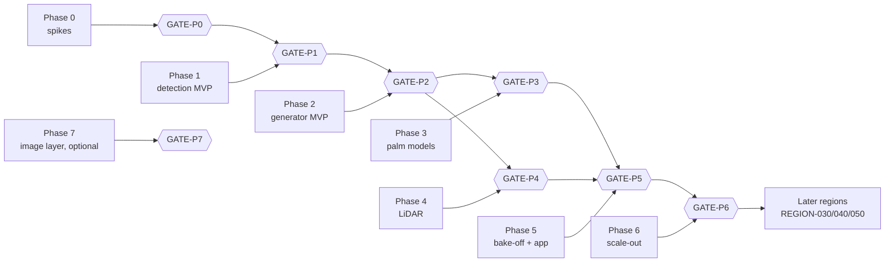
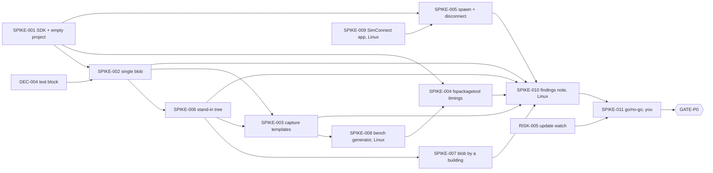

# 05. Development Phases: Detailed Plan

Source: `plans/05-phases.md`. Areas: **SPIKE** (Phase 0), **REGION** (Phase 6), **GATE** (`GATE-P0`..`GATE-P7`), plus the phase view of every other area.
Date: 2026-11-22. Status: plan only. Task counts and hours below come from the task files on this date.

## Summary

- Eight phases, each ending in a gate the user signs off. A gate lists the deliverables and checks it needs in `depends_on`, the exit criteria as checkboxes with targets, an evidence list to fill in, and what to do on fail (from the kill criteria in plan 07).
- Phase 0 is 11 SPIKE tasks: seven sim-PC runbooks for you (SPIKE-001..007), your go/no-go decision (SPIKE-011), and three Linux tasks an agent can do (SPIKE-008 benchmark generator, SPIKE-009 SimConnect app, SPIKE-010 findings note).
- Linux code runs in parallel with Phase 0 (ADR-0013, proposed). Sim work and every phase exit still wait for their gates.
- 213 tasks, about 680 hours in total, against roughly 77-152 hours (plus 5-10 per region) in the original plan. The gap is mostly tests, tooling, runbook prep, placeholders for later regions, and the optional Stage B of Phase 7.
- The real limit is your time on the sim PC and in Blender (about 362 of those hours), not code. Batch sim sessions.
- Phase 3 (models, Blender) and Phase 4 (LiDAR, Linux) can run side by side after GATE-P2: GATE-P4 depends on GATE-P2, not GATE-P3.
- Phase 6 uses one five-task pattern per region. San Diego coastal and LA Westside have concrete tasks; later regions are placeholders that get split when they become ready.

---

## Phase map

Gates and the order they pass in. Hexagons are gates; boxes are phases.



Phase 7 hangs off its own chain (FX-001 → ... → FX-100) and needs only SCAN-100 and the test block from earlier phases.

### Critical path

The longest chain of estimated hours, if every task started the moment its dependencies were done (about 124 h to GATE-P6, about 8 h less if static wins):

```mermaid
flowchart LR
    classDef sim fill:#fde2c8,stroke:#c46a1b
    classDef lin fill:#d7ecf7,stroke:#2b6c94
    A[ARCH-001..009<br/>palmcore]:::lin --> S[SCAN-001..013<br/>palmscan]:::lin
    S --> S100[SCAN-100<br/>Phase 1 run]:::sim
    S100 --> G16[GEN-016/017/100<br/>first builds, margin]:::sim
    G16 --> T104[TEST-104<br/>regression baseline]:::sim
    T104 --> GP2{{GATE-P2}}
    GP2 --> MFP[ASSET-010..016<br/>Mexican fan palm]:::sim
    MFP --> SP[ASSET-020..053<br/>other 4 species]:::sim
    SP --> A100[ASSET-100 + GEN-019]:::sim
    A100 --> L9[LIVE-009<br/>bake-off]:::sim
    L9 --> D7[DEC-007<br/>static or live]:::sim
    D7 --> LV[LIVE-010/011/101<br/>only if live wins]:::lin
    LV --> GP5{{GATE-P5}}
    GP5 --> R[REGION-001..024<br/>two regions]:::sim
    R --> GP6{{GATE-P6}}
```



Blue runs in a Linux container; orange needs the sim PC, Blender or you. Two things make the real path longer than the number above:

- **One sim PC, one person.** Species 2-5 are parallel on paper but you model them one after another (about 45 h more). All orange tasks share your PC.
- **Phase 0 is not on the paper critical path** because Linux code no longer waits for it, but it is the first thing on your queue, and GATE-P1 can't pass without it.

---

## How gates work

- A gate is a task with `kind: gate` and `requires: [human]` (GATE-P4 also needs the sim PC for the beach check). You sign it off; agents only gather evidence.
- `depends_on` holds every deliverable and check the exit criteria need, plus the previous gate. A gate becomes ready when all of them are `done` (or `dropped`, for conditional tasks like LIVE-101).
- Body: exit criteria as checkboxes with the measurable target, an Evidence list with paths to fill in, and an "On fail" section from the kill criteria (`plans/detailed/07-risks-and-open-questions.md#kill-criteria`).
- Pass: `python3 scripts/tasks.py set GATE-Pn done --by user --note "<one line>"`. Fail: follow "On fail", log it, and leave the gate open.
- Risk reviews run after GATE-P0 (RISK-006), GATE-P3 (RISK-007) and GATE-P5 (RISK-008). They depend on their gates, so gates never depend on them.

---

## Phase 0. Feasibility spike

**Goal:** prove one blob can be cut and replaced, by hand, on the current sim update; capture the XML templates; measure command-line builds and SimConnect persistence; decide go or no-go.

**Entry conditions:** none. DEC-004 (the test block) must be decided before SPIKE-002.

**Tasks:**

| ID | Title | Env | h |
|---|---|---|---|
| DEC-004 | Decide: first test block (a San Diego or LA street the user knows well) | You, Linux + net | 2 |
| INFRA-001 | Bootstrap plans, tracking, worktree tooling and specialist agents | Linux | 4 |
| RISK-005 | Set up the sim/SDK update watch and do the first pass on exclusion bugs | Linux + net | 3 |
| RISK-006 | Define the risk review routine and run the first review after Phase 0 | Linux | 2 |
| SPIKE-001 | Install the MSFS 2024 SDK and create an empty Dev Mode scenery project | Sim PC, You | 2 |
| SPIKE-002 | Cut one photogrammetry palm blob with Exclude TIN and the vegetation exclude | Sim PC, You | 2 |
| SPIKE-003 | Capture Scenery Editor XML templates (Exclude TIN polygon, vegetation exclude, scenery object) into palmgen/templates/ | Sim PC, You | 2 |
| SPIKE-004 | Measure fspackagetool command-line builds (1 and 1,000 polygons; behaviour with the sim open) | Sim PC | 2.5 |
| SPIKE-005 | Test SimConnect static SimObject spawn and whether it survives client disconnect | Sim PC | 2 |
| SPIKE-006 | Place one default library tree as a stand-in in the cut hole | Sim PC, You | 1 |
| SPIKE-007 | Cut a palm blob right next to a building and record what happens to the walls | Sim PC, You | 1.5 |
| SPIKE-008 | Write the fspackagetool benchmark project generator (1 and 1,000 polygons, broken and CRLF variants) | Linux | 2 |
| SPIKE-009 | Write the SimConnect spawn-and-disconnect spike console app (C#) | Linux | 2 |
| SPIKE-010 | Write the one-page Phase 0 findings note with screenshots | Linux | 1.5 |
| SPIKE-011 | Write the Phase 0 go/no-go proposal and get the user's decision | You | 1 |
| TEST-006 | Verify a repeatable flight, camera and screenshot method in MSFS 2024 | Sim PC | 2 |
| GATE-P0 | Phase 0 exit gate: one blob cut and replaced, command-line build works | You | 0.5 |

**Spike order** (arrows are `depends_on`):



**Coverage of plan 04's "Phase 0 spike requirements"** (`plans/detailed/04-fs2024-integration.md#phase-0-spike-requirements`):

| Requirement | Task |
|---|---|
| Lowercase-hyphen project name builds | SPIKE-001 (step 8), SPIKE-003 |
| 8 captured files + `CAPTURE_NOTES.md` with every listed item | SPIKE-003 |
| `fspackagetool` path, command line, exit codes (success, broken XML, missing project, sim open) | SPIKE-004 |
| Output listing, BGL mapping, two scene files | SPIKE-004 (with SPIKE-008 `two-files`) |
| Timings 1 / 1,000 in 1 file / 1,000 in 10 files / incremental rebuild, 3 runs | SPIKE-004 (with SPIKE-008 variants) |
| Full success and failure logs, error and warning patterns | SPIKE-004 |
| Sim open behaviour, process names, LF vs CRLF, `-nopause` | SPIKE-004 |
| SimConnect DLLs, default title, bad title, on-ground init, latency, 100 spawns | SPIKE-005 (app from SPIKE-009) |
| Survives clean disconnect, client kill, main menu; remove by old id; scaling; message pump | SPIKE-005 |

**Your sim sessions** (suggested batching; about 11 hours at the PC):

| Session | Tasks | About |
|---|---|---|
| A | SPIKE-001, TEST-006, SPIKE-002, SPIKE-006, SPIKE-007 | 4 h |
| (gap) | SPIKE-003 first, then an agent runs SPIKE-008 on Linux | |
| B | SPIKE-003 | 2 h |
| C | SPIKE-004, SPIKE-005 | 4.5 h |
| Desk | SPIKE-011 decision, GATE-P0 sign-off | 30 min |

SPIKE-009 (the C# app) is ready now for an agent, so session C never waits on it. TEST-006 isn't a gate dependency (plan 06 lists it as recommended), but it belongs in session A because TEST-100 in Phase 1 needs it.

**In parallel:** Linux agents work on ARCH, SCAN, TEST and GEN code from fixtures (see [Parallel tracks](#parallel-tracks)). RISK-005 (network) checks the exclusion bug status before session A.

**Where results go:** one findings note per spike in `docs/findings/SPIKE-00N.md` with screenshots in `docs/findings/SPIKE-00N/`; captured XML in `palmgen/templates/captured/`; the experiment project in `spikes/palmfix-spike/` (TEST-104 rebuilds it after every sim update); benchmark generator in `spikes/fspackagetool-bench/`; SimConnect app in `spikes/simconnect-persist/`; the go/no-go in `tracking/decisions/ADR-0014-phase-0-go-no-go.md`.

**Exit gate:** GATE-P0. One blob removed cleanly; a stand-in tree placed; a command-line build working; ADR-0014 says Go or Go with changes. Fail on K1 pauses the project.

---

## Phase 1. Detection MVP

**Goal:** `palms.geojson` for the test neighbourhood from inventory data, validated and QA-checked.

**Entry conditions:** code tasks can start now (ADR-0013). SCAN-100 needs TEST-100 (sites, which needs TEST-006 and DEC-004) and a region YAML. GATE-P1 needs GATE-P0.

**Tasks:**

| ID | Title | Env | h |
|---|---|---|---|
| ARCH-001 | Scaffold the Python monorepo (pyproject, package layout, lint/test tooling, CI) | Linux | 4 |
| ARCH-002 | Define the palms.geojson JSON Schema and a shared validator | Linux | 6 |
| ARCH-003 | Define the region YAML config schema and loader | Linux | 5 |
| ARCH-004 | Add palmcore logging, path resolution and download-cache helpers | Linux | 3 |
| ARCH-005 | Add palmcore geo helpers (Bbox, distances, UTM, transforms) | Linux | 3 |
| ARCH-006 | Add deterministic UUIDv5 ids and seeded randomness to palmcore | Linux | 2 |
| ARCH-007 | Add the palms.geojson serializer, reader and writer | Linux | 4 |
| ARCH-008 | Write the two example region configs and verify their sources | Linux + net | 2 |
| ARCH-009 | Add shared CLI plumbing and the palmfix utility CLI | Linux | 4 |
| DEC-009 | Decide: building footprint source (OSM, Microsoft, both, or county data) | You, Linux + net | 3 |
| RISK-001 | Audit data source licenses and terms (inventories, OSM, footprints, LiDAR) | Linux + net | 4 |
| RISK-003 | Inventory other palm and tree mods and their coverage for mask_out defaults | Linux + net, You | 3 |
| SCAN-001 | Create palmscan package core: config, cache, HTTP, models, CLI skeleton | Linux | 3 |
| SCAN-002 | Species normalization table, normalizer and palm filter | Linux | 3 |
| SCAN-003 | Source adapter base and geojson_file adapter | Linux | 3 |
| SCAN-004 | ArcGIS REST inventory adapter with paging and cache | Linux | 3 |
| SCAN-005 | Overpass client and OSM tree adapter | Linux | 2 |
| SCAN-006 | Building footprints adapter (OSM, Microsoft file) | Linux | 3 |
| SCAN-007 | Record live source fixtures and confirm source fields | Linux + net | 2 |
| SCAN-008 | Inventory ingest stage and cross-source dedupe | Linux | 3 |
| SCAN-009 | Palm sizes, exclusion radius, building conflict, mask_out | Linux | 3 |
| SCAN-010 | Species priors and deterministic prior sampling | Linux | 2 |
| SCAN-011 | palms.geojson writer, palm IDs and schema validation | Linux | 2 |
| SCAN-012 | QA outputs: qa_summary.md, qa_map.gpkg, qa_rejects.csv | Linux | 3 |
| SCAN-013 | palmscan run pipeline and CLI, end-to-end on fixtures | Linux | 3 |
| SCAN-100 | Deliverable: palmscan run produces validated palms.geojson from inventory data (Phase 1) | Linux + net, You | 2 |
| TEST-001 | Build the shared pytest harness and fixture loaders | Linux | 3 |
| TEST-004 | Add contract conformance tests for palms.geojson | Linux | 3 |
| TEST-005 | Add the test-site registry schema and loader | Linux | 2 |
| TEST-100 | Define test sites T1-T5 (bbox, purpose, region, saved flights, three viewpoints each) | You, Sim PC | 5 |
| GATE-P1 | Phase 1 exit gate: palms.geojson for the test neighbourhood from inventory data | You | 0.5 |

**Test region:** no task owns a separate test-block YAML (plan 02 Q7). Proposal: the Phase 1-5 test region is whichever ARCH-008 region contains the DEC-004 block (`san-diego-coastal` by default, else `la-westside`). Its bbox is a whole region, which palmscan handles fine; the QA count is still done along T1 streets. The Phase 6 REGION tasks for that region then review rather than redo. See [Open questions](#open-questions).

**In parallel:**
- Linux: ARCH-001 first, then ARCH-002..007 and TEST-001 in parallel, then SCAN-001..013 (fixtures only). TEST-004/005 after TEST-001.
- Linux + network: RISK-001, ARCH-008, SCAN-007, and RISK-003 (needs your mod list).
- You: DEC-009 (footprint source, after RISK-001), TEST-100 on the sim PC, the SCAN-100 QA count in QGIS.

**Exit gate:** GATE-P1. At least 90% of visible palms along three inventory streets in T1 have a point within 3 m; contract tests pass; offline rerun is byte-identical.

---

## Phase 2. Generator MVP

**Goal:** `palmgen build --region <test>` makes a working Community package that removes the blobs and places stand-ins.

**Entry conditions:** GEN code can start once ARCH-001 is done; GEN-009 needs SPIKE-003 and GEN-013 needs SPIKE-004. GEN-016 (first Windows build) needs SCAN-100. GATE-P2 needs GATE-P1.

**Tasks:**

| ID | Title | Env | h |
|---|---|---|---|
| GEN-001 | Scaffold palmgen package, CLI surface and data model | Linux | 2 |
| GEN-002 | Deterministic GUIDs and per-palm hashes | Linux | 1 |
| GEN-003 | 0.01 degree tiling and tile naming | Linux | 1 |
| GEN-004 | Load palms, buildings and region config | Linux | 2 |
| GEN-005 | Exclusion circles, merging and simplification | Linux | 3 |
| GEN-006 | Building footprint clipping | Linux | 2 |
| GEN-007 | Mod and airport masks, Overpass airport fetch | Linux | 3 |
| GEN-008 | Template engine and XML writer on fake templates | Linux | 3 |
| GEN-009 | Convert captured scene XML into real templates | Linux | 2 |
| GEN-010 | Project file, PackageDefinitions and version scheme | Linux | 2 |
| GEN-011 | Variant selection, scaling and heading | Linux | 2 |
| GEN-012 | Generate pipeline and golden tests | Linux | 3 |
| GEN-013 | fspackagetool wrapper and output checks | Linux | 3 |
| GEN-014 | build_report.md and build_report.json | Linux | 1 |
| GEN-015 | Wire palmgen build end to end | Linux | 2 |
| GEN-016 | First Windows build and output check calibration | Sim PC | 2 |
| GEN-017 | Dev Mode review and margin tuning | Sim PC, You | 3 |
| GEN-100 | Deliverable: palmgen build produces a working Community region package (Phase 2) | Sim PC, You | 2 |
| RISK-002 | Audit model, texture and tool licenses for palm assets | Linux + net | 4 |
| RISK-004 | Collect airport boundaries and known airport add-ons for default masks | Linux + net | 3 |
| TEST-002 | Add the golden-file comparison helper with an update flag | Linux | 3 |
| TEST-003 | Add geometry assertion helpers for exclusion polygons | Linux | 3 |
| TEST-007 | Capture a baseline no-fix visual run at T1-T5 | Sim PC, You | 3 |
| TEST-015 | Write the post-update regression routine, log and entry scaffolder | Linux | 2 |
| TEST-016 | Build the independent build-output checker and build-time history | Linux | 4 |
| TEST-017 | Write the test runbook and CI wiring notes | Linux | 2 |
| TEST-102 | Visual test protocol tooling: run scaffolder, checklist template, test log | Linux | 4 |
| TEST-104 | Run the post-update regression routine once and record the baseline log entry | Sim PC, You | 3 |
| GATE-P2 | Phase 2 exit gate: generated package removes the test neighbourhood's blobs | You | 0.5 |

**In parallel:**
- Linux: GEN-001..015 on fake templates and a fake runner; TEST-002/003/015/016/017/102. All golden and unit tests run in CI.
- Linux + network: RISK-002 and RISK-004 (do RISK-002 early so DEC-002 is ready for Phase 3).
- Sim PC, in this order: TEST-007 (no-fix baseline, needs TEST-100 and TEST-102), GEN-016, GEN-017 (margin tuning), GEN-100, TEST-104.

**Gap found:** R-02 expects a no-harm check at T5 at this gate, but GEN-100 only covers T1 and T3. See [Open questions](#open-questions).

**Exit gate:** GATE-P2. At least 90% of visible blobs gone at T1; C1, C4, C5 pass at T1 and T3 at all three viewpoints; golden tests and `check_build` pass. K2 and K3 can stop the project here.

---

## Phase 3. Palm asset library

**Goal:** five SoCal species with height variants and LODs, packaged as `palmfix-assets`, replacing the stand-ins.

**Entry conditions:** GATE-P2 (ASSET-010 depends on it). DEC-002 and DEC-008 before the first model. Linux tooling (ASSET-005/006/007) can start any time after ARCH-001.

**Tasks:**

| ID | Title | Env | h |
|---|---|---|---|
| ASSET-001 | Write reference sheets for the 5 SoCal palm species | Linux + net | 5 |
| ASSET-002 | Collect build-vs-license inputs for DEC-002 (palm models) | Linux + net | 3 |
| ASSET-003 | Install and pin Blender and the MSFS 2024 glTF exporter plugin | Blender, Sim PC | 2 |
| ASSET-004 | Smoke-test the asset pipeline end to end with a throwaway model | Blender, Sim PC | 5 |
| ASSET-005 | Asset manifest schema, species spec format, loader and generator (palmcore.assets) | Linux | 5 |
| ASSET-006 | glTF stats and automated asset checks (triangle budgets, heights, alpha mode, textures, naming) | Linux | 5 |
| ASSET-007 | Model XML parsing, GUID cross-check and LOD switch values in the manifest | Linux | 4 |
| ASSET-008 | Implement the asset large-file policy decided in DEC-008 (.gitattributes, assets/README.md) | Linux | 1.5 |
| ASSET-010 | Mexican fan palm: species spec, textures and materials | Blender | 4 |
| ASSET-011 | Mexican fan palm: LOD0 model of the medium variant | Blender | 5 |
| ASSET-012 | Mexican fan palm: LOD0 short and tall variants | Blender | 3 |
| ASSET-013 | Mexican fan palm: LOD1-LOD3 for all three variants | Blender | 4 |
| ASSET-014 | Mexican fan palm: export, create the palmfix-assets package, generate the first manifest | Blender, Sim PC | 4 |
| ASSET-015 | Mexican fan palm: in-sim review (lineup and test neighborhood) | Sim PC, You | 3 |
| ASSET-016 | Mexican fan palm: fix pass, acceptance sign-off and pipeline lessons | Blender, Sim PC, You | 4 |
| ASSET-020 | California fan palm: species spec, textures and materials | Blender | 3 |
| ASSET-021 | California fan palm: LOD0 models for all 2 height variants | Blender | 6 |
| ASSET-022 | California fan palm: LOD1-LOD3, export and automated checks | Blender | 4 |
| ASSET-023 | California fan palm: in-sim acceptance review | Sim PC, You, Blender | 2 |
| ASSET-030 | Canary Island date palm: species spec, textures and materials | Blender | 3 |
| ASSET-031 | Canary Island date palm: LOD0 models for all 3 height variants | Blender | 6 |
| ASSET-032 | Canary Island date palm: LOD1-LOD3, export and automated checks | Blender | 4 |
| ASSET-033 | Canary Island date palm: in-sim acceptance review | Sim PC, You, Blender | 2 |
| ASSET-040 | Queen palm: species spec, textures and materials | Blender | 3 |
| ASSET-041 | Queen palm: LOD0 models for all 2 height variants | Blender | 6 |
| ASSET-042 | Queen palm: LOD1-LOD3, export and automated checks | Blender | 4 |
| ASSET-043 | Queen palm: in-sim acceptance review | Sim PC, You, Blender | 2 |
| ASSET-050 | King palm: species spec, textures and materials | Blender | 3 |
| ASSET-051 | King palm: LOD0 models for all 2 height variants | Blender | 6 |
| ASSET-052 | King palm: LOD1-LOD3, export and automated checks | Blender | 4 |
| ASSET-053 | King palm: in-sim acceptance review | Sim PC, You, Blender | 2 |
| ASSET-100 | Deliverable: palmfix-assets 1.0.0 model library package with GUID/variant manifest | Sim PC | 3 |
| DEC-002 | Decide: build or license the palm models | You | 2 |
| DEC-006 | Decide: scope beyond palms (other blob trees) after Phase 3 | You | 2 |
| DEC-008 | Decide: storage for large asset binaries (Git LFS or external) | You | 1 |
| GEN-019 | Integrate the real model library into region builds | Sim PC, You | 3 |
| RISK-007 | Risk review after Phase 3 (mid-project) | Linux | 2 |
| GATE-P3 | Phase 3 exit gate: five SoCal species accepted and used in the region package | You | 0.5 |

**In parallel:**
- Linux: ASSET-005, ASSET-006, ASSET-007 (manifest, checks, model XML).
- Linux + network: ASSET-001, ASSET-002 (inputs for DEC-002) any time before Phase 3.
- Blender (you): Mexican fan palm first (ASSET-010..016), then the other four. They are independent after ASSET-016, so a second artist or licensed models would shorten this phase.
- Sim PC: species reviews, ASSET-100, GEN-019.
- Phase 4 Linux work runs at the same time (next section).

**Exit gate:** GATE-P3. Each species accepted against the plan 03 checklist; `palmfix-assets` 1.0.0 built; T1 looks right with real models. K4 can stop Phase 3.

---

## Phase 4. LiDAR enrichment

**Goal:** real heights for every palm and the palms the inventories miss (beaches, parks, yards).

**Entry conditions:** LiDAR code (SCAN-020..029) and TEST-009/010 can start after SCAN-001 and TEST-005, long before Phase 4. Labelling (TEST-101, TEST-011) needs TEST-100 and TEST-009. GATE-P4 needs GATE-P2.

**Tasks:**

| ID | Title | Env | h |
|---|---|---|---|
| SCAN-020 | USGS 3DEP EPT LiDAR adapter (PDAL pipeline, tiles, cache) | Linux | 4 |
| SCAN-021 | Record LiDAR fixtures and confirm 3DEP EPT facts | Linux + net | 2 |
| SCAN-022 | Canopy height model (DTM, DSM, CHM) | Linux | 3 |
| SCAN-023 | Peak detection and watershed crown segmentation | Linux | 3 |
| SCAN-024 | Palm rule filter with reject reasons | Linux | 2 |
| SCAN-025 | Inventory-to-LiDAR matching and merge | Linux | 3 |
| SCAN-026 | Species shape rules and classification order | Linux | 2 |
| SCAN-027 | Decision tree species classifier with rules fallback | Linux | 4 |
| SCAN-028 | Wire LiDAR stages into palmscan run, QA and eval | Linux | 4 |
| SCAN-029 | Run the TEST-010 accuracy evaluation from palmscan (in-run QA) | Linux | 2 |
| SCAN-030 | Tune LiDAR palm thresholds on test sites | Linux + net, You | 4 |
| SCAN-101 | Deliverable: LiDAR-enriched palmscan run with heights and LiDAR-only palms (Phase 4) | Linux + net, You | 3 |
| TEST-009 | Define the ground-truth format and write the labeling guide and tooling | Linux | 3 |
| TEST-010 | Build the accuracy metrics script with configurable thresholds | Linux | 4 |
| TEST-011 | Hand-label the false-positive site T4 | You | 2 |
| TEST-012 | Evaluate Phase 4 palmscan output against ground truth at T1, T2 and T4 | Linux + net | 2 |
| TEST-101 | Hand-label ground-truth palms at T1 and T2 (about 200 palms) | You | 6 |
| GATE-P4 | Phase 4 exit gate: LiDAR accuracy targets met and beach site fixed in the sim | You, Sim PC | 2 |

**In parallel:**
- Linux: all of SCAN-020..029, TEST-009, TEST-010. Run alongside Phases 2 and 3.
- Linux + network: SCAN-021 (fixtures), TEST-012 (evaluation).
- You: labelling about 200 palms at T1 and T2 plus T4 (no sim needed, QGIS). Doing T1 early lets GATE-P1 use a measured recall instead of an eyeball count. SCAN-030 tuning and SCAN-101 need your review.
- Sim PC: the T2 beach check inside GATE-P4.

**Exit gate:** GATE-P4. `lidar_only` precision ≥ 0.90 and recall ≥ 0.80 at T1 and T2; median height error < 2 m; T2 beach C1 and C2 pass in the sim. K6 drops LiDAR-only palms if precision stays under 0.80.

---

## Phase 5. Placement bake-off and companion app

**Goal:** decide static vs live placement with measurements, then build the region manager.

**Entry conditions:** GATE-P3 and GATE-P4 for the gate. The bake-off (LIVE-009) needs GEN-019 (real models), ASSET-101 (SimObject wrappers), LIVE-008 (SimConnect adapter) and TEST-103 (perf harness). LIVE Linux code starts after DEC-003 (app language), which needs only SPIKE-005, so you can decide it right after Phase 0 and let LIVE-001..007 run early. DEC-007 (static or live) reads the bake-off report.

**Tasks:**

| ID | Title | Env | h |
|---|---|---|---|
| ASSET-070 | Spike: wrap one palm variant as a SimObject and spawn it via SimConnect | Sim PC | 4 |
| ASSET-071 | SimObject wrapper generator from the manifest (python -m palmcore.assets simobjects) | Linux | 4 |
| ASSET-101 | Deliverable: SimObject wrapper package for every palm variant (only if live spawning is tested) | Sim PC | 3 |
| DEC-003 | Decide: companion app language (C# vs Python SimConnect binding) | You | 2 |
| DEC-005 | Decide: performance budget and reference hardware/settings | You | 1 |
| DEC-007 | Decide: static or live palm placement after the Phase 5 bake-off | You | 2 |
| GEN-018 | Spatial index export (palmgen index) | Linux | 2 |
| LIVE-001 | C# solution skeleton for palmlive | Linux | 2 |
| LIVE-002 | Region catalog from palmfix_build.json | Linux | 2 |
| LIVE-003 | Folder linker, region manager, sim detector and config | Linux | 3 |
| LIVE-004 | Flight plan region picker (optional) | Linux | 2 |
| LIVE-005 | App command router, CLI verbs and region window | Linux | 3 |
| LIVE-006 | SQLite spatial index reader | Linux | 2 |
| LIVE-007 | Spawn manager on fake adapter and flight tracks | Linux | 5 |
| LIVE-008 | SimConnect adapter, spawn and record-track verbs | Sim PC | 4 |
| LIVE-009 | Static vs live placement bake-off | Sim PC, GPU, You | 5 |
| LIVE-010 | Spawn ledger and crash-safe cleanup | Linux | 2 |
| LIVE-011 | Live palms in the app (LiveSession) | Linux | 3 |
| LIVE-012 | Build a region from the app (calls palmscan and palmgen) | Linux, Sim PC | 4 |
| LIVE-100 | Deliverable: palmlive region manager (list, activate, deactivate via folder links) | Sim PC, You | 2 |
| LIVE-101 | Deliverable: palmlive live spawner (only if the Phase 5 bake-off picks live placement) | Sim PC, You | 3 |
| RISK-008 | Risk review after Phase 5 (before scale-out and any publishing) | Linux | 2 |
| TEST-013 | Build the frametime capture parser and run comparison report | Linux | 5 |
| TEST-014 | Build soak-test report tooling for the live spawner | Linux | 3 |
| TEST-103 | Performance flight harness: fixed route, capture procedure, dry-run capture | Sim PC, GPU | 4 |
| GATE-P5 | Phase 5 exit gate: placement method decided with numbers; one-click region switching | You | 0.5 |

**Conditional tasks:** if DEC-007 picks static, LIVE-010, LIVE-011 and LIVE-101 are dropped (about 8 h saved). ASSET-101 stays, because the bake-off itself needs it.

**In parallel:**
- Linux: TEST-013, TEST-014, GEN-018, ASSET-071, LIVE-001..007 and LIVE-010/011.
- You: DEC-003 (app language) soon after Phase 0; DEC-005 (hardware and budget, 5 minutes, any time); DEC-007 after the bake-off.
- Sim PC + GPU: TEST-103, ASSET-070, ASSET-101, LIVE-008, LIVE-009, LIVE-100, LIVE-101 if live.

**Exit gate:** GATE-P5. Written decision with the 3 × 3 measurements within the ADR-0006 budget; one-click region switching with no file copying. K5 reduces scope if both methods are over budget.

---

## Phase 6. Scale-out

**Goal:** full coverage for the target metros, one region at a time, with the same five checks each time.

**Entry conditions:** GATE-P5 and DEC-011 (region list and order, ADR-0012). Decided (ADR-0012): pending. DEC-011 adds a one-line note here when decided.

**Tasks:**

| ID | Title | Env | h |
|---|---|---|---|
| ASSET-060 | Florida species: reference sheets for cabbage, royal, coconut and foxtail palm | Linux + net | 4 |
| ASSET-061 | Cabbage palm: low-detail model, two variants, LODs and export | Blender | 6 |
| ASSET-062 | Royal palm: low-detail model, two variants, LODs and export | Blender | 6 |
| ASSET-063 | Coconut palm: low-detail model, two variants, LODs and export | Blender | 6 |
| ASSET-064 | Foxtail palm: low-detail model, two variants, LODs and export | Blender | 6 |
| ASSET-065 | Florida set: acceptance review in the sim and manifest/package update | Sim PC, You | 4 |
| DEC-001 | Decide: personal use or publish (flightsim.to packages, GitHub tools, or both) | You, Linux + net | 2 |
| DEC-010 | Decide: which derived data ships if publishing (packages, palms.geojson, tools only) | You | 2 |
| DEC-011 | Decide: scale-out region list and order, and whether Florida is in scope | You | 1 |
| REGION-001 | Write the per-region scale-out runbook (commands for each region step) | Linux | 2 |
| REGION-010 | San Diego coastal: finalise the region YAML (bbox, sources, settings, no overlaps) | Linux + net | 1 |
| REGION-011 | San Diego coastal: add mask_out areas for other mods and airports | Linux + net, You | 1 |
| REGION-012 | San Diego coastal: palmscan run, priors and QA review | Linux + net, You | 2 |
| REGION-013 | San Diego coastal: palmgen build and spot checks at three random locations | Sim PC, You | 2.5 |
| REGION-014 | San Diego coastal: performance check over the densest area and region sign-off | Sim PC, GPU, You | 2 |
| REGION-020 | LA Westside and beaches: finalise the region YAML (bbox, sources, settings, no overlaps) | Linux + net | 1 |
| REGION-021 | LA Westside and beaches: add mask_out areas for other mods and airports | Linux + net, You | 1 |
| REGION-022 | LA Westside and beaches: palmscan run, priors and QA review | Linux + net, You | 2 |
| REGION-023 | LA Westside and beaches: palmgen build and spot checks at three random locations | Sim PC, You | 2.5 |
| REGION-024 | LA Westside and beaches: performance check over the densest area and region sign-off | Sim PC, GPU, You | 2 |
| REGION-030 | Rest of LA basin: split into regions and run the per-region pattern (placeholder) | Linux + net, Sim PC, You | 24 |
| REGION-040 | Other SoCal photogrammetry cities: pick cities and run the per-region pattern (placeholder) | Linux + net, Sim PC, You | 16 |
| REGION-050 | Florida regions after the Florida species set exists (placeholder) | Linux + net, Sim PC, You | 16 |
| RISK-009 | Write attribution and credits text for published packages | Linux | 2 |
| TEST-008 | Add optional image-diff scoring for visual viewpoints | Linux | 3 |
| TEST-018 | Calibrate the image-diff noise floor at T1 | Sim PC | 2 |
| GATE-P6 | Phase 6 exit gate: first two regions packaged, checked and within budget | You | 0.5 |

### Per-region task pattern

Every region gets five tasks in its own block of ids (San Diego coastal REGION-010..014, LA Westside REGION-020..024). When a placeholder (REGION-030, 040, 050) is split, each new region takes the next free block of ten (for example REGION-060..064). Commands for each step live in `docs/regions/RUNBOOK.md` (REGION-001).

| Step | Id | What | Env | Touches | About |
|---|---|---|---|---|---|
| 1 Config | REGION-0N0 | bbox, sources re-checked with vintage, tuned exclusion values, no overlap with other regions | Linux + net | `regions/<r>.yaml` | 1 h |
| 2 Masks | REGION-0N1 | `mask_out` for mods you run (RISK-003) and airport add-ons (RISK-004); `palmgen masks airports` | Linux + net, you | `regions/<r>.yaml` | 1 h |
| 3 Scan + QA | REGION-0N2 | `palmscan run`, offline rerun, contract check, `palmscan priors`, QA review and verdict | Linux + net, you | `regions/<r>.yaml`, `tracking/logs/REGION-0N2-qa.md` | 2 h |
| 4 Build + spot checks | REGION-0N3 | `palmgen build`, `check_build`, activate in palmlive, 3 seeded random spots × no-fix/fix × 2 heights | Sim PC, you | `tests/visual/regions/<r>/`, `tracking/logs/REGION-0N3.md` | 2.5 h |
| 5 Perf + sign-off | REGION-0N4 | 5-minute route over the densest 1 km cell, 3 runs no-fix and fix, `tests.perf.compare` | Sim PC, GPU, you | `tests/perf/routes/region-<r>/`, `tests/perf/runs/region-<r>/` | 2 h |

Rules:
- Steps 1-3 of a region run on Linux while the sim PC is busy with another region; step 4 of the next region waits for step 5 of the previous one (REGION-023 depends on REGION-014), so the sim queue stays in order and lessons carry over.
- Regions must not overlap, or must `mask_out` each other (plan 01 Q7).
- The region that served as the Phase 1-5 test region reviews steps 1-3 instead of redoing them.
- A placeholder task (REGION-030, 040, 050) is split into one five-task block per region when it becomes ready, then dropped with the new ids in its note.
- Florida (REGION-050) also needs the Florida species set (ASSET-060..065) and a new SCAN task for Florida genera and aliases.

**Order:** San Diego coastal → LA Westside and beaches → rest of LA basin → other SoCal photogrammetry cities → Florida (only if DEC-011 says so).

**In parallel:** Florida assets (ASSET-060..065, Blender) can run alongside the SoCal regions. TEST-008/018 (image diff) are optional helpers. DEC-001 → DEC-010 → RISK-009 run as one chain with you.

**Exit gate:** GATE-P6. Both first regions pass contract, QA, three spot checks and the perf budget; masks applied; DEC-001 decided (and DEC-010/RISK-009 if publishing). Later regions follow the gate.

---

## Phase 7. Image-layer experiment

**Goal (optional):** test neural erase-and-redraw of blobs offline first (Stage A); only build the real-time add-on (Stage B) on GO.

**Entry conditions:** none formally. FX Linux code (FX-002..005, FX-008..012, FX-014..018) can run any time after ARCH-001. Captures (FX-007) need FX-001, FX-006, DEC-004 and SCAN-100.

**Tasks:**

| ID | Title | Env | h |
|---|---|---|---|
| FX-001 | Verify ReShade depth access in MSFS 2024 (incl. multiplayer/online lockout) | Sim PC, You | 3 |
| FX-002 | Scaffold palmfx.offline package, session I/O and CLI | Linux | 3 |
| FX-003 | Camera model: geodesy, attitude, pinhole projection | Linux | 4 |
| FX-004 | Synthetic test scene generator and pytest fixtures | Linux | 3 |
| FX-005 | ReShade depth-pack effect and depth decoder | Linux | 3 |
| FX-006 | SimConnect pose logger, screenshot trigger and camera SimVar check | Sim PC | 5 |
| FX-007 | Capture procedure and first capture sessions at the test block | Sim PC, You | 5 |
| FX-008 | Ingest, pose interpolation and sample-fixture builder | Linux | 4 |
| FX-009 | Calibration: clicks tool, vfov, time offset, pose bias, depth model | Linux | 4 |
| FX-010 | Mask by projection from palms.geojson | Linux | 4 |
| FX-011 | Mask by depth and colour heuristics | Linux | 4 |
| FX-012 | Mask comparison metrics (pixel IoU, instance precision/recall) | Linux | 2 |
| FX-013 | Hand labels: ground-truth blob masks, correspondences, committed sample fixture | You | 3 |
| FX-014 | Inpainting runner: Telea baseline, LaMa backend, tiling | Linux + net | 4 |
| FX-015 | Temporal stabilisation baselines (flow fill, previous-frame reuse, temporal blending) | Linux | 5 |
| FX-016 | Flicker metric with pseudo-mask baseline | Linux | 3 |
| FX-017 | Palm sprite compositing scaled by depth | Linux | 4 |
| FX-018 | Judging protocol and judge-pack builder | Linux | 3 |
| FX-019 | Full Stage A run on captured sessions | GPU | 5 |
| FX-020 | Judging session (single-frame believability and shimmer) | You | 3 |
| FX-021 | Stage B: ReShade C++ add-on skeleton reading colour and depth tiles | Sim PC | 6 |
| FX-022 | Stage B: GPU tile inference spike (ONNX Runtime DirectML vs TensorRT) | GPU, Linux + net | 6 |
| FX-023 | Stage B: pose helper and shared-memory IPC to the add-on | Sim PC | 5 |
| FX-024 | Stage B: frame-time budget measurement | Sim PC, GPU | 5 |
| FX-025 | Stage B: DLSS, frame generation and DLSS 5 interaction study | Sim PC, GPU, You | 4 |
| FX-100 | Deliverable: Stage A offline image-layer go/no-go report | You | 3 |
| GATE-P7 | Phase 7 exit gate: offline image-layer go/no-go accepted | You | 0.5 |

**In parallel:** almost all of Stage A is Linux code with synthetic fixtures. You: FX-001 (depth check), FX-007 (captures), FX-013 labels, FX-020 judging. Stage B (FX-021..025, about 26 h) only after GO.

**Exit gate:** GATE-P7 accepts the FX-100 verdict. NO-GO is a valid outcome (K8): Stage B is dropped and the scenery fix stays the answer.

---

## Revised effort table

Summed `estimate_h` from the task files on 2026-11-22 (all statuses except `dropped`). "Your envs" means tasks needing the sim PC, Blender, a GPU or you. Recompute with:

```bash
python3 -c "import sys; sys.path.insert(0,'scripts'); import tasks as T; from collections import Counter; c=Counter(); [c.update({t.meta['phase']: float(t.meta.get('estimate_h') or 0)}) for t in T.load_all().values() if t.meta.get('status')!='dropped']; print(sorted(c.items()))"
```

| Phase | Original (h) | Revised (h) | Tasks | Your envs (h) | Main reason for the difference |
|---|---|---|---|---|---|
| 0 | 6-10 | 33 | 17 | 18.5 | Spikes split into measurable runbooks; two Linux helpers; write-ups; DEC-004, RISK-005/006, TEST-006, INFRA-001 |
| 1 | 8-15 | 93.5 | 31 | 13.5 | palmcore foundation (ARCH) and test harness were not in the original |
| 2 | 8-12 | 70.5 | 29 | 13.5 | Golden tests, build checker, visual tooling and regression baseline |
| 3 | 20-40 | 131 | 38 | 105.5 | 5 species x variants x LODs, Python asset checks, reviews |
| 4 | 10-20 | 55 | 18 | 17 | LiDAR chain with tests, hand labels, evaluation, T2 check |
| 5 | 10-25 | 74.5 | 26 | 34.5 | LIVE C# app, perf harness, SimObject wrappers; ~8 h drops if static wins |
| 6 | 5-10 per region | 119.5 | 27 | 106.5 | Two concrete regions ~17 h; placeholders 56 h; Florida assets 32 h |
| 7 | 10-20 | 103.5 | 27 | 53.5 | Stage B (26 h) only on GO; Stage A ~77 h |
| **All** | **about 77-152 + regions** | **680.5** | **213** | **362.5** | |

Why the numbers grew:
- **Tests and tooling are now explicit.** Each area has unit tests, fixtures, golden files and a test harness (TEST area alone is about 70 h across phases).
- **Phase 0:** runbooks are split into measurable spikes (3 runs per timing, failure cases, disconnect and crash cases), plus two Linux helper tasks and the findings and decision write-ups. Your sim time is about 11 h, close to the original 6-10 h.
- **Phase 1 and 2:** the shared `palmcore` foundation (ARCH, about 33 h) wasn't in the original estimate.
- **Phase 3:** five species × (spec, three variants, LODs, export, review) plus Python asset checks. Licensing models instead would cut most of the Blender hours (DEC-002).
- **Phase 5:** includes conditional live-spawner work (about 8 h dropped if static wins) and the SimObject wrappers.
- **Phase 6:** includes the Florida species (32 h) and three region placeholders (56 h) that the original counted as "5-10 per region, later". The first two regions are about 17 h, within the original range.
- **Phase 7:** includes Stage B (26 h) which only runs on GO.
- Estimates are still rough. Treat a phase running more than 50% over as the R-20 early warning.

---

## Parallel tracks

### What Linux agents do while you run Phase 0

Policy (ADR-0013, proposed): tasks with `requires: [none]` or `[network]` may start now. Anything needing the sim, and every phase exit, waits for its gate and the SPIKE outputs. If Phase 0 is a no-go, that code is parked, not thrown away.

Ready now or soon, in a sensible order:

1. **SPIKE-009** (C# SimConnect app) and **ARCH-001** (scaffold): ready now.
2. **RISK-005** (update watch, exclusion bug status): ready now; needed before your session A.
3. **RISK-001, RISK-002, RISK-004, ASSET-001, ASSET-002**: network research, ready now.
4. After ARCH-001: ARCH-002..007, TEST-001, then SCAN-001..013, TEST-002..005, TEST-015, GEN-001..008, GEN-010..012, GEN-014, ASSET-005..007, FX-002..005.
5. After ARCH-003: ARCH-008 (region YAMLs, network).
6. After SPIKE-003: **SPIKE-008** (benchmark generator), GEN-009. After SPIKE-004: GEN-013, TEST-016.
7. After all spikes: **SPIKE-010** (findings note).

`python3 scripts/tasks.py batch --requires none,network --max 4` gives a conflict-free set at any moment.

### Your queue

Tasks that need the sim PC, Blender, a GPU or you, in recommended order. Items on the same line can be one sitting.

1. **Now, no sim:** DEC-004 (pick the test block), RISK-003 (tell us which mods you run), DEC-005 hardware facts (5 minutes).
2. **Sim session A:** SPIKE-001, TEST-006, SPIKE-002, SPIKE-006, SPIKE-007.
3. **Sim session B:** SPIKE-003.
4. **Sim session C:** SPIKE-004, SPIKE-005.
5. **Desk:** SPIKE-011 (go/no-go), GATE-P0.
6. **Phase 1:** DEC-009 (footprints), TEST-100 (sites, sim), SCAN-100 QA count, GATE-P1. If you have time, TEST-101 T1 labels now.
7. **Phase 2 sim:** TEST-007, GEN-016, GEN-017, GEN-100, TEST-104, then GATE-P2.
8. **Before Phase 3:** DEC-002 + DEC-008 (one conversation), ASSET-008.
9. **Phase 3 Blender/sim:** ASSET-003, ASSET-004, ASSET-010..016, then species 2-5 (ASSET-020..053), ASSET-100, GEN-019, DEC-006, GATE-P3.
10. **Phase 4, interleaved with 9:** TEST-101, TEST-011 (labels), SCAN-030, SCAN-101, GATE-P4 (T2 beach check on the sim PC).
11. **Phase 5:** DEC-003 (can be right after Phase 0), TEST-103, ASSET-070, ASSET-101, LIVE-008, LIVE-009, DEC-007, LIVE-100, LIVE-101 (if live), GATE-P5.
12. **Phase 6:** DEC-011, then per region steps 2-5 (REGION-011..014, REGION-021..024), DEC-001 → DEC-010, GATE-P6.
13. **Phase 7 (optional):** FX-001, FX-006, FX-007, FX-013, FX-020, FX-100, GATE-P7.

`python3 scripts/tasks.py list --needs windows-sim,blender,gpu,human --status todo` shows the live version.

---

## Decision points

| When | Decision | Task | ADR | Gate that needs it | Default if unclear |
|---|---|---|---|---|---|
| Before SPIKE-002 | First test block | DEC-004 | ADR-0005 | GATE-P0 | Palm-lined City of San Diego street in the `san-diego-coastal` bbox |
| After Phase 0 | Go / no-go on Exclude TIN | SPIKE-011 | ADR-0014 | GATE-P0 | Stop and file a bug report if exclusions don't work (K1) |
| Now (proposed) | Linux code in parallel with Phase 0 | INFRA-001 | ADR-0013 | (all) | Parallel code, gated integration |
| Before SCAN-100 | Building footprint source | DEC-009 | ADR-0010 | GATE-P1 | OSM |
| Start of Phase 3 | Build vs license models | DEC-002 | ADR-0003 | GATE-P3 | Build one species first, then decide |
| Before the first binary commit | Asset binary storage | DEC-008 | ADR-0009 | GATE-P3 | Git LFS |
| After ASSET-100 | Scope beyond palms | DEC-006 | ADR-0007 | GATE-P4 | Palms only |
| Before TEST-103 | Performance budget and hardware | DEC-005 | ADR-0006 | GATE-P5 | +5% frametime, no added stutter |
| After the bake-off | Static vs live placement | DEC-007 | ADR-0008 | GATE-P5 | Static |
| After SPIKE-005 | Companion app language | DEC-003 | ADR-0004 | GATE-P5 | C# .NET 8 |
| Start of Phase 6 | Regions, order, Florida | DEC-011 | ADR-0012 | GATE-P6 | Plan order, Florida deferred |
| Phase 6 | Publish or keep personal | DEC-001 | ADR-0002 | GATE-P6 | Personal until licenses are checked |
| If publishing | Which derived data ships | DEC-010 | ADR-0011 | GATE-P6 | Packages only where terms are clear |
| After Stage A | Image-layer GO / NO-GO | FX-100 | (report) | GATE-P7 | Fixed criteria C0-C4 |

---

## Open questions

1. **Test region (plan 02 Q7).** OK to use the ARCH-008 region that contains your test block (whole `san-diego-coastal` or `la-westside`) as the Phase 1-5 test region, instead of a separate small test-block YAML? It avoids overlapping regions later. If you prefer a small one, a REGION task for it is needed before SCAN-100.
2. **Viewpoint height.** Plan 03 and the Phase 3 exit use 600 m; the visual protocol uses 500 m (VP3). GATE-P3 accepts 500 m at T1 if the 600 m lineup shots pass. Agree, or add a 600 m viewpoint?
3. **T5 no-harm check.** R-02 expects T5 at GATE-P2, but no Phase 2 task runs the fix at T5. Add T5 to GEN-100, or accept T1/T3 only?
4. **Phase 3 and 4 in parallel.** GATE-P4 depends on GATE-P2, not GATE-P3, so LiDAR work and its gate don't wait for the models. OK?
5. **SimConnect spike size.** The plan says "50 lines"; covering every SPIKE-005 question takes about 150. Fine?
6. **Repo visibility.** Screenshots of the test block go into `docs/findings/`. If the repo may become public, pick a block that doesn't reveal your home (DEC-004 already says this).
7. **Later regions.** Is the placeholder scope right (about three LA basin sub-regions, two other SoCal cities, two Florida regions)? DEC-011 settles it.

---

## Recap

- Phase 0 is seven short sim runbooks for you plus three Linux helpers, ending in your go/no-go (ADR-0014) and GATE-P0.
- Every gate lists its deliverables in `depends_on`, measurable exit criteria, evidence to fill in, and the kill-criterion action on fail.
- Linux agents keep coding during Phase 0; your sim PC and Blender time is the real schedule.
- Phase 3 and 4 overlap; Phase 5 decides static vs live with numbers; Phase 6 repeats a five-step pattern per region.
- About 680 h on paper, of which about 362 h need you or your PC. Licensing models and dropping Stage B are the biggest levers.
