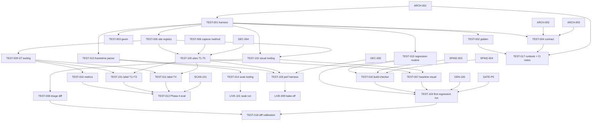

# 06. Testing: detailed plan

Source: `plans/06-testing.md`. Area: TEST. Agent: `test-engineer`.
Date: 2026-11-21. Status: plan only.

## Summary

- TEST owns the **shared harness** (`tests/conftest.py`, `tests/helpers/`) and the **cross-cutting layers**: contract conformance, data accuracy, build-output checks, in-sim visual, performance, soak and post-update regression. Area owners write their own module unit tests on top of the harness.
- Every procedure that needs the sim, a GPU or a human is split from the tooling it uses. Tooling tasks are `requires: [none]` and can be done by any Linux agent now.
- All targets from `plans/06-testing.md` become explicit, configurable thresholds in YAML files next to the code that checks them (`tests/accuracy/thresholds.yaml`, `tests/perf/perf_config.yaml`, `tests/perf/soak_config.yaml`, `tests/visual/diff_thresholds.yaml`).
- Unknown tool facts (MSFS 2024 flight saving and camera presets, PresentMon/CapFrameX columns, `fspackagetool` output layout) are marked `VERIFY:` and each one is owned by a task.
- 23 tasks: 5 anchors (TEST-100..104) and 18 ordinary tasks (TEST-001..018).
- Aligned with the parallel breakdowns: ARCH's `palmcore.contract` validator and pytest-socket guard, GEN's `build_report.json`, LIVE-009 (bake-off) and LIVE-101 (soak run) use the TEST harnesses and write to `tests/perf/bakeoff/` and `tests/perf/soak/`.

---

## Scope and interfaces

### Directory layout

The repo root plays the role of `palmfix/`. TEST owns everything below marked `(TEST)`.

```
tests/
  __init__.py                 (TEST) makes `tests` importable for `python -m tests.<layer>.<tool>`
  conftest.py                 (TEST) markers, CLI flags, network guard, shared fixtures
  README.md                   (TEST) how to run each layer; CI wiring notes
  helpers/                    (TEST) importable as tests.helpers
    __init__.py
    fixtures.py               fixture loaders
    golden.py                 golden-file comparison with update flag
    geom.py                   geometry assertions (validity, closure, radius, clipping)
    contract.py               palms.geojson schema + invariant checks
    sites.py                  test-site registry loader
    build_checks.py           build-output checks (BGL per tile, counts)
  sites/                      (TEST) test-site registry, shared by all layers
    sites.yaml
    sites.schema.json
    <site>/flights/           saved flights / position presets (format: VERIFY, TEST-006)
  unit/<package>/test_*.py    area owners; TEST writes tests/unit/{helpers,contract,accuracy,visual,perf,regression}/
  fixtures/<package>/         recorded fixtures; area owners record their own
  golden/<case>/              golden XML; GEN owns the cases, TEST owns the helper
  accuracy/                   (TEST) ground truth + metrics
    ground_truth.schema.json
    thresholds.yaml
    LABELING.md
    gt.py  metrics.py
    <site>/ground_truth.geojson  <site>/labeled_area.geojson  <site>/meta.yaml  <site>/results/
  visual/                     (TEST) visual protocol
    PROTOCOL.md  checklist_template.md  test_log.md  graphics_profile.yaml  .gitignore
    new_run.py  check_run.py  diff_score.py  diff_thresholds.yaml
    <site>/<date>[_<label>]/
  perf/                       (TEST) frametime harness and soak test
    PROCEDURE.md  SOAK.md  perf_config.yaml  soak_config.yaml  .gitignore
    frametimes.py  compare.py  soak.py
    routes/  runs/<date>_<label>/     dry runs, regression R4, scale-out checks (TEST)
    bakeoff/<date>/                  Phase 5 bake-off runs (LIVE-009, same run format)
    soak/<date>/                     live-spawner soak runs (LIVE-101)
  regression/                 (TEST) post-update routine
    ROUTINE.md  LOG.md  build_history.csv
    new_entry.py  check_build.py
    runs/<date>/notes.md
```

Findings from sim runs go to `docs/findings/<TASK-ID>.md` (repo convention, `docs/findings/README.md`). ASSET review lineups use `tests/visual/lineup-<species>/` (ASSET-owned); the visual tools only touch `tests/visual/T<n>/`.

### Pytest configuration requested from ARCH-001

TEST does not edit `pyproject.toml`. ARCH-001 is asked to include:

```toml
[tool.pytest.ini_options]
testpaths = ["tests"]
pythonpath = ["."]                       # so `import tests.helpers` and `python -m tests.x` work
addopts = ["--import-mode=importlib", "-ra"]   # allows duplicate test_*.py basenames across packages
```

`plans/detailed/01-architecture.md` already plans these, plus `--disable-socket` (pytest-socket). TEST keeps that and adds only marker handling in `conftest.py` (below).

Test dependencies needed by TEST code (dev extra): `pytest`, `jsonschema`, `pyyaml`, `numpy`, `scipy`, `shapely`, `pyproj`, `lxml`, `pillow`, `scikit-image`. Markers and CLI flags are registered in `tests/conftest.py`, not in pyproject, so TEST never needs to touch it.

### Pytest markers and flags

| Marker / flag | Meaning | Default |
|---|---|---|
| `@pytest.mark.network` | test makes live network calls | skipped unless `--run-network` |
| `@pytest.mark.sim` | needs Windows + MSFS 2024 + SDK | skipped unless `--run-sim` (and skipped on non-Windows even then) |
| `@pytest.mark.slow` | > 10 s | runs; deselect with `-m "not slow"` |
| `--update-golden` (or env `PALMFIX_UPDATE_GOLDEN=1`) | rewrite golden files instead of comparing | off; refused when env `CI` is set |

Network guard: ARCH-001 sets pytest-socket `--disable-socket`. `conftest.py` adds `pytest.mark.enable_socket` to every item marked `network`, so authors only write `@pytest.mark.network`. Fallback if pytest-socket is dropped (ARCH Q5): an autouse fixture patches `socket.socket.connect` for non-loopback AF_INET/AF_INET6 and raises `RuntimeError("network disabled in tests: use tests/fixtures or mark @pytest.mark.network")`.

### Helper API

Exact signatures. Area owners code against these.

```python
# tests/helpers/fixtures.py
REPO_ROOT: Path; FIXTURES_ROOT: Path            # <repo>/tests/fixtures
def fixture_path(package: str, name: str) -> Path        # raises FileNotFoundError naming the expected path
def load_text(package: str, name: str, encoding: str = "utf-8") -> str
def load_bytes(package: str, name: str) -> bytes
def load_json(package: str, name: str) -> Any
def load_yaml(package: str, name: str) -> Any
def load_geojson(package: str, name: str) -> dict         # asserts type is Feature or FeatureCollection
def copy_fixture_tree(package: str, name: str, dest: Path) -> Path   # copies a fixture dir into dest; returns new path

# tests/conftest.py fixtures
repo_root -> Path; fixtures_root -> Path; golden_root -> Path
golden -> GoldenChecker   # .check(actual, case, relpath, normalize=None); .check_dir(actual_dir, case, pattern="**/*")

# tests/helpers/golden.py
GOLDEN_ROOT: Path                                  # <repo>/tests/golden
def normalize_newlines(text: str) -> str           # CRLF/CR -> LF; ensures one trailing LF
def assert_golden(actual: str | bytes, case: str, relpath: str, *, update: bool | None = None,
                  normalize: Callable[[str], str] | None = normalize_newlines, root: Path = GOLDEN_ROOT) -> None
def assert_golden_dir(actual_dir: Path, case: str, *, pattern: str = "**/*", update: bool | None = None,
                      normalize: Callable[[str], str] | None = normalize_newlines, root: Path = GOLDEN_ROOT) -> None
class GoldenMismatch(AssertionError)               # message: path + unified diff, max 200 lines

# tests/helpers/geom.py   (inputs are shapely geometries in EPSG:4326 lon/lat unless stated)
def distance_m(a: tuple[float, float], b: tuple[float, float]) -> float      # WGS84 geodesic (pyproj.Geod)
def to_local_m(geom, origin: tuple[float, float]) -> BaseGeometry            # aeqd projection centred on origin
def assert_valid_polygon(geom, *, allow_multi: bool = True, min_area_m2: float = 0.01) -> None
def assert_ring_closed(ring) -> None
def assert_circle_like(poly, center: tuple[float, float], radius_m: float, sides: int, rel_tol: float = 0.02) -> None
def assert_radius_within(poly, center: tuple[float, float], r_min_m: float, r_max_m: float) -> None
def assert_disjoint_from(poly, others, *, tol_m2: float = 0.01) -> None     # building-clip check
def assert_points_close(a: tuple[float, float], b: tuple[float, float], tol_m: float) -> None

# tests/helpers/contract.py
def validate_palms(fc: dict) -> list[str]                      # wraps palmcore.contract.validate_palms (ARCH-002), returns error strings
def check_palms_invariants(fc: dict, *, region: dict | None = None) -> list[str]
def assert_palms_ok(path_or_fc: Path | dict, *, region: dict | Path | None = None) -> None
# CLI: python -m tests.helpers.contract <palms.geojson> [--region regions/<r>.yaml]   exit 0 ok / 1 errors

# tests/helpers/sites.py
@dataclass(frozen=True) class Viewpoint: id: str; kind: str; lat: float; lon: float; alt_m_agl: float; heading_deg: float; pitch_deg: float; preset: str | None
@dataclass(frozen=True) class Site: id: str; name: str; status: str; purpose: str; region: str; bbox: tuple[float, float, float, float]; photogrammetry: bool; inventory_coverage: bool; flight: str | None; viewpoints: tuple[Viewpoint, ...]
SITES_FILE: Path                                   # tests/sites/sites.yaml
def load_sites(path: Path = SITES_FILE) -> dict[str, Site]    # validates against sites.schema.json
def get_site(site_id: str, path: Path = SITES_FILE) -> Site

# tests/helpers/build_checks.py
@dataclass class BuildCheckResult: ok: bool; errors: list[str]; tiles: int; bgls: int; polygons: int; objects: int; build_time_s: float | None
def count_tile_elements(tile_xml: Path) -> tuple[int, int]     # (polygons, objects); element names from SPIKE-003 templates
def check_build(build_dir: Path, palms: dict | None = None, *, expect_objects: bool = True) -> BuildCheckResult
# reads GEN's build_report.json (plans/detailed/04-fs2024-integration.md#build-report-fields) but recounts from the files
```

### Site registry format

`tests/sites/sites.yaml`, validated by `tests/sites/sites.schema.json`:

```yaml
version: 1
sites:
  T1:
    name: "<street name, city>"
    status: defined              # placeholder (skeleton) | defined (TEST-100 filled it)
    purpose: happy_path          # happy_path | lidar_only | building_clip | false_positive | no_harm
    description: "Palm-lined street with inventory coverage"
    region: san-diego-coastal    # name of regions/<region>.yaml (REGION area owns the file)
    bbox: [-117.2560, 32.7870, -117.2500, 32.7920]   # lon_min, lat_min, lon_max, lat_max; 200 m to 1 km a side
    photogrammetry: true
    inventory_coverage: true
    ground_truth: true           # has tests/accuracy/T1/
    flight: tests/sites/T1/flights/<file>   # VERIFY format (TEST-006); null until TEST-100 saves it
    time_local: "12:00"
    weather: clear
    viewpoints:
      - {id: VP1, kind: street,   lat: 0, lon: 0, alt_m_agl: 2,   heading_deg: 0, pitch_deg: 0,   preset: null}
      - {id: VP2, kind: oblique,  lat: 0, lon: 0, alt_m_agl: 150, heading_deg: 0, pitch_deg: -30, preset: null}
      - {id: VP3, kind: approach, lat: 0, lon: 0, alt_m_agl: 600, heading_deg: 0, pitch_deg: -15, preset: null}
```

Rules: exactly VP1 (street, about 2 m), VP2 (oblique, about 150 m), VP3 (approach, about 600 m) per site. These are the project's three standard viewpoints (street level, low oblique, approach), shared with the asset acceptance checks and Phase 3 exit criteria. `preset` records how to reach the viewpoint reproducibly (camera slot, SimConnect teleport file, etc., per TEST-006 findings). Site purposes:

| Site | Purpose | Notes |
|---|---|---|
| T1 | happy_path | palm-lined street with inventory coverage; normally the DEC-004 block |
| T2 | lidar_only | beach or boardwalk, no inventory (for example Mission Beach or Venice) |
| T3 | building_clip | palms within 3 m of building walls |
| T4 | false_positive | Italian cypress, eucalyptus, light poles, few palms |
| T5 | no_harm | outside photogrammetry coverage, but inside a region bbox so the package does apply there |

### Ground truth format

Per site under `tests/accuracy/<site>/`:

- `ground_truth.geojson`: FeatureCollection of Points, EPSG:4326, one per palm. Validated by `tests/accuracy/ground_truth.schema.json`.
- `labeled_area.geojson`: one Polygon (EPSG:4326): exactly the area that was swept. Metrics ignore everything outside it.
- `meta.yaml`: `site`, `imagery: {source, date, resolution_m}`, `labelers`, `labeled_on`, `notes`, optional `thresholds:` overrides.
- `results/<date>_<label>.json|.md|_errors.geojson`: metric outputs (committed).

Feature properties:

| Property | Type | Values / meaning |
|---|---|---|
| `gt_id` | string, required | `<site>-gt-0001`, unique |
| `height_class` | enum, required | `S` (< 8 m), `M` (8 to < 15), `T` (15 to < 25), `X` (≥ 25), `unknown` |
| `height_ref_m` | number or null | CHM max within 1.5 m of the point (filled by `gt.py fill-heights`), else null |
| `species` | string, required | internal species key (`washingtonia_robusta`, ...) or `unknown` |
| `species_basis` | enum, required | `inventory`, `streetview`, `imagery`, `unknown` |
| `context` | enum, required | `street`, `beach`, `park`, `yard`, `parking`, `other` |
| `confidence` | enum, required | `high`, `low` (low = maybe a palm; not counted as a miss) |
| `note` | string, optional | free text |

Point placement rule: crown centre as seen in the orthoimage.

### Visual run format

```
tests/visual/<site>/<YYYY-MM-DD>[_<label>]/
  run.yaml          site, date, label, tester, sim_version, sdk_version, packages {region, assets}, graphics_profile, deviations, time_local, weather, variants
  checklist.md      copy of checklist_template.md, filled in
  raw/<variant>/    original screenshots, any names, gitignored (tests/visual/.gitignore: */*/raw/)
  <variant>/VP1_street.jpg  VP2_oblique.jpg  VP3_approach.jpg    committed, JPEG q90, max 2560 px wide
  diff/             optional, from diff_score.py
```

Variants: `nofix`, `static`, `live`. Default `nofix,static`. `tests/visual/graphics_profile.yaml` holds the reference graphics settings (named profiles, for example `ref-v1`); `run.yaml` names the profile and lists any deviations. `tests/visual/test_log.md` is one append-only table:

| Date | Site | Label | Variants | Sim version | Region pkg | Result | Run folder |
|---|---|---|---|---|---|---|---|

Result is `pending`, `pass` or `fail`, written by `check_run.py --update-log`.

Checklist (`checklist_template.md`): a table, rows C1..C8, columns VP1, VP2, VP3; each cell `pass`, `fail` or `na`; plus a Notes section.

| Id | Check |
|---|---|
| C1 | Blobs gone |
| C2 | A palm at every former blob, believable height |
| C3 | No floating or sunken palm bases |
| C4 | No building walls cut or missing |
| C5 | No autogen trees in the holes |
| C6 | Ground under cuts acceptable (no obvious hole edges or colour seams) |
| C7 | LOD transitions don't pop distractingly on a slow pass |
| C8 | Species look right for the area |

Run passes when no cell is `fail` and no cell is blank. Before Phase 3, C8 is `na` (stand-in trees).

### Perf capture format

```
tests/perf/runs/<YYYY-MM-DD>_<label>/     (or tests/perf/bakeoff/<YYYY-MM-DD>/ for LIVE-009)
  run.yaml          hardware {cpu, gpu, ram, driver}, graphics_profile, sim_version, route, aircraft, capture_tool + version, packages, variants, reps
  captures/<variant>_r<n>.csv      raw frametime captures, gitignored (tests/perf/.gitignore: `**/captures/`, `**/raw/`)
  metrics.json      per-capture metrics (committed)
  report.md, report.json           comparison (committed)
```

`<variant>` is `nofix`, `static` or `live`; `<n>` is 1..3.

### Soak telemetry format

Requested from LIVE (`palmlive` live spawner, LIVE-101). JSON Lines, one object per line:

```json
{"t": "2027-03-01T14:00:01.250Z", "event": "tick", "live": 812, "cap": 2000, "spawned_total": 950, "removed_total": 138, "pending_create": 3, "agl_m": 210.5, "radius_m": 2300.0, "proc_private_mb": 182.4}
{"t": "...", "event": "shutdown_begin"}
{"t": "...", "event": "shutdown_complete", "live": 0}
{"t": "...", "event": "audit", "palm_objects_found": 0}
```

`audit` comes from an independent post-shutdown check (method: VERIFY, TEST-014 with LIVE-101). If LIVE emits a different format, `tests/perf/soak.py` gets an adapter; the field meanings stay.

### Regression log format

`tests/regression/LOG.md`, one row per sim or SDK update:

| Date | Trigger | Sim version | SDK version | R1 single blob | R2 rebuild | R3 visual T1 | R3 visual T3 | R4 full suite | Result | Notes |
|---|---|---|---|---|---|---|---|---|---|---|

Cells: `pass`, `fail`, `skip`, `pending`. Trigger: `SU`, `hotfix`, `beta`, `SDK`. Notes links to `tests/regression/runs/<date>/notes.md`. `tests/regression/build_history.csv` columns: `date,region,sdk_version,tiles,bgls,polygons,objects,build_time_s,ok`.

---

## Work breakdown

### Unit harness

TEST-001 builds `tests/__init__.py`, `tests/conftest.py`, `tests/helpers/__init__.py`, `tests/helpers/fixtures.py`, with self-tests in `tests/unit/helpers/`.

Fixture policy for area owners:
- Recorded responses live in `tests/fixtures/<package>/`, named after the source and query, e.g. `tests/fixtures/palmscan/arcgis_sd_trees_page1.json`.
- Keep each fixture under 1 MB. Trim records rather than commit a full download.
- Every fixture dir has a short `SOURCES.md` line per file: URL, date fetched, license note.
- No test makes a live call unless it is marked `network`; the guard enforces it.

### Golden files

TEST-002. Plan rule: generated XML for a fixed input must match a saved file **exactly**.

- Comparison is byte-exact after `normalize_newlines` (so Git CRLF conversion on Windows can't cause false failures). Pass `normalize=None` for raw bytes.
- `assert_golden_dir` compares a whole output tree: missing, extra and differing files are all reported in one failure.
- Update: `pytest --update-golden` (or `PALMFIX_UPDATE_GOLDEN=1`) writes the actual output to `tests/golden/<case>/<relpath>` and the test passes with a `GoldenUpdated` warning. Refused when env `CI` is set.
- Missing golden file and no update flag: fail with "golden file missing: <path>; run pytest --update-golden to create it, then review the diff".
- Review rule: a golden update is committed in its own commit with subject `test(<ID>): update golden <case>` so reviewers see it.

Case layout (GEN owns cases): `tests/golden/<case>/input/palms.geojson`, `input/region.yaml`, `expected/...` mirroring the generator output tree.

### Geometry helpers

TEST-003. Definitions for the plan's geometry checks:

- **Valid and closed:** `geom.is_valid` (message includes `shapely.validation.explain_validity`), not empty, every ring has `coords[0] == coords[-1]`, area in local metres ≥ `min_area_m2`.
- **Circle-like** (12-sided circle, radius r): ring has `sides + 1` coordinates; every vertex distance d from the centre satisfies `r·cos(π/sides)·(1 − rel_tol) ≤ d ≤ r/cos(π/sides)·(1 + rel_tol)`. This accepts inscribed or circumscribed polygons, whichever GEN chooses.
- **Radius within bounds:** max vertex distance ≤ `r_max_m` and min ≥ `r_min_m`.
- **Building clip:** `to_local_m(poly ∩ building).area ≤ tol_m2` for every building, and the clipped result passes `assert_valid_polygon` (never invalid, never empty).
- Distances use `pyproj.Geod(ellps="WGS84")`; areas use an azimuthal equidistant projection centred on the geometry.

### Contract conformance

TEST-004. Two levels:

1. **Schema:** every `palms.geojson` validates with `palmcore.contract.validate_palms` (ARCH-002) against `schemas/palms.geojson.schema.json`. Region files are already covered by ARCH's own test; TEST loads regions only through `palmcore.config.load_region` (ARCH-003) for the invariants below.
2. **Invariants** (`check_palms_invariants`), beyond what JSON Schema can say:
   - `palm_id` unique within the file.
   - Every feature's `region` equals the region config's `region` (when given) and is the same across the file.
   - Every point lies inside the region `bbox` (when given).
   - `exclusion_radius_m ≥ crown_diam_m / 2` and `> 0`; with a region given, `exclusion_radius_m == clamp(crown_diam_m/2 + exclusion.margin_m, exclusion.radius_min_m, exclusion.radius_max_m)` ± 0.01 m (formula and defaults from ARCH-003/SCAN, resolved 2026-11-22).
   - `height_m > 0`; `species_confidence` in [0, 1].
   - `detected_by` consistent with `height_source`: `height_source == "lidar"` implies `detected_by` contains `lidar`.

Test sources: hand-written fixtures in `tests/fixtures/contract/` (one valid, one invalid per rule; the valid one may start as a copy of `tests/fixtures/palmcore/palms_io/sample_10.geojson`, never edited in place), and any local palmscan output at the canonical `build/scan/<region>/palms.geojson` (parametrized; skipped when none exist).

### Data accuracy

TEST-009 (ground-truth tooling), TEST-010 (metrics), TEST-101 and TEST-011 (labeling), TEST-012 (Phase 4 evaluation). TEST-010 is the single implementation of the metrics and the one that gates Phase 4; palmscan's in-run accuracy (SCAN-029) imports `tests.accuracy.metrics` rather than reimplementing it, and its height classes are the ones defined here.

#### Matching algorithm

Input: predictions P (a `palms.geojson`), ground truth G (`ground_truth.geojson`), area A (`labeled_area.geojson`), match radius R (default 3.0 m, configurable; 2.0 to 3.0 is the sensible range).

1. Keep predictions inside A. Keep G as is (the validator requires every G point inside A).
2. Apply the profile's prediction filter (`detected_by` values) and ground-truth filter (`context` values).
3. Project P and G to an azimuthal equidistant CRS centred on A's centroid (metres).
4. Build the distance matrix D (|P| × |G|). Set entries with `D > R` to a large constant (1e9).
5. Solve the minimum-cost one-to-one assignment with `scipy.optimize.linear_sum_assignment`. Drop assigned pairs whose true distance is > R. The rest are matches M.
6. Classify:
   - TP = |M|.
   - FP = predictions not in M.
   - FN = ground-truth points not in M with `confidence == high`.
   - Unmatched low-confidence ground truth is "ignored" (neither FN nor TP).

Why optimal assignment, not greedy nearest: in tight palm rows (4 to 8 m spacing) greedy can steal a neighbour's match. At a few hundred points the solver is instant.

#### Metric definitions

| Metric | Formula | Notes |
|---|---|---|
| Precision | TP / (TP + FP) | `null` if TP + FP = 0 |
| Recall | TP / (TP + FN) | `null` if TP + FN = 0 |
| F1 | 2PR / (P + R) | reported only |
| Position error | median, mean, p90 of distance over M (m) | |
| Height error | median, mean, p90 of \|pred.height_m − gt.height_ref_m\| over M where `height_ref_m` is not null; also bias = median(pred − ref) | n reported; `null` if n = 0 |
| Height-class agreement | share of M (gt class ≠ unknown) where class(pred.height_m) = gt.height_class | class edges 8, 15, 25 m |
| Species accuracy | share of M (gt species ≠ unknown) where pred.species = gt.species | plus confusion matrix and a split by `species_source` |

Percentiles use `numpy.percentile(..., method="linear")`.

Height reference: the plan says "height error vs LiDAR on matched palms" while labels only carry a rough class. So `height_ref_m` is the CHM maximum within 1.5 m of the labelled point, sampled by `python -m tests.accuracy.gt fill-heights <site> --chm <chm.tif>`. This checks palmscan's peak and height extraction, not LiDAR itself. Height-class agreement is the independent human check.

#### Thresholds

`tests/accuracy/thresholds.yaml` (starting targets from `plans/06-testing.md`; edit here, never in code):

```yaml
match_radius_m: 3.0
profiles:
  lidar_only:                     # Phase 4: palms LiDAR detected
    pred_detected_by: [lidar, inventory+lidar]
    gt_context: null              # all contexts
    precision_min: 0.90
    recall_min: 0.80
  combined:                       # all sources
    pred_detected_by: null
    gt_context: null
    precision_min: 0.90
    recall_min: 0.90
  phase1_inventory:               # Phase 1 exit: palms along inventory streets within 3 m
    pred_detected_by: null
    gt_context: [street]
    precision_min: null
    recall_min: 0.90
position_error_median_max_m: 2.0
height_error_median_max_m: 2.0
species_accuracy_min: null        # report only until Phase 4 sets a target
```

Precedence: CLI flag (`--radius`, `--profile`) > `tests/accuracy/<site>/meta.yaml` `thresholds:` > `thresholds.yaml`. A `null` threshold is reported, never checked. T4 (few palms) normally overrides `recall_min: null`, because the site exists to measure false positives.

CLI: `python -m tests.accuracy.metrics evaluate --site T1 --pred build/scan/<region>/palms.geojson --profile lidar_only [--label phase4] [--write]`. Exit codes: 0 all checked thresholds pass, 1 a threshold failed, 2 input error. `--write` saves `results/<date>_<label>.json`, `.md` and `_errors.geojson` (FP and FN points with an `error` property, for review in QGIS).

#### Labeling procedure

Full step list in `tests/accuracy/LABELING.md` (written by TEST-009). Summary:

1. `python -m tests.accuracy.gt init-site T1` creates `tests/accuracy/T1/` with an empty `ground_truth.geojson`, `labeled_area.geojson` from the site bbox in `tests/sites/sites.yaml`, and a `meta.yaml` skeleton.
2. QGIS: add an aerial basemap. Recommended: USDA NAIP (public domain, dated). VERIFY: NAIP WMS/WMTS endpoint URL (TEST-009). Record imagery source and date in `meta.yaml`.
3. Load `ground_truth.geojson` and `labeled_area.geojson`. Set attribute widgets to Value Map for each enum property (values from the table above), so labels are dropdowns.
4. Optionally load the palmscan CHM GeoTIFF (Phase 4) at 50% opacity to help with height class.
5. Zoom to about 1:500. Sweep the area in north-to-south strips. Place one point per palm at crown centre. Fill properties. Mark unsure ones `confidence: low`.
6. Use Street View or similar for species where possible (`species_basis: streetview`). Don't copy predictions.
7. Save. Run `python -m tests.accuracy.gt validate T1` (schema, ids, all points inside area).
8. With a CHM available: `python -m tests.accuracy.gt fill-heights T1 --chm <path>`.

Target: about 100 palms each at T1 and T2 (about 200 total, as the plan asks), plus all palms at T4.

### Build checks

TEST-016. Independent of GEN's own checks in `palmgen/build.py`, so a GEN bug can't hide itself. Runs after every `palmgen build` in the regression routine and on demand:

`python -m tests.regression.check_build build/palmfix-<region> --palms <palms.geojson> [--no-objects] [--append-history]`

Checks:
1. `fspackagetool` exit code 0: read `fspackagetool.exit_code` from GEN's `build_report.json` (`plans/detailed/04-fs2024-integration.md#build-report-fields`).
2. One BGL per tile XML: every `PackageSources/scene/tile_*.xml` has a compiled `.bgl` in the output. VERIFY: where `fspackagetool` writes BGLs and whether naming maps one-to-one to source XML (SPIKE-004 findings).
3. Counts: polygon count in all tiles = number of merged exclusion polygons expected. Since merging changes the count, the check is `1 ≤ polygons ≤ number of palms`, and every palm point lies inside some polygon (if `--palms` given). Object count = number of palms when static placement is on (`--no-objects` for live). Every recount is also compared with GEN's own numbers in `build_report.json` (`counts`, `tiles[]`); a disagreement fails the check. Element names come from the SPIKE-003 templates. VERIFY: element names.
4. `build_report.json` exists and has `timings.compile_s` and `timings.total_s`. The time is appended to `tests/regression/build_history.csv`. Flag (warning, exit 0) when the time per 1,000 polygons is more than 1.5× the median of the last 5 rows for the same region (factor configurable with `--slowdown-factor`).

### In-sim visual

#### Capture method

TEST-006 (spike, Windows) answers, in `docs/findings/TEST-006.md`:
- VERIFY: how MSFS 2024 saves and reloads a flight with fixed position, time and weather (saved flight file, or a SimConnect position/time script, or manual steps).
- VERIFY: how to return the drone camera (or another camera) to the same position repeatably (camera presets, saved custom cameras, or teleporting the aircraft and using a fixed camera).
- VERIFY: where screenshots are saved and in what format.

TEST-100 then records the chosen method per viewpoint in `preset`.

#### Visual protocol

Tooling: TEST-102. Step by step (also in `tests/visual/PROTOCOL.md`):

1. `python -m tests.visual.new_run --site T1 --label phase2 --sim-version <v> --region-pkg <ver> [--variants nofix,static]`. Creates the run folder, `run.yaml`, `checklist.md`, `raw/<variant>/` and adds a `pending` row to `test_log.md`.
2. Sim: graphics profile `ref-v1` (from `graphics_profile.yaml`), local time 12:00, clear weather. Note any deviation in `run.yaml`.
3. Deactivate the fix package (no-fix). Load the site flight. Visit VP1, VP2, VP3 in that order; take one screenshot each. Copy them into `raw/nofix/`.
4. Activate the fix package. Restart the sim if Community packages only load at startup (VERIFY in TEST-006). Repeat into `raw/static/`.
5. `python -m tests.visual.new_run finalize <run_dir>`: sorts each `raw/<variant>/` by modification time, maps the 1st/2nd/3rd image to VP1/VP2/VP3, writes JPEG q90 (max 2560 px wide) and prints the mapping for you to confirm.
6. Fill `checklist.md` (compare side by side).
7. `python -m tests.visual.check_run <run_dir> --update-log`: checks all images exist and every checklist cell is filled; sets pass/fail in `test_log.md`.

TEST-007 runs this once in no-fix mode at all five sites to record a baseline before any fix exists.

#### Image-diff scoring

Optional (TEST-008, calibrated by TEST-018). `python -m tests.visual.diff_score <run_a> <run_b> --variant static [--write]`:

- For each viewpoint: load both JPEGs, resize to the smaller size, convert to greyscale, apply optional mask `tests/visual/<site>/mask_<VP>.png` (white = compare).
- Scores: SSIM (`skimage.metrics.structural_similarity`, `data_range=255`) and MAD = mean |a − b| / 255.
- Flag "changed" when `ssim < ssim_min` or `mad > mad_max` (from `tests/visual/diff_thresholds.yaml`; starting values `ssim_min: 0.90`, `mad_max: 0.05`, provisional).
- `--write` saves `diff/<VP>_heatmap.png` and `diff/scores.json` in `run_b`.
- Calibration (TEST-018): two no-fix runs at T1 in one session give the noise floor; set `ssim_min = noise_ssim_min − 0.03` and `mad_max = noise_mad_max + 0.02`.

Scores flag regressions for a human to look at. They never pass or fail a phase on their own.

### Performance

#### Frametime metrics

TEST-013, `tests/perf/frametimes.py`. Input: one capture file. The frametime column is chosen from `perf_config.yaml` `frametime_columns` (first one present wins). Placeholder list: `[MsBetweenPresents, FrameTime, msBetweenPresents]`. VERIFY: real column names for the PresentMon version and CapFrameX export in use (TEST-103 dry run).

After trimming `trim_start_s` (default 5) and `trim_end_s` (default 0), with frametimes f₁..f_N in ms:

| Metric | Formula |
|---|---|
| `avg_frametime_ms` | Σf / N |
| `avg_fps` | 1000 · N / Σf (not the mean of per-frame FPS) |
| `median_frametime_ms` | median(f) |
| `p99_frametime_ms` | `numpy.percentile(f, 99, method="linear")` |
| `low1_fps` | 1000 / mean of the slowest ⌈0.01·N⌉ frametimes |
| `stutter_count` | #{i : fᵢ > k · median(f)}, k = `stutter_factor` (default 2.0) |
| `stutter_per_min` | stutter_count / (Σf / 60000) |
| `duration_s` | Σf / 1000 |

"1% low" has two common definitions. This uses "average of the slowest 1% of frames"; the other (1000 / p99 frametime) is available as `1000 / p99_frametime_ms`. VERIFY: which definition CapFrameX shows, so numbers can be compared with its UI (TEST-103).

`stutter_baseline` may be set to `rolling` (median over a centred `rolling_window_s`, default 30 s) for routes where density changes a lot. Default `global`, matching the plan.

#### Run comparison

TEST-013, `tests/perf/compare.py`. `python -m tests.perf.compare tests/perf/runs/<id> [--captures <dir>]`:

1. Compute metrics for every `captures/<variant>_r<n>.csv`, write `metrics.json`.
2. Outliers per variant: m = median of the runs' `avg_frametime_ms`. Drop a run when |ft − m| / m > `outlier_rel_dev` (default 0.10). If more than one run of a variant is dropped, or fewer than 2 remain, the report says "unstable: rerun" and exits 3.
3. Per variant, mean of each metric over kept runs.
4. Deltas vs `nofix`: `delta_frametime_pct = 100 · (ft_v − ft_nofix) / ft_nofix`; same for `low1_fps` (drop %) and `stutter_count`.
5. Budget check (from `perf_config.yaml` `budget:`, set by DEC-005):
   - `delta_frametime_pct ≤ frametime_pct_max` (default 5.0).
   - "No added stutter": `stutter_v ≤ stutter_nofix + max(stutter_abs_tol, stutter_rel_tol · stutter_nofix)` (defaults 3 and 0.10).
   - `low1_drop_pct_max`: default null (reported only).
6. Write `report.md` (table per variant, deltas, pass/fail per budget line) and `report.json`. Exit 0 all pass, 1 budget fail, 2 input error, 3 unstable.

#### Perf procedure

TEST-103 (Windows + GPU) writes `tests/perf/PROCEDURE.md` and the route, then does one dry run:

- Route: a 5-minute low pass over the densest palm area of the bake-off region at 150 to 300 m AGL, same aircraft every time. Stored as `tests/perf/routes/<route_id>.*`. VERIFY: whether MSFS 2024 can load a flight plan for the autopilot to fly, or replay a recorded flight; pick the most repeatable.
- Capture: PresentMon or CapFrameX on the sim process for the whole pass. VERIFY: sim process name, PresentMon CLI flags for process, output file and timed capture; CapFrameX export format.
- Runs: 3 per variant (`nofix`, `static`, `live`), alternating variants (nofix r1, static r1, live r1, nofix r2, ...) to spread thermal and streaming-cache effects. Same graphics profile. VERIFY: whether a restart between variants is required (Community package load).
- Dry run acceptance: our `avg_fps` and `p99_frametime_ms` for one capture are within 1% of the capture tool's own summary.

The full bake-off (3 × 3 runs and the decision) is LIVE-009, writing `tests/perf/bakeoff/<date>/` in this run format; the decision record is DEC-007. TEST supplies the harness.

#### Soak test

TEST-014 (tooling). The 1-hour run itself is LIVE-101 (`plans/detailed/04-fs2024-integration.md`), which should depend on TEST-014. `python -m tests.perf.soak <telemetry.jsonl> [--config tests/perf/soak_config.yaml]` checks:

| Id | Check | Default |
|---|---|---|
| S1 | `live ≤ cap` at every tick | |
| S2 | last `shutdown_complete.live == 0` and `audit.palm_objects_found == 0` | |
| S3 | `spawned_total − removed_total == live` at every tick (bookkeeping matches) | |
| S4 | `proc_private_mb` slope over the last `leak_window_min` (30) ≤ `leak_mb_per_min_max` (1.0), least-squares fit | |
| S5 | no gap between ticks > `max_tick_gap_s` (5) | |
| S6 | tick span ≥ `min_duration_min` (60) | |

Flight: the TEST-103 route flown in a loop for 60 minutes (steady load), then shutdown of palmlive, then the audit. Exit 0 all pass, 1 a check failed, 2 input error. Output `tests/perf/soak/<date>/report.md`.

### Regression

TEST-015 writes `tests/regression/ROUTINE.md`, `LOG.md` and `new_entry.py`. TEST-104 runs the routine the first time. Routine after every sim or SDK update:

0. `python -m tests.regression.new_entry --trigger SU --sim-version <v> --sdk-version <v>` adds a `pending` row and `runs/<date>/notes.md`.
1. **R1 single blob:** open the Phase 0 project (path per the Phase 0 findings, VERIFY in TEST-104), build in Dev Mode, check at street level and 150 m: blob cut and stand-in visible. pass/fail.
2. **R2 rebuild:** `palmgen build --region <T1 region>` with the current SDK, then `python -m tests.regression.check_build build/palmfix-<region> --palms <palms.geojson> --append-history`. pass = exit 0.
3. **R3 visual:** visual protocol at T1 and T3 (`nofix,static`). pass = `check_run` pass. With TEST-008 done, also run `diff_score` against the last passing run and note flags.
4. **R4 full suite:** only if R1 to R3 show any fail or flagged change: visual protocol at T1 to T5 and the perf flight compared with the last report. Otherwise `skip`.
5. Fill the row. If anything fails: deactivate region packages, check DevSupport for a known issue, file a bug report if none, and log it in the RISK area.

---

## Which tests gate which phase

Suggested gate dependencies for the GATE owner (plan 05). Gates are not edited here.

| Gate | Test layers that gate it | TEST tasks to depend on | Pass rule |
|---|---|---|---|
| GATE-P0 | In-sim visual (manual, Phase 0 findings); build check (CLI exit code, SPIKE-004) | none required; TEST-006 recommended | per plan 05 exit criteria |
| GATE-P1 | Unit harness; contract conformance on the Phase 1 output; data accuracy by QA map review (human) | TEST-001, TEST-004, TEST-100 | contract tests pass; ≥ 90% visible palms along inventory streets within 3 m (QA map, or `phase1_inventory` profile if T1 ground truth exists) |
| GATE-P2 | Golden files; build checks; in-sim visual at T1 and T3; regression routine baseline | TEST-002, TEST-016, TEST-102, TEST-104 | golden tests pass; `check_build` exit 0; T1/T3 C1, C4, C5 pass at all viewpoints |
| GATE-P3 | In-sim visual at T1 (VP1, VP2, VP3; C3, C7, C8 now apply) | TEST-102 | checklist pass at T1 |
| GATE-P4 | Data accuracy (`lidar_only` at T1+T2, precision at T4); in-sim visual at T2 | TEST-012 | thresholds in `thresholds.yaml` pass; T2 checklist C1, C2 pass |
| GATE-P5 | Performance comparison (LIVE-009 bake-off); soak test (LIVE-101, only if live) | TEST-103, TEST-014 (only if live) | `compare` exit 0 for the chosen variant; `soak` exit 0 |
| GATE-P6 | Per-region contract conformance, spot-check visual, perf over densest area; regression routine | TEST-004, TEST-102, TEST-103, TEST-015 | per region: contract pass; perf within budget |
| GATE-P7 | Optional image-diff scoring of offline frames | TEST-008 (optional) | FX's own criteria |

---

## Task index

| ID | Title | Phase | Depends on | Requires | Est h |
|---|---|---|---|---|---|
| TEST-001 | Shared pytest harness and fixture loaders | 1 | ARCH-001 | none | 3 |
| TEST-002 | Golden-file helper with update flag | 2 | TEST-001 | none | 3 |
| TEST-003 | Geometry assertion helpers | 2 | TEST-001 | none | 3 |
| TEST-004 | Contract conformance tests (schema + invariants) | 1 | TEST-001, ARCH-002, ARCH-003 | none | 3 |
| TEST-005 | Test-site registry schema and loader | 1 | TEST-001 | none | 2 |
| TEST-006 | Verify repeatable flight, camera and screenshot method in MSFS 2024 | 0 | none | windows-sim | 2 |
| TEST-100 | Define test sites T1-T5 with saved flights and viewpoints | 1 | TEST-005, TEST-006, DEC-004 | human, windows-sim | 5 |
| TEST-102 | Visual protocol tooling | 2 | TEST-001, TEST-005 | none | 4 |
| TEST-007 | Baseline no-fix visual run at T1-T5 | 2 | TEST-100, TEST-102 | windows-sim, human | 3 |
| TEST-008 | Image-diff scoring for visual viewpoints (optional) | 6 | TEST-102 | none | 3 |
| TEST-009 | Ground-truth format, labeling guide and GT tooling | 4 | TEST-005 | none | 3 |
| TEST-101 | Hand-label ground truth at T1 and T2 | 4 | TEST-009, TEST-100 | human | 6 |
| TEST-010 | Accuracy metrics script with configurable thresholds | 4 | TEST-009 | none | 4 |
| TEST-011 | Hand-label false-positive site T4 | 4 | TEST-009, TEST-100 | human | 2 |
| TEST-012 | Evaluate Phase 4 palmscan output against ground truth | 4 | TEST-010, TEST-101, TEST-011, SCAN-101 | network | 2 |
| TEST-013 | Frametime parser and run comparison report | 5 | TEST-001 | none | 5 |
| TEST-103 | Performance flight harness: route, procedure, dry-run capture | 5 | TEST-013, TEST-100, DEC-005 | windows-sim, gpu | 4 |
| TEST-014 | Soak-test report tooling for the live spawner | 5 | TEST-013 | none | 3 |
| TEST-015 | Regression routine, log and entry scaffolder | 2 | TEST-001 | none | 2 |
| TEST-016 | Build-output checker and build-time history | 2 | TEST-015, SPIKE-003, SPIKE-004 | none | 4 |
| TEST-104 | First post-update regression run and baseline log entry | 2 | TEST-015, TEST-016, TEST-007, GEN-100, GATE-P0 | windows-sim, human | 3 |
| TEST-017 | Test runbook and CI wiring notes | 2 | TEST-002, TEST-004, ARCH-001 | none | 2 |
| TEST-018 | Calibrate the image-diff noise floor | 6 | TEST-008, TEST-104 | windows-sim | 2 |

Total about 73 hours, of which about 51 are `requires: [none]`.

---

## Dependency graph



---

## Parallelization notes

- **Wave 1 (no sim, after ARCH-001):** TEST-001 first (it creates `tests/__init__.py` and `conftest.py`). TEST-006 can run on the sim PC at any time, even before ARCH-001.
- **Wave 2 (after TEST-001), all parallel:** TEST-002, TEST-003, TEST-005, TEST-013, TEST-015, and TEST-004 once ARCH-002/003 land. No shared files.
- **Wave 3:** TEST-102, TEST-009 (after TEST-005); TEST-010 (after TEST-009); TEST-014 (after TEST-013); TEST-016 (after TEST-015 and the Phase 0 spikes); TEST-017.
- **Human / sim queue (user's PC):** TEST-006 → TEST-100 → TEST-007 → TEST-104. Labeling (TEST-101, TEST-011) can be done at any time after TEST-100 and TEST-009, without the sim. Labeling T1 early lets GATE-P1 use the `phase1_inventory` profile instead of an eyeball check.
- **TEST-100 is on SCAN's critical path** (SCAN-100 and SCAN-021 need the T1/T2 bboxes). TEST-100 should push the bbox/purpose/region fields first (sites still `status: placeholder`) and the flights and viewpoints after, so SCAN can read bboxes early from the branch. TEST-006 is a Phase 0 sim task, so it normally runs while the user is at the sim PC for the spikes.
- **Shared files, ordered by depends_on:** `tests/conftest.py` (TEST-001 → TEST-002); `tests/perf/perf_config.yaml` (TEST-013 → TEST-103); `tests/visual/test_log.md` and `tests/visual/T1/`, `T3/` (TEST-102 → TEST-007 → TEST-104 → TEST-018); `tests/accuracy/T1/`, `T2/`, `T4/` (TEST-101/011 → TEST-012); `tests/regression/LOG.md` (TEST-015 → TEST-104).

---

## Verification strategy

How the test tooling itself is tested:

- **Harness:** self-tests in `tests/unit/helpers/` prove the network guard blocks a real connect, `--run-network`/`--run-sim` skip logic works (via `pytester`), and fixture loaders give clear errors for missing files.
- **Golden helper:** tests in a `tmp_path` root: match passes; one changed byte fails with a diff; CRLF vs LF passes; missing file fails with the hint; update mode writes; update refused with `CI=1`; directory mode reports missing and extra files.
- **Geometry helpers:** known-good and known-bad shapes: bow-tie (invalid), unclosed ring, 12-gon at exact radius (pass), 12-gon at 1.1× radius (fail), polygon overlapping a building by 1 m² (fail).
- **Metrics:** hand-computed tiny cases plus properties: predictions = ground truth gives P = R = 1 and zero error; shift all by 2.5 m with R = 3 gives P = R = 1 and median error 2.5; shift by 3.5 m gives P = R = 0; a two-row case where greedy fails but assignment succeeds; low-confidence points never counted as FN; predictions outside the area ignored.
- **Frametime parser:** synthetic arrays with known answers (constant 16.667 ms gives 60 FPS and 0 stutter; 1 spike of 50 ms in 100 frames gives stutter 1 and `low1_fps` = 20); a small hand-written CSV with the placeholder columns; the dry-run check in TEST-103 against the capture tool's own summary (within 1%).
- **Comparison report:** fixture runs with a planted outlier (dropped), two outliers (exit 3), and a 6% slowdown (exit 1).
- **Soak report:** synthetic JSONL that passes, and one failing case per check S1 to S6.
- **Build checker:** a fixture build tree in `tests/fixtures/regression/build_sample/` with tiles and fake BGLs; delete one BGL (fail); change counts (fail).
- **Scaffolders (visual, regression):** run into `tmp_path`, check created files, idempotence (second call refuses to overwrite) and log-row format.
- Every tool task's Verification runs `pytest tests/unit/<layer> -q` and `python3 scripts/tasks.py validate`.

---

## Open questions and VERIFY items

| # | Item | Owner task |
|---|---|---|
| V1 | VERIFY: how MSFS 2024 saves/reloads a flight with fixed position, time and weather; file format | TEST-006 |
| V2 | VERIFY: repeatable drone/custom camera positions in MSFS 2024 | TEST-006 |
| V3 | VERIFY: screenshot location and format; whether Community packages need a sim restart to (de)activate | TEST-006 |
| V4 | VERIFY: MSFS 2024 process name; PresentMon CLI flags; frametime CSV column name per version | TEST-103 |
| V5 | VERIFY: CapFrameX export format and its "1% low" definition | TEST-103 |
| V6 | VERIFY: autopilot flight-plan loading or replay availability in MSFS 2024 for a repeatable route | TEST-103 |
| V7 | VERIFY: `fspackagetool` BGL output location and one-to-one mapping to tile XML | TEST-016 (from SPIKE-004) |
| V8 | VERIFY: XML element names for exclusion polygons and scenery objects | TEST-016 (from SPIKE-003) |
| V9 | Resolved by GEN's plan: `build_report.json` fields. VERIFY only that GEN-100 ships them as planned | TEST-016 |
| V10 | VERIFY: independent way to count leftover spawned SimObjects after palmlive shuts down | TEST-014 (answered in LIVE-101's run) |
| V11 | Resolved 2026-11-22: Phase 0 project is `spikes/palmfix-spike/` | TEST-104 |
| V12 | Mostly resolved: `palmcore.contract.validate_palms(doc, mode=...) -> ValidationReport`, `palmcore.config.load_region()` per `plans/detailed/01-architecture.md`. VERIFY against the merged code | TEST-004 |
| V13 | Resolved: `clamp(crown_diam_m/2 + exclusion.margin_m, radius_min_m, radius_max_m)`, values from the region `exclusion:` block (ARCH-003) | TEST-004 |
| V14 | VERIFY: NAIP WMS/WMTS endpoint for QGIS | TEST-009 |
| V15 | Resolved: `build/scan/<region>/palms.geojson`; CHM for `fill-heights` at `build/scan/<region>/eval/<site>/chm.tif` (SCAN-028) | TEST-012 |

Questions and inconsistencies in the source plans:

1. **Approach viewpoint height:** `06-testing.md` says approach at about 500 m; Phase 3 exit and the asset acceptance checks say 600 m. Resolved 2026-11-22: VP3 is ~600 m everywhere (street ~2 m, oblique ~150 m, approach ~600 m).
2. **Height error "vs LiDAR"** while ground truth only has a height class: resolved here with `height_ref_m` sampled from the CHM. It checks palmscan's extraction, not true height.
3. **"Recall ≥ 80% LiDAR-only"** is defined here as the `lidar_only` profile (predictions whose `detected_by` includes `lidar`), not a separate LiDAR-only palmscan run. Confirm.
4. **Matching radius:** task brief says 2 to 3 m; Phase 1 exit uses 3 m. Default 3.0, configurable.
5. **1% low and stutter** definitions are ambiguous in the source; defined above.
6. **`01-architecture.md` says the JSON Schema lives in `tests/`;** repo convention puts it in `schemas/` (ARCH). This plan follows the convention.
7. **Ground truth phase:** the stub put labeling in Phase 4, but T1 labels would make the Phase 1 exit measurable. Recommend labeling T1 early.
8. **Screenshot storage in Git:** this plan commits JPEG q90 and gitignores raw PNGs. Git LFS is the alternative; user decision, now folded into DEC-008 (ADR-0009, asset binary storage) and implemented by ASSET-008.
9. **Bake-off and soak ownership:** the 3 × 3 perf runs are LIVE-009 and the 1-hour soak is LIVE-101 (`plans/detailed/04-fs2024-integration.md`); TEST supplies TEST-103 and TEST-014. LIVE-101 should list TEST-014 in `depends_on` (LIVE owns that file). Done 2026-11-22.
10. **Spawn-manager recorded flight tracks** for the C# tests (plan 06 section 1) are LIVE-owned fixtures in `palmlive/PalmLive.Tests`; TEST provides no C# harness.
11. **Duplicate accuracy metrics:** SCAN-029 (`palmscan/qa/accuracy.py`, `plans/detailed/02-detection-pipeline.md#w19-accuracy-metrics`) also computes precision/recall against ground truth, with a different assumed height-class scheme (short < 10, medium 10-18, tall > 18 m). Proposal: TEST-010 is the gating evaluator (independent of palmscan, like the build checker); SCAN-029 reads the TEST-009 ground-truth format and uses the same definitions and `thresholds.yaml` values, for its in-run QA section. Needs agreement between SCAN and TEST. Resolved 2026-11-22: TEST-010 is the single implementation and gates Phase 4; SCAN-029 depends on TEST-010 and only runs it (and adds its fallback height error); height classes are TEST's.
12. **Region config tests:** ARCH already tests every `regions/*.yaml` (`tests/unit/palmcore/test_region_files.py`), so TEST-004 does not repeat it.

---

## Reconciliation notes (2026-11-22)

- Viewpoints: VP3 approach is ~600 m (was 500 m); the three standard viewpoints are street (~2 m), low oblique (~150 m), approach (~600 m) (TEST-100, site registry example, question 1).
- Palmscan output path: canonical `build/scan/<region>/palms.geojson` (contract conformance glob in TEST-004, accuracy CLI example, TEST-012, TEST-104). V15 resolved, including the CHM path from SCAN-028.
- Accuracy: TEST-010 is the single metrics implementation and gates Phase 4; SCAN-029 now depends on TEST-010 and calls its `evaluate`/`load_thresholds`/`check_thresholds` (question 11).
- V13 resolved: the radius formula and clamps come from the region `exclusion:` block (ARCH-003); TEST-004 checks equality when a region is given.
- Screenshot storage moved into DEC-008 (question 8); TEST-102 follows ADR-0009.
- LIVE-101 now depends on TEST-014 (question 9).
- Visual run touches: TEST-007, TEST-018 and TEST-104 now list their labelled run folders (`tests/visual/<site>/<date>_<label>/`) instead of whole site trees, as do the GEN visual tasks, so `tasks.py conflicts` no longer reports `tests/visual/T1/` overlaps.

## Recap

- TEST builds the shared pytest harness first (TEST-001), then golden, geometry, contract and site-registry helpers that every other area uses.
- Accuracy is measured with a one-to-one matching at 3 m against hand labels, with all targets in `tests/accuracy/thresholds.yaml`.
- Visual, perf, soak and regression each get a scaffolding script, a fixed folder layout and a written procedure, with sim and human runs split into their own tasks.
- Unknown tool facts are `VERIFY:` items, each owned by a task, mostly TEST-006, TEST-103 and TEST-016.
