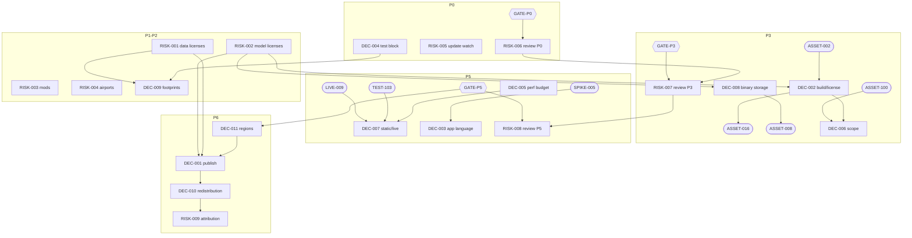

# 07. Risks and Open Questions: Detailed Plan

**Source:** `plans/07-risks-and-open-questions.md`
**Areas:** DEC (decisions) and RISK (cross-cutting risk work)
**Date:** 2026-11-21

## Summary

- The top risk is still Exclude TIN breaking on a sim update. It is outside our control, so the plan watches for it (RISK-005), tests for it (GATE-P0, TEST-104) and defines when to pause (kill criteria K1, K9).
- Eleven decisions belong to you. Each has a task (DEC-001..DEC-011) that gathers evidence, lists options, proposes a default and writes an ADR. Agents prepare; you decide.
- Nine RISK tasks cover work no engineering area owns: license audits, mod and airport masks, the sim update watch, risk reviews at three gates, and attribution if you publish.
- Engineering mitigations (building clipping, crown rules, LOD budgets, spawn caps) stay with their areas. This plan points at their anchors and gates instead of duplicating them.
- One timing trap: DEC-002 (build or license models, Phase 3) needs a provisional answer to DEC-001 (publish or not, Phase 6). DEC-002 asks for it.

---

## Risk register

Likelihood and impact: L (low), M (medium), H (high). "Owner area" is who carries the mitigation. Review cadence says when the row is re-rated (see [Risk reviews](#risk-reviews)).

| ID | Risk | Lik. | Impact | Early warning / trigger | Mitigation | Owner area | Mitigating tasks / anchors / gates | Review cadence |
|---|---|---|---|---|---|---|---|---|
| R-01 | Exclude TIN or vegetation exclude broken on the current sim update | M | H: blocks the project | DevSupport threads on exclusions; SU or beta release notes mention exclusions or TIN; Phase 0 single-blob test fails | Test first in Phase 0; regression routine after every update; report bugs on DevSupport; pause rule K1 | SPIKE, TEST, RISK | SPIKE-003, GATE-P0, TEST-104, RISK-005 | Every sim/SDK update; every gate |
| R-02 | Cuts leave ugly ground (seams, hole edges), or harm areas without photogrammetry | M | M | Phase 0 screenshots show hard edges; T5 shows changes where there were no blobs | Small tuned margin; merge nearby cuts; three-viewpoint protocol; T5 no-harm site | GEN, TEST | GEN-100, TEST-100 (T5), TEST-102, GATE-P2 | GATE-P0, GATE-P2 |
| R-03 | Cuts damage nearby building meshes | M | M | Phase 0 task 4 (blob next to a building) shows cut walls | Clip cuts by building footprints; test site T3; choose a footprint source with good small-building coverage | SCAN, GEN, TEST | SCAN-100 (`building_conflict`), GEN-100 (clipping), TEST-100 (T3), DEC-009 | GATE-P0, GATE-P2 |
| R-04 | Tree data out of date (palms removed or planted) | H in places | M: leftover blobs | `data_vintage` older than ~5 years in `qa_summary.md`; QA map mismatches aerial imagery | Combine sources; record vintage; QA map flags stale areas; LiDAR cross-check | SCAN | SCAN-100, SCAN-101, GATE-P1, GATE-P4 | GATE-P1, GATE-P4, each new region |
| R-05 | Photogrammetry capture date differs from tree data date | M | L | Spot checks find blobs with no palm record, or palms with no blob | Accept a small miss rate; spot checks during scale-out | REGION | GATE-P6 (spot checks at three random locations) | Each new region |
| R-06 | Private-yard palms missing from inventories | H | M | Residential streets in T1 neighbourhood keep blobs after Phase 2 | LiDAR detection in Phase 4 | SCAN | SCAN-101, GATE-P4 | GATE-P2, GATE-P4 |
| R-07 | False positives (Italian cypress, eucalyptus, poles, chimneys) | M | M | Precision under target at T4; `qa_rejects.csv` shows rules too loose | Building filter, crown-size and pole rules, test site T4, hand labels | SCAN, TEST | SCAN-101, TEST-100 (T4), TEST-101, GATE-P4 | GATE-P4 |
| R-08 | Generated XML rejected or subtly wrong | M | M | `fspackagetool` warnings; object counts differ from input | Templates saved by Scenery Editor; golden-file tests; build count checks | SPIKE, GEN | SPIKE-003, GEN-100, GATE-P2 | GATE-P2; every SDK update |
| R-09 | `fspackagetool` slow, or cannot run with the sim open | M | L: "on demand" becomes "before launch" | Phase 0 timing of the 1,000-polygon build | Measure in Phase 0; prebuild regions (data is static); region manager warns if sim is running | SPIKE, LIVE | SPIKE-004, GATE-P0, LIVE-100 | Retired after SPIKE-004 unless an SDK update changes it |
| R-10 | Too many objects hurt performance | M | M | Perf flight over budget; stutter events | LOD budgets; static vs live bake-off; spawn cap; agreed budget | ASSET, TEST, DEC | ASSET-100, TEST-103, DEC-005, DEC-007, GATE-P5 | GATE-P3, GATE-P5, each new region |
| R-11 | SimConnect live objects leak or cost too much CPU | M | M | SPIKE-005 objects persist after disconnect; soak test count does not return to zero | Default to static; track and clean up object IDs; soak test | LIVE, SPIKE | SPIKE-005, LIVE-101, DEC-007 | GATE-P0, GATE-P5 |
| R-12 | Palm models look wrong or cheap | M | H: the fix looks worse than the blob | First species review at street level, 150 m, 600 m fails | One species first, review, then the rest; consider licensing | ASSET, DEC | DEC-002, ASSET-100, GATE-P3 | GATE-P3 |
| R-13 | Conflicts with other mods or airport add-ons | M | M | Duplicate palms in screenshots; airport scenery clashes | `mask_out` areas for known mods; airport masks by default | RISK, ARCH, REGION | RISK-003, RISK-004, ARCH-003 (`mask_out`), GATE-P6 | Each new region; when you install new mods |
| R-14 | Licensing trouble if published (tree data, OSM, footprints, models) | L personal, M if published | H if published | Any source with unclear or restrictive redistribution terms in the audit | Audit every source and model; decide publish scope with the audit in hand; attribution file | RISK, DEC | RISK-001, RISK-002, DEC-001, DEC-010, RISK-009 | GATE-P3 (models), before any upload |
| R-15 | A data source moves, changes schema or disappears (ArcGIS endpoint, GitHub compilation) | M | M | Adapter errors on refresh; HTTP 404; field renamed | Cache raw downloads with vintage; adapter tests on saved samples; note alternate sources in the license audit | SCAN | SCAN-100, RISK-001 | Each region refresh |
| R-16 | Microsoft refreshes photogrammetry for a target city (World Update), changing or removing blobs | L-M | M | World Update or photogrammetry release notes naming SoCal cities | Update watch flags it; rerun regression at affected sites | RISK, TEST | RISK-005, TEST-104 | Every sim update |
| R-17 | Palm bases float or sink because sim terrain under the cut differs from the photogrammetry surface | M | M | "Floating or sunken bases" checklist item fails | Snap to sim ground (per plan 04); visual checklist | GEN, TEST | GEN-100, TEST-102, GATE-P3 | GATE-P2, GATE-P3 |
| R-18 | Toolchain version drift (Blender vs MSFS exporter, SDK vs sim) | M | M | Exporter refuses the Blender version; packages built with an old SDK fail | Pin versions in the asset README; regression after SDK updates | ASSET, TEST | ASSET-100, TEST-104, RISK-005 | Every SDK update |
| R-19 | Large asset binaries bloat the repo, or licensed files end up somewhere their license forbids | M | M | Repo clone size grows past ~1 GB; a licensed file appears in a public commit | Decide storage before the first binary commit | DEC, ASSET | DEC-008, DEC-002 | GATE-P3 |
| R-20 | Effort overrun or loss of momentum (Phase 3 is the biggest unknown) | M | H | Phase actuals exceed the upper estimate by more than 50% | Phase gates stop cheaply; license instead of build; risk reviews re-plan | DEC, RISK | DEC-002, RISK-006, RISK-007, RISK-008 | Every gate |
| R-21 | Single Windows PC bottleneck: many tasks need `windows-sim` and only one machine has it | H | M | `windows-sim` tasks queue while Linux tasks finish | Keep logic testable on Linux (golden files, fake adapters); batch sim sessions | ARCH, TEST | ARCH-001, GEN-100, TEST-102 | GATE-P2, GATE-P5 |
| R-22 | Image-layer experiment blocked (ReShade depth disabled, flicker, GPU cost) | H | L: optional phase | Stage A frames shimmer; depth unavailable | Offline Stage A first; stop rule K8 | FX | FX-100, GATE-P7 | GATE-P7 |

---

## Decision register

Each decision gets one ADR. The ADR number is pre-assigned so this register never needs editing when a decision lands. If the number is already taken when a task runs, use the next free number and update the task's `touches`.

| DEC | Question | Needed by | Options | Default if unclear | Evidence needed | Downstream impact per outcome | ADR |
|---|---|---|---|---|---|---|---|
| DEC-004 | Which street is the first test block? | Before SPIKE-003 starts (GATE-P0) | Candidate streets you name; agent-proposed candidates from inventory counts | A palm-lined City of San Diego street inside the `san-diego-coastal` bbox with inventory and photogrammetry coverage | Your knowledge of the street; palm counts from the inventory; in-sim screenshot showing blobs | Sets the Phase 0 site, T1 (TEST-100), the first region YAML bbox | ADR-0005 |
| DEC-009 | Which building footprint source? | Before the SCAN-100 building adapter (GATE-P1) | OSM; Microsoft footprints; union of both; county/city outlines | OSM | Side-by-side coverage at the test block and T3; license terms (RISK-001) | Building adapter, region `buildings:` value, attribution list | ADR-0010 |
| DEC-002 | Build or license the palm models? | Opens at the start of Phase 3 (after GATE-P2) with the default; decided before modeling beyond the Mexican fan palm pilot (ASSET-016 depends on it) | Build; license; hybrid (licensed LOD0, hand-made LODs) | Build Mexican fan palm first, time it, then re-decide | RISK-002 terms; ASSET-002 build-vs-license inputs; pilot hours; provisional publish intent; your Blender time | ASSET task list, cost, storage limits (DEC-008), redistribution limits | ADR-0003 |
| DEC-008 | Where do large asset binaries live, and are visual screenshots JPEG in plain git or LFS? | Before the first `.blend`, texture or screenshot-set commit (Phase 3) | Git LFS; external storage + manifest; plain git with size cap; sources outside the repo | Git LFS for `assets/blender/` and texture binaries; licensed sources never in a public repo | Size estimate; repo visibility; LFS quota (VERIFY); RISK-002 storage terms | `.gitattributes`, CI checkout, ASSET workflow, TEST-102 screenshot rule; implemented by ASSET-008 | ADR-0009 |
| DEC-006 | Handle other blob trees (Italian cypress, eucalyptus) too? | After ASSET-100, before Phase 4 classifier work (GATE-P4 at latest) | Palms only; add one species; general tall-tree registry | Palms only | Counts of other species at test sites; screenshots proving they blob; Phase 3 actual hours per species; LiDAR separability | Genus filter, species keys, asset list, classifier classes (SCAN-101) | ADR-0007 |
| DEC-005 | What is the performance budget, on what hardware and settings? | Before TEST-103 runs (Phase 5) | +5% avg frametime and no new stutter; absolute ms budget; tiered by preset | +5% avg frametime, 1% low no worse than 5%, no new stutter; your PC at your usual settings | Your GPU, CPU, RAM, resolution, preset, LOD sliders, upscaler and frame generation; optional baseline run | TEST-103 thresholds, LOD budgets, spawn cap, GATE-P5 criteria | ADR-0006 |
| DEC-007 | Static or live palm placement? | GATE-P5 | Static; live; hybrid | Static (fewer moving parts) | LIVE-009 findings (`docs/findings/LIVE-009.md`): 3 setups × 3 runs, pop-in notes; SPIKE-005 disconnect result | Static: drop LIVE-010, LIVE-011, LIVE-101 and ASSET-101. Live: build them; `palmgen` exclusions-only mode | ADR-0008 |
| DEC-003 | Companion app language? | Before palmlive coding (LIVE-001), hence before the bake-off | C# .NET 8; Python with community SimConnect binding; Python region manager + C# spawner | C# .NET 8 (plan default) | SPIKE-005 notes; binding check (2024 support, `AICreateSimulatedObject_EX1`, maintenance); your maintenance preference | `palmlive/` layout, test framework, LIVE-100/101 | ADR-0004 |
| DEC-011 | Which regions to scale to, in what order; add Florida? | Start of Phase 6 (after GATE-P5) | Plan order; your own order; SoCal only; add Florida | Plan order (San Diego coastal, LA Westside and beaches, rest of LA basin); Florida deferred | GATE-P5 results; actual hours per region; inventory availability; photogrammetry coverage | REGION tasks per region; Florida species assets and genus list | ADR-0012 |
| DEC-001 | Personal use or publish? | GATE-P6, before any public upload | Personal; publish packages on flightsim.to; publish tools only; both | Personal until licenses are checked | RISK-001 and RISK-002 re-checked; DEC-011 region list; your support hours | Personal: drop DEC-010 and RISK-009. Publish: DEC-010, RISK-009, release tasks | ADR-0002 |
| DEC-010 | If publishing, which derived data ships, and in what form? | Before any public upload | Compiled packages only; packages + `palms.geojson`; tools only; per-source mix | Per-source: ship packages only where terms are clear; tools only elsewhere | RISK-001 per-source terms; your answers to the flagged questions | Package contents, attribution file (RISK-009), release notes | ADR-0011 |

---

## Decision details

### How every decision task runs

Same procedure for DEC-001..DEC-011. The task file lists the specifics.

1. Gather the evidence listed for the decision. Link each item (task log, file path, URL).
2. Write the ADR from `tracking/decisions/_TEMPLATE.md` with **Status: proposed**, all options, the criteria and the default.
3. Present it to you: one short message with options, the recommendation and what changes downstream. You decide.
4. Set **Status: accepted**, **Decided by:** you, the date, and fill Decision and Consequences.
5. Apply downstream changes: add a one-line "Decided (ADR-NNNN): ..." note to the affected detailed plan section; drop tasks with `python3 scripts/tasks.py set <ID> dropped --note "ADR-NNNN"`; create new tasks with `python3 scripts/tasks.py new`.
6. Run `python3 scripts/tasks.py validate`.

**If you are unavailable by the "needed by" gate:** the default applies provisionally so work can continue. The ADR stays `proposed` with "Default applied provisionally" in Decision, and the DEC task sits in `review` until you confirm.

### DEC-001 Personal use or publish

- **Question:** keep the mod personal, or publish it (flightsim.to packages, GitHub tools, or both)?
- **Why it matters:** publishing redistributes data and models. Every source and model license has to allow that, credits must ship, and support work starts.
- **Criteria:** license audit has no unresolved blocker for what would ship; you accept support load; region list (DEC-011) known.
- **Outcomes:** personal → DEC-010 and RISK-009 dropped, nothing else changes. Publish packages → DEC-010, RISK-009 and new release tasks (versioning per plan 04, changelog, support notes). Tools only → DEC-010 still runs (to confirm no data ships), RISK-009 covers code and model credits.
- **Timing note:** a provisional answer is collected earlier by DEC-002, because model licensing depends on it.

### DEC-002 Build or license the palm models

- **Question:** model five species in Blender, buy or license models, or mix (licensed LOD0, hand-made lower LODs)?
- **Criteria:** looks right per plan 03 acceptance checks; license allows use in a redistributed mod if publishing is possible; total cost and hours; MSFS conversion effort (LODs, cutout materials).
- **Evidence:** RISK-002 terms for each candidate source; 2-3 candidate models with price, triangle counts, texture licenses; your provisional publish intent; your Blender time per week.
- **Default:** build Mexican fan palm first, record hours, then re-decide for the other four (matches the plan 05 decision table).
- **Timing:** opened at the start of Phase 3 (plan 05 Phase 3 task 1), depends on RISK-002 and ASSET-002. The pilot (ASSET-010..015) runs under the default and its hours inform the decision; ASSET-016 (and so every other species) depends on DEC-002, and ASSET-016 writes the `Decided (ADR-0003)` note into `plans/detailed/03-palm-assets.md`.
- **Outcomes:** build → ASSET per-species tasks proceed as planned. License → purchase task, license records added to `docs/licenses/models-and-tools.md`, conversion tasks, storage limits fed to DEC-008. Hybrid → both, and the LOD0 license still governs the package.

### DEC-003 Companion app language

- **Question:** C# .NET 8 with the SDK's managed SimConnect wrapper, Python with a community binding, or a split?
- **Criteria:** SimConnect API coverage for 2024 (especially `SimConnect_AICreateSimulatedObject_EX1` and `SimConnect_AIRemoveObject`); maintenance status; testability without the sim; your comfort maintaining it.
- **Timing:** decided before LIVE-001, so before DEC-007. The bake-off (LIVE-009) needs a spawner (LIVE-008) written in the chosen language, so DEC-003 cannot wait for DEC-007 (that order formed a dependency cycle). Key input: SPIKE-005. If DEC-007 later picks static, the app only needs folder links and a "sim is running" check, and a Python region manager can be reconsidered in a new DEC task.
- **Default:** C# .NET 8.
- **Outcomes:** C# → `palmlive/` C# solution and xUnit as planned. Python → `palmlive/` becomes a Python package using `palmcore`, tests in pytest; ARCH layout note updated. Split → Python region manager, C# spawner only if live.

### DEC-004 First test block

- **Question:** which street do you know well enough to judge?
- **Criteria:** you know it in person; inside City of San Diego or City of LA inventory coverage; inside photogrammetry with visible palm blobs; a row of 10+ palms; at least one palm within about 3 m of a building wall (Phase 0 task 4); not inside an airport or known palm mod area. If the repo is or may become public, pick a street that does not reveal your home address.
- **Evidence:** inventory palm count for the bbox; in-sim screenshot of the blobs.
- **Default:** a palm-lined City of San Diego street inside the `san-diego-coastal` bbox (ArcGIS REST is the simplest adapter).
- **Outcomes:** the ADR records name, centre point, bbox (300-500 m), and a slew start position. It feeds SPIKE-003, TEST-100 (T1) and the first region YAML.

### DEC-005 Performance budget and reference hardware

- **Question:** how much frame cost is acceptable, measured on which machine and settings?
- **Criteria:** measurable with TEST-103; matches how you actually fly; leaves room for run-to-run noise.
- **Evidence:** GPU, CPU, RAM, resolution, graphics preset, terrain and object LOD sliders, DLSS/FSR and frame generation use, target FPS. Optional: one no-fix baseline run.
- **Default:** fix adds at most 5% average frametime, 1% low FPS drops at most 5%, and stutter events (frames over 2× median) do not increase beyond the no-fix run's spread.
- **Outcomes:** thresholds go into TEST-103's report script and GATE-P5. A tight budget tightens LOD budgets (ASSET) and the spawn cap (LIVE).

### DEC-006 Scope beyond palms

- **Question:** after Phase 3, should the pipeline also fix other blob trees?
- **Criteria:** the other species actually render as blobs (screenshots); they are common at the test sites; LiDAR can tell them apart; asset cost per species from Phase 3 actuals.
- **Default:** palms only.
- **Outcomes:** palms only → no change. Extend → species keys and genus list change (SCAN), possible species enum change (ARCH-002), new asset species (ASSET), classifier classes (SCAN-101). Note: Italian cypress is currently a false-positive class; making it a target changes the T4 test meaning.

### DEC-007 Static or live placement

- **Question:** which placement method wins the Phase 5 bake-off?
- **Criteria:** perf within the DEC-005 budget; stutter; pop-in and LOD transitions; leftover objects after disconnect; complexity.
- **Evidence:** the LIVE-009 bake-off findings (`docs/findings/LIVE-009.md`; DEC-007 depends on LIVE-009, which writes no ADR), TEST-103 captures, SPIKE-005 disconnect findings.
- **Default:** static when results are within noise of each other, or both are within budget.
- **Outcomes:** static → LIVE-010, LIVE-011, LIVE-101 and ASSET-101 dropped (ASSET-101 kept only if it was needed for the bake-off itself and is already done). Live → those tasks proceed; `palmgen` gains an exclusions-only mode plus spatial index output. LIVE-010 and LIVE-101 depend on DEC-007.

### DEC-008 Asset binary storage

- **Question:** where do `.blend` files, large textures and exported binaries live, and are visual-test screenshots (`tests/visual/**`) committed as JPEG q90 in plain git (TEST plan) or through LFS (ASSET plan proposal)?
- **Criteria:** clone size; cost (LFS quota, VERIFY current GitHub limits); licensed-file restrictions; ease for agents in worktrees.
- **Evidence:** size estimate (5 species × 2-3 variants, 2K-4K textures); whether the GitHub repo is public or private; RISK-002 storage terms.
- **Default:** Git LFS for `assets/blender/**` and binary texture formats; exported glTF/bin also via LFS; licensed source files never in a public repo.
- **Outcomes:** implemented by ASSET-008 (depends on DEC-008). LFS → `.gitattributes` and CI LFS checkout. External → manifest file with hashes and a fetch script. Plain git → size cap check in CI. The screenshot rule goes to TEST-102.

### DEC-009 Building footprint source

- **Question:** OSM, Microsoft Global ML Building Footprints, both, or a county or city dataset?
- **Criteria:** small-structure coverage at T3; alignment with aerial imagery; license terms and attribution (RISK-001); download effort.
- **Evidence:** a side-by-side count and overlay at the test block (about 1-2 hours of QGIS work inside the task).
- **Default:** OSM via Overpass.
- **Outcomes:** sets the `buildings:` value in region YAML and which adapter SCAN-100 builds first; adds the source to the attribution list.

### DEC-010 Data redistribution if publishing

- **Question:** if publishing, what derived data ships: compiled packages, `palms.geojson`, neither?
- **Criteria:** each source's terms as recorded by RISK-001; attribution obligations; whether you are comfortable with any open questions RISK-001 flagged. This task records your choice; it does not settle legal questions.
- **Default:** per-source: packages only for sources whose terms are clear; tools only (users build their own) elsewhere.
- **Outcomes:** package content rules, the attribution file (RISK-009), and release notes text.

### DEC-011 Scale-out regions and Florida

- **Question:** which regions after the test neighbourhood, in what order, and is Florida in scope?
- **Criteria:** inventory availability; photogrammetry coverage; actual hours per region from Phases 1-5; your flying habits.
- **Default:** plan 05 order; Florida deferred until a Florida species set is decided.
- **Outcomes:** REGION tasks per chosen region; if Florida is in, ASSET tasks for the Florida species and a genus list update (SCAN).

---

## Cross-cutting risk tasks

### License audit

- **RISK-001 (data sources):** LA County compilation (stiles/la-trees), StreetsLA, City of San Diego street trees, OSM (ODbL), Microsoft footprints, USGS 3DEP, plus any county building outlines considered in DEC-009. Output `docs/licenses/data-sources.md`.
- **RISK-002 (models, textures, tools):** candidate model marketplaces, texture sources, MSFS SDK terms for distributing built packages, the Blender exporter's license. Output `docs/licenses/models-and-tools.md`.
- Both record: source URL, license name, exact quoted clause on redistribution and attribution, date checked, and **questions for you**. No legal conclusions.

### Mod and airport masks

- **RISK-003:** inventory of other palm and tree mods for SoCal (for example the LA palm enhancement mod, Bijan's Seasons 2024 Enhanced), what they cover, and which you run. Output `docs/compat/other-mods.md` and `docs/compat/mods-coverage.geojson`.
- **RISK-004:** airport boundary polygons for the target regions, plus known airport add-ons. Output `docs/compat/airports.md` and `docs/compat/airports-mask.geojson`.
- RISK-003's mod coverage: REGION tasks copy it into each region's `mask_out` (`kind: mod`). RISK-004's `airports-mask.geojson` is the default airport mask: ARCH-003's `masks.airports.path` points at it, palmgen buffers it by `masks.airports.buffer_m`, and GEN-016 depends on RISK-004.

### Sim update watch

- **RISK-005:** a short process (sources, cadence, trigger rule) and a watch log. A sim update, SDK update, beta note on exclusions, or SoCal photogrammetry change triggers the TEST-104 regression routine. The first pass checks the current status of known exclusion bugs before Phase 0.

### Risk reviews

- **RISK-006** after GATE-P0, **RISK-007** after GATE-P3, **RISK-008** after GATE-P5.
- Each review: re-rate every row in the risk register from new evidence, retire or add rows, check kill criteria, check every open DEC is still on time, and log the result in `tracking/logs/risk-reviews.md`.

### Attribution if published

- **RISK-009:** only if DEC-001 is publish. Writes `docs/licenses/ATTRIBUTION.md` (credits text for packages and the flightsim.to page) from the audits and DEC-010.

---

## Kill criteria

A kill criterion stops a phase or the project. Pause means "stop work, keep everything, recheck on a trigger".

| ID | Condition | Checked at | Action |
|---|---|---|---|
| K1 | Exclude TIN or vegetation exclude does not remove the blob in a native 2024 project on the current update | GATE-P0, TEST-104 | Pause the project. File or upvote a DevSupport bug. RISK-005 watches for a fix; rerun Phase 0 on each update. |
| K2 | No `margin_m` setting gives a cut that looks better than the blob at all three viewpoints | GATE-P2 | Stop after Phase 2. Write findings. The project does not proceed to assets. |
| K3 | Cuts always damage buildings at T3, even with clipping | GATE-P2 | Limit the fix to palms with `building_conflict = false`; if that leaves under 70% of blobs fixed at T1, treat as K2. |
| K4 | First species fails plan 03 acceptance checks after two revision rounds, and licensing is not viable | GATE-P3 | Stop Phase 3; revisit DEC-002 once; if still failing, stop the project at Phase 2 output (personal experiment). |
| K5 | Both static and live placement exceed the DEC-005 budget after LOD tuning | GATE-P5 | Reduce scope (density cap, smaller regions) or stop scale-out. |
| K6 | LiDAR-only precision stays under 80% after tuning | GATE-P4 | Drop LiDAR-only palms; keep LiDAR heights only. Phase 4 ends without the beach site. |
| K7 | A source or model license blocks redistribution | DEC-001, DEC-010 | Stop publishing that part (tools only, or personal). The project continues. |
| K8 | Image-layer Stage A fails go/no-go | FX-100, GATE-P7 | Stop Phase 7 (owned by FX-100). |
| K9 | A sim update breaks a released or active package | TEST-104 | Pause; mark packages incompatible in release notes if published; same recovery as K1. |

---

## Task index

| ID | Title | Phase | Depends on | Requires | Est h |
|---|---|---|---|---|---|
| DEC-004 | Decide: first test block | 0 | - | human, network | 2 |
| RISK-005 | Set up the sim/SDK update watch and do the first pass | 0 | - | network | 3 |
| RISK-006 | Risk review after Phase 0 | 0 | GATE-P0 | none | 2 |
| RISK-001 | Audit data source licenses | 1 | - | network | 4 |
| RISK-003 | Inventory other palm and tree mods for mask_out | 1 | - | network, human | 3 |
| DEC-009 | Decide: building footprint source | 1 | DEC-004, RISK-001 | human, network | 3 |
| RISK-004 | Collect airport boundaries for default masks | 2 | - | network | 3 |
| RISK-002 | Audit model, texture and tool licenses | 2 | - | network | 4 |
| DEC-002 | Decide: build or license the palm models | 3 | RISK-002, ASSET-002 | human | 2 |
| DEC-008 | Decide: storage for large asset binaries | 3 | RISK-002 | human | 1 |
| DEC-006 | Decide: scope beyond palms | 3 | ASSET-100, DEC-002 | human | 2 |
| RISK-007 | Risk review after Phase 3 | 3 | RISK-006, GATE-P3 | none | 2 |
| DEC-005 | Decide: performance budget and reference hardware | 5 | - | human | 1 |
| DEC-007 | Decide: static or live placement | 5 | LIVE-009, TEST-103, DEC-005 | human | 2 |
| DEC-003 | Decide: companion app language | 5 | SPIKE-005 | human | 2 |
| RISK-008 | Risk review after Phase 5 | 5 | RISK-007, GATE-P5 | none | 2 |
| DEC-011 | Decide: scale-out regions and Florida | 6 | GATE-P5 | human | 1 |
| DEC-001 | Decide: personal use or publish | 6 | RISK-001, RISK-002, DEC-011 | human, network | 2 |
| DEC-010 | Decide: data redistribution if publishing | 6 | DEC-001 | human | 2 |
| RISK-009 | Write attribution and credits if publishing | 6 | DEC-010 | none | 2 |

Total: 20 tasks, about 45 hours (most DEC hours are prep and write-up; your share is a short conversation each).

---

## Dependency graph

Rounded boxes are anchors owned by other areas; hexagons are gates.

---

## Parallelization notes

- **Start now, in parallel:** DEC-004, RISK-005, RISK-001, RISK-003, RISK-004, RISK-002. They share no files. RISK-001..RISK-005 run in a Linux container with network; DEC-004 needs you.
- **Do early even though the phase is later:** RISK-002 (phase 2) so DEC-002 is ready on time; collect DEC-005 hardware facts whenever you have five minutes.
- **File ownership:** every DEC task writes its own ADR. Shared detailed-plan files are touched only by ordered chains: `03-palm-assets.md` (DEC-006 only; DEC-002's note is written by ASSET-016, which DEC-006 follows via ASSET-100), `04-fs2024-integration.md` (DEC-003 → LIVE chain → DEC-007), `05-phases.md` (DEC-011 → DEC-001 → DEC-010), this file (RISK-006 → RISK-007 → RISK-008).
- **Human batching:** DEC-002 and DEC-008 can be one conversation; so can DEC-005 and DEC-007; and DEC-011, DEC-001, DEC-010.
- **No `windows-sim` tasks here.** Nothing in this plan competes for the sim PC (R-21).

---

## Verification strategy

A risk is retired, or downgraded, only on recorded evidence. Risk reviews check this table.

| Risk | Retired or downgraded when | Evidence location |
|---|---|---|
| R-01 | Phase 0 single blob passes; re-opens on every update until TEST-104 passes | GATE-P0 findings note; TEST-104 regression log |
| R-02, R-03 | GATE-P2 checklist passes at T1, T3, T5 | `tests/visual/<site>/<date>/` and checklist |
| R-04, R-06, R-07 | GATE-P4 metrics meet targets against TEST-101 labels | `qa_summary.md`, accuracy report |
| R-08 | Golden tests green and a Phase 2 build has matching counts | CI run; `build_report.md` |
| R-09 | SPIKE-004 times recorded and the build flow chosen | SPIKE-004 log |
| R-10, R-11 | Bake-off within DEC-005 budget; ADR-0008 accepted | TEST-103 reports; ADR-0008 |
| R-12 | GATE-P3 species acceptance checks pass | GATE-P3 log, screenshots |
| R-13 | Masks applied and no duplicates in GATE-P6 spot checks | `docs/compat/*`; region YAMLs |
| R-14 | Every shipped source has recorded terms and you accepted DEC-010 | `docs/licenses/*`; ADR-0002, ADR-0011 |
| R-16, R-18 | Never retired; watched by RISK-005 | `tracking/logs/sim-update-watch.md` |
| R-19 | ADR-0009 accepted and implemented before the first binary commit | ADR-0009; `git lfs ls-files` or manifest |

Checks for this plan's own tasks:

- `python3 scripts/tasks.py validate` shows no errors for DEC-* and RISK-*.
- Every accepted decision has an ADR whose Status line reads `accepted` and whose Task line names the DEC id: `grep -l "DEC-0" tracking/decisions/ADR-*.md`.
- Each risk review appends a dated entry to `tracking/logs/risk-reviews.md`.

---

## Open questions and VERIFY items

**Questions for you**

1. Is the GitHub repo public, private, or undecided? It changes DEC-004 (address privacy), DEC-008 (licensed files) and RISK-002.
2. Provisional publish intent (yes, no, maybe)? Needed by DEC-002 long before DEC-001.
3. Which mods are in your Community folder today? Needed by RISK-003.

**VERIFY (checked by the named task)**

- Current MSFS 2024 sim version and status of the SU6-beta exclusion bug thread (RISK-005).
- License or terms for: stiles/la-trees data (vs its code license), StreetsLA, City of San Diego open data, Microsoft Global ML Building Footprints (RISK-001).
- MSFS SDK terms on distributing built packages; license of `io_scene_gltf2_msfs_2024` (RISK-002).
- Current GitHub LFS storage and bandwidth limits (DEC-008).
- Whether a Python SimConnect binding supports MSFS 2024 and `SimConnect_AICreateSimulatedObject_EX1` (DEC-003).
- Whether the LA palm enhancement mod documents its coverage area (RISK-003).

**Inconsistencies found in the source plans**

- Viewpoints: `06-testing.md` used street level, 150 m and 500 m; `03-palm-assets.md` and Phase 3 exit criteria use street level, 150 m and 600 m. Resolved 2026-11-22: street (~2 m), low oblique (~150 m), approach (~600 m) everywhere.
- Airport masks: `04-fs2024-integration.md` says "mask airport boundaries by default", but the region config example has only `mask_out: []`. ARCH-003 should say whether airport masks are a separate key or entries in `mask_out`. Resolved 2026-11-22: `masks.airports.{enabled, buffer_m, path}` with `path` defaulting to RISK-004's file; manual extras are `mask_out` entries with `kind: airport`.
- Decision timing: `05-phases.md` lists build vs license "after phase 3", but Phase 3 task 1 makes the decision at the start. This plan treats it as start of Phase 3 with the "build one species first" default. Resolved 2026-11-22: DEC-002 opens at the start of Phase 3; the pilot runs under the default; ASSET-016 and later species wait for the decision.
- ADR numbers 0002-0012 are pre-assigned here. ADR-0013 is reserved for the bootstrap session (Linux code work in parallel with Phase 0). Any other task that writes an ADR names it `ADR-NNNN` and takes the next free number when it runs (check `tracking/decisions/`); never a fixed number above 0013 without checking. LIVE-009 no longer writes an ADR (it writes `docs/findings/LIVE-009.md`; DEC-007 writes ADR-0008).

---

## Reconciliation notes (2026-11-22)

- DEC-002: depends on ASSET-002; opens at the start of Phase 3 with the "build one species first" default; the robusta pilot (ASSET-010..015) no longer waits for it; ASSET-016 depends on it and writes the plan 03 note, so DEC-002 no longer touches `plans/detailed/03-palm-assets.md`.
- DEC-003: dependency on DEC-007 removed (it formed a cycle once DEC-007 depended on LIVE-009); now depends on SPIKE-005 and is decided before LIVE-001.
- DEC-007: depends on LIVE-009, reads `docs/findings/LIVE-009.md`, writes ADR-0008, drops LIVE-010, LIVE-011, LIVE-101 and ASSET-101 if static wins; LIVE-010 and LIVE-101 depend on DEC-007.
- DEC-008: now also decides screenshot storage (JPEG vs LFS, from the TEST plan); ASSET-008 is its implementation and depends on it.
- RISK-004: its GeoJSON is the default airport mask via ARCH-003 `masks.airports.path`; buffer suggestion aligned to the 100 m config default; GEN-016 depends on it.
- ADR numbering: 0002-0012 pre-assigned here, 0013 reserved for the bootstrap session, everything else takes the next free number.
- Resolved inconsistencies: viewpoints (600 m), airport masks key, DEC-002 timing.

## Recap

- Eleven decisions, each with a task, a default and a pre-numbered ADR. Agents prepare; you decide.
- Nine RISK tasks: two license audits, two mask inventories, the update watch, three reviews and attribution.
- Kill criteria K1-K9 say exactly when to pause or stop.
- Start now with DEC-004 and the five network tasks; none of them need the sim PC.
