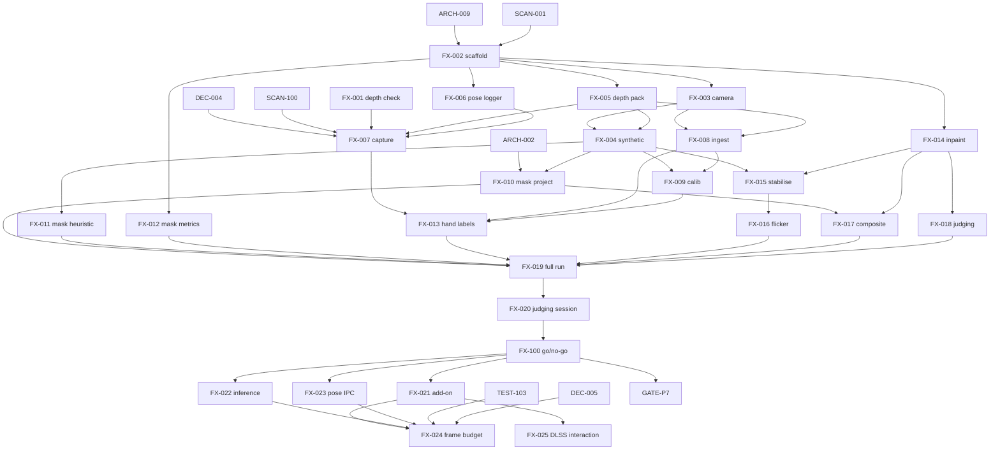

# 08. Image-Layer Experiment (`palmfx`): Detailed Plan

Source: `plans/08-image-layer-experiment.md`. Phase 7 (optional). Area `FX`.

## Summary

- Stage A is an offline test on recorded sim frames: capture colour + depth + camera pose, make blob masks two ways, erase with an inpainting model (LaMa), stabilise over time, draw a palm sprite, and judge.
- All image processing is Python in `palmfx/offline/`, tested on a synthetic scene with exact ground truth, so most tasks run in a Linux container. Only capture needs the Windows sim; full-resolution inpainting wants a GPU; judging needs a human.
- The go/no-go (FX-100) uses criteria fixed before judging: a human 1-5 believability score, a human shimmer score, and a warp-compensated flicker ratio. Passing with hand-painted masks only counts as NO-GO, because a real-time version can't hand-paint.
- Stage B (C++ ReShade add-on, GPU tile inference, pose IPC, frame budget, DLSS interaction) is a set of coarse tasks that all wait on FX-100.
- FX-001 is a kill switch: if ReShade can't read depth with photogrammetry streaming on, the experiment stops early.

---

## Scope and interfaces

### Paths

| Path | What | Committed |
|---|---|---|
| `palmfx/offline/` | Python package `palmfx.offline`: session I/O, camera model, depth decode, masks, inpainting, stabilisation, metrics, compositing, judging | yes |
| `palmfx/offline/commands/` | One file per CLI subcommand, each exposing `register(subparsers)` (no shared CLI file to edit) | yes |
| `palmfx/offline/capture/` | Windows-only capture helpers: pose logger, screenshot trigger, ReShade effect `PalmFxDepthPack.fx` | yes |
| `palmfx/addon/` | Stage B C++ ReShade add-on and pose helper | yes (Stage B) |
| `palmfx/docs/` | Findings, procedures, protocol, report | yes |
| `data/fx/<session_id>/` | Captured sessions and all derived outputs (large) | no (under gitignored `data/`) |
| `tests/unit/palmfx/test_*.py` | Unit tests; `tests/unit/palmfx/conftest.py` holds the synthetic-scene fixtures | yes |
| `tests/fixtures/palmfx/sample-seq/` | 5 downscaled real frames + poses + palms subset + hand masks + clicks, under 5 MB | yes |

`session_id` = `YYYYMMDD-<site>-<view>-<nn>`, for example `20261205-T1-low-01`. `<site>` is a TEST-100 site id or the DEC-004 block name. `<view>` is `low` (30-60 m AGL) or `obl` (about 150 m AGL).

### Session data formats

```
data/fx/<session_id>/
  session.json              # capture metadata (fields below)
  raw/
    triggers.csv            # frame_idx,t_trigger_ns          (host perf_counter_ns at keypress)
    poses.csv               # one row per SimConnect sample  (columns below)
    reshade/                # ReShade screenshots, untouched
  frames/
    000000.color.png        # 8-bit sRGB RGB, native resolution
    000000.depthraw.npy     # float32 HxW, decoded raw depth-buffer value d; 0 = sky / no depth
    000000.depth.npy        # float32 HxW, metric view-space z (m); NaN = sky / invalid (after calibration)
  frames.jsonl              # one JSON object per frame (below)
  calib/
    static_occluder.png     # 0/255; pixels of cockpit/aircraft that never change; excluded everywhere
    clicks.json             # manual correspondences (A6)
    intrinsics.json         # {"width","height","fx","fy","cx","cy","vfov_deg","rms_px"}
    depth_model.json        # {"kind":"inv","a":..,"b":..,"rms_rel":..}
    time_offset.json        # {"offset_ms":..,"rms_px":..}
    pose_bias.json          # {"d_heading_deg","d_pitch_deg","d_bank_deg","d_body_m":[f,r,d]}
  masks/<method>/           # mask formats below
  inpaint/<mask>-<backend>/000000.png
  stab/<mask>-<backend>-<variant>/000000.png
  composite/<mask>-<backend>-<variant>/000000.png
  metrics/<name>.json
  judge/<packet_id>/
```

`session.json`: `session_id`, `site`, `created`, `sim_build` (as shown in the sim), `reshade_version`, `reshade_build` (`standard` or `addon`), `resolution` `[W,H]`, `graphics` (preset and changed settings, free text), `upscaler`, `render_scale_pct`, `frame_generation`, `sim_rate`, `trigger_interval_ms`, `sim_step_ms` (= interval × sim rate), `view` (free text), `zoom` (free text), `depth_encoding` `{"kind":"log24","dmin":1e-7}`, `reshade_depth_flags` (the preprocessor values used), `simvar_conventions` (from FX-006), `cam_offset_body_m` `[f,r,d]` initial guess, `notes`.

`poses.csv` columns: `t_host_ns,sim_time_s,lat_deg,lon_deg,alt_msl_m,heading_true_deg,pitch_deg,bank_deg`, then optional camera columns named `cam_<simvar_snake>` for whichever camera SimVars FX-006 confirms. Values are logged raw (as the sim reports them, in the requested units). Sign conventions are applied later by `camera.pose_from_simvars()` using `session.json.simvar_conventions`.

`frames.jsonl` line:

```json
{"idx": 0, "t_ns": 1234567890, "color": "frames/000000.color.png",
 "depthraw": "frames/000000.depthraw.npy", "depth": "frames/000000.depth.npy",
 "pose": {"lat_deg": 32.7893, "lon_deg": -117.2531, "alt_msl_m": 61.0,
          "heading_deg": 271.0, "pitch_deg": -8.0, "bank_deg": 0.5},
 "pose_gap_ms": 4.1}
```

`pose` is the canonical pose (conventions applied, offset applied) or `null` if no pose sample lies within `max_gap_ms`.

### Mask formats

Per method directory `masks/<method>/` (methods: `project-raw`, `project-depth`, `heuristic`, `hand`):

- `NNNNNN.png`: 8-bit single channel, 0 or 255, union mask, same size as the frame.
- `NNNNNN.inst.png`: 16-bit single channel label image, 0 = background, k = instance k.
- `NNNNNN.json`: `{"method": "...", "params": {...}, "instances": [{"k": 1, "palm_id": "sdc-000123" | null, "bbox": [x0,y0,x1,y1], "area_px": 812, "z_m": 84.2 | null, "base_uv": [u,v] | null, "top_uv": [u,v] | null}]}`

Hand masks may omit `.inst.png`; the reader derives instances from 8-connected components.

### CLI commands

Console script `palmfx` (also `python -m palmfx.offline`). Every command takes `--session data/fx/<sid>`.

| Command | Task | Does |
|---|---|---|
| `palmfx capture --frames 60 --interval-ms 133 --key <key> [--probe]` | FX-006 | Windows only. Logs poses, sends the ReShade screenshot key, writes `raw/` |
| `palmfx ingest [--max-gap-ms 50]` | FX-008 | `raw/` to `frames/` + `frames.jsonl`; decodes depth; interpolates poses |
| `palmfx fixture --out tests/fixtures/palmfx/sample-seq --frames 0,10,20,30,40 --scale 0.25` | FX-008 | Downscaled sample fixture (nearest-neighbour for depth) |
| `palmfx clicks --frames 0,15,30,45,59 --palms <geojson>` | FX-009 | Interactive correspondence clicking (needs a display) |
| `palmfx calib --palms <geojson>` | FX-009 | Fits vfov, time offset, pose bias, depth model; writes `calib/` and metric depth |
| `palmfx mask-project --palms <geojson> [--no-depth-test]` | FX-010 | `masks/project-raw/` and `masks/project-depth/` |
| `palmfx mask-heuristic [--config <yaml>]` | FX-011 | `masks/heuristic/` |
| `palmfx mask-compare --a <method> --b <method>` | FX-012 | `metrics/mask-<a>-vs-<b>.json` |
| `palmfx inpaint --mask <method> --backend lama\|telea [--device cuda\|cpu]` | FX-014 | `inpaint/<mask>-<backend>/` |
| `palmfx stabilise --input <mask>-<backend> --variant none\|reuse\|blend [--alpha 0.8]` | FX-015 | `stab/.../` |
| `palmfx flicker --input <stab dir name>` | FX-016 | `metrics/flicker-<name>.json` |
| `palmfx composite --input <stab dir name> --sprites <dir> --palms <geojson>` | FX-017 | `composite/.../` |
| `palmfx judge-pack --inputs <dir>,<dir> --stills 30 --seed 1` | FX-018 | `judge/<packet_id>/` |
| `palmfx judge-score --packet <dir>` | FX-018 | C2 / C4 per configuration from filled score sheets |
| `palmfx run-stage-a --palms <geojson>` | FX-019 | Runs the whole chain with the frozen parameters |

### Python interfaces

```python
# session.py (FX-002)
@dataclass(frozen=True)
class FrameRecord: idx: int; t_ns: int; color: Path; depthraw: Path | None; depth: Path | None; pose: dict | None
@dataclass
class MaskSet: union: np.ndarray; labels: np.ndarray; instances: list[dict]; method: str; params: dict
class Session:
    root: Path; meta: dict
    def frames(self) -> list[FrameRecord]: ...
    def path(self, *parts: str) -> Path: ...
def open_session(root: Path) -> Session
def new_session(root: Path, meta: dict) -> Session
def read_mask(mask_dir: Path, idx: int) -> MaskSet
def write_mask(mask_dir: Path, idx: int, m: MaskSet) -> None

# camera.py (FX-003)
@dataclass(frozen=True)
class Intrinsics: width: int; height: int; fx: float; fy: float; cx: float; cy: float
    @classmethod
    def from_vfov(cls, width: int, height: int, vfov_deg: float) -> "Intrinsics": ...
@dataclass(frozen=True)
class CameraPose: position_enu: np.ndarray; R_cam_from_enu: np.ndarray
class LocalFrame:
    def __init__(self, lat0: float, lon0: float, h0: float): ...
    def to_enu(self, lat, lon, h) -> np.ndarray: ...      # (N,3)
    def from_enu(self, enu: np.ndarray) -> tuple[np.ndarray, np.ndarray, np.ndarray]: ...
def R_ned_from_body(heading_deg: float, pitch_deg: float, bank_deg: float) -> np.ndarray
def pose_from_simvars(row: Mapping[str, float], frame: LocalFrame, cam_offset_body_m: Sequence[float],
                      conventions: Mapping[str, float], bias: Mapping[str, float] | None = None) -> CameraPose
def project(points_enu: np.ndarray, pose: CameraPose, K: Intrinsics) -> tuple[np.ndarray, np.ndarray]  # uv (N,2), z (N,)
def backproject(uv: np.ndarray, z: np.ndarray, pose: CameraPose, K: Intrinsics) -> np.ndarray          # (N,3) ENU

# depth.py (FX-005)
def pack_log24(d: np.ndarray, dmin: float = 1e-7) -> np.ndarray      # uint8 HxWx3, mirrors the .fx
def unpack_log24(rgb: np.ndarray, dmin: float = 1e-7) -> np.ndarray  # float32 d, 0 = sky
@dataclass(frozen=True)
class DepthModel: a: float; b: float                                 # z = a / (d + b)
def fit_depth_model(d: np.ndarray, z: np.ndarray) -> DepthModel
def to_metric(d: np.ndarray, model: DepthModel) -> np.ndarray        # NaN where d == 0

# timing.py (FX-008)
def interpolate_poses(rows: list[dict], t_ns: np.ndarray, max_gap_ms: float = 50) -> list[dict | None]

# calib.py (FX-009)
@dataclass
class CalibResult: vfov_deg: float; offset_ms: float; bias: dict; depth_model: DepthModel | None; rms_px: float
def calibrate(session: Session, clicks: list[dict], palms: list[dict]) -> CalibResult

# mask_project.py (FX-010) / mask_heuristic.py (FX-011)
def project_masks(frame: FrameRecord, palms: list[dict], K: Intrinsics, pose: CameraPose,
                  depth_m: np.ndarray | None, params: ProjectParams) -> tuple[MaskSet, MaskSet]  # raw, depth-tested
def heuristic_masks(color_rgb: np.ndarray, depth_raw: np.ndarray, params: HeuristicParams) -> MaskSet

# mask_metrics.py (FX-012)
def iou(a: np.ndarray, b: np.ndarray) -> float
def match_instances(pred: MaskSet, ref: MaskSet, iou_thr: float = 0.3) -> MatchResult

# inpaint.py (FX-014)
class Inpainter(Protocol):
    name: str
    def inpaint(self, rgb: np.ndarray, mask: np.ndarray) -> np.ndarray: ...
def inpaint_tiled(rgb, mask, inpainter: Inpainter, pad: int = 48, max_side: int = 1024, feather_px: int = 4) -> np.ndarray

# flow.py / stabilise.py (FX-015)
def dense_flow(prev_gray: np.ndarray, cur_gray: np.ndarray) -> np.ndarray       # HxWx2, cur -> prev
def fill_flow(flow: np.ndarray, mask: np.ndarray) -> np.ndarray
def warp(img: np.ndarray, flow: np.ndarray) -> np.ndarray
def fb_valid(f_cur_prev: np.ndarray, f_prev_cur: np.ndarray, tol_px: float = 1.0, tol_rel: float = 0.05) -> np.ndarray
def stabilise(raw, fills, masks, variant: str, alpha: float = 0.8, min_valid: float = 0.8) -> Iterator[np.ndarray]

# flicker.py (FX-016)
def flicker_series(raw: list[np.ndarray], out: list[np.ndarray], masks: list[np.ndarray], seed: int = 0) -> FlickerReport

# composite.py (FX-017)
def fill_depth(depth_m: np.ndarray, mask: np.ndarray) -> np.ndarray
def composite_palms(rgb, depth_filled, placements: list[Placement], sprites: SpriteSet, K: Intrinsics) -> np.ndarray
```

---

## Stage A work breakdown

### A1. Depth access check

Task FX-001. Done on the Windows PC before any code depends on depth.

Check, and record in `palmfx/docs/depth-access.md` as a matrix:

| Condition | Record |
|---|---|
| Online data and photogrammetry ON, multiplayer OFF | Depth visible in `DisplayDepth.fx`? Any ReShade overlay message about network / depth? |
| Same, multiplayer ON | Same |
| Offline mode | Same (expected: no photogrammetry, so not useful; tells us if traffic is the trigger) |
| Upscaler TAA or DLAA at 100 % vs DLSS upscaling | Depth buffer size vs back buffer size |
| Frame generation on vs off | Does depth still line up with colour? |

Also record: ReShade version and build (standard or "full add-on support"), the Generic Depth settings that pick the right buffer, the `RESHADE_DEPTH_INPUT_IS_REVERSED` / `_IS_UPSIDE_DOWN` / `_IS_LOGARITHMIC` values that make `DisplayDepth.fx` look right, what the sky reads as, and whether the screenshot "save before and after" option exists and what it names files.

- VERIFY: ReShade disables depth access when it detects network activity it treats as multiplayer. Whether MSFS 2024's streaming traffic trips it.
- VERIFY: whether the "full add-on support" build removes that restriction, and whether using it with MSFS online services is acceptable.
- VERIFY: whether MSFS 2024 depth is reversed-Z.

Verdict line at the top of the doc: `DEPTH-OK`, `DEPTH-OK-WITH: <config>`, or `DEPTH-UNAVAILABLE`. `DEPTH-UNAVAILABLE` with photogrammetry on fails precondition C0 and FX-100 is written as an early NO-GO.

### A2. Capture procedure

Task FX-007, using FX-005's effect and FX-006's logger. Written up in `palmfx/docs/capture-procedure.md`.

**How colour and depth come out of the same frame.** `PalmFxDepthPack.fx` replaces the image with packed depth. With ReShade's "save before and after" screenshot option, the "before" image is the clean colour frame and the "after" image is packed depth. Fallbacks if that option is missing (VERIFY in FX-001): (1) toggle the effect between two triggers per sample (colour then depth) at a lower sim rate; (2) a minimal C++ frame-dump add-on, which is Stage B work and would be split out as a new task.

**Depth packing (log24).** Raw depth `d` in (0, 1] is packed as `v = round((ln d - ln dmin) / (-ln dmin) * (2^24 - 1))` with `dmin = 1e-7`; `d < dmin` packs to 0 (sky). `R = v >> 16`, `G = (v >> 8) & 255`, `B = v & 255`, written with arithmetic (`floor`, `fmod`) so no integer intrinsics are needed in ReShade FX. Relative precision is about 1e-6 at every range, so it works whether or not depth is reversed-Z.

**Settings (fixed for every session; copy into `session.json`):**

- Native resolution, DX12, fixed graphics preset. Upscaler TAA or DLAA at 100 % render scale (no upscaling). Frame generation OFF. UI hidden.
- Clear weather, local noon, photogrammetry and online data ON, multiplayer as FX-001 allows.
- View: the one FX-006 picks as reconstructable, zoom fixed and recorded. Paint `calib/static_occluder.png` once per session if any cockpit or aircraft pixels are visible.
- Motion: slow helicopter, autopilot, or slew mode on a straight line past at least 5 known blobs. Sim rate 0.25× (VERIFY that 2024 offers it).
- Capture cadence: target sim-time step `sim_step_ms` ≤ 33 ms (≥ 30 fps equivalent). At 0.25× that is a trigger interval of about 133 ms. If ReShade can't save two PNGs that fast (missing files in `raw/reshade/`), raise the interval and record the real `sim_step_ms`. Larger steps make temporal reuse harder, so results stay conservative.
- Sessions: at least `low` (30-60 m AGL) and `obl` (about 150 m AGL), 60 frames each, at the DEC-004 block. Optional `far` (about 600 m, the standard approach viewpoint).

**Command:** `palmfx capture --session data/fx/<sid> --frames 60 --interval-ms 133 --key <ReShade screenshot key>`, started when the aircraft is about 10 s before the first blob. After the run, copy (or point ReShade's screenshot path at) `raw/reshade/`.

### A3. Pose logging and camera variables

Task FX-006. The logger runs in the same Python process as the screenshot trigger so both use one clock (`time.perf_counter_ns()`).

- Request aircraft position and attitude every visual frame (SimConnect period VISUAL_FRAME or SIM_FRAME; VERIFY which the chosen binding exposes): `PLANE LATITUDE`, `PLANE LONGITUDE`, `PLANE ALTITUDE`, `PLANE HEADING DEGREES TRUE`, `PLANE PITCH DEGREES`, `PLANE BANK DEGREES`, plus a sim time variable (for example `ABSOLUTE TIME` or `SIMULATION TIME`; VERIFY which exists in 2024).
- VERIFY in the MSFS 2024 SDK docs which camera variables exist, and which give a camera world position, orientation relative to the aircraft, or FOV/zoom. Candidates known from the 2020 SDK: `CAMERA STATE`, `CAMERA SUBSTATE`, `CAMERA VIEW TYPE AND INDEX`, `CAMERA GAMEPLAY PITCH YAW`. Use `palmfx capture --probe`, which prints candidates live while you switch views.
- VERIFY sign conventions of `PLANE PITCH DEGREES` and `PLANE BANK DEGREES` (nose up and right bank) by probing on the ground and in a gentle turn. Record them in `simvar_conventions`, e.g. `{"pitch_sign": -1, "bank_sign": 1}`.
- VERIFY that the Python SimConnect binding used works with MSFS 2024. Default choice: the `SimConnect` package on PyPI. Fallback: `ctypes` against `SimConnect.dll` from the 2024 SDK.
- View choice, in order of preference: (1) any view whose world pose comes from SimVars; (2) a view with a constant aircraft-relative offset and fixed zoom (cockpit view with head movement off, or a locked external view), with the offset solved in A6 as `d_body_m`; (3) if neither works, A6 still solves a per-session bias, and FX-006 records the residual.

Output: `palmfx/docs/camera-simvars.md` with the confirmed variables, units, conventions and chosen view.

### A4. Ingest and timestamp alignment

Task FX-008.

1. Pair screenshots with triggers. Sort `raw/reshade/` files by name, then mtime; split before/after pairs by ReShade's suffix (as recorded in FX-001). The count must equal the `triggers.csv` rows, otherwise fail with the list of gaps, unless `--drop i,j` is given.
2. Decode depth with `unpack_log24` into `NNNNNN.depthraw.npy`. `depth.npy` is written later by `palmfx calib`.
3. Frame time `t_i = t_trigger_i + offset`. `offset` starts at 0 and is fitted in A6.
4. Pose at `t_i`: positions converted to local ENU and linearly interpolated; attitude as quaternions, interpolated with `scipy.spatial.transform.Slerp`. Pose is `null` when the nearest sample is more than `max_gap_ms` (default 50) away.
Implemented in FX-008 (`palmfx/offline/ingest.py`, `timing.py`); behaviours the steps above leave open:

- Frame `idx` is the trigger's `frame_idx`; `--drop` takes trigger indices that produced no screenshot and leaves holes in the numbering. The "before" file is clean colour, "after" is packed depth. File suffixes (placeholders `_before` / `_after`, VERIFY in FX-001) come from `--before-suffix/--after-suffix`, else `session.json` `reshade_suffixes`, else the defaults. Pose log column names are mapped by `--pose-column NAME=COL` or `session.json` `pose_columns` (VERIFY in FX-006).
- Time offset: `calib/time_offset.json` `offset_ms`, else 0 (`--offset-ms` overrides). `t_ns = t_trigger + offset`.
- `timing.interpolate_poses(rows, t_ns, max_gap_ms=50, conventions=None)` returns canonical poses (conventions applied; the camera body offset is NOT applied, `pose_from_simvars` does that, so call it with empty conventions on ingested poses); `interpolate_poses_with_gap` also returns `pose_gap_ms`, the distance to the nearest sample. Rows are sorted by `t_host_ns`; duplicate timestamps keep the first. Outside the sample range there is no extrapolation: within `max_gap_ms` of the first or last sample the pose holds that sample, further out it is `null`. Inside a hole between samples the pose is `null` once the nearest sample is over `max_gap_ms` away; times within `max_gap_ms` of a sample still interpolate across the hole. Heading wraps through slerp; `cam_*_deg` columns interpolate along the shortest arc. Pitch near +-90 deg (gimbal lock) is not handled.
- `frames.jsonl` `depth` is `null` until `palmfx calib` writes `depth.npy`.
- `palmfx fixture` stores `source_frames`, `fixture_scale` and `reshade_suffixes` in the fixture's `session.json`, drops `.inst.png`/`.json` of hand masks (instances are derived from the union mask), and deletes the output directory if it exceeds 5 MB or fails.

5. `palmfx fixture` writes a 0.25-scale *raw* session of selected frames, renumbered from 0: screenshot pairs (area-averaged colour; packed depth stride-sampled, never interpolated), matching trigger and pose rows, `session.json`, scaled `calib/`, hand masks, and a palms subset clipped to 2 km around the frames. Tests ingest it like a real session.

### A5. Camera model and projection

Task FX-003.

- **World frame.** Local ENU tangent plane at the first pose. Geodetic to ECEF with pyproj (EPSG:4979 to EPSG:4978), then ECEF to ENU with the standard rotation. Heights: palms `ground_elev_m` and SimConnect altitude are both treated as heights above MSL. Using MSL in place of ellipsoidal height adds a nearly constant offset (the geoid) that cancels over a few km. VERIFY the vertical datum of `ground_elev_m` with SCAN (see Open questions).
- **Aircraft attitude.** Aerospace ZYX: `R_ned_from_body = Rz(heading) · Ry(pitch) · Rx(bank)`, body axes forward-right-down, canonical signs (pitch positive nose up, bank positive right wing down). Raw SimVars pass through `simvar_conventions` first. ENU from NED: `(e, n, u) = (y_n, x_n, -z_d)`.
- **Camera.** Camera position `c = p_aircraft + R_enu_from_body · d_body`. Camera axes are OpenCV (x right, y down, z forward); body to camera is the fixed permutation `x_c = right, y_c = down, z_c = forward`, then any camera pitch/yaw relative to the body.
- **Pinhole.** `u = fx · X/Z + cx`, `v = fy · Y/Z + cy`, valid only for `Z > 0`. Square pixels, principal point at the image centre: `fx = fy = (H/2) / tan(vfov/2)`. VERIFY whether the sim's FOV setting is horizontal or vertical; it does not matter for the fit, only for reading a starting value.

### A6. Intrinsics and pose check

Task FX-009 (code), FX-013 (the human clicks).

- `palmfx clicks` shows a frame with the current projected palm points labelled by `palm_id`. The user clicks a palm's base (where the blob meets the ground) or top, then types its id. Free world points (surveyed corners) are allowed as `{"world": [lat, lon, h]}`. At least 8 points per frame on 5 frames spread over the sequence.
- `clicks.json`: `[{"frame": 12, "palm_id": "sdc-000123", "part": "base", "uv": [u, v]}, {"frame": 12, "world": [32.79, -117.25, 14.0], "uv": [u, v]}]`. Palm `top` = `ground_elev_m + height_m`.
- `palmfx calib` fits, with `scipy.optimize.least_squares` (Huber loss, scale 3 px), these unknowns: `vfov_deg` (start 60), attitude bias `d_heading, d_pitch, d_bank` (start 0, bounded ±5°), body offset `d_body_m` (start from `session.json`, bounded ±5 m). It wraps that in a grid search over time offset (−150 to +150 ms, step 5 ms, then a 1 ms refinement around the best).
- Identifiability (FX-009): on a straight constant-velocity flight a time offset is indistinguishable from a forward `d_body_m`, and a heading bias from a lateral one. The fit adds a weak prior pulling `d_body_m` to 0 (3 px per metre). Real captures should include attitude change or a known camera offset.
- Depth model: for every clicked palm base, sample `d` (median over a 5×5 window) and the fitted `z`; fit `z = a / (d + b)` by least squares on `1/z`. Write `depth.npy` for all frames.
- Targets: reprojection RMS ≤ 8 px at 1440 p (scale with height); depth model relative RMS ≤ 5 %. Above target, projection masks are reported but flagged, and C0 is checked against the heuristic only.

### A7. Mask by projection

Task FX-010. Two outputs per frame: `project-raw` (geometry only) and `project-depth` (geometry ∩ depth-consistent pixels).

Per palm (missing `height_m` defaults to 12 m and missing `crown_diam_m` to 4 m, both flagged in the instance JSON):

1. Base `B` = palm point at `ground_elev_m` in ENU; top `T = B + (0, 0, height_m + top_extra_m)`.
2. Billboard facing the camera: `r` = horizontal unit vector perpendicular to the camera-to-base direction. Width `w = max(min_width_m, width_scale · crown_diam_m)`.
3. Project corners `B ± r·w/2`, `T ± r·w/2`; fill the quadrilateral (`cv2.fillPoly`). Skip if `Z ≤ 0` at the base, range > `max_range_m`, or projected height < `min_height_px`.
4. `project-depth`: keep a pixel only if `|z_pix − z_base| ≤ max(depth_tol_m, depth_tol_rel · z_base)`. That drops nearer occluders and the background visible beside a thin blob.
5. Dilate by `dilate_px`; remove `static_occluder` pixels; overlapping instances keep the nearer palm.

Starting parameters (`ProjectParams`): `min_width_m=4.0`, `width_scale=1.3`, `top_extra_m=1.0`, `depth_tol_m=3.0`, `depth_tol_rel=0.05`, `dilate_px=3`, `max_range_m=1500`, `min_height_px=6`.

Implementation notes (FX-010, `palmfx/offline/mask_project.py`, `palmfx mask-project --session DIR --palms GEOJSON [--no-depth-test] [--params JSON|FILE] [--vfov-deg] [--ground-elev-m] [--lenient-palms]`):
- The quad is rasterised by sampling pixel centres (`cv2.fillPoly` also paints outline pixels, which made thin blobs about 1 px wider per side). Skip reasons are `behind_camera` (base or any corner at `Z <= 0`), `out_of_range`, `too_small`, `off_screen`, and `fully_occluded` (nothing left after the nearer-palm rule or static occluder).
- Null `ground_elev_m`: median of the palms that have one, else `--ground-elev-m`, else median of `alt_msl_m - alt_agl_m` over posed frames if the pose records both (VERIFY: FX-006), else an error. Filled palms carry `elev_estimated: true`; defaulted `height_m`/`crown_diam_m` are listed in `defaulted`.
- Camera: `--vfov-deg`, else `calib/camera.json` `vfov_deg` and optional `bias` (VERIFY: FX-009 owns the name), else synthetic `vfov_deg`, else 60. ENU origin is the first posed frame at height 0.
- On the 320x180 synthetic scene `dilate_px=0, width_scale=1.2, top_extra_m=1.0` gives per-frame IoU >= 0.93 vs ground truth; `dilate_px=3` costs about 0.2 IoU on 5x14 px blobs, so the plan defaults are for 1440 p.

### A8. Mask by depth and colour

Task FX-011. Uses raw depth only. Gradients of `ln d` don't depend on the depth scale, so no calibration is needed. Thresholds are for 1440 p; pixel sizes scale with `H/1440`. All values live in `palmfx/offline/config/heuristic.yaml`.

1. `L = ln(max(d, dmin))`; sky = `d == 0`.
2. **Protrusion.** A blob is a narrow object nearer than what's left and right of it. With reversed-Z that's a narrow peak in `L`. `bg = grey_opening(L, size=(1, 61))` (horizontal), `prot = L − bg`. Candidate if `prot > 0.10` (about 10 % nearer than its surroundings).
3. **Colour.** OpenCV HSV (H 0-179): `15 ≤ H ≤ 85`, `S ≥ 40`, `25 ≤ V ≤ 200` (olive green to brown, not sky or bright paint).
4. **Depth edges** (support only): Sobel magnitude of `L` > 0.08 on at least one side of the component.
5. `cand = prot ∧ colour ∧ ¬sky ∧ ¬static_occluder`; close with a 5×5 ellipse; 8-connected components.
6. Keep a component if: height ≥ 24 px, height/width ≥ 1.2, fill ratio (area / bbox area) ≥ 0.4, edge support on ≥ 30 % of its left+right boundary pixels.
7. Dilate by 3 px. Instances have `palm_id = null`.

If `reversed: false` in `session.json`, step 2 uses `−L`.

Implementation notes (FX-011, `palmfx/offline/mask_heuristic.py`, `palmfx mask-heuristic --session DIR [--config YAML] [--occluder PNG] [--debug]`):

- `heuristic_masks(color_rgb, depth_raw, params, reversed=True, occluder=None, debug=False) -> MaskSet`, `method="heuristic"`. `reversed` comes from the `session.json` key `reversed` (default true; VERIFY against FX-001). Sky pixels (`d <= 0`) are set to the far end before the opening. Needs only colour and raw depth, no calibration.
- Added step 6b, **regrow** (`regrow_depth_tol`, 0.06, 0 disables): the low rows of a blob are barely nearer than the ground beside it, so protrusion drops them (synthetic IoU 0.59 without, 0.82 with). Colour-matching pixels in a kept component's column span within 6 % of its median depth are added back before dilation. Not in the original plan text; VERIFY on real captures (FX-019).
- Sobel is scaled by `sobel_scale` (0.25) so a clean depth step of size D reads D, and a boundary pixel counts as an edge if one lies within `edge_tolerance_px` (2). Both were unspecified; VERIFY.
- Every component is listed in `params.debug.components` with height, aspect, fill, edge support and `reasons`; `--debug` also writes `masks/heuristic/debug/NNNNNN.png` (yellow candidates, green kept, red rejected with reason initials H/A/F/E).
- Synthetic result (FX-004 scene, 8 frames): pixel IoU 0.83 mean, precision 1.00, recall 0.80 at IoU 0.3. The farthest blob (about 190 m) is missed because only its top rows protrude (aspect fails). Blobs wider than the opening (61 px at 1440 p) are missed by design.

### A9. Mask comparison

Task FX-012 (metric), FX-013 (hand masks).

- Pixel IoU per frame: `IoU = |A ∩ B| / |A ∪ B|` on union masks, static occluder removed from both; reported as mean and median over frames. Empty ∪ empty counts as 1.0 and is listed separately.
- Instance matching: greedy by IoU, highest first, one-to-one, match if instance IoU ≥ `iou_thr` (0.3; blobs are small and edges vague). Report `precision = TP / (TP + FP)`, `recall = TP / (TP + FN)` and the median IoU of matched pairs.
- Comparisons run in FX-019: each automatic method vs `hand`, and `project-depth` vs `heuristic`.
- Implemented in FX-012 (`palmfx/offline/mask_metrics.py`, `palmfx mask-compare --a METHOD --b METHOD [--iou-thr 0.3] [--occluder PNG]`). `--a` is the prediction, `--b` the reference. Precision and recall pool TP, FP and FN over compared frames and are null when their denominator is 0 (as in `plans/detailed/06-testing.md`). Empty ∪ empty frames score 1.0 in the pixel IoU mean and median and are also counted in `empty_empty_frames`. Instance pairs need IoU > 0 as well as IoU >= thr. Ties go to the lower prediction label, then the lower reference label. Output: `metrics/mask-<a>-vs-<b>.json`.
- Hand masks (FX-013): 6 frames (3 per session, start/middle/end), painted in GIMP or Krita as a separate layer and exported as 8-bit 0/255 PNG, same size. Paint the whole blob including soft edges, but no ground shadow. Procedure in `palmfx/docs/labelling.md`.

### A10. Inpainting

Task FX-014.

- **Primary model: LaMa ("big-lama")**, run through a thin wrapper that loads a TorchScript export with `torch.jit.load` and calls it with an image and a mask tensor. Source of the export: as distributed by the IOPaint / lama-cleaner or `simple-lama-inpainting` projects. VERIFY the download URL, the input convention (value ranges, channel order, mask polarity) and the licence at download time. Record URL, SHA-256 and licence in `palmfx/offline/models.lock.json`. Weights go under `data/fx/models/` (gitignored).
- **Baseline and test backend:** OpenCV `cv2.inpaint` (Telea, radius 5). It needs no weights, so unit tests always run.
- **Tiling (`inpaint_tiled`).** For each connected mask component: bbox padded by 48 px (clipped to the image), sides rounded up to multiples of 8. Neighbouring tiles that overlap merge into one. If the longest side is > 1024, downscale to 1024 for inference and upscale the result. Paste back only inside the mask, with a 4 px Gaussian feather on the mask edge. Pixels outside the mask must stay bit-identical.
- Device: `--device cuda` if available, else CPU (slow but fine for 2 × 60 frames). Log seconds per tile.

### A11. Temporal stabilisation

Task FX-015. The blob moves differently from the background behind it, so flow inside the mask is replaced by flow interpolated from around it.

- `dense_flow`: OpenCV DIS optical flow (`cv2.DISOpticalFlow_create(cv2.DISOPTICAL_FLOW_PRESET_MEDIUM)`) on greyscale raw frames, current → previous.
- `fill_flow`: replace flow inside `dilate(mask, 7 px)` by `cv2.inpaint` (Telea) per channel.
- `fb_valid`: forward-backward check, valid if `|F_cp(p) + F_pc(p + F_cp(p))| ≤ 1.0 + 0.05 · |F_cp(p)|`.

Variants (applied only inside the current mask; outside it, output = raw):

| Variant | Rule |
|---|---|
| `none` | `O_t = fill_t` |
| `reuse` | `O_t = warp(O_{t-1})` where valid and the warped pixel was inside `M_{t-1}`, else `fill_t`. If valid coverage of `M_t` drops below `min_valid` (0.8), take `fill_t` for the whole frame (refresh) |
| `blend` | `O_t = α · warp(O_{t-1}) + (1 − α) · fill_t` where valid, else `fill_t`; α ∈ {0.5, 0.8} |

The previous output `O_{t-1}` is the already stabilised one (recursive).

### A12. Flicker metric

Task FX-016. A warp-compensated temporal error inside the mask, normalised by the same error on untouched pixels around it.

For frame t ≥ 1, with output `O`, raw `I`, union mask `M_t`, flow `F` (filled, from raw frames), validity `V_t`, and lightness `L*` from CIELAB (`skimage.color.rgb2lab`):

- `e(S, X) = mean over p ∈ S ∩ V_t of | L*(X_t)(p) − L*(warp(X_{t−1}, F))(p) |`
- Ring `R_t = dilate(M_t, 15 px) \ dilate(M_t, 3 px)`.
- `ratio_t = e(M_t, O) / max(e(R_t, I), 0.5)`

**Baseline.** The same ratio computed on raw frames with pseudo-masks: the frame's mask shapes moved by random offsets (seeded) to spots that overlap no mask, no sky and no static occluder. It shows how much natural change looks like, giving `base_median` and `base_p95`.

**Report** (`metrics/flicker-<name>.json`): per-frame `e_mask`, `e_ring`, `ratio`; sequence `median`, `p95`; baseline `base_median`, `base_p95`; and `pass` per the C3 rule below.

### A13. Sprite compositing

Task FX-017. The draw step. It is judged as information only in Stage A because the sprites are placeholders.

- **Sprites.** `SpriteSet` = directory of RGBA PNGs + `sprites.json`: `{"<name>": {"height_m": 12.0, "base_px": [x, y], "top_px": [x, y], "species": "washingtonia_robusta", "licence": "..."}}`. FX-017 ships a procedural generator (`palmfx/offline/sprites.py`: trunk + crown of fronds, 3 shapes) for tests and for Stage A. Sprites rendered from ASSET-100 models can replace them later; not a dependency.
- **Depth under the erased blob.** `fill_depth`: inside the mask, take the 80th percentile of metric depth on the 5 px ring (the farther surroundings), smoothed with `cv2.inpaint` on `ln z`.
- **Placement** (from `project-depth` instances): base pixel `(u_b, v_b)`, distance `z_b`, scale `s = fy · height_m / (z_b · sprite_height_px)`. Resize the sprite by `s` (area interpolation), anchor `base_px` at `(u_b, v_b)`.
- **Depth test.** The sprite is a billboard at constant depth `z_b`. Draw a sprite pixel only where `depth_filled ≥ z_b − max(1.0, 0.02 · z_b)`, so nearer objects stay in front.
- **Blend.** Premultiplied alpha. Brightness gain = mean luminance of the ring / mean luminance of the sprite's opaque pixels, clamped to [0.8, 1.2].

### A14. Judging protocol

Task FX-018 (protocol + packet builder), FX-020 (the session). Written in `palmfx/docs/judging-protocol.md`.

- **Packet** (`palmfx judge-pack`): `stills/` with 30 shuffled full-resolution frames drawn from all configurations under test. Each still has the judged blob locations listed by number in `stills_index.csv`, not drawn on the image. `videos/`: per sequence and configuration, a side-by-side raw | output MP4 at 60 fps and at 30 fps (`ffmpeg -framerate 60 -i %06d.png -c:v libx264 -crf 12 -pix_fmt yuv420p`). Configurations are labelled with random letters; `key.json` maps letters to configurations and stays closed until scoring is done. Score sheets: `scores_stills.csv` (`still_id, blob_no, score_1to5, comment`) and `scores_temporal.csv` (`video_id, shimmer_0to2, comment`).
- **Controls:** 3 extra stills where a same-sized patch of plain road or lawn (no blob) was inpainted. They should score ≥ 4; if the judge scores them ≤ 2, note "judge over-critical" in the report.
- **Viewing:** the user's flight-sim monitor, full screen, native resolution, normal seating distance, no zoom. First pass: about 5 s per still, then score. An optional second "scrutiny" pass is recorded in a separate column and doesn't gate.
- **Still scale** (per blob): 5 = can't see an edit; 4 = visible only when looking for it; 3 = visible but acceptable in flight; 2 = clearly wrong (smear, wrong structure, seam); 1 = worse than the blob.
- **Shimmer scale** (per video): 0 = none visible; 1 = visible only when looking for it; 2 = visible and distracting.
- **Draw-step score** (information only): 1-5 for palm placement and scale on composite stills.

### A15. Synthetic test scene

Task FX-004. Exact ground truth for unit tests, at 320×180, under 2 s per test module.

- Scene in ENU: ground plane at 0 m with procedural texture; N axis-aligned "blob" boxes (4 × 4 × 12 m, olive green with noise) at palm positions; one grey building box as an occluder; sky.
- Camera: straight-line trajectory at 50 m altitude, 10° down, configurable speed and frame step. Analytic ray casting (plane + boxes, nearest hit).
- Outputs per frame: colour; raw reversed-Z depth `d = 0.1 / z` (synthetic choice); metric depth; GT `MaskSet` with `palm_id`; clean plate (the same frame without blobs, for inpainting/composite checks); a SimVar-like pose row (lat/lon/alt via `LocalFrame.from_enu`, with configurable sign conventions); and a trigger time with a known offset.
- Also writes a palms FeatureCollection matching the boxes, and can write a complete fake session directory (`raw/` + `session.json`) so ingest runs end to end.
- Fixtures in `tests/unit/palmfx/conftest.py` (session-scoped, read-only): `synth_scene`, `synth_K`, `synth_rows`, `synth_frame`, `synth_seq` (8 frames), `synth_session_dir` (tmp_path_factory). API in `palmfx/offline/synth.py`: `SynthScene`, `render`, `render_sequence`, `trajectory`, `to_raw_row`, `make_palms_geojson`, `write_fake_session`. Pixel centres are sampled at (i+0.5, j+0.5); `write_fake_session` fires triggers at `t_i - offset_ms` (so ingest's `t_i = t_trigger + offset` recovers the truth), writes `raw/reshade/shot_NNNNNN_{before,after}.png` (VERIFY real names, FX-001), `palms.geojson` and exact masks in `masks/gt/`.

---

## Stage A go or no-go criteria

Fixed now and copied unchanged into the FX-100 report before any judging. Thresholds can't be changed after seeing results; a changed threshold means a new, separately labelled run.

| # | Criterion | Pass rule | Source |
|---|---|---|---|
| C0 | Preconditions | FX-001 verdict not `DEPTH-UNAVAILABLE`; ≥ 2 sessions × ≥ 30 aligned frames with pose; at least one automatic mask method available | FX-001, FX-019 |
| C1 | Automatic masking works | For the chosen automatic method vs `hand`: instance recall ≥ 0.8 at IoU ≥ 0.3, and median per-frame pixel IoU ≥ 0.5 | FX-012 metrics in FX-019 |
| C2 | Single-frame believability | ≥ 20 blob instances scored across ≥ 2 sessions; median score ≥ 4; ≤ 10 % of instances scored ≤ 2 | FX-020 |
| C3 | Temporal metric | For the chosen variant, on every session: `median(ratio) ≤ 1.5 × base_median` and `p95(ratio) ≤ 2.0 × base_p95` | FX-016 metrics in FX-019 |
| C4 | Temporal judgement | For the chosen variant: shimmer score ≤ 1 on every session at 60 fps playback | FX-020 |

- **Chosen configuration** = one (automatic mask method, backend, variant) triple. C1-C4 must all pass for that same triple.
- **GO** if C0-C4 pass. Stage B tasks FX-021..FX-025 become workable.
- **NO-GO** otherwise, labelled by the first failing criterion: `NO-GO-C0 (no depth / no data)`, `NO-GO-C1 (masking)`, `NO-GO-C2 (erase not believable)`, `NO-GO-C3/C4 (shimmer)`. Passing C2-C4 only with `hand` masks is `NO-GO-C1`. On NO-GO, Stage B tasks are set to `dropped`, and the scenery-based fix stays the answer.

---

## Stage B outline and known blockers

Only after FX-100 = GO. Coarse tasks; each gets broken down again when it becomes workable.

| Task | Shape |
|---|---|
| FX-021 | C++ ReShade add-on skeleton in `palmfx/addon/`: loads in MSFS 2024, gets colour + depth resources each frame, copies a tile around a fixed screen rect to a staging texture, draws a debug overlay |
| FX-022 | GPU tile inference spike: export the chosen inpainting model to ONNX; benchmark ONNX Runtime + DirectML and TensorRT on 256²/512² tiles; check output matches PyTorch |
| FX-023 | Pose helper: small native SimConnect client in `palmfx/addon/posehelper/` that publishes the latest pose into named shared memory with a sequence-lock header; the add-on reads it each frame |
| FX-024 | Frame-time budget: measure add-on cost on the TEST-103 route against the DEC-005 budget |
| FX-025 | DLSS, frame generation and DLSS 5 interaction: what the add-on sees and where its output ends up in each mode |

Known blockers (all VERIFY, none assumed):

- **Depth lockout** in network-active games (FX-001 settles it for capture; Stage B needs it in normal online flight).
- **Add-on loading:** whether the standard ReShade build loads third-party add-ons in MSFS 2024, or whether the "full add-on support" build is required, and what that means for online use.
- **Upscaled depth:** with DLSS upscaling the depth buffer may be at render resolution while ReShade works at output resolution.
- **Frame generation and DLSS 5:** whether generated frames pass through the add-on, and whether ReShade edits happen before or after DLSS 5's pass. The source plan says DLSS 5 treats engine geometry as a fixed foundation; nothing more is assumed.
- **Model export:** LaMa's Fourier convolutions use FFT ops. Whether ONNX export, DirectML and TensorRT support them is unknown. Fallback: an FFT-free inpainting network (candidate MI-GAN; VERIFY licence and ONNX availability).
- **GPU cost** on top of DLSS 5, and **temporal stability** in real time (Stage A only measures offline).

---

## Task index

| ID | Title | Phase | Depends on | Requires | Est h |
|---|---|---|---|---|---|
| FX-001 | Verify ReShade depth access in MSFS 2024 (incl. multiplayer lockout) | 7 | none | windows-sim, human | 3 |
| FX-002 | Scaffold palmfx.offline package, session I/O and CLI | 7 | ARCH-009, SCAN-001 | none | 3 |
| FX-003 | Camera model: geodesy, attitude, pinhole projection | 7 | FX-002 | none | 4 |
| FX-004 | Synthetic test scene generator and fixtures | 7 | FX-003, FX-005 | none | 3 |
| FX-005 | ReShade depth-pack effect and depth decoder | 7 | FX-002 | none | 3 |
| FX-006 | SimConnect pose logger, screenshot trigger, camera SimVar check | 7 | FX-002 | windows-sim | 5 |
| FX-007 | Capture procedure and first capture sessions | 7 | FX-001, FX-005, FX-006, DEC-004, SCAN-100 | windows-sim, human | 5 |
| FX-008 | Ingest, pose interpolation and fixture builder | 7 | FX-003, FX-005 | none | 4 |
| FX-009 | Calibration: clicks tool, vfov, time offset, pose bias, depth model | 7 | FX-004, FX-008 | none | 4 |
| FX-010 | Mask by projection from palms.geojson | 7 | FX-004, ARCH-002 | none | 4 |
| FX-011 | Mask by depth and colour heuristics | 7 | FX-004 | none | 4 |
| FX-012 | Mask comparison metrics (IoU, instance P/R) | 7 | FX-002 | none | 2 |
| FX-013 | Hand labels: GT masks, correspondences, sample fixture | 7 | FX-007, FX-008, FX-009 | human | 3 |
| FX-014 | Inpainting runner: Telea baseline, LaMa backend, tiling | 7 | FX-002 | network | 4 |
| FX-015 | Temporal stabilisation baselines (flow, reuse, blend) | 7 | FX-004, FX-014 | none | 5 |
| FX-016 | Flicker metric with pseudo-mask baseline | 7 | FX-015 | none | 3 |
| FX-017 | Palm sprite compositing scaled by depth | 7 | FX-010, FX-014 | none | 4 |
| FX-018 | Judging protocol and judge-pack builder | 7 | FX-014 | none | 3 |
| FX-019 | Full Stage A run on captured sessions | 7 | FX-010, FX-011, FX-012, FX-013, FX-016, FX-017, FX-018 | gpu | 5 |
| FX-020 | Judging session | 7 | FX-019 | human | 3 |
| FX-100 | Deliverable: Stage A go/no-go report | 7 | FX-020 | human | 3 |
| FX-021 | Stage B: ReShade add-on skeleton (colour + depth tiles) | 7 | FX-100 | windows-sim | 6 |
| FX-022 | Stage B: GPU tile inference spike (ONNX/DirectML vs TensorRT) | 7 | FX-100 | gpu, network | 6 |
| FX-023 | Stage B: pose helper and shared-memory IPC | 7 | FX-100 | windows-sim | 5 |
| FX-024 | Stage B: frame-time budget measurement | 7 | FX-021, FX-022, FX-023, TEST-103, DEC-005 | windows-sim, gpu | 5 |
| FX-025 | Stage B: DLSS / frame generation / DLSS 5 interaction | 7 | FX-021 | windows-sim, gpu, human | 4 |

Stage A: 77 h. Stage B (coarse): 26 h.

---

## Dependency graph



---

## Parallelization notes

- **Linux container, no sim, no GPU:** FX-002 to FX-005 and FX-008 to FX-012, FX-015 to FX-018. They test against the synthetic scene (FX-004), so they don't wait for real captures. Once FX-002 is in, FX-003, FX-005, FX-012, FX-014 can run in parallel; FX-004 needs FX-003 and FX-005; FX-018 needs FX-014 (it inpaints control patches); after FX-004, FX-010, FX-011, FX-015 can run in parallel. Each subcommand is its own file in `commands/`, so these tasks never edit the same file.
- **Windows sim:** FX-001 and FX-006 can start any time (FX-006 after FX-002). FX-007 waits on DEC-004 (which block) and SCAN-100 (real `build/scan/<region>/palms.geojson` to plan the pass; a SCAN-101 LiDAR run is preferred because Phase 1 output has `ground_elev_m: null`).
- **Network:** FX-014 downloads LaMa weights once; its unit tests use Telea and need no network.
- **GPU:** FX-019 runs LaMa at full resolution on the machine holding `data/fx/` (normally the user's PC). CPU works but is slow.
- **Human:** FX-001, FX-007 (flying), FX-013 (painting, clicking), FX-020 (scoring), FX-100 (decision).
- **Critical path:** FX-002 → FX-003 → FX-008 → FX-009 → FX-013 → FX-019 → FX-020 → FX-100, plus the outside wait on SCAN-100 and DEC-004.

---

## Verification strategy

- **Unit tests** (`pytest tests/unit/palmfx -q`) on the synthetic scene, with exact targets:
  - Projection of box corners matches the ray caster within 0.5 px.
  - `pack_log24` / `unpack_log24` round trip relative error ≤ 2e-6.
  - Time offset recovered within 5 ms; vfov within 0.5°.
  - `project-depth` IoU vs GT ≥ 0.85; heuristic IoU vs GT ≥ 0.7.
  - Telea inpaint leaves pixels outside the mask bit-identical.
  - `reuse` on a static camera gives flicker ratio ≤ baseline.
  - Injecting per-frame noise into the fill raises the ratio monotonically.
- **Real-data regression:** FX-019 adds `tests/unit/palmfx/test_sample_seq.py`, which runs ingest, masks and Telea on the committed 5-frame fixture and checks frame count, pose presence and hand-mask IoU above a floor recorded at fixture time.
- **Manual:** capture procedure dry run (FX-007), clicks and labelling (FX-013), blinded judging with controls (FX-020).
- **Pre-registration:** the criteria table above is copied into the report before FX-020 starts; FX-100's reviewer checks it against this file.

---

## Open questions and VERIFY items

| Item | Owner task |
|---|---|
| VERIFY: ReShade depth lockout under MSFS 2024 streaming; effect of multiplayer toggle; whether the "full add-on support" build lifts it | FX-001 |
| VERIFY: MSFS 2024 depth is reversed-Z; correct ReShade depth preprocessor flags; sky value | FX-001 |
| VERIFY: ReShade "save before and after" screenshot option, file naming, PNG throughput at about 7 pairs/s | FX-001, FX-007 |
| VERIFY: depth buffer resolution with DLSS upscaling vs DLAA/TAA; alignment with frame generation | FX-001, FX-025 |
| VERIFY: which camera SimVars MSFS 2024 exposes (world position, relative orientation, FOV/zoom) | FX-006 |
| VERIFY: sign conventions of `PLANE PITCH DEGREES`, `PLANE BANK DEGREES`; available sim-time variable | FX-006 |
| VERIFY: Python SimConnect binding works with 2024; per-visual-frame data period available | FX-006 |
| VERIFY: sim rate 0.25× available in MSFS 2024 | FX-007 |
| VERIFY: LaMa TorchScript source URL, input convention, licence | FX-014 |
| VERIFY: standard ReShade build loads third-party add-ons in MSFS 2024 | FX-021 |
| VERIFY: LaMa FFT ops through ONNX / DirectML / TensorRT; MI-GAN licence and ONNX availability | FX-022 |
| VERIFY: where DLSS frame generation and DLSS 5 sit relative to ReShade's present hook | FX-025 |
| Resolved 2026-11-22: `ground_elev_m` is metres, orthometric (`VERIFY:` 3DEP vertical datum, usually NAVD88), null in Phase 1 (ARCH-002). FX-003 treats it as MSL; FX-010 has a fallback for null | FX-003, FX-010 |
| Open: Phase 1 palms may lack `height_m` / `crown_diam_m`; FX-010 uses defaults 12 m / 4 m and flags them | FX-010 |
| Open: source plan estimates Stage A at 10-20 h; this breakdown is about 77 h | FX-100 report notes actual hours |

---

## Reconciliation notes (2026-11-22)

- `pyproject.toml` ordering: FX-002 now depends on ARCH-009 and SCAN-001 (was ARCH-001 only), and adds `palmfx` to the hatch `packages` list (ARCH Q18).
- Palms input: the canonical palmscan output `build/scan/<region>/palms.geojson` (FX-007, FX-010), read with `palmcore.palms.read_palms`.
- `ground_elev_m`: datum documented by ARCH-002 (metres, orthometric, `VERIFY:` 3DEP); null in Phase 1, so FX-010 gained a fallback and FX-007 prefers a SCAN-101 run.
- Optional `far` capture session moved from about 500 m to about 600 m, the standard approach viewpoint.

## Recap

- Stage A: capture colour + depth + pose in the sim, then everything else is offline Python tested on a synthetic scene.
- Two mask methods (projection, depth+colour) are compared against hand masks; LaMa erases; three temporal variants are measured with a flicker ratio.
- GO needs believable stills, no visible shimmer, and automatic masks, all with one configuration and thresholds fixed in advance.
- Stage B tasks exist but all wait on FX-100 and get dropped on NO-GO.
